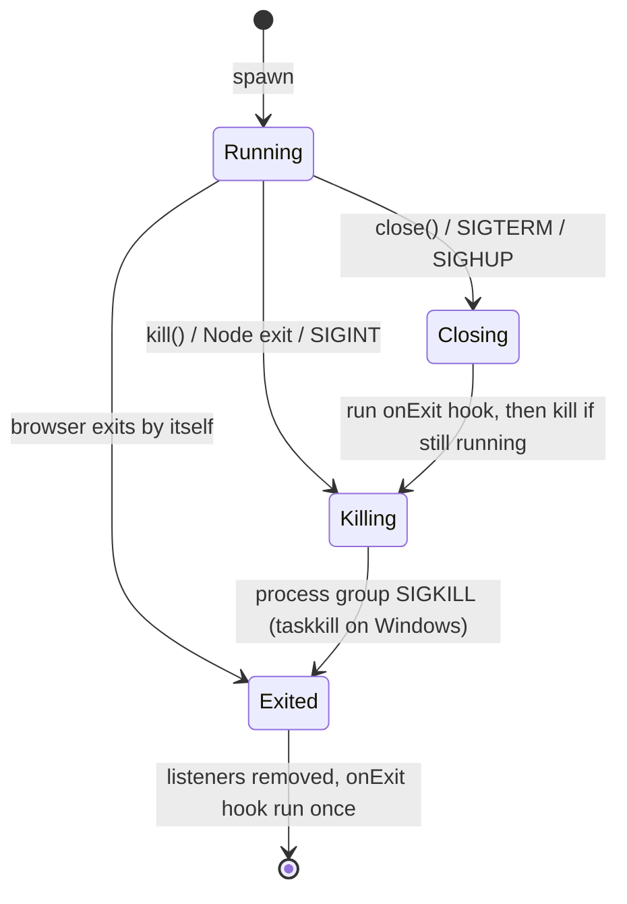

## Overview

`launch()` in `@puppeteer/browsers` starts a browser executable as a child process and returns a `Process` object that knows how to find the browser's debugging endpoint, wait for it to exit, and kill it together with all its child processes. It knows nothing about CDP or BiDi: Puppeteer's launcher computes the arguments and then uses `Process` to spawn, read the endpoint line and shut down ([[Launching Browsers]]). The same module computes executable paths for cached and system browsers.

Sources: [packages/browsers/src/launch.ts:194-208](repo://packages/browsers/src/launch.ts#L194-L208), [packages/puppeteer-core/src/node/BrowserLauncher.ts:132-142](repo://packages/puppeteer-core/src/node/BrowserLauncher.ts#L132-L142)

## Finding the executable

`computeExecutablePath({cacheDir, browser, buildId, platform?})` returns where a cached build's executable is, resolving aliases such as `stable` through the cache metadata ([[Installing Browsers and the Cache]]). With `cacheDir: null` it returns only the executable's path relative to an installation folder.

Sources: [packages/browsers/src/launch.ts:28-73](repo://packages/browsers/src/launch.ts#L28-L73)

`computeSystemExecutablePath({browser, channel, platform?})` returns the standard install location of a Chrome release channel ([[Browser Data and Version Resolution]]) after checking that the file is accessible, and throws `Could not find Google Chrome executable for channel '<channel>' at '<path>'` otherwise.

Sources: [packages/browsers/src/launch.ts:78-123](repo://packages/browsers/src/launch.ts#L78-L123)

## Spawning

### Launch options

| Option | Default | Effect |
| --- | --- | --- |
| `executablePath`, `args` | required, `[]` | What to run |
| `env` | `{}` | Environment of the child process |
| `pipe` | `false` | Open file descriptors 3 and 4 for a CDP pipe connection |
| `dumpio` | `false` | Forward the browser's stdout and stderr to this process |
| `handleSIGINT`, `handleSIGTERM`, `handleSIGHUP` | `true` | Shut the browser down when this process receives the signal |
| `detached` | `true` except on Windows | Make the browser the leader of a new process group |
| `onExit` | none | Async hook that runs once when the browser exits or is closed |

Sources: [packages/browsers/src/launch.ts:128-187](repo://packages/browsers/src/launch.ts#L128-L187), [packages/browsers/src/launch.ts:278-298](repo://packages/browsers/src/launch.ts#L278-L298)

### Standard streams

The stdio layout depends on `pipe` and `dumpio`. Without `dumpio`, stdout is ignored, but stderr is always piped when there is no CDP pipe, because the endpoint line is read from it:

Sources: [packages/browsers/src/launch.ts:370-387](repo://packages/browsers/src/launch.ts#L370-L387)

| `pipe` | `dumpio` | stdio |
| --- | --- | --- |
| false | false | `['pipe', 'ignore', 'pipe']` |
| false | true | `['pipe', 'pipe', 'pipe']` |
| true | false | `['ignore', 'ignore', 'ignore', 'pipe', 'pipe']` |
| true | true | `['ignore', 'pipe', 'pipe', 'pipe', 'pipe']` |

Sources: [packages/browsers/src/launch.ts:370-387](repo://packages/browsers/src/launch.ts#L370-L387)

The constructor logs the command line and any `PUPPETEER_*` environment variables on the `puppeteer:browsers:launcher` channel, spawns the process, and pipes stderr and stdout to the parent's when `dumpio` is on. `nodeProcess` exposes the `ChildProcess`, whose `stdio[3]` and `stdio[4]` Puppeteer wraps in a `PipeTransport` ([[Connecting to a Browser and Transports]]).

Sources: [packages/browsers/src/launch.ts:298-328](repo://packages/browsers/src/launch.ts#L298-L328), [packages/browsers/src/launch.ts:366-368](repo://packages/browsers/src/launch.ts#L366-L368), [packages/puppeteer-core/src/node/BrowserLauncher.ts:340-356](repo://packages/puppeteer-core/src/node/BrowserLauncher.ts#L340-L356)

## Reading the endpoint

### The endpoint lines

Puppeteer reads the debugging WebSocket URL from a line the browser prints on stderr. Two regular expressions match those lines and capture the URL:

Sources: [packages/browsers/src/launch.ts:201-208](repo://packages/browsers/src/launch.ts#L201-L208)

```ts
export const CDP_WEBSOCKET_ENDPOINT_REGEX =
  /^DevTools listening on (ws:\/\/.*)$/;

export const WEBDRIVER_BIDI_WEBSOCKET_ENDPOINT_REGEX =
  /^WebDriver BiDi listening on (ws:\/\/.*)$/;
```

Sources: [packages/browsers/src/launch.ts:201-208](repo://packages/browsers/src/launch.ts#L201-L208)

### waitForLineOutput

`waitForLineOutput(regex, timeout)` reads stderr line by line and resolves with the first capture group of the first matching line. It collects every line it saw. If stderr closes, the process exits, or spawning fails first, it rejects with `Failed to launch the browser process!` followed by the collected output and a link to the troubleshooting guide. If `timeout` passes first, it rejects with this package's `TimeoutError` (`Timed out after <n> ms while waiting for the WS endpoint URL to appear in stdout!`), which Puppeteer converts to its own `TimeoutError`. All listeners are removed in every case.

Sources: [packages/browsers/src/launch.ts:480-541](repo://packages/browsers/src/launch.ts#L480-L541), [packages/browsers/src/launch.ts:594-603](repo://packages/browsers/src/launch.ts#L594-L603)

## Shutting down

### Lifecycle



Sources: [packages/browsers/src/launch.ts:342-364](repo://packages/browsers/src/launch.ts#L342-L364), [packages/browsers/src/launch.ts:396-422](repo://packages/browsers/src/launch.ts#L396-L422)

When the browser's `exit` event fires, the process removes its signal listeners, marks itself exited and runs the `onExit` hook; `hasClosed()` resolves when that is done, and rejects if the hook throws. The hook runs at most once, whether the browser exited on its own or `close()` ran it first. Puppeteer's hook deletes the temporary profile.

Sources: [packages/browsers/src/launch.ts:271-276](repo://packages/browsers/src/launch.ts#L271-L276), [packages/browsers/src/launch.ts:342-364](repo://packages/browsers/src/launch.ts#L342-L364), [packages/browsers/src/launch.ts:420-422](repo://packages/browsers/src/launch.ts#L420-L422)

### close and kill

`close()` runs the exit hook, kills the browser if it is still running, and waits for it to exit. `kill()` does nothing if the process never got a pid or no longer exists (checked with `process.kill(pid, 0)`). On Windows it runs `taskkill /pid <pid> /T /F` to end the whole process tree. Elsewhere it sends `SIGKILL` to the negative pid, which is the process group created by `detached: true`, so the browser's child processes are killed with it. If either fails, it falls back to killing only the main process. An unexpected error is rethrown with an explanation that leftover browser processes may block future launches.

Sources: [packages/browsers/src/launch.ts:412-478](repo://packages/browsers/src/launch.ts#L412-L478), [packages/browsers/src/launch.ts:544-563](repo://packages/browsers/src/launch.ts#L544-L563)

### Signals from the parent process

Every `Process` subscribes to the parent's `exit` event and, depending on options, to `SIGINT`, `SIGTERM` and `SIGHUP`:

Sources: [packages/browsers/src/launch.ts:329-338](repo://packages/browsers/src/launch.ts#L329-L338), [packages/browsers/src/launch.ts:396-410](repo://packages/browsers/src/launch.ts#L396-L410)

| Parent event | Action |
| --- | --- |
| `exit` | `kill()` the browser synchronously |
| `SIGINT` | `kill()` and `process.exit(130)` |
| `SIGTERM`, `SIGHUP` | `close()` the browser |

Sources: [packages/browsers/src/launch.ts:329-338](repo://packages/browsers/src/launch.ts#L329-L338), [packages/browsers/src/launch.ts:396-410](repo://packages/browsers/src/launch.ts#L396-L410)

The module registers one dispatcher per signal on `process` and keeps its own list of handlers, adding the dispatcher with the first handler and removing it with the last. Many browsers launched from one script therefore add only a single listener per signal to Node's `process`.

Sources: [packages/browsers/src/launch.ts:210-261](repo://packages/browsers/src/launch.ts#L210-L261), [packages/browsers/src/launch.ts:389-394](repo://packages/browsers/src/launch.ts#L389-L394)
