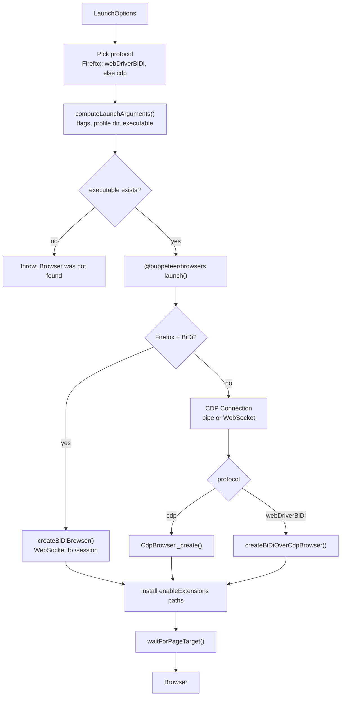

## Overview

`puppeteer.launch()` turns a `LaunchOptions` object into a running browser process and a connected `Browser`. The work is split between `PuppeteerNode`, which picks a launcher for the requested browser, the abstract `BrowserLauncher`, which runs the shared sequence (spawn, connect, wait), and two subclasses, `ChromeLauncher` and `FirefoxLauncher`, which know each browser's command-line flags, profile layout and executable. The process itself is spawned by `@puppeteer/browsers` ([[Launching Browser Processes]]); attaching to a browser that is already running is covered in [[Connecting to a Browser and Transports]].

Sources: [packages/puppeteer-core/src/node/PuppeteerNode.ts:152-184](repo://packages/puppeteer-core/src/node/PuppeteerNode.ts#L152-L184), [packages/puppeteer-core/src/node/BrowserLauncher.ts:54-74](repo://packages/puppeteer-core/src/node/BrowserLauncher.ts#L54-L74)

## Choosing a launcher

`PuppeteerNode.launch()` reads `options.browser`, defaulting to the configured `defaultBrowser` (`chrome` unless [[Configuration and Browser Download]] says otherwise). It records it as the last launched browser, resets `defaultBrowserRevision` to the pinned revision for that browser, and reuses the current launcher when it targets the same browser; otherwise it creates a new `ChromeLauncher` or `FirefoxLauncher`. Any other value throws `Unknown product`.

Sources: [packages/puppeteer-core/src/node/PuppeteerNode.ts:152-184](repo://packages/puppeteer-core/src/node/PuppeteerNode.ts#L152-L184)

`executablePath()`, `defaultArgs()` and `trimCache()` live on the same object. Its constructor binds them, so `const {launch} = puppeteer` works without a receiver, which is how the package entry points export them.

Sources: [packages/puppeteer-core/src/node/PuppeteerNode.ts:99-103](repo://packages/puppeteer-core/src/node/PuppeteerNode.ts#L99-L103), [packages/puppeteer-core/src/node/PuppeteerNode.ts:189-273](repo://packages/puppeteer-core/src/node/PuppeteerNode.ts#L189-L273)

## The launch sequence

### Steps at a glance

`BrowserLauncher.launch()` runs the same steps for both browsers:

Sources: [packages/puppeteer-core/src/node/BrowserLauncher.ts:74-130](repo://packages/puppeteer-core/src/node/BrowserLauncher.ts#L74-L130), [packages/puppeteer-core/src/node/BrowserLauncher.ts:132-238](repo://packages/puppeteer-core/src/node/BrowserLauncher.ts#L132-L238)

Sources: [packages/puppeteer-core/src/node/BrowserLauncher.ts:74-130](repo://packages/puppeteer-core/src/node/BrowserLauncher.ts#L74-L130), [packages/puppeteer-core/src/node/BrowserLauncher.ts:132-238](repo://packages/puppeteer-core/src/node/BrowserLauncher.ts#L132-L238)

### Protocol selection

When `protocol` is unset, Firefox uses `webDriverBiDi` and Chrome uses CDP. Asking for CDP with Firefox throws `Connecting to Firefox using CDP is no longer supported`. Firefox with BiDi cannot use a pipe either: the launcher throws if the arguments contain `--remote-debugging-pipe`.

Sources: [packages/puppeteer-core/src/node/BrowserLauncher.ts:92-130](repo://packages/puppeteer-core/src/node/BrowserLauncher.ts#L92-L130)

### Spawning the process

After `computeLaunchArguments` returns, the launcher checks that the executable exists and then calls `launch()` from `@puppeteer/browsers` with the executable, the arguments, the signal-handling flags, `dumpio`, `env`, and `pipe` set when the arguments include `--remote-debugging-pipe`. The `onExit` hook calls `cleanUserDataDir`, so a temporary profile is removed whenever the process exits, however it exits.

Sources: [packages/puppeteer-core/src/node/BrowserLauncher.ts:103-142](repo://packages/puppeteer-core/src/node/BrowserLauncher.ts#L103-L142)

### Opening the connection

There are three ways to connect, chosen by browser and transport:

Sources: [packages/puppeteer-core/src/node/BrowserLauncher.ts:316-420](repo://packages/puppeteer-core/src/node/BrowserLauncher.ts#L316-L420)

| Case | How the endpoint is found | Result |
| --- | --- | --- |
| Firefox, BiDi | Waits for the `WEBDRIVER_BIDI_WEBSOCKET_ENDPOINT_REGEX` line on the process output, appends `/session`, opens a `NodeWebSocketTransport` | `BidiConnection` and `BidiBrowser` |
| Chrome, pipe | Uses the process's stdio file descriptors 3 (write) and 4 (read) as a `PipeTransport` | CDP `Connection` |
| Chrome, WebSocket | Waits for the `CDP_WEBSOCKET_ENDPOINT_REGEX` line, opens a `NodeWebSocketTransport` | CDP `Connection` |

Sources: [packages/puppeteer-core/src/node/BrowserLauncher.ts:316-420](repo://packages/puppeteer-core/src/node/BrowserLauncher.ts#L316-L420)

With a CDP connection, `protocol: 'cdp'` creates a `CdpBrowser` directly, while `protocol: 'webDriverBiDi'` wraps the CDP connection with `connectBidiOverCdp` and creates a `BidiBrowser` on top ([[BiDi Connection and BiDi over CDP]]). Both BiDi paths import `../bidi/bidi.js` dynamically, so CDP-only scripts never load it.

Sources: [packages/puppeteer-core/src/node/BrowserLauncher.ts:156-210](repo://packages/puppeteer-core/src/node/BrowserLauncher.ts#L156-L210), [packages/puppeteer-core/src/node/BrowserLauncher.ts:361-382](repo://packages/puppeteer-core/src/node/BrowserLauncher.ts#L361-L382)

### Extensions and the first page

If `enableExtensions` is an array of paths, each path is installed with `browser.installExtension`. In Chrome this requires a pipe connection and throws otherwise. Then, unless `waitForInitialPage` is false, `waitForPageTarget` waits up to `timeout` for a target of type `page`; if none appears, it closes the browser and rethrows.

Sources: [packages/puppeteer-core/src/node/BrowserLauncher.ts:219-238](repo://packages/puppeteer-core/src/node/BrowserLauncher.ts#L219-L238), [packages/puppeteer-core/src/node/BrowserLauncher.ts:296-311](repo://packages/puppeteer-core/src/node/BrowserLauncher.ts#L296-L311)

## Chrome arguments

`ChromeLauncher.defaultArgs()` builds Chrome's flag list. It starts from a fixed set that suits automation: no background networking or throttling, no crash reporter, popup blocking or default apps, `--enable-automation`, a basic password store, a mock keychain and an sRGB colour profile. It disables the `Translate`, `AcceptCHFrame`, `MediaRouter` and `OptimizationHints` features (plus two more unless `PUPPETEER_TEST_EXPERIMENTAL_CHROME_FEATURES` is `true`) and enables `PdfOopif`.

Sources: [packages/puppeteer-core/src/node/ChromeLauncher.ts:156-235](repo://packages/puppeteer-core/src/node/ChromeLauncher.ts#L156-L235)

User `--disable-features=` and `--enable-features=` flags are not appended blindly: `getFeatures` extracts their values and `removeMatchingFlags` deletes them from `options.args`, and the values are merged into the single feature flag Chrome sees. The user's features and Puppeteer's defaults therefore end up in one flag each.

Sources: [packages/puppeteer-core/src/node/ChromeLauncher.ts:159-202](repo://packages/puppeteer-core/src/node/ChromeLauncher.ts#L159-L202), [packages/puppeteer-core/src/node/ChromeLauncher.ts:314-344](repo://packages/puppeteer-core/src/node/ChromeLauncher.ts#L314-L344)

The options then add:

Sources: [packages/puppeteer-core/src/node/ChromeLauncher.ts:236-270](repo://packages/puppeteer-core/src/node/ChromeLauncher.ts#L236-L270)

- `--user-data-dir=<path>` when `userDataDir` is given.
- `--auto-open-devtools-for-tabs` when `devtools` is true, which also turns headless off by default.
- `--headless=new` for `headless: true`, or `--headless` for `headless: 'shell'`, plus `--hide-scrollbars` and `--mute-audio`.
- `--enable-unsafe-extension-debugging` when `enableExtensions` is set, else `--disable-extensions`.
- `about:blank` when every user argument is a flag, so the browser opens one page.
- The user's `args` last.

Sources: [packages/puppeteer-core/src/node/ChromeLauncher.ts:236-270](repo://packages/puppeteer-core/src/node/ChromeLauncher.ts#L236-L270)

`computeLaunchArguments` decides which list to use. With `ignoreDefaultArgs: true` it uses only `args`; with an array it filters those flags out of the defaults. Unless a `--remote-debugging-*` flag is already present, it adds `--remote-debugging-pipe` for `pipe: true` or `--remote-debugging-port=<debuggingPort or 0>`; asking for both a pipe and a port fails an assertion. With no `--user-data-dir` it creates a temporary directory under `temporaryDirectory` and marks it for deletion.

Sources: [packages/puppeteer-core/src/node/ChromeLauncher.ts:61-118](repo://packages/puppeteer-core/src/node/ChromeLauncher.ts#L61-L118), [packages/puppeteer-core/src/node/BrowserLauncher.ts:425-430](repo://packages/puppeteer-core/src/node/BrowserLauncher.ts#L425-L430)

## Finding the executable

For Chrome, `executablePath` from the options wins. Otherwise `channel` (`chrome`, `chrome-beta`, `chrome-dev`, `chrome-canary`) maps to the system installation of that release channel through `computeSystemExecutablePath`. With neither, `resolveExecutablePath` uses the configured `executablePath` or computes the path of the pinned build inside the cache, choosing `chrome-headless-shell` when `headless` is `'shell'`. `puppeteer-core` has no cache configuration, so it asserts that an `executablePath` or a `channel` was passed.

Sources: [packages/puppeteer-core/src/node/ChromeLauncher.ts:120-136](repo://packages/puppeteer-core/src/node/ChromeLauncher.ts#L120-L136), [packages/puppeteer-core/src/node/ChromeLauncher.ts:272-300](repo://packages/puppeteer-core/src/node/ChromeLauncher.ts#L272-L300), [packages/puppeteer-core/src/node/BrowserLauncher.ts:435-474](repo://packages/puppeteer-core/src/node/BrowserLauncher.ts#L435-L474)

When the computed path does not exist, the error depends on the cause. A configured version produces a message naming that version; otherwise the message tells the user to run `npx puppeteer browsers install` or fix the cache path.

Sources: [packages/puppeteer-core/src/node/BrowserLauncher.ts:476-502](repo://packages/puppeteer-core/src/node/BrowserLauncher.ts#L476-L502)

## Firefox arguments and profiles

`FirefoxLauncher.defaultArgs()` is shorter: `--foreground` on macOS, `--wait-for-browser` on Windows, `--profile <dir>` for `userDataDir`, `--headless`, `--devtools`, `about:blank` when no URL was given, then the user's `args`.

Sources: [packages/puppeteer-core/src/node/FirefoxLauncher.ts:179-216](repo://packages/puppeteer-core/src/node/FirefoxLauncher.ts#L179-L216)

Firefox always gets `--remote-debugging-port`, even with `pipe: true`. When no `-profile` or `--profile` argument is present, the launcher creates a temporary profile directory. In both cases it calls `createProfile` from `@puppeteer/browsers` to write the automation preferences, merged with `extraPrefsFirefox` and with `fission.webContentIsolationStrategy` forced to `0`. `puppeteer-core` must pass `executablePath`.

Sources: [packages/puppeteer-core/src/node/FirefoxLauncher.ts:30-130](repo://packages/puppeteer-core/src/node/FirefoxLauncher.ts#L30-L130)

On exit, a temporary profile is deleted. A user profile is restored instead: when `createProfile` left `prefs.js.puppeteer` or `user.js.puppeteer` backups, the launcher puts them back in place of the modified files.

Sources: [packages/puppeteer-core/src/node/FirefoxLauncher.ts:135-170](repo://packages/puppeteer-core/src/node/FirefoxLauncher.ts#L135-L170)

## Closing and failure handling

The launcher hands every `Browser` a close callback that runs at most once. With a CDP connection it sends `Browser.close` and waits for the process to exit, killing it if that fails. Without one (Firefox over BiDi) it waits up to five seconds for the process to exit by itself and then calls `browserProcess.close()`.

Sources: [packages/puppeteer-core/src/node/BrowserLauncher.ts:144-154](repo://packages/puppeteer-core/src/node/BrowserLauncher.ts#L144-L154), [packages/puppeteer-core/src/node/BrowserLauncher.ts:265-291](repo://packages/puppeteer-core/src/node/BrowserLauncher.ts#L265-L291)

If anything fails between spawning and receiving the `Browser`, the launcher calls the close callback so no process is left behind, and it converts the `@puppeteer/browsers` `TimeoutError` (no endpoint line in time) into Puppeteer's own `TimeoutError` ([[Errors and Debug Logging]]).

Sources: [packages/puppeteer-core/src/node/BrowserLauncher.ts:211-217](repo://packages/puppeteer-core/src/node/BrowserLauncher.ts#L211-L217)

## LaunchOptions reference

`LaunchOptions` extends `ConnectOptions`, so everything `connect()` accepts also applies to `launch()`.

Sources: [packages/puppeteer-core/src/node/LaunchOptions.ts:23-142](repo://packages/puppeteer-core/src/node/LaunchOptions.ts#L23-L142), [packages/puppeteer-core/src/node/BrowserLauncher.ts:74-90](repo://packages/puppeteer-core/src/node/BrowserLauncher.ts#L74-L90), [packages/puppeteer-core/src/common/util.ts:42-42](repo://packages/puppeteer-core/src/common/util.ts#L42-L42), [packages/puppeteer-core/src/common/ConnectOptions.ts:85-102](repo://packages/puppeteer-core/src/common/ConnectOptions.ts#L85-L102)

| Option | Default | Effect |
| --- | --- | --- |
| `browser` | configured `defaultBrowser` | `chrome` or `firefox` |
| `channel` | none | Use the system Chrome of that release channel |
| `executablePath` | computed | Browser binary to run |
| `headless` | `true` | `true` is new headless, `'shell'` is chrome-headless-shell, `false` shows a window |
| `devtools` | `false` | Open DevTools for each tab; implies `headless: false` |
| `args`, `ignoreDefaultArgs` | `[]`, `false` | Extra flags; drop all or some default flags |
| `userDataDir` | temporary | Profile directory, kept after exit |
| `pipe`, `debuggingPort` | `false`, `0` | Connect over stdio pipes or a fixed port |
| `timeout` | `30000` | Milliseconds to wait for the endpoint and the first page |
| `dumpio`, `env` | `false`, `process.env` | Forward browser output; environment for the process |
| `handleSIGINT`, `handleSIGTERM`, `handleSIGHUP` | `true` | Close the browser on these signals |
| `enableExtensions` | `false` | Allow extensions, or a list of extension paths to install |
| `extraPrefsFirefox` | `{}` | Additional Firefox preferences |
| `waitForInitialPage` | `true` | Wait for a page target before resolving |
| `protocol` | `cdp` for Chrome, `webDriverBiDi` for Firefox | Protocol to speak |
| `protocolTimeout` | `180000` | Timeout for a single protocol call |
| `defaultViewport` | 800×600 | Viewport for each page, or `null` to keep the window size |
| `slowMo` | `0` | Milliseconds the connection waits before handling each incoming protocol message |
| `acceptInsecureCerts`, `networkEnabled`, `downloadBehavior`, `targetFilter` | see [[Connecting to a Browser and Transports]] | Shared connect options |

Sources: [packages/puppeteer-core/src/node/LaunchOptions.ts:23-142](repo://packages/puppeteer-core/src/node/LaunchOptions.ts#L23-L142), [packages/puppeteer-core/src/node/BrowserLauncher.ts:74-90](repo://packages/puppeteer-core/src/node/BrowserLauncher.ts#L74-L90), [packages/puppeteer-core/src/common/util.ts:42-42](repo://packages/puppeteer-core/src/common/util.ts#L42-L42), [packages/puppeteer-core/src/common/ConnectOptions.ts:85-102](repo://packages/puppeteer-core/src/common/ConnectOptions.ts#L85-L102)
