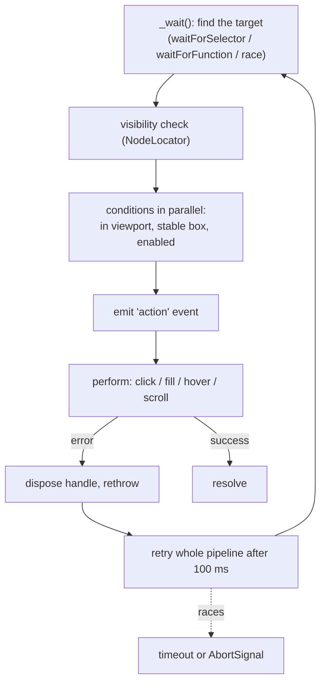

## Overview

A locator describes how to find something and what to do with it, without finding it yet. `page.locator('button.submit').click()` waits for the element, checks that it is ready (in the viewport, not moving, enabled), clicks, and retries the whole sequence when any step fails, until it succeeds or the timeout expires. Unlike a handle from `page.$`, a locator queries the page again on every attempt. They are built with RxJS observables from the vendored copy in `third_party/rxjs` ([[Events and Async Primitives]]).

Sources: [packages/puppeteer-core/src/api/locators/locators.ts:93-115](repo://packages/puppeteer-core/src/api/locators/locators.ts#L93-L115), [packages/puppeteer-core/src/api/locators/locators.ts:370-398](repo://packages/puppeteer-core/src/api/locators/locators.ts#L370-L398)

## Creating locators

### Kinds of locator

| Created by | Class | Finds |
| --- | --- | --- |
| `page.locator(selector)`, `frame.locator(selector)` | `NodeLocator` | An element via `waitForSelector` |
| `elementHandle.asLocator()` | `NodeLocator` | That existing handle |
| `page.locator(() => value)` | `FunctionLocator` | The first truthy result of a function, via `waitForFunction` |
| `Locator.race([a, b])`, `page.locatorRace([a, b])` | `RaceLocator` | Whichever locator resolves first |
| `locator.filter(fn)`, `locator.filterHandle(fn)` | `FilteredLocator` | Results of another locator that pass a predicate |
| `locator.map(fn)`, `locator.mapHandle(fn)` | `MappedLocator` | Another locator's result transformed by a function |

Sources: [packages/puppeteer-core/src/api/Page.ts:1083-1128](repo://packages/puppeteer-core/src/api/Page.ts#L1083-L1128), [packages/puppeteer-core/src/api/locators/locators.ts:653-698](repo://packages/puppeteer-core/src/api/locators/locators.ts#L653-L698), [packages/puppeteer-core/src/api/locators/locators.ts:748-785](repo://packages/puppeteer-core/src/api/locators/locators.ts#L748-L785), [packages/puppeteer-core/src/api/locators/locators.ts:965-1000](repo://packages/puppeteer-core/src/api/locators/locators.ts#L965-L1000)

`NodeLocator.create` and `FunctionLocator.create` start from the page's default timeout, so `page.setDefaultTimeout` applies to locators created afterwards.

Sources: [packages/puppeteer-core/src/api/locators/locators.ts:749-758](repo://packages/puppeteer-core/src/api/locators/locators.ts#L749-L758), [packages/puppeteer-core/src/api/locators/locators.ts:966-986](repo://packages/puppeteer-core/src/api/locators/locators.ts#L966-L986)

### Configuration is immutable

Every setter returns a new locator through `_clone()` and leaves the original unchanged, so a base locator can be shared and refined.

Sources: [packages/puppeteer-core/src/api/locators/locators.ts:125-132](repo://packages/puppeteer-core/src/api/locators/locators.ts#L125-L132), [packages/puppeteer-core/src/api/locators/locators.ts:179-256](repo://packages/puppeteer-core/src/api/locators/locators.ts#L179-L256)

| Setter | Default | Effect |
| --- | --- | --- |
| `setTimeout(ms)` | page default (30000) | Total time for an action, including retries |
| `setVisibility(value)` | `null` | `'visible'` or `'hidden'` also waits until the element is visible or hidden |
| `setEnsureElementIsInTheViewport(bool)` | `true` | Scroll the element into view before acting |
| `setWaitForStableBoundingBox(bool)` | `true` | Wait until the element stops moving |
| `setWaitForEnabled(bool)` | `true` | Wait until a form control is enabled (`click` and `fill`) |

Sources: [packages/puppeteer-core/src/api/locators/locators.ts:125-132](repo://packages/puppeteer-core/src/api/locators/locators.ts#L125-L132), [packages/puppeteer-core/src/api/locators/locators.ts:179-256](repo://packages/puppeteer-core/src/api/locators/locators.ts#L179-L256)

Delegating locators (`filter`, `map`) copy the options of the locator they wrap and forward every setter to it, so `locator.filter(fn).setTimeout(5000)` changes the timeout of the inner query too.

Sources: [packages/puppeteer-core/src/api/locators/locators.ts:803-875](repo://packages/puppeteer-core/src/api/locators/locators.ts#L803-L875)

## How an action runs

### The pipeline

Each action is one observable pipeline, run with `firstValueFrom`:

Sources: [packages/puppeteer-core/src/api/locators/locators.ts:137-164](repo://packages/puppeteer-core/src/api/locators/locators.ts#L137-L164), [packages/puppeteer-core/src/api/locators/locators.ts:370-398](repo://packages/puppeteer-core/src/api/locators/locators.ts#L370-L398), [packages/puppeteer-core/src/api/locators/locators.ts:1117-1117](repo://packages/puppeteer-core/src/api/locators/locators.ts#L1117-L1117)



Sources: [packages/puppeteer-core/src/api/locators/locators.ts:137-164](repo://packages/puppeteer-core/src/api/locators/locators.ts#L137-L164), [packages/puppeteer-core/src/api/locators/locators.ts:370-398](repo://packages/puppeteer-core/src/api/locators/locators.ts#L370-L398), [packages/puppeteer-core/src/api/locators/locators.ts:1117-1117](repo://packages/puppeteer-core/src/api/locators/locators.ts#L1117-L1117)

The `conditions` operator merges the condition observables for a handle. Conditions emit nothing and only complete or error, and `defaultIfEmpty(handle)` passes the handle on once all have completed. The `retryAndRaceWithSignalAndTimer` operator wraps the whole pipeline in `retry({delay: 100})` and races it against `timeout(this._timeout)` and the action's `AbortSignal`. Any error (element missing, condition failed, click threw) restarts from `_wait`, and the timeout bounds the total. Each action creates an `Error` such as `Locator.click` as the `cause` of the eventual timeout and names the action.

Sources: [packages/puppeteer-core/src/api/locators/locators.ts:137-164](repo://packages/puppeteer-core/src/api/locators/locators.ts#L137-L164), [packages/puppeteer-core/src/common/util.ts:288-296](repo://packages/puppeteer-core/src/common/util.ts#L288-L296)

### Preconditions

| Condition | Check | Used by |
| --- | --- | --- |
| In viewport | If `isIntersectingViewport({threshold: 0})` is false, `scrollIntoView()`, then poll until it intersects | `click`, `fill`, `hover`, `scroll` |
| Stable bounding box | Read `getBoundingClientRect()` in two consecutive animation frames; retry until both are equal | `click`, `fill`, `hover`, `scroll` |
| Enabled | `waitForFunction` until the element is not a disabled `BUTTON`, `INPUT`, `SELECT`, `TEXTAREA`, `OPTION` or `OPTGROUP` | `click`, `fill` |
| Visibility | Poll `isVisible()` or `isHidden()` until it matches `setVisibility` | every `NodeLocator` wait |

Sources: [packages/puppeteer-core/src/api/locators/locators.ts:262-368](repo://packages/puppeteer-core/src/api/locators/locators.ts#L262-L368), [packages/puppeteer-core/src/api/locators/locators.ts:1008-1025](repo://packages/puppeteer-core/src/api/locators/locators.ts#L1008-L1025)

The stable-box check deliberately uses `handle.evaluate` with nested `requestAnimationFrame` calls rather than `waitForFunction`. Every check is retried with the same 100 ms delay and ends when the action's timeout or signal fires.

Sources: [packages/puppeteer-core/src/api/locators/locators.ts:298-344](repo://packages/puppeteer-core/src/api/locators/locators.ts#L298-L344)

### Finding the target

`NodeLocator._wait` calls `waitForSelector(selector, {visible: false, timeout, signal})` on the page or frame, so all selector syntaxes work ([[Selectors and Query Handlers]]). A `null` result becomes an error and therefore a retry. A locator made from a handle emits that handle directly. `FunctionLocator._wait` calls `waitForFunction(func, {timeout, signal})`, and `RaceLocator._wait` subscribes to every candidate's `_wait` with `race`, keeping the first to emit. Before the action runs, the locator emits a `LocatorEvent.Action` event.

Sources: [packages/puppeteer-core/src/api/locators/locators.ts:1035-1056](repo://packages/puppeteer-core/src/api/locators/locators.ts#L1035-L1056), [packages/puppeteer-core/src/api/locators/locators.ts:774-784](repo://packages/puppeteer-core/src/api/locators/locators.ts#L774-L784), [packages/puppeteer-core/src/api/locators/locators.ts:1076-1106](repo://packages/puppeteer-core/src/api/locators/locators.ts#L1076-L1106), [packages/puppeteer-core/src/api/locators/locators.ts:80-92](repo://packages/puppeteer-core/src/api/locators/locators.ts#L80-L92)

## Actions

### click, hover and scroll

`click(options)` calls `ElementHandle.click` with the same options (button, count, delay, offset), and `hover()` calls `ElementHandle.hover` ([[Element Handles]]). `scroll({scrollTop, scrollLeft})` sets those properties on the element in the page. When the action throws, its handle is disposed before the retry.

Sources: [packages/puppeteer-core/src/api/locators/locators.ts:370-398](repo://packages/puppeteer-core/src/api/locators/locators.ts#L370-L398), [packages/puppeteer-core/src/api/locators/locators.ts:534-603](repo://packages/puppeteer-core/src/api/locators/locators.ts#L534-L603), [packages/puppeteer-core/src/api/locators/locators.ts:703-742](repo://packages/puppeteer-core/src/api/locators/locators.ts#L703-L742)

### fill

`fill(value)` first classifies the element in the page, then acts by kind:

Sources: [packages/puppeteer-core/src/api/locators/locators.ts:400-453](repo://packages/puppeteer-core/src/api/locators/locators.ts#L400-L453), [packages/puppeteer-core/src/api/locators/locators.ts:455-532](repo://packages/puppeteer-core/src/api/locators/locators.ts#L455-L532)

| Kind | Elements | Action |
| --- | --- | --- |
| `select` | `<select>` | `handle.select(value)` |
| `typeable-input` | `<textarea>`; `<input>` of type text, url, tel, search, password, number or email | Type only what is missing (below) |
| `contenteditable` | Elements with `isContentEditable` | Same as typeable input, on `innerText` |
| `other-input` | Any other `<input>` (date, color, range…) | Focus, set `value`, dispatch `input` and `change` |
| `unknown` | Anything else | Throws `Element cannot be filled out.` |

Sources: [packages/puppeteer-core/src/api/locators/locators.ts:400-453](repo://packages/puppeteer-core/src/api/locators/locators.ts#L400-L453), [packages/puppeteer-core/src/api/locators/locators.ts:455-532](repo://packages/puppeteer-core/src/api/locators/locators.ts#L455-L532)

For typeable inputs, `fill` avoids retyping text that is already there. If the new value is longer than the current value and starts with it, the field is reset to its current value (which puts the caret at the end) and only the remaining suffix is typed with `handle.type`. Otherwise the field is cleared and the whole value is typed. Typing goes through the page keyboard ([[Keyboard, Mouse and Touch]]).

Sources: [packages/puppeteer-core/src/api/locators/locators.ts:459-501](repo://packages/puppeteer-core/src/api/locators/locators.ts#L459-L501)

### Waiting without acting

`waitHandle()` runs `_wait` with the same retry and timeout and returns the handle. `wait()` returns `jsonValue()` of that handle and disposes it.

Sources: [packages/puppeteer-core/src/api/locators/locators.ts:627-646](repo://packages/puppeteer-core/src/api/locators/locators.ts#L627-L646)

## Transforming locators

`filter(predicate)` runs the predicate in the page through `frame.waitForFunction` with the handle as argument, so it waits until the predicate holds. `filterHandle(predicate)` runs a predicate in Node on the handle. Both reject non-matching results with an error, which triggers a retry from the start.

Sources: [packages/puppeteer-core/src/api/locators/locators.ts:667-689](repo://packages/puppeteer-core/src/api/locators/locators.ts#L667-L689), [packages/puppeteer-core/src/api/locators/locators.ts:880-916](repo://packages/puppeteer-core/src/api/locators/locators.ts#L880-L916)

`map(mapper)` evaluates the mapper in the page against the handle and continues with the result handle, and `mapHandle(mapper)` maps in Node.

Sources: [packages/puppeteer-core/src/api/locators/locators.ts:653-658](repo://packages/puppeteer-core/src/api/locators/locators.ts#L653-L658), [packages/puppeteer-core/src/api/locators/locators.ts:696-698](repo://packages/puppeteer-core/src/api/locators/locators.ts#L696-L698), [packages/puppeteer-core/src/api/locators/locators.ts:932-953](repo://packages/puppeteer-core/src/api/locators/locators.ts#L932-L953)

The README combines these in its example, typing into a search box found by its accessible name and reading text from a result:

Sources: [README.md:39-47](repo://README.md#L39-L47)

```ts
await page.locator('aria/Search').fill('automate beyond recorder');
await page.locator('.devsite-result-item-link').click();
const textSelector = await page
  .locator('text/Customize and automate')
  .waitHandle();
```

Sources: [README.md:39-47](repo://README.md#L39-L47)
