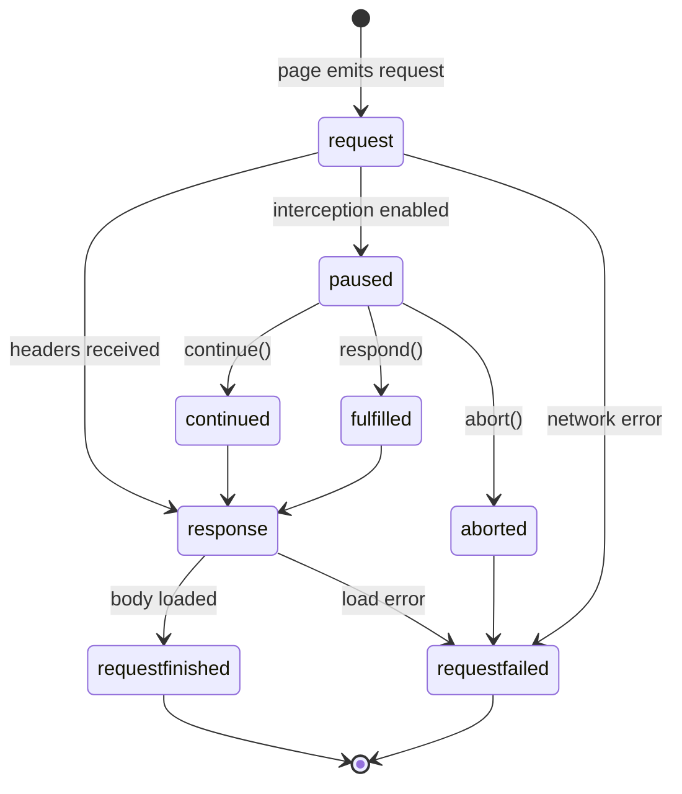

## Overview

Every network request a page makes surfaces as an `HTTPRequest`, and its answer as an `HTTPResponse`. A page emits `request` when a request starts, `response` when headers arrive, and then `requestfinished` when the body has loaded or `requestfailed` when it failed. With request interception on, each request is paused until a handler decides to continue it (optionally modified), answer it with a mocked response, or abort it. Several handlers can cooperate on one request by voting with priorities. This page covers that public model and the page-level network settings; [[Network Manager (CDP)]] explains how CDP events are turned into these objects.

Sources: [packages/puppeteer-core/src/api/HTTPRequest.ts:71-104](repo://packages/puppeteer-core/src/api/HTTPRequest.ts#L71-L104), [packages/puppeteer-core/src/api/Page.ts:534-571](repo://packages/puppeteer-core/src/api/Page.ts#L534-L571)

## The request lifecycle

### Events



Sources: [packages/puppeteer-core/src/api/HTTPRequest.ts:71-103](repo://packages/puppeteer-core/src/api/HTTPRequest.ts#L71-L103), [packages/puppeteer-core/src/cdp/NetworkManager.ts:703-775](repo://packages/puppeteer-core/src/cdp/NetworkManager.ts#L703-L775)

An HTTP error status such as 404 or 503 is a successful response at the network level, so the request ends with `requestfinished`, not `requestfailed`. A redirect also finishes the original request with `requestfinished` and issues a new request to the redirect target, which carries the earlier requests in its `redirectChain()`. A request served from the memory cache additionally emits `requestservedfromcache`.

Sources: [packages/puppeteer-core/src/api/HTTPRequest.ts:93-100](repo://packages/puppeteer-core/src/api/HTTPRequest.ts#L93-L100), [packages/puppeteer-core/src/cdp/NetworkManager.ts:541-584](repo://packages/puppeteer-core/src/cdp/NetworkManager.ts#L541-L584)

### What a request exposes

| Method | Returns |
| --- | --- |
| `url()`, `method()`, `headers()` | The request line and headers; header names are lower-cased |
| `postData()`, `hasPostData()`, `fetchPostData()` | The body if Chrome sent it inline, whether one exists, and a fetch of it otherwise |
| `resourceType()` | `document`, `stylesheet`, `image`, `xhr`, `fetch` and so on (lower-cased CDP types; `other` when unknown) |
| `isNavigationRequest()` | True for a frame's document request |
| `frame()`, `initiator()` | The frame that issued it and what initiated it |
| `redirectChain()` | Earlier requests in the redirect chain, oldest first |
| `response()`, `failure()` | The response once received, or `{errorText}` after a failure |

Sources: [packages/puppeteer-core/src/api/HTTPRequest.ts:283-385](repo://packages/puppeteer-core/src/api/HTTPRequest.ts#L283-L385), [packages/puppeteer-core/src/cdp/HTTPRequest.ts:85-171](repo://packages/puppeteer-core/src/cdp/HTTPRequest.ts#L85-L171)

On CDP a request counts as a navigation when its request id equals its loader id and its type is `Document`. The URL includes the fragment.

Sources: [packages/puppeteer-core/src/cdp/HTTPRequest.ts:88-93](repo://packages/puppeteer-core/src/cdp/HTTPRequest.ts#L88-L93)

### What a response exposes

`HTTPResponse` gives `status()`, `statusText()`, lower-cased `headers()`, `ok()` (status 0 or 200-299), `remoteAddress()`, `securityDetails()` (issuer, protocol, validity and subject names of the TLS certificate), `timing()`, `fromCache()`, `fromServiceWorker()`, and the body as `content()`, `buffer()`, `text()` or `json()`.

Sources: [packages/puppeteer-core/src/api/HTTPResponse.ts:28-143](repo://packages/puppeteer-core/src/api/HTTPResponse.ts#L28-L143), [packages/puppeteer-core/src/common/SecurityDetails.ts:38-78](repo://packages/puppeteer-core/src/common/SecurityDetails.ts#L38-L78)

On CDP, status, status text and headers come from `responseReceivedExtraInfo` when available, which carries the raw headers as received. `content()` waits until the body has finished loading and then calls `Network.getResponseBody` once, caching the promise. A redirect response has no body, and a preflight request produces `Could not load body for this request`.

Sources: [packages/puppeteer-core/src/cdp/HTTPResponse.ts:33-82](repo://packages/puppeteer-core/src/cdp/HTTPResponse.ts#L33-L82), [packages/puppeteer-core/src/cdp/HTTPResponse.ts:119-151](repo://packages/puppeteer-core/src/cdp/HTTPResponse.ts#L119-L151), [packages/puppeteer-core/src/cdp/NetworkManager.ts:569-584](repo://packages/puppeteer-core/src/cdp/NetworkManager.ts#L569-L584)

## Request interception

### Turning it on

`page.setRequestInterception(true)` makes every request wait for a decision. The API's example blocks images:

Sources: [packages/puppeteer-core/src/api/Page.ts:955-963](repo://packages/puppeteer-core/src/api/Page.ts#L955-L963)

```ts
await page.setRequestInterception(true);
page.on('request', interceptedRequest => {
  if (
    interceptedRequest.url().endsWith('.png') ||
    interceptedRequest.url().endsWith('.jpg')
  )
    interceptedRequest.abort();
  else interceptedRequest.continue();
});
```

Sources: [packages/puppeteer-core/src/api/Page.ts:955-963](repo://packages/puppeteer-core/src/api/Page.ts#L955-L963)

> [!WARNING]
> With interception on, every request must end in `continue`, `respond` or `abort`. When no handler resolves it, `finalizeInterceptions` takes no action and the request stays paused.

Sources: [packages/puppeteer-core/src/api/HTTPRequest.ts:260-277](repo://packages/puppeteer-core/src/api/HTTPRequest.ts#L260-L277)

On CDP, interception enables the `Fetch` domain with the pattern `*` and `handleAuthRequests: true`. `data:` URLs and requests served from the memory cache cannot be intercepted; `continue`, `respond` and `abort` silently do nothing for them.

Sources: [packages/puppeteer-core/src/cdp/NetworkManager.ts:287-324](repo://packages/puppeteer-core/src/cdp/NetworkManager.ts#L287-L324), [packages/puppeteer-core/src/api/HTTPRequest.ts:387-389](repo://packages/puppeteer-core/src/api/HTTPRequest.ts#L387-L389)

### The three resolutions

| Call | Effect | CDP command |
| --- | --- | --- |
| `continue(overrides?)` | Send the request on, optionally changing `url`, `method`, `postData` or `headers` | `Fetch.continueRequest` |
| `respond(response)` | Answer without contacting the server, from `status` (default 200), `headers`, `contentType` and `body` (string or bytes) | `Fetch.fulfillRequest` |
| `abort(errorCode?)` | Fail the request with a network error such as `aborted`, `accessdenied`, `connectionrefused` or `timedout` (default `failed`) | `Fetch.failRequest` |

Sources: [packages/puppeteer-core/src/api/HTTPRequest.ts:20-56](repo://packages/puppeteer-core/src/api/HTTPRequest.ts#L20-L56), [packages/puppeteer-core/src/api/HTTPRequest.ts:594-608](repo://packages/puppeteer-core/src/api/HTTPRequest.ts#L594-L608), [packages/puppeteer-core/src/cdp/HTTPRequest.ts:176-270](repo://packages/puppeteer-core/src/cdp/HTTPRequest.ts#L176-L270)

`respond` lower-cases the given header names, sets `content-type` from `contentType`, adds `content-length` from the body's byte length unless given, base64-encodes the body, and takes the status phrase from the `STATUS_TEXTS` table. Each call asserts that interception is enabled and the request is not already handled. A protocol error caused by an invalid or unsafe header is rethrown; any other protocol error, typically for a request that was already cancelled or a page that closed, is only logged.

Sources: [packages/puppeteer-core/src/cdp/HTTPRequest.ts:203-253](repo://packages/puppeteer-core/src/cdp/HTTPRequest.ts#L203-L253), [packages/puppeteer-core/src/api/HTTPRequest.ts:731-747](repo://packages/puppeteer-core/src/api/HTTPRequest.ts#L731-L747)

## Cooperative intercept resolution

### Why handlers vote

When several handlers listen to `request` on the same page and each resolves immediately, the first call wins and the others throw `Request is already handled!`. Passing a `priority` as the last argument switches to cooperative mode: the call only records a vote, and the request is resolved once all handlers have run.

Sources: [packages/puppeteer-core/src/api/HTTPRequest.ts:419-453](repo://packages/puppeteer-core/src/api/HTTPRequest.ts#L419-L453), [packages/puppeteer-core/src/api/HTTPRequest.ts:70-70](repo://packages/puppeteer-core/src/api/HTTPRequest.ts#L70-L70)

### Running the handlers in order

`Page.on('request', handler)` wraps each handler so that it is queued with `request.enqueueInterceptAction` instead of being called directly ([[Pages]]). After the network layer emits the request, it calls `finalizeInterceptions()`. That method chains the queued handlers one after another, awaiting each one, including async handlers, and then applies the winning vote with `_abort`, `_respond` or `_continue`.

Sources: [packages/puppeteer-core/src/api/Page.ts:767-792](repo://packages/puppeteer-core/src/api/Page.ts#L767-L792), [packages/puppeteer-core/src/api/HTTPRequest.ts:233-277](repo://packages/puppeteer-core/src/api/HTTPRequest.ts#L233-L277), [packages/puppeteer-core/src/cdp/NetworkManager.ts:527-538](repo://packages/puppeteer-core/src/cdp/NetworkManager.ts#L527-L538)

### Voting rules

| New vote vs. current vote | Result |
| --- | --- |
| Higher priority (or no vote yet) | The new action wins |
| Same priority, new is `abort` | `abort` wins |
| Same priority, new is `respond` | `respond` wins unless the current vote is `abort` |
| Same priority, new is `continue` | Kept only if the current vote is also `continue` |
| Lower priority | Ignored (the overrides, response or abort reason are still stored) |

Sources: [packages/puppeteer-core/src/api/HTTPRequest.ts:428-452](repo://packages/puppeteer-core/src/api/HTTPRequest.ts#L428-L452), [packages/puppeteer-core/src/api/HTTPRequest.ts:496-516](repo://packages/puppeteer-core/src/api/HTTPRequest.ts#L496-L516), [packages/puppeteer-core/src/api/HTTPRequest.ts:544-557](repo://packages/puppeteer-core/src/api/HTTPRequest.ts#L544-L557)

At equal priority the order is therefore `abort` over `respond` over `continue`. `DEFAULT_INTERCEPT_RESOLUTION_PRIORITY` is `0`.

Sources: [packages/puppeteer-core/src/api/HTTPRequest.ts:70-70](repo://packages/puppeteer-core/src/api/HTTPRequest.ts#L70-L70), [packages/puppeteer-core/src/api/HTTPRequest.ts:442-452](repo://packages/puppeteer-core/src/api/HTTPRequest.ts#L442-L452)

### Inspecting the state

A handler can look at what others decided before voting. `interceptResolutionState()` returns `{action, priority}`, where `action` is `abort`, `respond`, `continue`, `none`, `disabled` (interception off) or `already-handled`. `isInterceptResolutionHandled()` reports whether the request was already resolved, and `continueRequestOverrides()`, `responseForRequest()` and `abortErrorReason()` return the stored data of the votes.

Sources: [packages/puppeteer-core/src/api/HTTPRequest.ts:176-225](repo://packages/puppeteer-core/src/api/HTTPRequest.ts#L176-L225), [packages/puppeteer-core/src/api/HTTPRequest.ts:582-589](repo://packages/puppeteer-core/src/api/HTTPRequest.ts#L582-L589)

> [!NOTE]
> A call without `priority` resolves the request immediately, even in a page whose other handlers vote. Mixing the two styles makes the immediate call win and the later votes fail with `Request is already handled!`.

Sources: [packages/puppeteer-core/src/api/HTTPRequest.ts:426-430](repo://packages/puppeteer-core/src/api/HTTPRequest.ts#L426-L430)

## Page-level network settings

These `Page` methods change the network behaviour of every request of the page. On CDP they are stored in the `NetworkManager`, applied to every session it tracks, and applied again to each session added later through `addClient`.

Sources: [packages/puppeteer-core/src/cdp/NetworkManager.ts:106-135](repo://packages/puppeteer-core/src/cdp/NetworkManager.ts#L106-L135), [packages/puppeteer-core/src/cdp/NetworkManager.ts:142-227](repo://packages/puppeteer-core/src/cdp/NetworkManager.ts#L142-L227), [packages/puppeteer-core/src/cdp/NetworkManager.ts:237-285](repo://packages/puppeteer-core/src/cdp/NetworkManager.ts#L237-L285)

| Method | Effect | CDP command |
| --- | --- | --- |
| `setExtraHTTPHeaders(headers)` | Adds headers to every request; values must be strings, names are lower-cased | `Network.setExtraHTTPHeaders` |
| `authenticate({username, password})` | Answers HTTP authentication challenges; `null` stops | `Fetch.continueWithAuth` |
| `setOfflineMode(bool)` | Simulates no network | `Network.emulateNetworkConditions` |
| `emulateNetworkConditions(conditions)` | Throttles download, upload and latency ([[Emulation]]) | `Network.emulateNetworkConditions` |
| `setCacheEnabled(bool)` | Turns the HTTP cache on or off | `Network.setCacheDisabled` |
| `setUserAgent(ua, metadata?)` | Overrides the user agent | `Network.setUserAgentOverride` |

Sources: [packages/puppeteer-core/src/cdp/NetworkManager.ts:106-135](repo://packages/puppeteer-core/src/cdp/NetworkManager.ts#L106-L135), [packages/puppeteer-core/src/cdp/NetworkManager.ts:142-227](repo://packages/puppeteer-core/src/cdp/NetworkManager.ts#L142-L227), [packages/puppeteer-core/src/cdp/NetworkManager.ts:237-285](repo://packages/puppeteer-core/src/cdp/NetworkManager.ts#L237-L285)

Authentication reuses the `Fetch` domain: `authenticate` turns protocol interception on even when user interception is off, and requests paused only for that reason are continued automatically. The first challenge for a request gets the credentials. A second challenge for the same request is answered with `CancelAuth`.

Sources: [packages/puppeteer-core/src/cdp/NetworkManager.ts:142-152](repo://packages/puppeteer-core/src/cdp/NetworkManager.ts#L142-L152), [packages/puppeteer-core/src/cdp/NetworkManager.ts:372-415](repo://packages/puppeteer-core/src/cdp/NetworkManager.ts#L372-L415)
