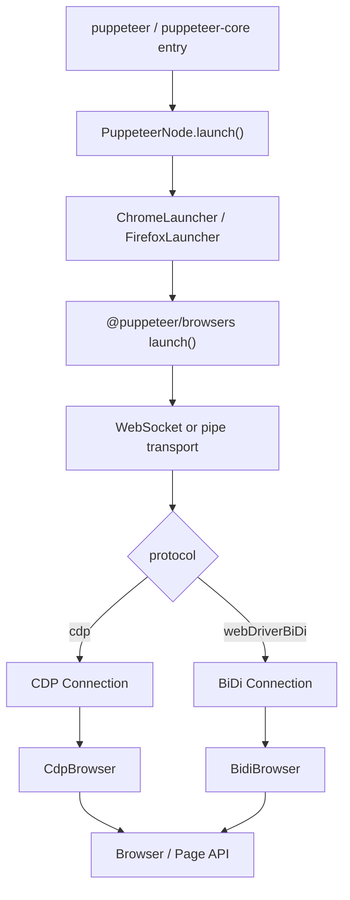

## Overview

Puppeteer is a JavaScript library that drives Chrome or Firefox from Node.js (and, with `puppeteer-core`, from a web page or a browser extension). It talks to the browser over the Chrome DevTools Protocol (CDP) or over WebDriver BiDi and runs headless by default. A script launches or connects to a browser, opens pages, and then navigates, queries, clicks, types and captures them through one high-level API, whichever protocol is underneath.

Sources: [README.md:8-54](repo://README.md#L8-L54)

The repository is a monorepo of npm workspaces. `puppeteer-core` holds the library itself. `puppeteer` wraps it with a configuration file loader and a postinstall step that downloads a matching browser. `@puppeteer/browsers` downloads and launches browser builds. `@puppeteer/ng-schematics` adds Puppeteer end-to-end tests to Angular projects, and `@pptr/testserver` is the HTTP server the test suite runs against.

Sources: [packages/browsers/package.json:1-13](repo://packages/browsers/package.json#L1-L13), [packages/ng-schematics/package.json:1-4](repo://packages/ng-schematics/package.json#L1-L4), [packages/testserver/package.json:1-4](repo://packages/testserver/package.json#L1-L4), [packages/puppeteer/package.json:1-12](repo://packages/puppeteer/package.json#L1-L12), [package.json:198-206](repo://package.json#L198-L206)

## Parts of the project

| Area | What it does | Page |
| --- | --- | --- |
| Install and configuration | Reads `.puppeteerrc` files and `PUPPETEER_*` variables, downloads browsers after `npm install` | [[Configuration and Browser Download]] |
| Launching | Builds browser arguments, spawns the process, opens the protocol connection | [[Launching Browsers]] |
| Connecting | Attaches to a running browser over a WebSocket, a pipe or a custom transport | [[Connecting to a Browser and Transports]] |
| Browser object model | `Browser`, `BrowserContext`, `Target` | [[Browsers, Browser Contexts and Targets]] |
| Pages and frames | `Page`, `Frame`, navigation and lifecycle events | [[Pages]], [[Frames and Navigation]] |
| Script execution | `evaluate`, `JSHandle`, `ElementHandle`, the injected utility script | [[JavaScript Evaluation and Handles]], [[Element Handles]] |
| Finding elements | Selector prefixes, custom query handlers, waiting, locators | [[Selectors and Query Handlers]], [[Waiting for Conditions]], [[Locators]] |
| Input | Keyboard, mouse and touch | [[Keyboard, Mouse and Touch]] |
| Network | Requests, responses, interception | [[Network Requests and Interception]] |
| Page features | Emulation, screenshots and PDFs, accessibility, coverage, dialogs | [[Emulation]], [[Screenshots, PDFs and Screen Recording]], [[Accessibility Snapshots]], [[Code Coverage and Tracing]], [[Dialogs, File Choosers and Device Prompts]] |
| CDP backend | Connection, sessions, targets, frame tree, network events | [[CDP Connection and Sessions]], [[Target Management (CDP)]], [[CDP Pages and Frame Management]], [[Network Manager (CDP)]] |
| WebDriver BiDi backend | Spec-shaped core layer and the adapters onto the public API | [[WebDriver BiDi Core Layer]], [[BiDi Connection and BiDi over CDP]], [[BiDi Implementation of the Puppeteer API]] |
| Shared internals | Event emitter, deferreds, disposables, errors, debug logging | [[Events and Async Primitives]], [[Errors and Debug Logging]] |
| `@puppeteer/browsers` | Download, cache, resolve versions, launch processes, CLI | [[Installing Browsers and the Cache]], [[Browser Data and Version Resolution]], [[Launching Browser Processes]], [[Browsers CLI]] |
| Angular | `ng add @puppeteer/ng-schematics` and its builder | [[Angular Schematics]] |
| Repository | Test suites and build pipeline | [[Test Infrastructure]], [[Build and Tooling]] |

Sources: [packages/puppeteer-core/src/api/api.ts:7-22](repo://packages/puppeteer-core/src/api/api.ts#L7-L22), [packages/puppeteer-core/src/common/common.ts:7-42](repo://packages/puppeteer-core/src/common/common.ts#L7-L42)

## Main flow

A call to `puppeteer.launch()` travels from the package entry point through a launcher, a transport and a protocol connection before the script receives a `Browser`.

Sources: [packages/puppeteer-core/src/node/PuppeteerNode.ts:152-167](repo://packages/puppeteer-core/src/node/PuppeteerNode.ts#L152-L167)

Sources: [packages/puppeteer/src/puppeteer.ts:15-48](repo://packages/puppeteer/src/puppeteer.ts#L15-L48), [packages/puppeteer-core/src/node/PuppeteerNode.ts:152-184](repo://packages/puppeteer-core/src/node/PuppeteerNode.ts#L152-L184), [packages/puppeteer-core/src/node/BrowserLauncher.ts:132-217](repo://packages/puppeteer-core/src/node/BrowserLauncher.ts#L132-L217)

1. The `puppeteer` entry point builds a `PuppeteerNode` with the resolved configuration; `puppeteer-core` builds one with no configuration. [[Configuration and Browser Download]] explains where that configuration comes from.
2. `PuppeteerNode.launch()` picks a `ChromeLauncher` or `FirefoxLauncher` from the `browser` option, as [[Launching Browsers]] describes.
3. The launcher computes the arguments and executable and asks `@puppeteer/browsers` to spawn the process ([[Launching Browser Processes]]).
4. It reads the DevTools or BiDi endpoint from the process output, or uses the process pipes, and wraps it in a transport ([[Connecting to a Browser and Transports]]).
5. Over CDP, a `Connection` carries messages and `CdpBrowser` discovers targets ([[CDP Connection and Sessions]], [[Target Management (CDP)]]). Over BiDi, a BiDi connection feeds the core layer and `BidiBrowser` ([[BiDi Connection and BiDi over CDP]]).
6. The script uses the returned `Browser` and its pages through the public API ([[Browsers, Browser Contexts and Targets]], [[Pages]]).

Sources: [packages/puppeteer-core/src/puppeteer-core.ts:7-48](repo://packages/puppeteer-core/src/puppeteer-core.ts#L7-L48), [packages/puppeteer-core/src/node/BrowserLauncher.ts:316-420](repo://packages/puppeteer-core/src/node/BrowserLauncher.ts#L316-L420)

## Design decisions

### One public API, two protocol backends

Every public class in `src/api` is abstract: `Browser`, `Page`, `Frame`, `ElementHandle`, `JSHandle`, `HTTPRequest` and the input classes declare the API and implement the protocol-independent parts. `src/cdp` and `src/bidi` subclass them, for example `CdpPage extends Page` and `BidiPage extends Page`. A script written against `Page` therefore runs over either protocol, and features a backend lacks throw `UnsupportedOperation` instead of disappearing from the type.

Sources: [packages/puppeteer-core/src/api/Page.ts:685-685](repo://packages/puppeteer-core/src/api/Page.ts#L685-L685), [packages/puppeteer-core/src/cdp/Page.ts:98-98](repo://packages/puppeteer-core/src/cdp/Page.ts#L98-L98), [packages/puppeteer-core/src/bidi/Page.ts:77-77](repo://packages/puppeteer-core/src/bidi/Page.ts#L77-L77), [packages/puppeteer-core/src/bidi/Page.ts:480-486](repo://packages/puppeteer-core/src/bidi/Page.ts#L480-L486), [packages/puppeteer-core/src/api/Browser.ts:248-248](repo://packages/puppeteer-core/src/api/Browser.ts#L248-L248)

### BiDi is loaded on demand

The launcher imports `../bidi/bidi.js` dynamically only when the chosen protocol is WebDriver BiDi, so a CDP-only script never loads the BiDi code or `chromium-bidi`.

Sources: [packages/puppeteer-core/src/node/BrowserLauncher.ts:361-420](repo://packages/puppeteer-core/src/node/BrowserLauncher.ts#L361-L420)

### Page methods delegate to the main frame

Most document-level `Page` methods (`$`, `$$`, `evaluateHandle`, `$eval`, `addScriptTag`, `url`, `content`) forward to `this.mainFrame()`. The logic lives once on `Frame` and every frame, including iframes, gets the same behaviour.

Sources: [packages/puppeteer-core/src/api/Page.ts:1150-1190](repo://packages/puppeteer-core/src/api/Page.ts#L1150-L1190), [packages/puppeteer-core/src/api/Page.ts:1500-1530](repo://packages/puppeteer-core/src/api/Page.ts#L1500-L1530)

### An injected utility script runs inside the page

Code in `src/injected` (query selectors, pollers, text matching) is bundled at build time into a generated source string. `ScriptInjector` wraps that string, plus any registered custom query handlers, into one script that each execution context evaluates as `PuppeteerUtil`. Selectors and waits then run in the page instead of round-tripping per node.

Sources: [packages/puppeteer-core/src/common/ScriptInjector.ts:11-57](repo://packages/puppeteer-core/src/common/ScriptInjector.ts#L11-L57), [packages/puppeteer-core/src/injected/README.md:1-5](repo://packages/puppeteer-core/src/injected/README.md#L1-L5)

### Node-only dependencies are injected

`environment.value` holds `fs`, `path` and `ScreenRecorder`, and its defaults throw when used. The Node entry point fills them in, while `puppeteer-core-browser` leaves them unset and exposes only `connect`. The same core code then bundles for browsers and extensions without importing Node modules.

Sources: [packages/puppeteer-core/src/environment.ts:9-38](repo://packages/puppeteer-core/src/environment.ts#L9-L38), [packages/puppeteer-core/src/puppeteer-core.ts:14-28](repo://packages/puppeteer-core/src/puppeteer-core.ts#L14-L28), [packages/puppeteer-core/src/puppeteer-core-browser.ts:7-25](repo://packages/puppeteer-core/src/puppeteer-core-browser.ts#L7-L25)

### Resources are disposable

`Browser`, `Page` and `JSHandle` implement `Symbol.asyncDispose`, so `await using` closes a page, disposes a handle, or closes a launched browser (and disconnects from a connected one) at the end of a block. [[Events and Async Primitives]] covers the disposable helpers behind this.

Sources: [packages/puppeteer-core/src/api/Browser.ts:500-506](repo://packages/puppeteer-core/src/api/Browser.ts#L500-L506), [packages/puppeteer-core/src/api/Page.ts:3153-3156](repo://packages/puppeteer-core/src/api/Page.ts#L3153-L3156), [packages/puppeteer-core/src/api/JSHandle.ts:200-212](repo://packages/puppeteer-core/src/api/JSHandle.ts#L200-L212)
