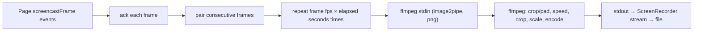

## Overview

Puppeteer can capture a page three ways: a still image with `page.screenshot()` (or `elementHandle.screenshot()`), a printed document with `page.pdf()` or `page.createPDFStream()`, and a video with `page.screencast()`. Option checking and the full-page logic for screenshots live once in `api/Page.ts`, and each backend implements the capture command (`_screenshot`, `createPDFStream`). Video recording runs only in Node: it streams CDP screencast frames into an `ffmpeg` child process.

Sources: [packages/puppeteer-core/src/api/Page.ts:2580-2692](repo://packages/puppeteer-core/src/api/Page.ts#L2580-L2692), [packages/puppeteer-core/src/api/Page.ts:2712-2719](repo://packages/puppeteer-core/src/api/Page.ts#L2712-L2719), [packages/puppeteer-core/src/api/Page.ts:2431-2499](repo://packages/puppeteer-core/src/api/Page.ts#L2431-L2499)

## Screenshots

### Screenshot options

| Option | Default | Meaning |
| --- | --- | --- |
| `type` | inferred from `path`, else `png` | `png`, `jpeg` or `webp` |
| `quality` | none | 0-100, only for `jpeg` and `webp` |
| `path` | none | Also write the image to this file |
| `encoding` | `binary` | `binary` returns a `Uint8Array`, `base64` a string |
| `fullPage` | `false` | Capture the whole scrollable page |
| `clip` | none | A rectangle (`x`, `y`, `width`, `height`, optional `scale`) to capture |
| `captureBeyondViewport` | `true` when clipping or full-page | Render content outside the viewport |
| `omitBackground` | `false` | Transparent instead of white background (`png`, `webp`) |
| `fromSurface`, `optimizeForSpeed` | `true`, `false` | Passed through to the protocol |

Sources: [packages/puppeteer-core/src/api/Page.ts:262-326](repo://packages/puppeteer-core/src/api/Page.ts#L262-L326), [packages/puppeteer-core/src/api/Page.ts:626-634](repo://packages/puppeteer-core/src/api/Page.ts#L626-L634)

### Validation and normalisation

`Page.screenshot` first holds the browser context's screenshot mutex, so it cannot overlap with opening or closing a page in the same context ([[Browsers, Browser Contexts and Targets]]). Then it copies the options and:

Sources: [packages/puppeteer-core/src/api/Page.ts:2587-2652](repo://packages/puppeteer-core/src/api/Page.ts#L2587-L2652), [packages/puppeteer-core/src/api/Page.ts:3179-3213](repo://packages/puppeteer-core/src/api/Page.ts#L3179-L3213)

1. infers `type` from the `path` extension (`png`, `jpg`/`jpeg`, `webp`) when no type is given;
2. rejects a `quality` outside 0-100, or with `png`;
3. rejects a `clip` with a non-positive width or height, and a `clip` combined with `fullPage`;
4. fills in defaults with `setDefaultScreenshotOptions`;
5. normalises the clip (negative width or height flips the rectangle) and rounds it to whole pixels.

Sources: [packages/puppeteer-core/src/api/Page.ts:2587-2652](repo://packages/puppeteer-core/src/api/Page.ts#L2587-L2652), [packages/puppeteer-core/src/api/Page.ts:3179-3213](repo://packages/puppeteer-core/src/api/Page.ts#L3179-L3213)

### Full-page and viewport captures

Without a clip there are two cases. A plain screenshot forces `captureBeyondViewport` to false and captures the viewport. A full-page screenshot keeps `captureBeyondViewport: true` by default and lets the browser render beyond the viewport. When the caller sets it to false, Puppeteer instead measures `document.documentElement.scrollWidth` and `scrollHeight`, resizes the viewport to that size, and restores the previous viewport afterwards through an `AsyncDisposableStack`. Page CSS and JavaScript can react to that resize.

Sources: [packages/puppeteer-core/src/api/Page.ts:2644-2679](repo://packages/puppeteer-core/src/api/Page.ts#L2644-L2679)

The backend returns base64 data. With `encoding: 'base64'` that string is returned unchanged. Otherwise it is decoded to bytes, written to `path` through `environment.value.fs` if a path was given, and returned.

Sources: [packages/puppeteer-core/src/api/Page.ts:2681-2689](repo://packages/puppeteer-core/src/api/Page.ts#L2681-L2689), [packages/puppeteer-core/src/api/Page.ts:2380-2389](repo://packages/puppeteer-core/src/api/Page.ts#L2380-L2389)

### The CDP capture

`CdpPage._screenshot` sends `Page.captureScreenshot` with the format, quality (rounded), clip (scale defaults to 1), `fromSurface`, `optimizeForSpeed` and `captureBeyondViewport`. Two details happen around it:

Sources: [packages/puppeteer-core/src/cdp/Page.ts:1014-1064](repo://packages/puppeteer-core/src/cdp/Page.ts#L1014-L1064)

- With `omitBackground` and a `png` or `webp` type, it sets a transparent default background through the emulation manager and defers resetting it ([[Emulation]]).
- With a clip and `captureBeyondViewport: false`, it intersects the clip with the visual viewport (`window.visualViewport` read in the isolated realm).

Sources: [packages/puppeteer-core/src/cdp/Page.ts:1014-1064](repo://packages/puppeteer-core/src/cdp/Page.ts#L1014-L1064)

Element screenshots are page screenshots with a clip computed from the element's bounding box ([[Element Handles]]). Over WebDriver BiDi some options are not available; `omitBackground`, for example, throws `UnsupportedOperation`.

Sources: [packages/puppeteer-core/src/api/ElementHandle.ts:1431-1464](repo://packages/puppeteer-core/src/api/ElementHandle.ts#L1431-L1464), [packages/puppeteer-core/src/bidi/Page.ts:480-486](repo://packages/puppeteer-core/src/bidi/Page.ts#L480-L486)

## PDF generation

### PDF options

`page.pdf(options)` prints the page with the `print` CSS media type; call `page.emulateMediaType('screen')` first to print the screen styles.

Sources: [packages/puppeteer-core/src/common/PDFOptions.ts:10-31](repo://packages/puppeteer-core/src/common/PDFOptions.ts#L10-L31), [packages/puppeteer-core/src/common/PDFOptions.ts:73-189](repo://packages/puppeteer-core/src/common/PDFOptions.ts#L73-L189), [packages/puppeteer-core/src/api/Page.ts:2694-2712](repo://packages/puppeteer-core/src/api/Page.ts#L2694-L2712)

| Option | Default | Meaning |
| --- | --- | --- |
| `format` | none (Letter size used) | Paper size: `letter`, `legal`, `tabloid`, `ledger`, `a0`-`a6`, any case |
| `width`, `height` | 8.5in × 11in | Paper size when no `format`; numbers are pixels, strings may end in `px`, `in`, `cm` or `mm` |
| `margin` | 0 | `top`, `right`, `bottom`, `left`, with the same units |
| `landscape`, `scale`, `pageRanges` | `false`, 1, all | Orientation, zoom, and pages such as `1-5, 8` |
| `printBackground` | `false` | Include background graphics |
| `displayHeaderFooter`, `headerTemplate`, `footerTemplate` | `false`, empty | HTML templates using the classes `date`, `title`, `url`, `pageNumber`, `totalPages` |
| `preferCSSPageSize` | `false` | Let CSS `@page` size win over `format` |
| `tagged`, `outline` | `true`, `false` | Accessible tagged PDF; document outline (forces `tagged`) |
| `omitBackground` | `false` | Transparent background |
| `waitForFonts` | `true` | Wait for `document.fonts.ready` first |
| `timeout` | page default | Applies to waiting for fonts and to printing |
| `path` | none | Also write the PDF to this file |

Sources: [packages/puppeteer-core/src/common/PDFOptions.ts:10-31](repo://packages/puppeteer-core/src/common/PDFOptions.ts#L10-L31), [packages/puppeteer-core/src/common/PDFOptions.ts:73-189](repo://packages/puppeteer-core/src/common/PDFOptions.ts#L73-L189), [packages/puppeteer-core/src/api/Page.ts:2694-2712](repo://packages/puppeteer-core/src/api/Page.ts#L2694-L2712)

### Parsing sizes

`parsePDFOptions` resolves the paper size from the `paperFormats` table (in inches by default) or from `width` and `height`. An unknown format fails an assertion. Every length is converted to inches: numbers count as pixels, and strings with a known two-letter unit use `px` = 1, `in` = 96, `cm` = 37.8, `mm` = 3.78 pixels. A string without a known unit is parsed as pixels, and a value that is not a number throws `Failed to parse parameter value`. When `outline` is requested, `tagged` is forced on.

Sources: [packages/puppeteer-core/src/common/util.ts:324-424](repo://packages/puppeteer-core/src/common/util.ts#L324-L424), [packages/puppeteer-core/src/common/PDFOptions.ts:226-274](repo://packages/puppeteer-core/src/common/PDFOptions.ts#L226-L274)

### Printing on CDP

`createPDFStream` optionally sets a transparent background, waits for `document.fonts.ready` in the isolated realm, and sends `Page.printToPDF` with `transferMode: 'ReturnAsStream'`, racing both waits against the timeout. It then wraps the returned protocol stream handle as a web `ReadableStream`. `pdf()` reads that stream into a `Uint8Array` and writes it to `path` when given.

Sources: [packages/puppeteer-core/src/cdp/Page.ts:1066-1146](repo://packages/puppeteer-core/src/cdp/Page.ts#L1066-L1146)

The repository's BiDi example prints a page to a Letter-size file:

Sources: [examples/webdriver-bidi.mjs:15-18](repo://examples/webdriver-bidi.mjs#L15-L18)

```js
await page.pdf({
  path: 'pptr.pdf',
  format: 'letter',
});
```

Sources: [examples/webdriver-bidi.mjs:15-18](repo://examples/webdriver-bidi.mjs#L15-L18)

## Screen recording

### Starting a recording

`page.screencast(options)` returns a `ScreenRecorder`, a Node `PassThrough` stream carrying the encoded video. The page first measures its native pixel size: it temporarily sets `deviceScaleFactor` to 0 and reads the visual viewport size times `devicePixelRatio`. It validates `crop` (non-negative origin, positive size, inside the viewport), `speed` and `scale`, and converts the crop to device pixels. It then creates the recorder and starts the CDP screencast. With `path`, the stream is also piped to a file.

Sources: [packages/puppeteer-core/src/api/Page.ts:2431-2499](repo://packages/puppeteer-core/src/api/Page.ts#L2431-L2499), [packages/puppeteer-core/src/api/Page.ts:2541-2561](repo://packages/puppeteer-core/src/api/Page.ts#L2541-L2561)

Several recorders can share one page. `_startScreencast` counts sessions, sends `Page.startScreencast` with PNG frames only for the first, and resolves once the first frame arrives; `_stopScreencast` sends `Page.stopScreencast` when the count returns to zero.

Sources: [packages/puppeteer-core/src/api/Page.ts:2501-2536](repo://packages/puppeteer-core/src/api/Page.ts#L2501-L2536)

### The ffmpeg pipeline



Sources: [packages/puppeteer-core/src/node/ScreenRecorder.ts:145-236](repo://packages/puppeteer-core/src/node/ScreenRecorder.ts#L145-L236)

The recorder checks that `ffmpeg` (or `ffmpegPath`) can be spawned and starts it reading PNG images from stdin at the target frame rate. Screencast frames carry timestamps, and the recorder turns them into a constant frame rate. It takes frames in overlapping pairs, writes the earlier frame `round(fps × Δt)` times, where `Δt` is the time until the next frame, and acknowledges every frame with `Page.screencastFrameAck`.

Sources: [packages/puppeteer-core/src/node/ScreenRecorder.ts:93-185](repo://packages/puppeteer-core/src/node/ScreenRecorder.ts#L93-L185), [packages/puppeteer-core/src/node/ScreenRecorder.ts:186-236](repo://packages/puppeteer-core/src/node/ScreenRecorder.ts#L186-L236)

### Formats

| Format | Encoding |
| --- | --- |
| `webm` (default) | VP9, constant quality `-crf` from `quality` (default 30, lower is better), realtime deadline |
| `mp4` | VP9 in a fragmented MP4 container |
| `gif` | A generated palette of up to `colors` colours, 20 fps by default, `loop` and `delay` (in ms) applied |

Sources: [packages/puppeteer-core/src/node/ScreenRecorder.ts:238-297](repo://packages/puppeteer-core/src/node/ScreenRecorder.ts#L238-L297), [packages/puppeteer-core/src/api/Page.ts:332-417](repo://packages/puppeteer-core/src/api/Page.ts#L332-L417)

### Stopping

`recorder.stop()` stops the page screencast, ends the frame subscription, and writes the last frame enough times to cover the time since it arrived (at least once). It then closes ffmpeg's stdin and waits for the process to exit. The recorder also stops when the page's session disconnects, and supports `await using`.

Sources: [packages/puppeteer-core/src/node/ScreenRecorder.ts:314-349](repo://packages/puppeteer-core/src/node/ScreenRecorder.ts#L314-L349), [packages/puppeteer-core/src/node/ScreenRecorder.ts:193-196](repo://packages/puppeteer-core/src/node/ScreenRecorder.ts#L193-L196)

> [!NOTE]
> `screencast` needs `ScreenRecorder` from `environment.value`, which only the Node entry point provides; in a browser bundle it throws `ScreenRecorder is not available in this environment`.

Sources: [packages/puppeteer-core/src/api/Page.ts:2434-2434](repo://packages/puppeteer-core/src/api/Page.ts#L2434-L2434), [packages/puppeteer-core/src/environment.ts:20-38](repo://packages/puppeteer-core/src/environment.ts#L20-L38)
