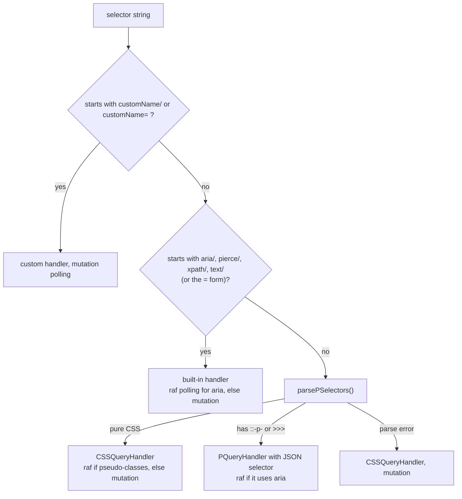

## Overview

Every method that takes a selector (`page.$`, `frame.$$`, `waitForSelector`, `locator`, `click`) passes the string to `getQueryHandlerAndSelector`. It returns a query handler class, the selector with any prefix removed, and the polling mode a wait should use. Plain CSS goes straight to the browser's `querySelector`. Puppeteer adds text, XPath, ARIA and shadow-piercing selectors, a combined syntax using `::-p-` pseudo-elements and `>>>` combinators, and user-registered custom handlers. Except for ARIA, every handler's query code runs inside the page as part of the injected `PuppeteerUtil` script ([[JavaScript Evaluation and Handles]]).

Sources: [packages/puppeteer-core/src/common/GetQueryHandler.ts:19-81](repo://packages/puppeteer-core/src/common/GetQueryHandler.ts#L19-L81), [packages/puppeteer-core/src/api/ElementHandle.ts:381-392](repo://packages/puppeteer-core/src/api/ElementHandle.ts#L381-L392)

## Choosing a handler

### Resolution order

Sources: [packages/puppeteer-core/src/common/GetQueryHandler.ts:31-81](repo://packages/puppeteer-core/src/common/GetQueryHandler.ts#L31-L81)

Custom handlers are checked first, so a custom handler named like a built-in one takes over its prefix. Both `/` and `=` separate the name from the selector: `text/Hello` and `text=Hello` are the same. A selector that `parsePSelectors` cannot tokenize is passed to the CSS handler unchanged.

Sources: [packages/puppeteer-core/src/common/GetQueryHandler.ts:26-56](repo://packages/puppeteer-core/src/common/GetQueryHandler.ts#L26-L56), [packages/puppeteer-core/src/common/GetQueryHandler.ts:74-80](repo://packages/puppeteer-core/src/common/GetQueryHandler.ts#L74-L80)

### Polling mode

The polling mode only matters for `waitForSelector`. Mutation polling re-runs the query when the DOM changes. RAF polling re-runs it every animation frame; it is chosen for ARIA selectors and for CSS selectors that use pseudo-classes such as `:hover`. [[Waiting for Conditions]] describes both pollers.

Sources: [packages/puppeteer-core/src/common/GetQueryHandler.ts:47-73](repo://packages/puppeteer-core/src/common/GetQueryHandler.ts#L47-L73), [packages/puppeteer-core/src/common/QueryHandler.ts:41-44](repo://packages/puppeteer-core/src/common/QueryHandler.ts#L41-L44)

## The built-in handlers

### Prefixes at a glance

| Selector | Handler | Matches |
| --- | --- | --- |
| `div > .item` | `CSSQueryHandler` | `querySelector` / `querySelectorAll` on the root |
| `pierce/.item` | `PierceQueryHandler` | CSS matches anywhere, descending into every open shadow root |
| `text/Hello` | `TextQueryHandler` | The deepest elements whose text contains `Hello` |
| `xpath///button` | `XPathQueryHandler` | `document.evaluate` results, read in document order |
| `aria/Submit[role="button"]` | `ARIAQueryHandler` | Accessibility-tree nodes by accessible name and role |
| `div ::-p-text(Hello)`, `a >>> b` | `PQueryHandler` | Mixed CSS and Puppeteer selectors across shadow roots |

Sources: [packages/puppeteer-core/src/common/CSSQueryHandler.ts:14-29](repo://packages/puppeteer-core/src/common/CSSQueryHandler.ts#L14-L29), [packages/puppeteer-core/src/common/PierceQueryHandler.ts:14-29](repo://packages/puppeteer-core/src/common/PierceQueryHandler.ts#L14-L29), [packages/puppeteer-core/src/common/TextQueryHandler.ts:12-20](repo://packages/puppeteer-core/src/common/TextQueryHandler.ts#L12-L20), [packages/puppeteer-core/src/common/XPathQueryHandler.ts:16-35](repo://packages/puppeteer-core/src/common/XPathQueryHandler.ts#L16-L35), [packages/puppeteer-core/src/common/PQueryHandler.ts:16-31](repo://packages/puppeteer-core/src/common/PQueryHandler.ts#L16-L31)

### Text matching

`textQuerySelectorAll` walks the children of the root (entering shadow roots) and recurses first. It yields an element only when none of its descendants matched and its own full text contains the selector. A text query therefore returns the innermost matching elements, not every ancestor. `<script>`, `<style>` and anything inside `<head>` are skipped.

Sources: [packages/puppeteer-core/src/injected/TextQuerySelector.ts:17-46](repo://packages/puppeteer-core/src/injected/TextQuerySelector.ts#L17-L46), [packages/puppeteer-core/src/injected/TextContent.ts:34-45](repo://packages/puppeteer-core/src/injected/TextContent.ts#L34-L45)

`createTextContent` computes an element's text: the `value` for `<select>`, `<textarea>` and text-like `<input>`s, otherwise the concatenated text nodes plus the text of child elements and the shadow root. Results are cached per node. A `MutationObserver` and an `input` listener evict the node and its ancestors when the content changes, so repeated polling stays cheap.

Sources: [packages/puppeteer-core/src/injected/TextContent.ts:11-32](repo://packages/puppeteer-core/src/injected/TextContent.ts#L11-L32), [packages/puppeteer-core/src/injected/TextContent.ts:60-146](repo://packages/puppeteer-core/src/injected/TextContent.ts#L60-L146)

### XPath and pierce

`xpathQuerySelectorAll` reads every result of an ordered node iterator into an array before yielding any, because the iterator becomes invalid once the document mutates. `queryOne` stops after the first result. The pierce selectors walk the tree with a `TreeWalker`, recurse into each `shadowRoot`, and test `matches(selector)` on every element other than the root.

Sources: [packages/puppeteer-core/src/injected/XPathQuerySelector.ts:10-39](repo://packages/puppeteer-core/src/injected/XPathQuerySelector.ts#L10-L39), [packages/puppeteer-core/src/injected/PierceQuerySelector.ts:10-65](repo://packages/puppeteer-core/src/injected/PierceQuerySelector.ts#L10-L65)

### ARIA

ARIA queries use the browser's accessibility tree, which page JavaScript cannot read. `ARIAQueryHandler` overrides `queryAll` and `queryOne` to run in Node. It parses the selector into a `name` and a `role`: bracketed `[name="…"]` and `[role="…"]` attributes are extracted, any other attribute fails an assertion, and the remaining text becomes the name. It then calls `element.queryAXTree(name, role)`, which on CDP sends `Accessibility.queryAXTree` and adopts each non-ignored, non-text node ([[Element Handles]]). Selectors longer than 10,000 characters are rejected.

Sources: [packages/puppeteer-core/src/cdp/AriaQueryHandler.ts:13-88](repo://packages/puppeteer-core/src/cdp/AriaQueryHandler.ts#L13-L88), [packages/puppeteer-core/src/cdp/ElementHandle.ts:176-204](repo://packages/puppeteer-core/src/cdp/ElementHandle.ts#L176-L204)

Code running in the page reaches ARIA through two bindings, `__ariaQuerySelector` and `__ariaQuerySelectorAll`, which the execution context installs before injecting `PuppeteerUtil`. The in-page `ariaQuerySelector` calls them on `globalThis` (in Firefox sandboxes `globalThis` is not `window`), and the bindings call back into `ARIAQueryHandler` in Node. This is how `::-p-aria(...)` inside a P-selector and `waitForSelector('aria/…')` work.

Sources: [packages/puppeteer-core/src/injected/ARIAQuerySelector.ts:7-36](repo://packages/puppeteer-core/src/injected/ARIAQuerySelector.ts#L7-L36), [packages/puppeteer-core/src/cdp/ExecutionContext.ts:42-63](repo://packages/puppeteer-core/src/cdp/ExecutionContext.ts#L42-L63)

## P-selectors

### Parsing

`parsePSelectors` tokenizes the selector with the vendored `parsel-js`, after teaching it two extra combinators, `>>>` and `>>>>`, and the `&` nesting token. It builds a list (one entry per comma-separated selector) of complex selectors, each an alternation of compound selectors and deep combinators. Ordinary CSS tokens are kept together as strings. Each `::-p-<name>(value)` pseudo-element becomes a `{name, value}` object with the value unquoted and unescaped. The function also reports whether the selector is pure CSS, uses pseudo-classes, or uses `aria`.

Sources: [packages/puppeteer-core/src/common/PSelectorParser.ts:20-121](repo://packages/puppeteer-core/src/common/PSelectorParser.ts#L20-L121), [packages/puppeteer-core/src/injected/PQuerySelector.ts:21-47](repo://packages/puppeteer-core/src/injected/PQuerySelector.ts#L21-L47)

| Syntax | Meaning |
| --- | --- |
| `a >>> b` | `b` anywhere under `a`, including inside nested shadow roots |
| `a >>>> b` | `b` inside `a`'s own shadow root, or under `a` when it has none |
| `::-p-text(x)`, `::-p-xpath(x)`, `::-p-aria(x)` | The built-in text, XPath and ARIA queries |
| `::-p-<custom>(x)` | A registered custom handler |

Sources: [packages/puppeteer-core/src/injected/PQuerySelector.ts:32-35](repo://packages/puppeteer-core/src/injected/PQuerySelector.ts#L32-L35), [packages/puppeteer-core/src/injected/PQuerySelector.ts:126-148](repo://packages/puppeteer-core/src/injected/PQuerySelector.ts#L126-L148), [packages/puppeteer-core/src/injected/util.ts:45-72](repo://packages/puppeteer-core/src/injected/util.ts#L45-L72)

### Evaluating in the page

The parsed selector travels to the page as JSON. `pQuerySelectorAll` rejects two deep combinators in a row (`Multiple deep combinators found in sequence.`), runs one `PQueryEngine` per comma branch, and merges the results. The engine keeps a lazy async iterable of current elements and applies each part in turn:

Sources: [packages/puppeteer-core/src/injected/PQuerySelector.ts:57-151](repo://packages/puppeteer-core/src/injected/PQuerySelector.ts#L57-L151), [packages/puppeteer-core/src/injected/PQuerySelector.ts:153-180](repo://packages/puppeteer-core/src/injected/PQuerySelector.ts#L153-L180), [packages/puppeteer-core/src/injected/PQuerySelector.ts:248-279](repo://packages/puppeteer-core/src/injected/PQuerySelector.ts#L248-L279)

- A CSS string that starts with a type or universal selector runs `querySelectorAll` under each element.
- Any other CSS string (`.class`, `:hover`, `>div`) is applied to the element itself, by querying its parent with `:scope>:nth-child(i)` plus the selector.
- A `{name, value}` part runs the matching text, XPath, ARIA or custom query under each element; an unknown name throws `Unknown selector type`.
- `>>>` replaces each element with itself and every shadow root under it; `>>>>` with its own shadow root, if any.

Sources: [packages/puppeteer-core/src/injected/PQuerySelector.ts:57-151](repo://packages/puppeteer-core/src/injected/PQuerySelector.ts#L57-L151), [packages/puppeteer-core/src/injected/PQuerySelector.ts:153-180](repo://packages/puppeteer-core/src/injected/PQuerySelector.ts#L153-L180), [packages/puppeteer-core/src/injected/PQuerySelector.ts:248-279](repo://packages/puppeteer-core/src/injected/PQuerySelector.ts#L248-L279)

The results are de-duplicated and sorted into document order by `domSort`. It computes each node's path of sibling indexes from the root, treating a shadow root as its host, and compares the paths. `pQuerySelector` returns the first result in that order.

Sources: [packages/puppeteer-core/src/injected/PQuerySelector.ts:182-241](repo://packages/puppeteer-core/src/injected/PQuerySelector.ts#L182-L241), [packages/puppeteer-core/src/injected/PQuerySelector.ts:286-294](repo://packages/puppeteer-core/src/injected/PQuerySelector.ts#L286-L294)

## The QueryHandler base class

### One query method is enough

A handler subclass defines `querySelector`, `querySelectorAll` or both as functions that run in the page and receive `(node, selector, PuppeteerUtil)`. When only one exists, `_querySelector` and `_querySelectorAll` derive the other: "first result of all" or "a one-item iterator around one". They splice the existing function's source into a template with `interpolateFunction`, so the derived function is self-contained and can be sent to the page.

Sources: [packages/puppeteer-core/src/common/QueryHandler.ts:23-98](repo://packages/puppeteer-core/src/common/QueryHandler.ts#L23-L98), [packages/puppeteer-core/src/util/Function.ts:76-91](repo://packages/puppeteer-core/src/util/Function.ts#L76-L91)

### queryOne, queryAll and waitFor

`queryOne(element, selector)` evaluates `_querySelector` against the element, passing `PuppeteerUtil` as a `LazyArg`, and returns the handle if it is an element, otherwise `null`. `queryAll` evaluates `_querySelectorAll` and streams the resulting in-page iterable back as handles in batches.

Sources: [packages/puppeteer-core/src/common/QueryHandler.ts:105-139](repo://packages/puppeteer-core/src/common/QueryHandler.ts#L105-L139)

`waitFor(elementOrFrame, selector, options)` always runs in the frame's isolated realm, adopting the root element there when one is given. It starts a `waitForFunction` whose predicate rebuilds the query function from its source with `PuppeteerUtil.createFunction`, runs it, and passes the node through `checkVisibility`. `visible` or `hidden` forces RAF polling. A found element is transferred back to the main realm. Errors other than an abort are wrapped as ``Waiting for selector `…` failed``, keeping `TimeoutError` as the type when the cause was a timeout and the original error as `cause`.

Sources: [packages/puppeteer-core/src/common/QueryHandler.ts:148-219](repo://packages/puppeteer-core/src/common/QueryHandler.ts#L148-L219)

## Custom query handlers

`Puppeteer.registerCustomQueryHandler(name, {queryOne?, queryAll?})` adds a prefix usable everywhere a selector is accepted, as `name/selector` or `::-p-name(selector)`. Names may contain only ASCII letters, cannot be registered twice, and at least one function is required.

Sources: [packages/puppeteer-core/src/common/Puppeteer.ts:68-94](repo://packages/puppeteer-core/src/common/Puppeteer.ts#L68-L94), [packages/puppeteer-core/src/common/CustomQueryHandler.ts:74-86](repo://packages/puppeteer-core/src/common/CustomQueryHandler.ts#L74-L86)

Registration has two halves. In Node, the registry stores a generated `QueryHandler` subclass whose query functions look the name up in `PuppeteerUtil.customQuerySelectors`. For the page, it builds a script that calls `PuppeteerUtil.customQuerySelectors.register(name, {queryAll, queryOne})` with the user's functions inlined as source, and appends it to `scriptInjector`. An execution context that injects `PuppeteerUtil` after the change includes the new handler; `unregister` and `clear` pop the script again.

Sources: [packages/puppeteer-core/src/common/CustomQueryHandler.ts:88-158](repo://packages/puppeteer-core/src/common/CustomQueryHandler.ts#L88-L158), [packages/puppeteer-core/src/common/ScriptInjector.ts:15-38](repo://packages/puppeteer-core/src/common/ScriptInjector.ts#L15-L38)

> [!IMPORTANT]
> Custom `queryOne` and `queryAll` functions are serialized and run in the page. They cannot reach variables from the Node scope where they were defined.

Sources: [packages/puppeteer-core/src/common/CustomQueryHandler.ts:106-122](repo://packages/puppeteer-core/src/common/CustomQueryHandler.ts#L106-L122)
