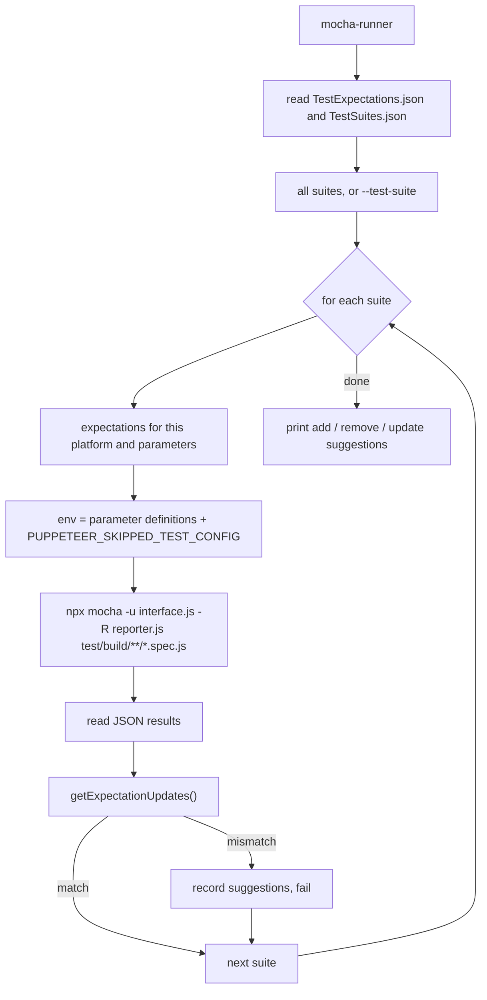

## Overview

Puppeteer's own tests run the same Mocha specs against several browser and protocol combinations: Chrome over CDP in headless, headful and `chrome-headless-shell` modes, Chrome over WebDriver BiDi, and Firefox over BiDi. A custom runner in `tools/mocha-runner` starts Mocha once per configuration, skips tests listed in `TestExpectations.json`, and compares the results with the expected outcomes. `test/src/mocha-utils.ts` gives every spec a shared browser, fresh pages, and an HTTP and HTTPS server from `@pptr/testserver`. Separate suites test the published npm packages and the TypeScript types.

Sources: [test/README.md:1-28](repo://test/README.md#L1-L28), [tools/mocha-runner/README.md:1-29](repo://tools/mocha-runner/README.md#L1-L29), [test/TestSuites.json:1-50](repo://test/TestSuites.json#L1-L50)

## Running tests

### npm scripts

`npm test` runs `npx ./tools/mocha-runner` after building the tools, the test package and the runner. Each `test:*` script picks one suite with `--test-suite`, and `test:chrome` and `test:firefox` run all suites for one browser:

Sources: [package.json:26-36](repo://package.json#L26-L36), [package.json:101-140](repo://package.json#L101-L140)

| Script | Suite |
| --- | --- |
| `test:chrome:headless` | `chrome-headless` |
| `test:chrome:headful` | `chrome-headful` |
| `test:chrome:shell` | `chrome-headless-shell` |
| `test:chrome:bidi` | `chrome-bidi` |
| `test:firefox:headless`, `test:firefox:headful` | `firefox-headless`, `firefox-headful` |

Sources: [package.json:26-36](repo://package.json#L26-L36), [package.json:101-140](repo://package.json#L101-L140)

The code must be built first, as the README notes, because the runner executes compiled specs. `BINARY=<path>` runs the tests against a custom browser executable.

Sources: [test/README.md:30-92](repo://test/README.md#L30-L92)

```bash
npm run build --workspace=@puppeteer-test/test && npm test
BINARY=<path-to-executable> npm run test:chrome:headless
```

Sources: [test/README.md:30-92](repo://test/README.md#L30-L92)

## Test suites and expectations

### TestSuites.json

A suite is a list of parameters, and each parameter maps to environment variables. `chrome` sets `PUPPETEER_BROWSER=chrome`, `headless` sets `HEADLESS=true` and `PUPPETEER_LOGLEVEL=silent`, `chrome-headless-shell` sets `HEADLESS=shell`, `webDriverBiDi` sets `PUPPETEER_PROTOCOL=webDriverBiDi`, and `cdp` sets nothing.

Sources: [test/TestSuites.json:23-49](repo://test/TestSuites.json#L23-L49)

```json
{
  "id": "chrome-bidi",
  "parameters": ["chrome", "headless", "webDriverBiDi"]
}
```

Sources: [test/TestSuites.json:23-49](repo://test/TestSuites.json#L23-L49)

### TestExpectations.json

Each expectation names a test id pattern, platforms, parameters and acceptable results:

Sources: [test/TestExpectations.json:9-15](repo://test/TestExpectations.json#L9-L15)

```json
{
  "testIdPattern": "[bfcache.spec] *",
  "platforms": ["darwin", "linux", "win32"],
  "parameters": ["webDriverBiDi"],
  "expectations": ["SKIP"],
  "comment": "Chrome-only feature blocked on https://github.com/GoogleChromeLabs/chromium-bidi/issues/2082"
}
```

Sources: [test/TestExpectations.json:9-15](repo://test/TestExpectations.json#L9-L15)

| Field | Match logic |
| --- | --- |
| `testIdPattern` | Full test id `[file.spec] describe … it`, with `*` as a greedy wildcard |
| `platforms` | Any of `linux`, `win32`, `darwin` |
| `parameters` | All listed parameters must be in the suite |
| `expectations` | Any of `PASS`, `FAIL`, `TIMEOUT`, `SKIP`; `SKIP` prevents the test from running |

Sources: [tools/mocha-runner/README.md:31-67](repo://tools/mocha-runner/README.md#L31-L67)

Later expectations take precedence over earlier ones.

Sources: [tools/mocha-runner/README.md:31-67](repo://tools/mocha-runner/README.md#L31-L67)

## The mocha runner

### One run per suite



Sources: [tools/mocha-runner/src/mocha-runner.ts:97-181](repo://tools/mocha-runner/src/mocha-runner.ts#L97-L181), [tools/mocha-runner/src/mocha-runner.ts:183-257](repo://tools/mocha-runner/src/mocha-runner.ts#L183-L257), [tools/mocha-runner/src/mocha-runner.ts:258-304](repo://tools/mocha-runner/src/mocha-runner.ts#L258-L304)

For each suite the runner filters the expectations by platform and parameters, and passes the skip list to Mocha as the `PUPPETEER_SKIPPED_TEST_CONFIG` environment variable. It runs Mocha through `npx` with a custom interface and reporter writing JSON results to a temporary file (or the `--save-stats-to` path). It then compares the results with the expectations. Any test whose outcome is not expected produces a suggested change to `TestExpectations.json`, and the runner fails. It also fails when fewer tests than `--min-tests` ran.

Sources: [tools/mocha-runner/src/mocha-runner.ts:141-232](repo://tools/mocha-runner/src/mocha-runner.ts#L141-L232), [tools/mocha-runner/src/mocha-runner.ts:233-304](repo://tools/mocha-runner/src/mocha-runner.ts#L233-L304), [tools/mocha-runner/README.md:69-73](repo://tools/mocha-runner/README.md#L69-L73)

### Runner options

| Option | Effect |
| --- | --- |
| `--test-suite <id>` | Run one suite |
| `--shard <n>-<total>` | Run every `total`-th spec file starting at `n` |
| `--no-cdp-tests` | Skip `test/build/cdp/**` specs |
| `--coverage` | Wrap Mocha in `c8 --check-coverage --lines 90` |
| `--save-stats-to <file>` | Keep the JSON results; `INSERTID` becomes a UUID |
| `--no-suggestions`, `--ignore-unexpectedly-passing`, `--print-memory`, `--reporter` | Output control |

Sources: [tools/mocha-runner/src/mocha-runner.ts:39-95](repo://tools/mocha-runner/src/mocha-runner.ts#L39-L95), [tools/mocha-runner/src/mocha-runner.ts:152-164](repo://tools/mocha-runner/src/mocha-runner.ts#L152-L164), [tools/mocha-runner/src/mocha-runner.ts:205-249](repo://tools/mocha-runner/src/mocha-runner.ts#L205-L249)

Other arguments are passed through to Mocha. When GitHub Actions debugging is on, the runner also sets `DEBUG=puppeteer:*` and launch options with `dumpio` and Firefox trace logging.

Sources: [tools/mocha-runner/src/mocha-runner.ts:39-95](repo://tools/mocha-runner/src/mocha-runner.ts#L39-L95), [tools/mocha-runner/src/mocha-runner.ts:152-164](repo://tools/mocha-runner/src/mocha-runner.ts#L152-L164), [tools/mocha-runner/src/mocha-runner.ts:205-249](repo://tools/mocha-runner/src/mocha-runner.ts#L205-L249)

### Interface helpers

The custom Mocha interface skips tests matching the skip list, and adds debugging helpers. `describe.withDebugLogs` captures Puppeteer's debug output and prints it for each failed test ([[Errors and Debug Logging]]). `it.deflake(n, …)` and `it.deflakeOnly` rerun a test `n` times. The `PUPPETEER_DEFLAKE_TESTS` pattern (with `PUPPETEER_DEFLAKE_RETRIES`, 100 by default) applies the same to matching tests without editing them.

Sources: [tools/mocha-runner/src/interface.ts:30-60](repo://tools/mocha-runner/src/interface.ts#L30-L60), [tools/mocha-runner/README.md:75-103](repo://tools/mocha-runner/README.md#L75-L103)

## Test state in specs

### Process-wide settings

`mocha-utils.ts` reads the suite's environment once: the browser from `PRODUCT` or `PUPPETEER_BROWSER`, the headless mode from `HEADLESS`, the protocol from `PUPPETEER_PROTOCOL`, the executable from `BINARY`, and extra launch options as JSON from `EXTRA_LAUNCH_OPTIONS`. It builds `defaultBrowserOptions` from them and always adds host-resolver rules that map `domain1.test` to `domain3.test` to `127.0.0.1`, so cross-origin tests can use real hostnames. If neither `BINARY` nor the downloaded browser exists, it throws asking for `npm install`.

Sources: [test/src/mocha-utils.ts:65-128](repo://test/src/mocha-utils.ts#L65-L128)

### Hooks and getTestState

| Helper | What it provides |
| --- | --- |
| Root `beforeAll` / `afterAll` | Starts an HTTP and an HTTPS `TestServer` on the test assets and stops them (and the browser) at the end |
| `setupTestBrowserHooks()` | One shared browser per worker, launched with the default options; each test's context is closed after it |
| `getTestState()` | Resets both servers, relaunches the browser if it disconnected, creates a fresh browser context and page unless told not to, and returns the state |
| `launch(options)` / `setupSeparateTestBrowserHooks()` | A separate browser for tests that need custom launch options |

Sources: [test/src/mocha-utils.ts:148-218](repo://test/src/mocha-utils.ts#L148-L218), [test/src/mocha-utils.ts:267-299](repo://test/src/mocha-utils.ts#L267-L299), [test/src/mocha-utils.ts:365-410](repo://test/src/mocha-utils.ts#L365-L410), [test/README.md:5-24](repo://test/README.md#L5-L24)

The state exposes `browser`, `context`, `page`, `puppeteer`, `server`, `httpsServer`, `defaultBrowserOptions`, `isFirefox`, `isChrome`, `isHeadless` and `headless`. Screenshot tests compare against golden images per browser in `golden-<browser>` folders, writing mismatches to `output-<browser>`.

Sources: [test/src/mocha-utils.ts:300-327](repo://test/src/mocha-utils.ts#L300-L327)

## The test server

`@pptr/testserver` serves the test assets over HTTP or HTTPS (with a bundled self-signed certificate) on a random port, and also accepts WebSocket connections. Specs use it to control responses:

Sources: [packages/testserver/src/index.ts:37-111](repo://packages/testserver/src/index.ts#L37-L111), [packages/testserver/src/index.ts:128-175](repo://packages/testserver/src/index.ts#L128-L175)

| Method | Use |
| --- | --- |
| `setRoute(path, handler)` | Custom response for a path |
| `setRedirect(from, to)` | 302 redirect |
| `setAuth(path, user, password)` | Require basic authentication |
| `enableGzip(path)`, `setCSP(path, csp)` | Compress a path or add a CSP header |
| `enableHTTPCache(prefix)` | Serve cache headers for a folder |
| `waitForRequest(path)` | Promise for the next request to a path |
| `reset()`, `stop()` | Clear routes between tests, close all sockets |

Sources: [packages/testserver/src/index.ts:37-111](repo://packages/testserver/src/index.ts#L37-L111), [packages/testserver/src/index.ts:128-175](repo://packages/testserver/src/index.ts#L128-L175)

Each test state gets `PREFIX` (`http://localhost:<port>`), `CROSS_PROCESS_PREFIX` (`http://127.0.0.1:<port>`, a different origin) and `EMPTY_PAGE`, and the same for HTTPS.

Sources: [test/src/mocha-utils.ts:148-169](repo://test/src/mocha-utils.ts#L148-L169)

## Installation and type tests

`npm run test-install` runs `test/installation`, which tests the packed packages as users would install them. `configureSandbox` creates a temporary folder and installs the `.tgz` tarballs of `puppeteer`, `puppeteer-core` and `@puppeteer/browsers` found in the repository root. Specs then check, for example, that the postinstall downloaded `chrome` and `chrome-headless-shell` into the configured cache, run CommonJS and ESM scripts, and build the in-browser example.

Sources: [test/installation/src/sandbox.ts:68-130](repo://test/installation/src/sandbox.ts#L68-L130), [test/installation/src/constants.ts:12-20](repo://test/installation/src/constants.ts#L12-L20), [test/installation/src/puppeteer.spec.ts:20-60](repo://test/installation/src/puppeteer.spec.ts#L20-L60)

`npm run test-types` runs `tsd` on `packages/puppeteer` with the files in `test-d`, which assert the public types, such as that the default export's `launch` has the type of the named `launch` export.

Sources: [package.json:141-146](repo://package.json#L141-L146), [test-d/puppeteer.test-d.ts:6-17](repo://test-d/puppeteer.test-d.ts#L6-L17)
