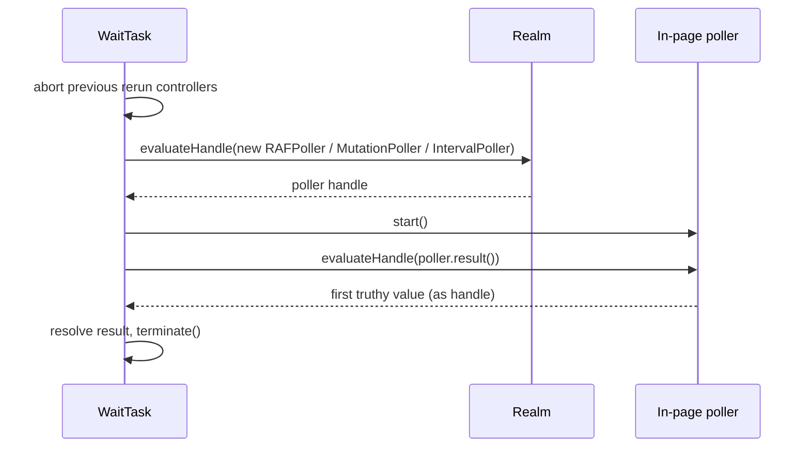

## Overview

`waitForFunction` and `waitForSelector` wait until something becomes true in the page. Puppeteer does not poll from Node. It installs a poller inside the page that re-runs a predicate until it returns a truthy value, and Node waits on one promise. The Node side is a `WaitTask` owned by a realm. A `WaitTask` survives navigations by re-installing its poller in each new execution context, and it ends on success, timeout, abort signal or frame detach. `waitForSelector` is a `waitForFunction` whose predicate is a selector query ([[Selectors and Query Handlers]]); locators build their own retrying on top of these waits ([[Locators]]).

Sources: [packages/puppeteer-core/src/api/Realm.ts:50-88](repo://packages/puppeteer-core/src/api/Realm.ts#L50-L88), [packages/puppeteer-core/src/common/WaitTask.ts:32-86](repo://packages/puppeteer-core/src/common/WaitTask.ts#L32-L86)

## Public entry points

### waitForFunction

`page.waitForFunction(fn, options, ...args)` and `frame.waitForFunction` delegate to the main realm's `waitForFunction`. The function may be a string expression or a function (async allowed), and the extra arguments are passed to it like `evaluate` arguments. The call resolves with a `JSHandle` to the first truthy value.

Sources: [packages/puppeteer-core/src/api/Frame.ts:94-118](repo://packages/puppeteer-core/src/api/Frame.ts#L94-L118), [packages/puppeteer-core/src/api/Frame.ts:786-800](repo://packages/puppeteer-core/src/api/Frame.ts#L786-L800), [packages/puppeteer-core/src/api/Realm.ts:50-88](repo://packages/puppeteer-core/src/api/Realm.ts#L50-L88)

| Option | Default | Effect |
| --- | --- | --- |
| `polling` | `raf` | `raf`, `mutation`, or an interval in milliseconds |
| `timeout` | page default, 30000 | `0` disables the timeout |
| `signal` | none | `AbortSignal` that cancels the wait |
| `root` | none (internal) | Element whose subtree a mutation poller observes |

Sources: [packages/puppeteer-core/src/api/Frame.ts:94-118](repo://packages/puppeteer-core/src/api/Frame.ts#L94-L118), [packages/puppeteer-core/src/api/Frame.ts:786-800](repo://packages/puppeteer-core/src/api/Frame.ts#L786-L800), [packages/puppeteer-core/src/api/Realm.ts:50-88](repo://packages/puppeteer-core/src/api/Realm.ts#L50-L88)

The API's own example waits for a viewport change triggered later in the script:

Sources: [packages/puppeteer-core/src/api/Page.ts:3050-3056](repo://packages/puppeteer-core/src/api/Page.ts#L3050-L3056)

```ts
const watchDog = page.waitForFunction('window.innerWidth < 100');
await page.setViewport({width: 50, height: 50});
await watchDog;
```

Sources: [packages/puppeteer-core/src/api/Page.ts:3050-3056](repo://packages/puppeteer-core/src/api/Page.ts#L3050-L3056)

`Realm.waitForFunction` rejects a negative polling interval with `Cannot poll with non-positive interval`, builds a `WaitTask` with the options, and returns its `result` promise.

Sources: [packages/puppeteer-core/src/api/Realm.ts:64-88](repo://packages/puppeteer-core/src/api/Realm.ts#L64-L88)

### waitForSelector

`waitForSelector(selector, {visible, hidden, timeout, signal})` resolves the query handler and calls `QueryHandler.waitFor`, which runs `waitForFunction` in the isolated realm with a predicate that queries the selector and checks visibility. With neither `visible` nor `hidden`, the element only has to exist. With `visible`, it must also be visible. With `hidden`, the wait succeeds when the element is hidden or missing, and resolves with `null` in the missing case. `visible` and `hidden` switch polling to `raf`; otherwise the handler's polling mode is used (`mutation` for most selectors).

Sources: [packages/puppeteer-core/src/api/Page.ts:185-213](repo://packages/puppeteer-core/src/api/Page.ts#L185-L213), [packages/puppeteer-core/src/common/QueryHandler.ts:148-205](repo://packages/puppeteer-core/src/common/QueryHandler.ts#L148-L205), [packages/puppeteer-core/src/injected/util.ts:11-31](repo://packages/puppeteer-core/src/injected/util.ts#L11-L31)

## The WaitTask lifecycle

### Construction

The constructor normalizes the predicate into source text: a string expression becomes `() => {return (<expr>);}`, and a function is stringified. It registers the task with the realm's `TaskManager`, listens for the abort signal, and, when `timeout` is non-zero, starts a timer that terminates the task with `TimeoutError('Waiting failed: <n>ms exceeded')`. It then calls `rerun()` once.

Sources: [packages/puppeteer-core/src/common/WaitTask.ts:50-86](repo://packages/puppeteer-core/src/common/WaitTask.ts#L50-L86)

### rerun: installing the poller



Sources: [packages/puppeteer-core/src/common/WaitTask.ts:92-170](repo://packages/puppeteer-core/src/common/WaitTask.ts#L92-L170)

Each rerun first aborts the controllers of earlier reruns, so only the newest one may report errors. It evaluates, in the realm, a constructor call for the chosen poller. The predicate source is rebuilt in the page with `PuppeteerUtil.createFunction` and wrapped in a closure over the arguments; for mutation polling the root element (or `document`) is passed too. Once the poller has started, the task waits for `poller.result()` as a handle, resolves its own result with that handle, and terminates.

Sources: [packages/puppeteer-core/src/common/WaitTask.ts:92-159](repo://packages/puppeteer-core/src/common/WaitTask.ts#L92-L159)

### Surviving navigation

A navigation destroys the execution context and with it the in-page poller, and the pending evaluation fails. `getBadError` sorts such failures:

Sources: [packages/puppeteer-core/src/common/WaitTask.ts:160-169](repo://packages/puppeteer-core/src/common/WaitTask.ts#L160-L169), [packages/puppeteer-core/src/common/WaitTask.ts:201-238](repo://packages/puppeteer-core/src/common/WaitTask.ts#L201-L238)

| Error message contains | Treatment |
| --- | --- |
| `Execution context was destroyed` | Ignored: wait for the next context |
| `Cannot find context with specified id` | Ignored |
| `DiscardedBrowsingContextError` (BiDi) | Ignored |
| `Execution context is not available in detached frame` | Fails with `Waiting failed: Frame detached` |
| Anything else | Fails with `Waiting failed`, the error as `cause` |

Sources: [packages/puppeteer-core/src/common/WaitTask.ts:160-169](repo://packages/puppeteer-core/src/common/WaitTask.ts#L160-L169), [packages/puppeteer-core/src/common/WaitTask.ts:201-238](repo://packages/puppeteer-core/src/common/WaitTask.ts#L201-L238)

When the realm gets a new execution context, it calls `taskManager.rerunAll()`, and every pending task installs a fresh poller in the new document. On CDP this happens in `IsolatedWorld.setContext`. A `waitForSelector` started before a navigation therefore finds the element on the next page.

Sources: [packages/puppeteer-core/src/common/WaitTask.ts:248-273](repo://packages/puppeteer-core/src/common/WaitTask.ts#L248-L273), [packages/puppeteer-core/src/cdp/IsolatedWorld.ts:92-100](repo://packages/puppeteer-core/src/cdp/IsolatedWorld.ts#L92-L100)

### Termination

`terminate(error?)` removes the task from the manager, detaches the abort listener, clears the timer, rejects the result if an error is given and the result is still pending, then asks the in-page poller to `stop()` and disposes its handle, ignoring cleanup errors. It runs on success, timeout (with the `TimeoutError`), abort (with `signal.reason`) and fatal errors.

Sources: [packages/puppeteer-core/src/common/WaitTask.ts:172-196](repo://packages/puppeteer-core/src/common/WaitTask.ts#L172-L196), [packages/puppeteer-core/src/common/WaitTask.ts:240-242](repo://packages/puppeteer-core/src/common/WaitTask.ts#L240-L242)

When a frame detaches, its realm is disposed and `taskManager.terminateAll` rejects every pending task with `waitForFunction failed: frame got detached.`

Sources: [packages/puppeteer-core/src/api/Realm.ts:98-103](repo://packages/puppeteer-core/src/api/Realm.ts#L98-L103), [packages/puppeteer-core/src/common/WaitTask.ts:259-264](repo://packages/puppeteer-core/src/common/WaitTask.ts#L259-L264)

## The in-page pollers

All three pollers implement `start()`, `stop()` and `result()` around a `Deferred`. `start()` runs the predicate once immediately and resolves if it is already truthy. Otherwise it schedules re-runs, resolving with the first truthy value and stopping itself. `stop()` rejects a pending result with `Polling stopped` and releases the scheduler.

Sources: [packages/puppeteer-core/src/injected/Poller.ts:13-72](repo://packages/puppeteer-core/src/injected/Poller.ts#L13-L72), [packages/puppeteer-core/src/injected/Poller.ts:77-168](repo://packages/puppeteer-core/src/injected/Poller.ts#L77-L168), [packages/puppeteer-core/src/api/Frame.ts:94-107](repo://packages/puppeteer-core/src/api/Frame.ts#L94-L107)

| Poller | Re-runs the predicate | Suited to |
| --- | --- | --- |
| `RAFPoller` | On every `requestAnimationFrame` | Styling changes; the default for `waitForFunction` |
| `MutationPoller` | On every mutation of the root's subtree (children, subtree, attributes) | DOM structure, used by most `waitForSelector` calls |
| `IntervalPoller` | Every `ms` milliseconds via `setInterval` | Checks at a fixed rate (`polling: <number>`) |

Sources: [packages/puppeteer-core/src/injected/Poller.ts:13-72](repo://packages/puppeteer-core/src/injected/Poller.ts#L13-L72), [packages/puppeteer-core/src/injected/Poller.ts:77-168](repo://packages/puppeteer-core/src/injected/Poller.ts#L77-L168), [packages/puppeteer-core/src/api/Frame.ts:94-107](repo://packages/puppeteer-core/src/api/Frame.ts#L94-L107)

## Errors seen by callers

| Situation | Error |
| --- | --- |
| Timeout in `waitForFunction` | `TimeoutError: Waiting failed: <n>ms exceeded` |
| Timeout in `waitForSelector` | ``TimeoutError: Waiting for selector `<s>` failed`` with the original as `cause` |
| Abort signal | The signal's `reason` (an `AbortError` by default), not wrapped |
| Frame detached | `Waiting failed: Frame detached` or `waitForFunction failed: frame got detached.` |
| Predicate threw | `Waiting failed` with the thrown error as `cause` |

Sources: [packages/puppeteer-core/src/common/WaitTask.ts:76-83](repo://packages/puppeteer-core/src/common/WaitTask.ts#L76-L83), [packages/puppeteer-core/src/common/QueryHandler.ts:206-218](repo://packages/puppeteer-core/src/common/QueryHandler.ts#L206-L218), [packages/puppeteer-core/src/common/WaitTask.ts:201-242](repo://packages/puppeteer-core/src/common/WaitTask.ts#L201-L242)
