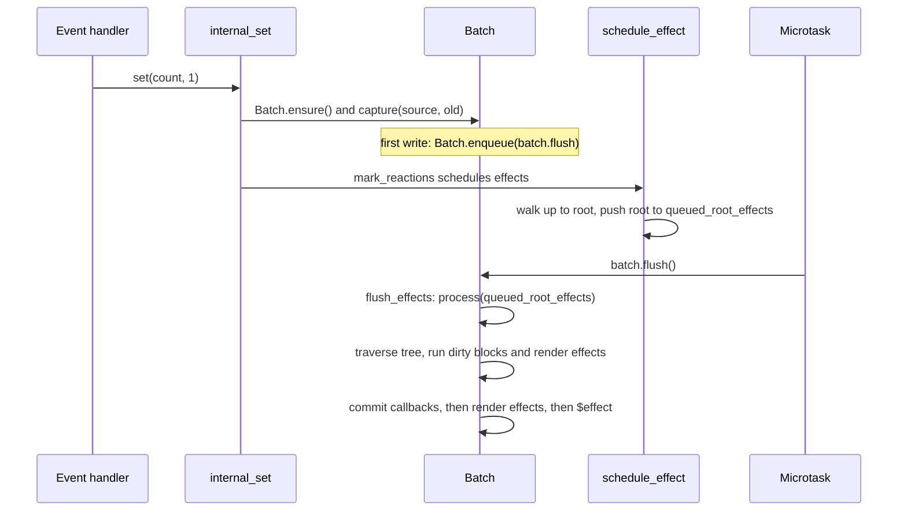

## Overview

Setting state does not update the DOM immediately. Each write is recorded in the current `Batch`, the effects that depend on it are scheduled, and a microtask later the batch walks the effect tree and runs what is dirty. Several writes in the same synchronous code therefore cause one update. `flushSync` runs that work immediately; `tick` and `settled` let code wait for it. In experimental async mode, a batch can also stay open while promises it started are pending, and its changes are applied to the DOM only when everything it waits for has resolved. All of this lives in `reactivity/batch.js`, with the async helpers in `reactivity/async.js`.

Sources: [packages/svelte/src/internal/client/reactivity/batch.js:49-151](repo://packages/svelte/src/internal/client/reactivity/batch.js#L49-L151), [packages/svelte/src/internal/client/reactivity/batch.js:461-483](repo://packages/svelte/src/internal/client/reactivity/batch.js#L461-L483)

The writes and the dirty marking that feed this are described in [[Signals and Dependency Tracking]]; the effects being run are described in [[Effects and the Effect Tree]].

Sources: [packages/svelte/src/internal/client/reactivity/sources.js:172-183](repo://packages/svelte/src/internal/client/reactivity/sources.js#L172-L183)

## From a write to a flush

### The sequence

Sources: [packages/svelte/src/internal/client/reactivity/batch.js:452-483](repo://packages/svelte/src/internal/client/reactivity/batch.js#L452-L483), [packages/svelte/src/internal/client/reactivity/batch.js:542-584](repo://packages/svelte/src/internal/client/reactivity/batch.js#L542-L584), [packages/svelte/src/internal/client/reactivity/batch.js:652-674](repo://packages/svelte/src/internal/client/reactivity/batch.js#L652-L674)

### Creating the batch

`Batch.ensure()` returns `current_batch`, creating it if needed. A new batch is added to the global `batches` set and, unless a `flushSync` is in progress, enqueues its own `flush` through `Batch.enqueue`, which runs tasks in a microtask (newest first). The flush is skipped if a `flushSync` already replaced the batch. `capture(source, old_value)` records the value before the first write in `#previous` and the latest value in `current`.

Sources: [packages/svelte/src/internal/client/reactivity/batch.js:342-354](repo://packages/svelte/src/internal/client/reactivity/batch.js#L342-L354), [packages/svelte/src/internal/client/reactivity/batch.js:452-483](repo://packages/svelte/src/internal/client/reactivity/batch.js#L452-L483), [packages/svelte/src/internal/client/reactivity/batch.js:30-40](repo://packages/svelte/src/internal/client/reactivity/batch.js#L30-L40)

### Scheduling roots, not effects

`schedule_effect(effect)` does not queue the effect itself. It walks up the parent chain and clears the `CLEAN` bit on every branch and root it passes, stopping early when it meets one that is already marked; then it pushes the root onto `queued_root_effects`. The marks form a path from the root to the dirty effect, so the flush only descends into branches that contain something to do. If a block effect is scheduling its own child while it runs (an `{#each}` updating an item's source), the call bails out to avoid a second flush.

Sources: [packages/svelte/src/internal/client/reactivity/batch.js:652-674](repo://packages/svelte/src/internal/client/reactivity/batch.js#L652-L674)

### Processing

`flush_effects` loops while roots are queued, calling `batch.process(roots)` and clearing `old_values` after each pass. More than 1000 passes means effects keep invalidating each other: it throws `effect_update_depth_exceeded` (in dev, after logging the stack traces of the writes) and routes the error to the boundary nearest the last scheduled effect.

Sources: [packages/svelte/src/internal/client/reactivity/batch.js:542-602](repo://packages/svelte/src/internal/client/reactivity/batch.js#L542-L602)

`process` walks each root with `#traverse_effect_tree`, a depth-first walk over the child links that skips clean branches, inert (paused) effects and branches in `skipped_effects`. On the way:

Sources: [packages/svelte/src/internal/client/reactivity/batch.js:274-286](repo://packages/svelte/src/internal/client/reactivity/batch.js#L274-L286)

- Branches have their `CLEAN` bit restored.
- `EFFECT`s (`$effect`) are collected for later, and so are render effects in async mode.
- Other dirty effects run at once if `is_dirty` confirms them. In practice these are block effects and, outside async mode, render effects, so the DOM structure is updated top-down before anything below reads it.
- `ASYNC` effects are collected separately.

Sources: [packages/svelte/src/internal/client/reactivity/batch.js:149-160](repo://packages/svelte/src/internal/client/reactivity/batch.js#L149-L160), [packages/svelte/src/internal/client/reactivity/batch.js:274-326](repo://packages/svelte/src/internal/client/reactivity/batch.js#L274-L326)

When no async work is pending, the batch commits: it runs the callbacks blocks registered with `add_callback` (which insert new branches and destroy old ones), then the collected render effects, then the `$effect`s, each through `flush_queued_effects`, which re-checks `is_dirty` and skips destroyed and inert effects. Effects that ran and turned out to have no dependencies, children or DOM are unlinked from the tree. `current_batch` is cleared while effects run, so writes made by effects start a new batch instead of mixing into the one being committed.

Sources: [packages/svelte/src/internal/client/reactivity/batch.js:188-222](repo://packages/svelte/src/internal/client/reactivity/batch.js#L188-L222), [packages/svelte/src/internal/client/reactivity/batch.js:400-411](repo://packages/svelte/src/internal/client/reactivity/batch.js#L400-L411), [packages/svelte/src/internal/client/reactivity/batch.js:604-650](repo://packages/svelte/src/internal/client/reactivity/batch.js#L604-L650)

## Flushing on demand

| API | Behaviour |
| --- | --- |
| `flushSync(fn?)` | Runs `fn` (after flushing what is queued), then loops: run pending microtasks and idle tasks from `dom/task.js`, flush the current batch, repeat until no roots are queued. In async mode it throws `flush_sync_in_effect` when called inside an effect. |
| `tick()` | Waits a microtask and calls `flushSync()`; in async mode it waits for the next animation frame instead. |
| `settled()` | Returns a promise from the current batch that resolves when the batch commits, including any async work it started. |

Sources: [packages/svelte/src/internal/client/reactivity/batch.js:486-540](repo://packages/svelte/src/internal/client/reactivity/batch.js#L486-L540), [packages/svelte/src/internal/client/runtime.js:496-521](repo://packages/svelte/src/internal/client/runtime.js#L496-L521)

`dom/task.js` keeps two small queues used by DOM code: `queue_micro_task` batches callbacks into one `queueMicrotask`, and `queue_idle_task` uses `requestIdleCallback` (or `setTimeout` where it does not exist). `flush_tasks` runs both synchronously, which is how `flushSync` makes deferred DOM work, such as event replay after hydration, observable at once.

Sources: [packages/svelte/src/internal/client/dom/task.js:1-60](repo://packages/svelte/src/internal/client/dom/task.js#L1-L60)

## Async batches

### Why batches wait

With `experimental.async`, `await` may appear in `$derived`, in template expressions and at the top of a component. A batch that triggers such work cannot commit until it resolves, or the DOM would show a mix of new and old values.

Sources: [packages/svelte/src/internal/client/reactivity/batch.js:96-151](repo://packages/svelte/src/internal/client/reactivity/batch.js#L96-L151)

### Pending work

Each async operation calls `batch.increment()` when it starts and `decrement()` when it settles. `async_derived` does this on its first run (so the component suspends while it loads); `suspend()` does it for `$.async_body` (a component or fragment with top-level `await`) and returns the matching `unsuspend` function. Inside a `<svelte:boundary>` that is showing its `pending` snippet, the boundary's own counter is used instead, so content still loading for the first time does not hold back unrelated updates.

Sources: [packages/svelte/src/internal/client/reactivity/deriveds.js:135-187](repo://packages/svelte/src/internal/client/reactivity/deriveds.js#L135-L187), [packages/svelte/src/internal/client/reactivity/batch.js:676-696](repo://packages/svelte/src/internal/client/reactivity/batch.js#L676-L696), [packages/svelte/src/internal/client/reactivity/async.js:177-193](repo://packages/svelte/src/internal/client/reactivity/async.js#L177-L193)

While a batch has pending work, `process` does not commit. Its collected render effects, `$effect`s and block effects are deferred into `#dirty_effects` and `#maybe_dirty_effects` and marked clean, so a later write can schedule them again. When the counter returns to zero, `decrement` restores their status, schedules them, and flushes the batch, which now commits.

Sources: [packages/svelte/src/internal/client/reactivity/batch.js:223-229](repo://packages/svelte/src/internal/client/reactivity/batch.js#L223-L229), [packages/svelte/src/internal/client/reactivity/batch.js:326-340](repo://packages/svelte/src/internal/client/reactivity/batch.js#L326-L340), [packages/svelte/src/internal/client/reactivity/batch.js:413-436](repo://packages/svelte/src/internal/client/reactivity/batch.js#L413-L436)

### Time travel

Several batches can be open at once: one waiting on a slow request while the user keeps typing. When `process` runs with more than one batch in `batches`, it temporarily rewrites history: sources changed by this batch get the batch's values, and sources changed by other open batches are reset to their values from before those batches. Deriveds computed in this state are cached in `batch_deriveds` rather than on the deriveds themselves. Afterwards every source is restored, unless an effect wrote a newer value meanwhile. Each batch therefore renders as if only its own changes had happened.

Sources: [packages/svelte/src/internal/client/reactivity/batch.js:156-184](repo://packages/svelte/src/internal/client/reactivity/batch.js#L156-L184), [packages/svelte/src/internal/client/reactivity/batch.js:231-249](repo://packages/svelte/src/internal/client/reactivity/batch.js#L231-L249), [packages/svelte/src/internal/client/runtime.js:654-662](repo://packages/svelte/src/internal/client/runtime.js#L654-L662)

If an async derived re-runs while its previous promise is still pending, the old run's batch is `neuter`ed: when it eventually commits, it skips its DOM callbacks, since a newer batch supersedes them.

Sources: [packages/svelte/src/internal/client/reactivity/deriveds.js:189-194](repo://packages/svelte/src/internal/client/reactivity/deriveds.js#L189-L194), [packages/svelte/src/internal/client/reactivity/batch.js:374-376](repo://packages/svelte/src/internal/client/reactivity/batch.js#L374-L376)

## Keeping context across await

JavaScript loses Svelte's module-level context (`active_effect`, `active_reaction`, `component_context`, `current_batch`) at every `await`. The compiler therefore rewrites `await x` inside reactive code as `(await $.save(x))()`. `save` captures the context before awaiting and returns a function that restores it and yields the value, so in `await a + b` the read of `b` is still tracked by the right reaction. `unset_context` clears everything again once async work completes.

Sources: [packages/svelte/src/internal/client/reactivity/async.js:67-106](repo://packages/svelte/src/internal/client/reactivity/async.js#L67-L106), [packages/svelte/src/internal/client/reactivity/async.js:170-175](repo://packages/svelte/src/internal/client/reactivity/async.js#L170-L175), [packages/svelte/src/compiler/phases/3-transform/client/visitors/AwaitExpression.js:18-28](repo://packages/svelte/src/compiler/phases/3-transform/client/visitors/AwaitExpression.js#L18-L28)

In dev, an `await` that is not wrapped this way goes through `track_reactivity_loss` instead, which keeps the information needed to warn with `await_reactivity_loss` when state is read after the `await`; `for_await_track_reactivity_loss` does the same for `for await` loops.

Sources: [packages/svelte/src/internal/client/reactivity/async.js:108-168](repo://packages/svelte/src/internal/client/reactivity/async.js#L108-L168)

`flatten(sync, async, fn)` is how template effects and blocks receive memoised values. Sync expressions become deriveds; when there are async ones, each becomes an `async_derived`, and `fn` is called with all values once every promise resolves, with the batch and context restored. A rejection goes to the nearest boundary ([[Error Boundaries and Async Rendering]]).

Sources: [packages/svelte/src/internal/client/reactivity/async.js:24-65](repo://packages/svelte/src/internal/client/reactivity/async.js#L24-L65)
