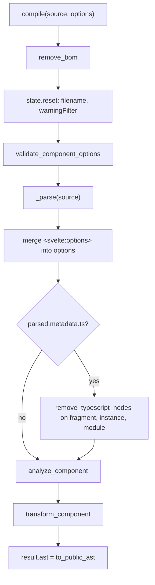

## Overview

`svelte/compiler` exposes three entry points that share one pipeline. `compile` turns a `.svelte` component into a JavaScript module, `compileModule` turns a `.svelte.js` or `.svelte.ts` file that uses runes into one, and `parse` stops after the first phase and returns the AST. All three live in `packages/svelte/src/compiler/index.js`, which also re-exports `preprocess`, `migrate` and `VERSION`.

Sources: [packages/svelte/src/compiler/index.js:1-12](repo://packages/svelte/src/compiler/index.js#L1-L12), [packages/svelte/src/compiler/index.js:165-173](repo://packages/svelte/src/compiler/index.js#L165-L173)

The pipeline has three phases, each in its own folder under `phases/`: `1-parse` produces the AST ([[Template Parser]]), `2-analyze` resolves scopes and validates the component ([[Scopes and Bindings]], [[Component Analysis]]), and `3-transform` emits code ([[Client Code Generation]], [[Server Code Generation]]). This page covers what happens around the phases: the options, the shared state, TypeScript removal and the shape of the result.

Sources: [packages/svelte/src/compiler/index.js:5-9](repo://packages/svelte/src/compiler/index.js#L5-L9)

## compile step by step

Sources: [packages/svelte/src/compiler/index.js:21-54](repo://packages/svelte/src/compiler/index.js#L21-L54)

1. `remove_bom` drops a leading `U+FEFF`, because it would otherwise end up in the generated template strings.
2. `state.reset` clears the module-level compiler state from the previous call and stores the filename (with backslashes turned into slashes) and the `warningFilter`.
3. `validate_component_options` checks the options and fills in defaults.
4. `_parse` builds the modern AST. Options written in the component's `<svelte:options>` tag come back on `parsed.options`; they are spread over the validated options, so the tag wins over the caller. Its `customElement` entry is kept apart as `customElementOptions`.
5. When the parser saw `lang="ts"`, `remove_typescript_nodes` runs over the template, the instance script and the module script, and over a custom element's `extend` function.
6. `analyze_component` and `transform_component` produce the `CompileResult`, and the public AST is attached last.

Sources: [packages/svelte/src/compiler/index.js:21-54](repo://packages/svelte/src/compiler/index.js#L21-L54), [packages/svelte/src/compiler/index.js:151-160](repo://packages/svelte/src/compiler/index.js#L151-L160), [packages/svelte/src/compiler/state.js:97-110](repo://packages/svelte/src/compiler/state.js#L97-L110)

`compileModule` is shorter: it validates with `validate_module_options` and goes straight to `analyze_module` and `transform_module`, because a JavaScript module has no template to parse; `analyze_module` parses the source with acorn itself. `parse` resets the state with a warning filter that drops everything, runs `_parse` (passing `loose`, which makes the parser return an AST even for input that would not compile) and converts the result with `to_public_ast`.

Sources: [packages/svelte/src/compiler/index.js:56-71](repo://packages/svelte/src/compiler/index.js#L56-L71), [packages/svelte/src/compiler/index.js:113-118](repo://packages/svelte/src/compiler/index.js#L113-L118), [packages/svelte/src/compiler/phases/2-analyze/index.js:249-255](repo://packages/svelte/src/compiler/phases/2-analyze/index.js#L249-L255)

## Options validation

`validate-options.js` describes the options as a tree of small validator functions. `object(children)` walks the input and rejects any unknown key with `options_unrecognised`; `string`, `boolean`, `list` and `fun` check one value and return a fallback when it is `undefined`; every failed check throws `options_invalid_value` with the key path, such as `compatibility.componentApi`.

Sources: [packages/svelte/src/compiler/validate-options.js:218-324](repo://packages/svelte/src/compiler/validate-options.js#L218-L324)

Three wrappers handle options that changed between versions. `removed(msg)` throws `options_removed` with a migration hint (`format`, `tag`, `sveltePath`, `legacy`, `errorMode`, `varsReport`). `warn_removed(fn)` and `deprecate(fn, validator)` emit a warning once per process through `warn_once`, which remembers which warning functions already ran; `deprecate` still validates and keeps the value (`accessors`, `immutable`), `warn_removed` drops it (`loopGuardTimeout`, `enableSourcemap`, `hydratable`).

Sources: [packages/svelte/src/compiler/validate-options.js:168-213](repo://packages/svelte/src/compiler/validate-options.js#L168-L213), [packages/svelte/src/compiler/validate-options.js:51-150](repo://packages/svelte/src/compiler/validate-options.js#L51-L150)

| Option | Default | Notes |
| --- | --- | --- |
| `generate` | `'client'` | `'server'` or `false`; the old `'dom'` and `'ssr'` are mapped with a warning |
| `dev` | `false` | Adds runtime checks and source locations |
| `filename`, `rootDir` | `'(unknown)'`, `process.cwd()` | `rootDir` falls back to `Deno.cwd()`; the filename is made relative to it |
| `warningFilter` | keep all | Returns `false` to drop a warning |
| `experimental.async` | `false` | Allows `await` in components and deriveds |
| `css` | `'external'` | `'injected'` puts styles in the JS; booleans and `'none'` are refused |
| `cssHash` | `svelte-${hash(css)}` | Builds the scoping class |
| `runes` | `undefined` | `undefined` means inferred from usage |
| `namespace`, `fragments` | `'html'`, `'html'` | `fragments: 'tree'` builds templates with DOM calls instead of HTML strings |
| `compatibility.componentApi` | `5` | `4` wraps the component in the Svelte 4 class API |
| `customElement`, `discloseVersion`, `hmr`, `preserveComments`, `preserveWhitespace`, `modernAst` | `false`, `true`, `false`, `false`, `false`, `false` | |

Sources: [packages/svelte/src/compiler/validate-options.js:11-49](repo://packages/svelte/src/compiler/validate-options.js#L11-L49), [packages/svelte/src/compiler/validate-options.js:51-112](repo://packages/svelte/src/compiler/validate-options.js#L51-L112)

`validate_module_options` accepts the same common options and maps every component-only key to a validator that returns nothing, so passing `css` to `compileModule` is not an error but has no effect.

Sources: [packages/svelte/src/compiler/validate-options.js:152-166](repo://packages/svelte/src/compiler/validate-options.js#L152-L166)

## Shared compiler state

Rather than threading context through every function, the compiler keeps per-compilation values as module-level `let` bindings in `state.js`: the `warnings` array, the `filename`, the `component_name`, the `source` and its `locator` (which turns an offset into line and column), the `dev` and `runes` flags, the `warning_filter`, and the `ignore_stack`/`ignore_map` used by `svelte-ignore` comments. Every generated error and warning function reads them to build its message and position ([[Errors and Warnings]]).

Sources: [packages/svelte/src/compiler/state.js:9-95](repo://packages/svelte/src/compiler/state.js#L9-L95)

`reset` runs at the start of each entry point. `adjust` runs once analysis knows the answer: it sets `dev`, `runes` and `component_name`, strips `rootDir` from the front of the filename, and empties the ignore structures. Because this state is global, the compiler is not re-entrant: two compilations cannot interleave in one module instance.

Sources: [packages/svelte/src/compiler/state.js:97-136](repo://packages/svelte/src/compiler/state.js#L97-L136), [packages/svelte/src/compiler/phases/2-analyze/index.js:284-288](repo://packages/svelte/src/compiler/phases/2-analyze/index.js#L284-L288)

## TypeScript removal

The compiler emits JavaScript, so `remove_typescript_nodes` walks the AST with zimmerframe and deletes type-only syntax. Every node loses `typeAnnotation`, `typeParameters`, `typeArguments`, `returnType` and `accessibility`. Type-only imports and exports become empty statements; `as`, `satisfies`, non-null `!` and type assertions are replaced by their expression; interfaces and type aliases disappear; a `this` parameter is dropped.

Sources: [packages/svelte/src/compiler/phases/1-parse/remove_typescript_nodes.js:8-100](repo://packages/svelte/src/compiler/phases/1-parse/remove_typescript_nodes.js#L8-L100)

TypeScript features that produce runtime code cannot be stripped, so they raise `typescript_invalid_feature`: decorators, `enum`, `accessor` fields, and `readonly` or accessibility modifiers on constructor parameters.

Sources: [packages/svelte/src/compiler/phases/1-parse/remove_typescript_nodes.js:31-33](repo://packages/svelte/src/compiler/phases/1-parse/remove_typescript_nodes.js#L31-L33), [packages/svelte/src/compiler/phases/1-parse/remove_typescript_nodes.js:72-110](repo://packages/svelte/src/compiler/phases/1-parse/remove_typescript_nodes.js#L72-L110)

## The CompileResult

`transform_component` assembles the result. With `generate: false` it skips code generation and returns `js: null` and `css: null`, which is how tools run only the analysis to collect warnings. Otherwise it picks `server_component` or `client_component`, prints the program with esrap's TypeScript printer (keeping the comments collected by the parser), and merges the map from any preprocessor into the JavaScript source map ([[Preprocessing and Source Maps]]). CSS is rendered separately unless the analysis decided to inject styles into the JavaScript ([[Scoped CSS]]).

Sources: [packages/svelte/src/compiler/phases/3-transform/index.js:13-62](repo://packages/svelte/src/compiler/phases/3-transform/index.js#L13-L62)

| Field | Content |
| --- | --- |
| `js` | `{ code, map }` from esrap; the map embeds the original source |
| `css` | `{ code, map, hasGlobal }` or `null` |
| `warnings` | The `state.warnings` array, already filtered by `warningFilter` |
| `metadata.runes` | Whether the component compiled in runes mode; always `true` for modules |
| `ast` | The public AST, set by `compile` after the transform |

Sources: [packages/svelte/src/compiler/types/index.d.ts:14-50](repo://packages/svelte/src/compiler/types/index.d.ts#L14-L50)

`transform_module` does the same for modules and also prepends a `/* file.svelte.js generated by Svelte vX */` comment, shifting the source map by one line (`';' + mappings`) to account for it.

Sources: [packages/svelte/src/compiler/phases/3-transform/index.js:64-118](repo://packages/svelte/src/compiler/phases/3-transform/index.js#L64-L118)

## Public AST

`to_public_ast` decides which AST the caller sees. With `modern: true` (or the `modernAst` compile option) it returns the parser's own AST after walking it to delete every `metadata` property, which holds analysis data that is not public API. Otherwise it calls `convert` from `legacy.js` to build the Svelte 4 shaped AST ([[Template Parser]]).

Sources: [packages/svelte/src/compiler/index.js:120-149](repo://packages/svelte/src/compiler/index.js#L120-L149)

The module also keeps a `walk` export that only throws, telling Svelte 4 users to import `walk` from `estree-walker` instead.

Sources: [packages/svelte/src/compiler/index.js:162-170](repo://packages/svelte/src/compiler/index.js#L162-L170)
