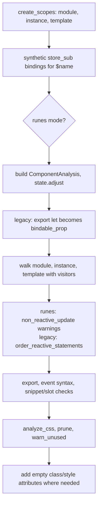

## Overview

Phase 2 sits between the parser and code generation. `analyze_component` takes the AST from the [[Template Parser]] and returns a `ComponentAnalysis`: the scopes, whether the component is in runes mode, its props and exports, the store subscriptions, the legacy `$:` statements in run order, and per-node `metadata` that tells the transform what is static and what needs an effect. Along the way it raises most compile errors and warnings about how runes, bindings and template nodes are used. `analyze_module` does the same, with fewer steps, for `.svelte.js` modules.

Sources: [packages/svelte/src/compiler/phases/2-analyze/index.js:315-335](repo://packages/svelte/src/compiler/phases/2-analyze/index.js#L315-L335), [packages/svelte/src/compiler/phases/2-analyze/index.js:463-535](repo://packages/svelte/src/compiler/phases/2-analyze/index.js#L463-L535)

Scopes and the binding model come from [[Scopes and Bindings]]; the element checks run here but are described in [[Accessibility Checks]]; the CSS steps at the end are in [[Scoped CSS]].

Sources: [packages/svelte/src/compiler/phases/2-analyze/index.js:847-866](repo://packages/svelte/src/compiler/phases/2-analyze/index.js#L847-L866), [packages/svelte/src/compiler/phases/2-analyze/visitors/RegularElement.js:12-25](repo://packages/svelte/src/compiler/phases/2-analyze/visitors/RegularElement.js#L12-L25)

## analyze_component step by step

Sources: [packages/svelte/src/compiler/phases/2-analyze/index.js:321-335](repo://packages/svelte/src/compiler/phases/2-analyze/index.js#L321-L335), [packages/svelte/src/compiler/phases/2-analyze/index.js:537-545](repo://packages/svelte/src/compiler/phases/2-analyze/index.js#L537-L545), [packages/svelte/src/compiler/phases/2-analyze/index.js:685-703](repo://packages/svelte/src/compiler/phases/2-analyze/index.js#L685-L703), [packages/svelte/src/compiler/phases/2-analyze/index.js:847-911](repo://packages/svelte/src/compiler/phases/2-analyze/index.js#L847-L911)

1. Three calls to `create_scopes` share one `ScopeRoot`, with the template scope inside the instance scope inside the module scope.
2. Every unresolved `$name` reference is a candidate store subscription. Unless the name is a rune used as a rune, the analyzer declares a synthetic `store_sub` binding for it in the instance scope and moves the references there. It rejects `$$name` globals, subscriptions inside the module script, and subscriptions to stores declared in a nested scope.
3. Runes mode is decided (next section), the `ComponentAnalysis` object is created and `state.adjust` records the component name, `dev` and `runes`.
4. In legacy mode, every `export let` or `export var` becomes a `bindable_prop` (with a `prop_alias` for `export { x as y }`), and other exports go to `analysis.exports`. Variables that are reassigned and read in the template or in `$:` become `state`.
5. The visitors walk the module, instance and template ASTs.
6. Cross-cutting checks and CSS analysis run on the collected data.

Sources: [packages/svelte/src/compiler/phases/2-analyze/index.js:321-436](repo://packages/svelte/src/compiler/phases/2-analyze/index.js#L321-L436), [packages/svelte/src/compiler/phases/2-analyze/index.js:537-617](repo://packages/svelte/src/compiler/phases/2-analyze/index.js#L537-L617)

## Runes mode or legacy mode

A component is in runes mode when the `runes` option (from the caller or `<svelte:options runes>`) says so. When the option is unset, the analyzer infers it: the component is in runes mode if any reference that bubbled up to the module scope is a rune name, or if either script or the template has an `await` outside a function.

Sources: [packages/svelte/src/compiler/phases/2-analyze/index.js:440-442](repo://packages/svelte/src/compiler/phases/2-analyze/index.js#L440-L442)

The decision changes a lot downstream. `immutable` is always true in runes mode. `accessors` is forced on for custom elements and for `compatibility.componentApi: 4`. `inject_styles` is set for `css: 'injected'` and for custom elements. A legacy component also gets `maybe_runes`: when it uses no `$$props`, `$$restProps`, `$:` or `export let`, it may be a component that only uses runes through imported modules, and the transforms fall back to runes behaviour where that matters.

Sources: [packages/svelte/src/compiler/phases/2-analyze/index.js:455-528](repo://packages/svelte/src/compiler/phases/2-analyze/index.js#L455-L528)

In runes mode, `$$props` and `$$restProps` are errors (`legacy_props_invalid`, `legacy_rest_props_invalid`). In legacy mode, they are declared as synthetic `rest_prop` bindings so code can read them.

Sources: [packages/svelte/src/compiler/phases/2-analyze/index.js:674-686](repo://packages/svelte/src/compiler/phases/2-analyze/index.js#L674-L686), [packages/svelte/src/compiler/phases/2-analyze/index.js:746-749](repo://packages/svelte/src/compiler/phases/2-analyze/index.js#L746-L749)

## The visitor walk

### Visitors and shared state

The analyzer has one visitor per node type it cares about, from `ArrowFunctionExpression` to `VariableDeclarator`, each in its own file under `visitors/`. They share an `AnalysisState` with the current scope, the analysis, the options, which AST is being walked (`ast_type`), the current `expression` metadata, the nearest `parent_element`, the enclosing `reactive_statement`, and the `function_depth`.

Sources: [packages/svelte/src/compiler/phases/2-analyze/index.js:86-199](repo://packages/svelte/src/compiler/phases/2-analyze/index.js#L86-L199), [packages/svelte/src/compiler/phases/2-analyze/index.js:685-703](repo://packages/svelte/src/compiler/phases/2-analyze/index.js#L685-L703)

The catch-all `_` visitor runs on every node. It collects `svelte-ignore` codes from HTML comments just before a template node, or from the leading JavaScript comments of a script node, pushes them on the ignore stack for the node's subtree, and stores a snapshot of the stack in `ignore_map` for warnings emitted later in the transform. It also swaps in the node's scope, like `set_scope` ([[Errors and Warnings]] covers the ignore format).

Sources: [packages/svelte/src/compiler/phases/2-analyze/index.js:87-139](repo://packages/svelte/src/compiler/phases/2-analyze/index.js#L87-L139)

### Rune validation

`CallExpression` checks every rune call against its allowed placement and arity:

Sources: [packages/svelte/src/compiler/phases/2-analyze/visitors/CallExpression.js:15-30](repo://packages/svelte/src/compiler/phases/2-analyze/visitors/CallExpression.js#L15-L30)

| Rune | Rule |
| --- | --- |
| `$props()` | Once, in a top-level `VariableDeclarator` of the instance script, no arguments |
| `$props.id()` | Once, assigned to an identifier at the top of the instance script |
| `$bindable()` | Only as a default value inside the `$props()` destructuring pattern |
| `$state`, `$state.raw` | A variable declaration, a class field, or a `this.x =` assignment at the root of a constructor; at most one argument |
| `$derived`, `$derived.by` | Same places; exactly one argument |
| `$effect`, `$effect.pre` | As an expression statement; exactly one argument |
| `$host()` | Only in a custom element's instance script |
| `$inspect.trace()` | First statement of a function body; not in a generator |

Sources: [packages/svelte/src/compiler/phases/2-analyze/visitors/CallExpression.js:29-140](repo://packages/svelte/src/compiler/phases/2-analyze/visitors/CallExpression.js#L29-L140), [packages/svelte/src/compiler/phases/2-analyze/visitors/CallExpression.js:188-230](repo://packages/svelte/src/compiler/phases/2-analyze/visitors/CallExpression.js#L188-L230)

The `Identifier` visitor catches runes used wrongly as values: `$state` without a call is `rune_missing_parentheses`, a misspelt member such as `$state.foo` is `rune_invalid_name`, and renamed runes such as `$state.frozen` get an error naming the replacement. In runes mode it also warns with `state_referenced_locally` when a `state`, `raw_state` or `derived` binding is read at the same function depth it was declared, because such a read captures the value once instead of tracking it.

Sources: [packages/svelte/src/compiler/phases/2-analyze/visitors/Identifier.js:39-77](repo://packages/svelte/src/compiler/phases/2-analyze/visitors/Identifier.js#L39-L77), [packages/svelte/src/compiler/phases/2-analyze/visitors/Identifier.js:104-150](repo://packages/svelte/src/compiler/phases/2-analyze/visitors/Identifier.js#L104-L150)

Assignments go through `validate_assignment`, which forbids writing to constants, to `{#each}` items in runes mode, to snippet parameters, to the `$props.id()` value, and to a class state field before its declaration in the constructor. `ClassBody` records the `$state` and `$derived` fields of each class in `analysis.classes`, which the transforms use to generate private signal fields with getters and setters.

Sources: [packages/svelte/src/compiler/phases/2-analyze/visitors/shared/utils.js:18-73](repo://packages/svelte/src/compiler/phases/2-analyze/visitors/shared/utils.js#L18-L73), [packages/svelte/src/compiler/phases/2-analyze/visitors/ClassBody.js:15-60](repo://packages/svelte/src/compiler/phases/2-analyze/visitors/ClassBody.js#L15-L60)

### Expression metadata

Every template expression owns an `ExpressionMetadata` record. Visitors such as `ExpressionTag` set it as `state.expression` before walking into the expression, and the visitors below fill it. `Identifier` adds each binding it meets to `dependencies` and `references`, and sets `has_state` unless the binding is `static`, a function that never changes, or an expression `scope.evaluate` can resolve to one value. `CallExpression` sets `has_call` and `has_state` unless the callee is pure (a global or a member of one) and has no dependencies. The client transform reads these flags to choose between inlining a value, wrapping it in a template effect, or memoising a call in a derived.

Sources: [packages/svelte/src/compiler/phases/2-analyze/visitors/ExpressionTag.js:11-26](repo://packages/svelte/src/compiler/phases/2-analyze/visitors/ExpressionTag.js#L11-L26), [packages/svelte/src/compiler/phases/2-analyze/visitors/Identifier.js:91-102](repo://packages/svelte/src/compiler/phases/2-analyze/visitors/Identifier.js#L91-L102), [packages/svelte/src/compiler/phases/2-analyze/visitors/CallExpression.js:256-266](repo://packages/svelte/src/compiler/phases/2-analyze/visitors/CallExpression.js#L256-L266), [packages/svelte/src/compiler/phases/2-analyze/visitors/shared/utils.js:199-245](repo://packages/svelte/src/compiler/phases/2-analyze/visitors/shared/utils.js#L199-L245)

`ExpressionTag` also calls `mark_subtree_dynamic`, which sets `metadata.dynamic` on every enclosing `Fragment`. Fragments left non-dynamic contain only static markup, and the transform can skip walking them at runtime.

Sources: [packages/svelte/src/compiler/phases/2-analyze/visitors/shared/fragment.js:1-15](repo://packages/svelte/src/compiler/phases/2-analyze/visitors/shared/fragment.js#L1-L15)

### Element bookkeeping

`RegularElement` runs the accessibility checks, stores the element's AST path in `metadata.path`, pushes it to `analysis.elements` for CSS pruning, and records whether it has a spread and whether it is SVG or MathML. `ExpressionTag` and other visitors use `is_tag_valid_with_parent` to reject markup the HTML parser would restructure, such as text directly inside a `<tr>`.

Sources: [packages/svelte/src/compiler/phases/2-analyze/visitors/RegularElement.js:12-25](repo://packages/svelte/src/compiler/phases/2-analyze/visitors/RegularElement.js#L12-L25), [packages/svelte/src/compiler/phases/2-analyze/visitors/RegularElement.js:85-110](repo://packages/svelte/src/compiler/phases/2-analyze/visitors/RegularElement.js#L85-L110), [packages/svelte/src/compiler/phases/2-analyze/visitors/ExpressionTag.js:12-19](repo://packages/svelte/src/compiler/phases/2-analyze/visitors/ExpressionTag.js#L12-L19)

## Legacy reactive statements

In legacy mode, a top-level `$:` statement in the instance script is a reactive statement; elsewhere it is a plain label and gets the `reactive_declaration_invalid_placement` warning. In runes mode it is the `legacy_reactive_statement_invalid` error. The `LabeledStatement` visitor collects the statement's dependencies: every binding referenced inside, except those only written by a plain `=` assignment. Names it assigns are its `assignments`.

Sources: [packages/svelte/src/compiler/phases/2-analyze/visitors/LabeledStatement.js:12-95](repo://packages/svelte/src/compiler/phases/2-analyze/visitors/LabeledStatement.js#L12-L95)

After the walk, `order_reactive_statements` sorts them topologically. It builds an edge from each assigned name to each dependency the statement does not itself assign, raises `reactive_declaration_cycle` if `check_graph_for_cycles` finds a loop (naming the cycle as `a → b → a`), and then inserts statements depth-first so that every statement comes after the statements that assign its dependencies, keeping source order otherwise.

Sources: [packages/svelte/src/compiler/phases/2-analyze/index.js:916-979](repo://packages/svelte/src/compiler/phases/2-analyze/index.js#L916-L979), [packages/svelte/src/compiler/phases/2-analyze/utils/check_graph_for_cycles.js:1-47](repo://packages/svelte/src/compiler/phases/2-analyze/utils/check_graph_for_cycles.js#L1-L47)

## Checks after the walk

Some rules need the whole component:

Sources: [packages/svelte/src/compiler/phases/2-analyze/index.js:704-712](repo://packages/svelte/src/compiler/phases/2-analyze/index.js#L704-L712)

- Runes mode warns with `non_reactive_update` for a plain `let` that is reassigned and read in the template outside a function, since the template will not update. A `bind:this` target is exempt unless it sits inside a block that can re-render.
- Legacy mode warns with `export_let_unused` for props nobody reads.
- `export { x }` in the module script must name a module-level binding; exporting a snippet that is not top-level is `snippet_invalid_export`.
- Mixing `on:click` directives and `onclick` attributes in one component is `mixed_event_handler_syntaxes`.
- Using `{@render}` together with `<slot>` or `$$slots` is `slot_snippet_conflict`.
- `<svelte:options>` attributes `accessors` and `immutable` are deprecated in runes mode, and `customElement` without the `customElement` compile option warns.

Sources: [packages/svelte/src/compiler/phases/2-analyze/index.js:658-745](repo://packages/svelte/src/compiler/phases/2-analyze/index.js#L658-L745), [packages/svelte/src/compiler/phases/2-analyze/index.js:772-845](repo://packages/svelte/src/compiler/phases/2-analyze/index.js#L772-L845)

Finally, after CSS pruning has marked scoped elements, every element that is scoped or has a `class:` directive but no `class` attribute gets an empty one, and every element with a `style:` directive but no `style` attribute gets an empty one. That lets the transform always emit a single `set_class` or `set_style` call that merges the hash and directives. Scoped custom elements are marked dynamic so their class is set at runtime.

Sources: [packages/svelte/src/compiler/phases/2-analyze/index.js:868-911](repo://packages/svelte/src/compiler/phases/2-analyze/index.js#L868-L911)

## Module analysis

`analyze_module` parses the source with acorn, builds one scope, and rejects `$store` references to local bindings (`store_invalid_subscription_module`), because modules cannot auto-subscribe. The result is always in runes mode and immutable, and the same visitors walk the program with a module `ast_type`.

Sources: [packages/svelte/src/compiler/phases/2-analyze/index.js:249-312](repo://packages/svelte/src/compiler/phases/2-analyze/index.js#L249-L312)

## Naming the component

The component's function name comes from the `name` option, or from the file name: `Button.svelte` becomes `Button`, and `index.svelte` takes the name of its folder unless the folder is `src`. The first letter is upper-cased and the name goes through `scope.generate` so it cannot collide with a local.

Sources: [packages/svelte/src/compiler/phases/2-analyze/index.js:228-240](repo://packages/svelte/src/compiler/phases/2-analyze/index.js#L228-L240), [packages/svelte/src/compiler/phases/2-analyze/index.js:458-459](repo://packages/svelte/src/compiler/phases/2-analyze/index.js#L458-L459)
