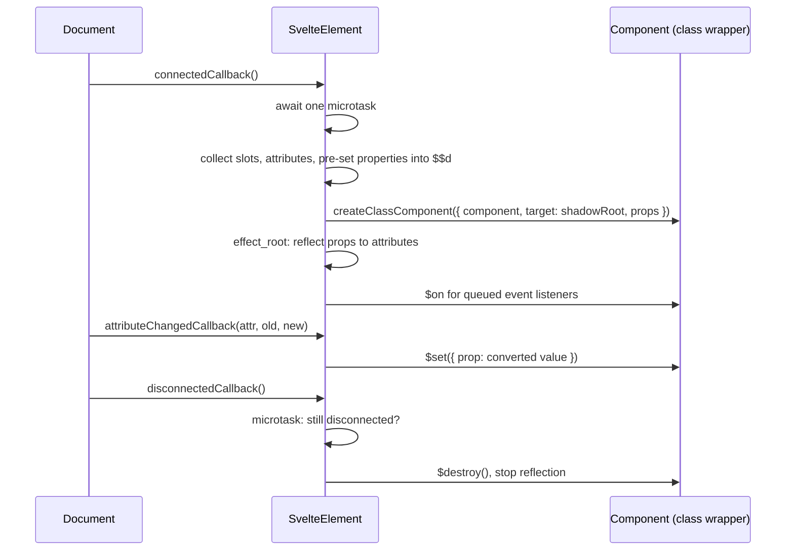

## Overview

A component compiled with the `customElement` option (or `<svelte:options customElement="my-tag">`) is still an ordinary Svelte component function, but the module also builds a class extending `HTMLElement` around it and, when a tag name is given, registers it with `customElements.define`. The element creates the Svelte component when it is connected to the document, forwards attributes and properties into its props, reflects selected props back to attributes, and destroys the component when it is removed. The class lives in `internal/client/dom/elements/custom-element.js`.

Sources: [packages/svelte/src/internal/client/dom/elements/custom-element.js:13-50](repo://packages/svelte/src/internal/client/dom/elements/custom-element.js#L13-L50), [packages/svelte/src/compiler/phases/3-transform/client/transform-client.js:621-691](repo://packages/svelte/src/compiler/phases/3-transform/client/transform-client.js#L621-L691)

The other direction, a Svelte component rendering someone else's custom element, is handled when setting attributes: `set_custom_element_data` decides between properties and attributes ([[Elements, Attributes and Events]]).

Sources: [packages/svelte/src/compiler/phases/3-transform/client/visitors/RegularElement.js:613-624](repo://packages/svelte/src/compiler/phases/3-transform/client/visitors/RegularElement.js#L613-L624)

## What the compiler emits

After the component function, `client_component` appends a call to `$.create_custom_element(Component, props, slots, exports, use_shadow_dom, extend)`:

Sources: [packages/svelte/src/compiler/phases/3-transform/client/transform-client.js:621-675](repo://packages/svelte/src/compiler/phases/3-transform/client/transform-client.js#L621-L675)

| Argument | Built from |
| --- | --- |
| `props` | The `customElement.props` option (per prop: `attribute`, `reflect`, `type`), plus an empty entry for every other prop the component declares. A prop whose default is a boolean literal gets `type: 'Boolean'` automatically. |
| `slots` | The names of `<slot>` elements the component renders |
| `exports` | The component's non-prop exports |
| `use_shadow_dom` | `true` unless `shadow: 'none'` |
| `extend` | The `customElement.extend` function, which can wrap the generated class |

Sources: [packages/svelte/src/compiler/phases/3-transform/client/transform-client.js:623-675](repo://packages/svelte/src/compiler/phases/3-transform/client/transform-client.js#L623-L675), [packages/svelte/src/compiler/phases/1-parse/read/options.js:39-150](repo://packages/svelte/src/compiler/phases/1-parse/read/options.js#L39-L150)

With a tag name the result is passed to `customElements.define`; under HMR the define is guarded by `customElements.get(tag) == null` because a tag can only be defined once. Without a tag name the class is only created and stored on `Component.element` for the user to define.

Sources: [packages/svelte/src/compiler/phases/3-transform/client/transform-client.js:677-690](repo://packages/svelte/src/compiler/phases/3-transform/client/transform-client.js#L677-L690), [packages/svelte/src/internal/client/dom/elements/custom-element.js:334-338](repo://packages/svelte/src/internal/client/dom/elements/custom-element.js#L334-L338)

Analysis also changes for custom elements: `accessors` is forced on, so the component instance exposes getters and setters for its props, and `inject_styles` is forced on, so the component's CSS is injected at runtime into the shadow root rather than emitted as a separate file ([[Component Analysis]], [[Scoped CSS]]).

Sources: [packages/svelte/src/compiler/phases/2-analyze/index.js:455-503](repo://packages/svelte/src/compiler/phases/2-analyze/index.js#L455-L503), [packages/svelte/src/internal/client/dom/css.js:9-32](repo://packages/svelte/src/internal/client/dom/css.js#L9-L32)

## The generated class

`create_custom_element` subclasses `SvelteElement`. The subclass constructor calls `super(Component, slots, use_shadow_dom)` (which attaches an open shadow root when requested) and stores the prop definitions in `$$p_d`. `observedAttributes` lists every prop's attribute name, lower-cased. For each prop a property accessor is defined on the prototype: the getter reads from the component instance when it exists and from the pending data `$$d` otherwise; the setter converts the value, stores it in `$$d`, and forwards it to the component through its accessor or `$set`. Non-prop exports get read-only getters.

Sources: [packages/svelte/src/internal/client/dom/elements/custom-element.js:288-338](repo://packages/svelte/src/internal/client/dom/elements/custom-element.js#L288-L338), [packages/svelte/src/internal/client/dom/elements/custom-element.js:43-51](repo://packages/svelte/src/internal/client/dom/elements/custom-element.js#L43-L51)

`SvelteElement` is only defined when `HTMLElement` exists, so the module can be imported on the server without failing.

Sources: [packages/svelte/src/internal/client/dom/elements/custom-element.js:13-17](repo://packages/svelte/src/internal/client/dom/elements/custom-element.js#L13-L17)

## Lifecycle

### Sequence

Sources: [packages/svelte/src/internal/client/dom/elements/custom-element.js:87-206](repo://packages/svelte/src/internal/client/dom/elements/custom-element.js#L87-L206)

### Connecting

`connectedCallback` waits one microtask so that child elements meant for slots exist, then builds the props:

Sources: [packages/svelte/src/internal/client/dom/elements/custom-element.js:87-135](repo://packages/svelte/src/internal/client/dom/elements/custom-element.js#L87-L135), [packages/svelte/src/internal/client/dom/elements/custom-element.js:208-218](repo://packages/svelte/src/internal/client/dom/elements/custom-element.js#L208-L218), [packages/svelte/src/internal/client/dom/elements/custom-element.js:268-277](repo://packages/svelte/src/internal/client/dom/elements/custom-element.js#L268-L277)

1. For each slot name the component uses, if the light DOM has content for that slot, a slot function is created that renders a native `<slot>` element (named, except for the default slot, which becomes `children`).
2. Every attribute is converted to its prop (`$$g_p` maps attribute names back to prop names) unless the prop was already set as a property.
3. Properties assigned before the element upgraded, which shadow the prototype accessors, are moved into `$$d` and deleted from the instance.

Sources: [packages/svelte/src/internal/client/dom/elements/custom-element.js:87-135](repo://packages/svelte/src/internal/client/dom/elements/custom-element.js#L87-L135), [packages/svelte/src/internal/client/dom/elements/custom-element.js:208-218](repo://packages/svelte/src/internal/client/dom/elements/custom-element.js#L208-L218), [packages/svelte/src/internal/client/dom/elements/custom-element.js:268-277](repo://packages/svelte/src/internal/client/dom/elements/custom-element.js#L268-L277)

The component is then created with `createClassComponent`, the Svelte 4-style wrapper from `svelte/legacy` ([[Legacy Component API]]), targeting the shadow root (or the element itself without shadow DOM), with `$$slots` and `$$host: this` added to the props. `$host()` in the component compiles to `$$props.$$host`, which is how a custom element component reaches its own element, for example to dispatch events.

Sources: [packages/svelte/src/internal/client/dom/elements/custom-element.js:136-144](repo://packages/svelte/src/internal/client/dom/elements/custom-element.js#L136-L144), [packages/svelte/src/compiler/phases/3-transform/client/visitors/CallExpression.js:14-19](repo://packages/svelte/src/compiler/phases/3-transform/client/visitors/CallExpression.js#L14-L19)

### Reflection and attributes

A render effect inside an `effect_root` reflects props marked `reflect: true`: whenever one changes inside the component, it is converted with `toAttribute` and written with `setAttribute` (or removed when `null`). `$$r` is set during reflection so that the resulting `attributeChangedCallback` does not feed the value back. Otherwise, `attributeChangedCallback` converts the new attribute value and calls `$set`.

Sources: [packages/svelte/src/internal/client/dom/elements/custom-element.js:146-167](repo://packages/svelte/src/internal/client/dom/elements/custom-element.js#L146-L167), [packages/svelte/src/internal/client/dom/elements/custom-element.js:178-190](repo://packages/svelte/src/internal/client/dom/elements/custom-element.js#L178-L190)

`get_custom_element_value` converts according to the prop's `type`:

Sources: [packages/svelte/src/internal/client/dom/elements/custom-element.js:221-262](repo://packages/svelte/src/internal/client/dom/elements/custom-element.js#L221-L262)

| Type | Attribute to prop | Prop to attribute |
| --- | --- | --- |
| `Boolean` | Present means `true` | `true` gives `''`, `false` removes the attribute |
| `Number` | `+value` | The number |
| `Object`, `Array` | `JSON.parse` | `JSON.stringify` |
| `String` or none | Unchanged | Unchanged |

Sources: [packages/svelte/src/internal/client/dom/elements/custom-element.js:221-262](repo://packages/svelte/src/internal/client/dom/elements/custom-element.js#L221-L262)

### Events and disconnecting

`addEventListener` is overridden: listeners are added to the element as usual and also subscribed through the component's `$on`, so events dispatched with `createEventDispatcher` reach them; listeners added before the component exists are queued and subscribed after creation. `removeEventListener` undoes both.

Sources: [packages/svelte/src/internal/client/dom/elements/custom-element.js:53-85](repo://packages/svelte/src/internal/client/dom/elements/custom-element.js#L53-L85), [packages/svelte/src/internal/client/dom/elements/custom-element.js:169-175](repo://packages/svelte/src/internal/client/dom/elements/custom-element.js#L169-L175)

`disconnectedCallback` waits a microtask before destroying the component, because removing and re-inserting an element (moving it) fires disconnect and connect in sequence; only an element that is still disconnected after the microtask is destroyed.

Sources: [packages/svelte/src/internal/client/dom/elements/custom-element.js:192-203](repo://packages/svelte/src/internal/client/dom/elements/custom-element.js#L192-L203)
