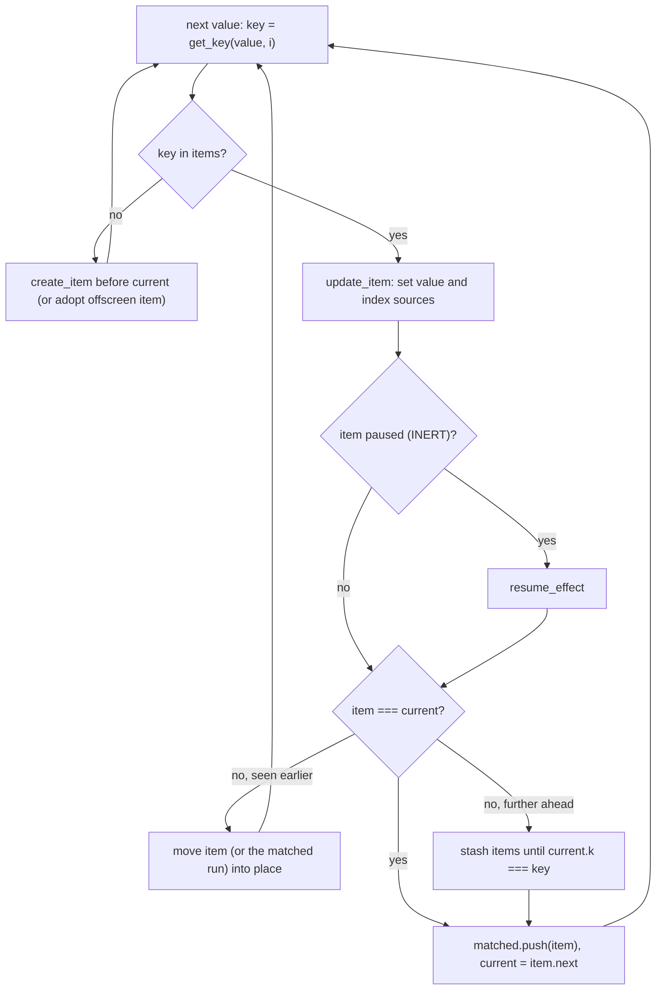

## Overview

`{#each items as item (key)}` is the most involved block in the runtime. Like the other blocks in [[Control Flow Blocks]] it is a block effect that owns branch effects, but it keeps one branch per item, in a doubly linked list that mirrors the DOM order, and on every change it reconciles the old list against the new array: it reuses items with the same key, updates their values, moves them into the new order with as few DOM moves as it can, creates the new ones and pauses the removed ones so outro transitions and `animate:` can play. The runtime is `each()` in `dom/blocks/each.js`; the compiler side is the client `EachBlock` visitor.

Sources: [packages/svelte/src/internal/client/dom/blocks/each.js:109-190](repo://packages/svelte/src/internal/client/dom/blocks/each.js#L109-L190), [packages/svelte/src/internal/client/dom/blocks/each.js:191-300](repo://packages/svelte/src/internal/client/dom/blocks/each.js#L191-L300), [packages/svelte/src/compiler/phases/3-transform/client/visitors/EachBlock.js:298-345](repo://packages/svelte/src/compiler/phases/3-transform/client/visitors/EachBlock.js#L298-L345)

## What the compiler emits

### The each call

The visitor compiles the block into a single call, `$.each(node, flags, get_collection, get_key, render_fn, fallback_fn?)`. For an unkeyed block over a literal array, the snapshot output is:

Sources: [packages/svelte/tests/snapshot/samples/each-string-template/index.svelte:1-3](repo://packages/svelte/tests/snapshot/samples/each-string-template/index.svelte#L1-L3)

```js
$.each(node, 0, () => ['foo', 'bar', 'baz'], $.index, ($$anchor, thing) => {
	$.next();

	var text = $.text();

	$.template_effect(() => $.set_text(text, `${thing ?? ''}, `));
	$.append($$anchor, text);
});
```

Sources: [packages/svelte/tests/snapshot/samples/each-string-template/_expected/client/index.svelte.js:5-18](repo://packages/svelte/tests/snapshot/samples/each-string-template/_expected/client/index.svelte.js#L5-L18)

Without a key the key function is `$.index`, which returns the position, so items are matched by index. With `(key)` it is an arrow function from the item (and the index, if the key uses it) to the key expression. In dev, keyed blocks are preceded by `$.validate_each_keys`, a render effect that reports duplicate keys.

Sources: [packages/svelte/src/internal/client/validate.js:14-29](repo://packages/svelte/src/internal/client/validate.js#L14-L29), [packages/svelte/src/compiler/phases/3-transform/client/visitors/EachBlock.js:298-307](repo://packages/svelte/src/compiler/phases/3-transform/client/visitors/EachBlock.js#L298-L307), [packages/svelte/src/compiler/phases/3-transform/client/visitors/EachBlock.js:339-342](repo://packages/svelte/src/compiler/phases/3-transform/client/visitors/EachBlock.js#L339-L342), [packages/svelte/src/internal/client/dom/blocks/each.js:58-65](repo://packages/svelte/src/internal/client/dom/blocks/each.js#L58-L65)

### Flags

The flags tell the runtime how much reactivity each item needs:

Sources: [packages/svelte/src/compiler/phases/3-transform/client/visitors/EachBlock.js:41-101](repo://packages/svelte/src/compiler/phases/3-transform/client/visitors/EachBlock.js#L41-L101), [packages/svelte/src/constants.js:1-6](repo://packages/svelte/src/constants.js#L1-L6)

| Flag | Set when | Effect |
| --- | --- | --- |
| `EACH_ITEM_REACTIVE` | The collection depends on outside state, and the block is not a runes-mode block keyed by the item itself (or it uses a store) | The item value is a source; the render function reads it with `$.get(item)` |
| `EACH_INDEX_REACTIVE` | The block is keyed and declares an index | The index is a source, since keyed items can change position |
| `EACH_ITEM_IMMUTABLE` | Runes mode without stores | Item sources use `===` instead of `safe_equals` |
| `EACH_IS_ANIMATED` | Keyed, and a direct child element has `animate:` | Measure positions around reconciliation |
| `EACH_IS_CONTROLLED` | The block is the only child of an element | The parent element is the container, enabling a fast clear |

Sources: [packages/svelte/src/compiler/phases/3-transform/client/visitors/EachBlock.js:41-101](repo://packages/svelte/src/compiler/phases/3-transform/client/visitors/EachBlock.js#L41-L101), [packages/svelte/src/constants.js:1-6](repo://packages/svelte/src/constants.js#L1-L6)

In the snapshot above none apply: the array is a literal, so `thing` is passed as a plain value and the template effect closes over it.

Sources: [packages/svelte/tests/snapshot/samples/each-string-template/_expected/client/index.svelte.js:5-12](repo://packages/svelte/tests/snapshot/samples/each-string-template/_expected/client/index.svelte.js#L5-L12)

## Block state

`each()` keeps an `EachState` with `items`, a `Map` from key to item, and `first`, the head of the linked list. Each item records its index `i` and value `v` (sources or plain values, depending on the flags), its key `k`, its animation manager `a`, its branch effect `e`, and `prev`/`next` links. The links are mirrored on the branch effects themselves, so the effect tree's child order matches the DOM order.

Sources: [packages/svelte/src/internal/client/dom/blocks/each.js:119-123](repo://packages/svelte/src/internal/client/dom/blocks/each.js#L119-L123), [packages/svelte/src/internal/client/dom/blocks/each.js:606-700](repo://packages/svelte/src/internal/client/dom/blocks/each.js#L606-L700)

The collection is read through `derived_safe_equal`, which accepts arrays, `null`/`undefined` (as an empty list) and other iterables (through `Array.from`). Safe equality is used even in runes mode, so that a store mutated in place still triggers an update.

Sources: [packages/svelte/src/internal/client/dom/blocks/each.js:147-155](repo://packages/svelte/src/internal/client/dom/blocks/each.js#L147-L155)

When the block is controlled, the anchor is a text node appended to the parent element instead of a comment, which saves a node per block.

Sources: [packages/svelte/src/internal/client/dom/blocks/each.js:125-133](repo://packages/svelte/src/internal/client/dom/blocks/each.js#L125-L133), [packages/svelte/src/compiler/phases/3-transform/client/visitors/shared/fragment.js:100-104](repo://packages/svelte/src/compiler/phases/3-transform/client/visitors/shared/fragment.js#L100-L104)

## Each run

The block effect reads the array and skips work when it was empty and still is. During hydration it creates items directly on top of the server nodes (and handles a server that rendered fewer or more items). Otherwise it reconciles, either at once or, in async mode, by preparing new items offscreen and deferring the DOM changes to the batch commit (the same deferral as other blocks). After reconciling, the `{:else}` fallback branch is resumed or created when the array is empty and paused when it is not.

Sources: [packages/svelte/src/internal/client/dom/blocks/each.js:191-300](repo://packages/svelte/src/internal/client/dom/blocks/each.js#L191-L300), [packages/svelte/src/internal/client/dom/blocks/each.js:300-350](repo://packages/svelte/src/internal/client/dom/blocks/each.js#L300-L350), [packages/svelte/src/internal/client/dom/blocks/each.js:163-189](repo://packages/svelte/src/internal/client/dom/blocks/each.js#L163-L189)

`create_item` makes the value and index sources as the flags require, then creates the branch with `render_fn(anchor, v, i, get_collection)` and splices the item into the list. While it runs, `current_each_item` points at the item so that an `animate:` directive inside can attach itself to it ([[Transitions and Animations]]).

Sources: [packages/svelte/src/internal/client/dom/blocks/each.js:621-700](repo://packages/svelte/src/internal/client/dom/blocks/each.js#L621-L700), [packages/svelte/src/internal/client/dom/blocks/each.js:40-56](repo://packages/svelte/src/internal/client/dom/blocks/each.js#L40-L56)

## Reconciliation

### The walk

`reconcile` walks the new array once, keeping a cursor `current` into the old list and `prev`, the last item placed.

Sources: [packages/svelte/src/internal/client/dom/blocks/each.js:352-396](repo://packages/svelte/src/internal/client/dom/blocks/each.js#L352-L396)



Sources: [packages/svelte/src/internal/client/dom/blocks/each.js:410-470](repo://packages/svelte/src/internal/client/dom/blocks/each.js#L410-L470), [packages/svelte/src/internal/client/dom/blocks/each.js:470-536](repo://packages/svelte/src/internal/client/dom/blocks/each.js#L470-L536)

For each value:

Sources: [packages/svelte/src/internal/client/dom/blocks/each.js:410-470](repo://packages/svelte/src/internal/client/dom/blocks/each.js#L410-L470), [packages/svelte/src/internal/client/dom/blocks/each.js:470-536](repo://packages/svelte/src/internal/client/dom/blocks/each.js#L470-L536), [packages/svelte/src/internal/client/dom/blocks/each.js:595-604](repo://packages/svelte/src/internal/client/dom/blocks/each.js#L595-L604)

1. **New key.** If an item was prepared offscreen for it (async mode), that item is linked in and its nodes moved before `current`; otherwise `create_item` renders it before `current`'s first node.
2. **Known key.** The item's sources are updated (`update_item` sets the value and the index), and a paused item is resumed, cancelling its outro.
3. **Already in place** (`item === current`): it is added to the `matched` run and the cursor advances.
4. **Further ahead in the old list.** Items from `current` up to the wanted key are added to `seen` and `stashed`; they may be needed later or may have been removed.
5. **Behind the cursor** (in `seen`). Something must move. If the run of items matched since the last jump is shorter than the stashed run, the matched items are moved after the stashed ones; otherwise this one item is moved before `current`. Moving the shorter side keeps DOM operations low for common changes such as moving one item or swapping two.

Sources: [packages/svelte/src/internal/client/dom/blocks/each.js:410-470](repo://packages/svelte/src/internal/client/dom/blocks/each.js#L410-L470), [packages/svelte/src/internal/client/dom/blocks/each.js:470-536](repo://packages/svelte/src/internal/client/dom/blocks/each.js#L470-L536), [packages/svelte/src/internal/client/dom/blocks/each.js:595-604](repo://packages/svelte/src/internal/client/dom/blocks/each.js#L595-L604)

`move(item, next, anchor)` moves an item's DOM nodes, from its branch's `nodes_start` up to the next item's start, before the destination; `link` updates both the item list and the effect siblings.

Sources: [packages/svelte/src/internal/client/dom/blocks/each.js:697-732](repo://packages/svelte/src/internal/client/dom/blocks/each.js#L697-L732)

### Removing items

Whatever remains after the walk (stashed items never claimed, plus everything from `current` to the end) is removed with `pause_effects`. Items that are already inert are skipped, since they are outroing from a previous update. `pause_effects` pauses all items together, collecting their transitions, and destroys them once every outro finishes. When the block is controlled, the array became empty and no transitions are involved, it takes a fast path: it clears the parent element with one `textContent` assignment and re-appends the anchor, instead of removing items one by one.

Sources: [packages/svelte/src/internal/client/dom/blocks/each.js:538-575](repo://packages/svelte/src/internal/client/dom/blocks/each.js#L538-L575), [packages/svelte/src/internal/client/dom/blocks/each.js:66-107](repo://packages/svelte/src/internal/client/dom/blocks/each.js#L66-L107)

### Animations

With `EACH_IS_ANIMATED`, reconciliation brackets the DOM changes with measurements. Before anything moves it calls `measure()` on the animation manager of every surviving item; items being removed are measured and then `fix()`ed (taken out of the layout with absolute positioning) so they can animate out in place; and after the moves a microtask calls `apply()` on every surviving item, which runs its FLIP animation from the old position to the new one.

Sources: [packages/svelte/src/internal/client/dom/blocks/each.js:398-408](repo://packages/svelte/src/internal/client/dom/blocks/each.js#L398-L408), [packages/svelte/src/internal/client/dom/blocks/each.js:557-584](repo://packages/svelte/src/internal/client/dom/blocks/each.js#L557-L584)

Finally the block effect's `first` and `last` child pointers are set from the list, and offscreen items that were prepared but not used are destroyed.

Sources: [packages/svelte/src/internal/client/dom/blocks/each.js:577-593](repo://packages/svelte/src/internal/client/dom/blocks/each.js#L577-L593)

## Keyed versus unkeyed

| | Unkeyed (`$.index`) | Keyed |
| --- | --- | --- |
| Matching | By position | By key |
| On reorder | Item `i` keeps its DOM; its value source changes | Items' DOM moves with their data |
| Index | Plain number | Source, when declared |
| Local state in item (inputs, components) | Stays at the position | Follows the item |
| `animate:` | Not allowed | Allowed |

Sources: [packages/svelte/src/compiler/phases/3-transform/client/visitors/EachBlock.js:46-49](repo://packages/svelte/src/compiler/phases/3-transform/client/visitors/EachBlock.js#L46-L49), [packages/svelte/src/compiler/phases/3-transform/client/visitors/EachBlock.js:86-97](repo://packages/svelte/src/compiler/phases/3-transform/client/visitors/EachBlock.js#L86-L97), [packages/svelte/src/internal/client/dom/blocks/each.js:58-65](repo://packages/svelte/src/internal/client/dom/blocks/each.js#L58-L65)

Unkeyed blocks still use the same `reconcile` code; since every position's key equals its index, existing items always match in place, and only the tail is created or removed.

Sources: [packages/svelte/src/internal/client/dom/blocks/each.js:410-460](repo://packages/svelte/src/internal/client/dom/blocks/each.js#L410-L460)
