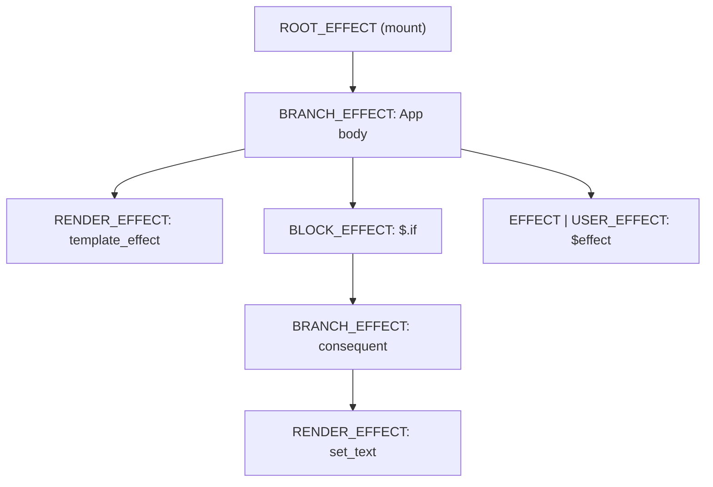
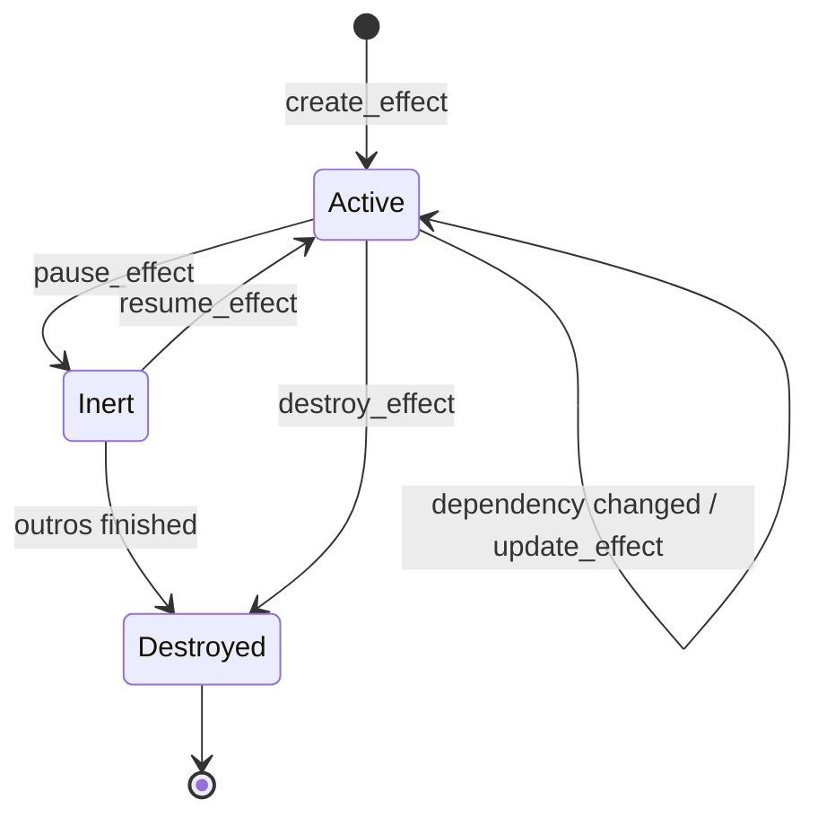

## Overview

Effects are the reactions that do things: update a text node, swap an `{#if}` branch, call a user's `$effect` callback. Every effect is created inside another one, so a mounted application is a tree of effects rooted at the effect `mount` creates. The tree is what makes cleanup automatic: destroying a branch destroys every effect below it, runs their teardowns and removes their DOM. It is also what transitions use to keep content on screen while it animates out.

Sources: [packages/svelte/src/internal/client/reactivity/effects.js:79-178](repo://packages/svelte/src/internal/client/reactivity/effects.js#L79-L178), [packages/svelte/src/internal/client/reactivity/types.d.ts:63-80](repo://packages/svelte/src/internal/client/reactivity/types.d.ts#L63-L80)

An effect is a reaction ([[Signals and Dependency Tracking]]) with extra fields: `parent`, `first`/`last`/`prev`/`next` links to its children and siblings, `nodes_start`/`nodes_end` for the DOM it owns, `teardown` (the function its last run returned), `transitions`, and `b`, the nearest boundary. When a scheduled effect runs is decided by [[Batches and Scheduling]].

Sources: [packages/svelte/src/internal/client/reactivity/effects.js:103-120](repo://packages/svelte/src/internal/client/reactivity/effects.js#L103-L120)

## Kinds of effect

### Effect types

All effects go through `create_effect(type, fn, sync, push)`. The type flags decide when it runs and how it behaves:

Sources: [packages/svelte/src/internal/client/reactivity/effects.js:79-86](repo://packages/svelte/src/internal/client/reactivity/effects.js#L79-L86)

| Function | Flags | Runs | Used for |
| --- | --- | --- | --- |
| `effect_root`, `component_root` | `ROOT_EFFECT` | Immediately | `mount`, `$effect.root` |
| `branch` | `BRANCH_EFFECT` | Immediately | A piece of template: a component body, an `{#if}` branch, an `{#each}` item |
| `block` | `BLOCK_EFFECT` | Immediately, then on change | `{#if}`, `{#each}`, `{#await}` and other blocks that decide which branches exist |
| `render_effect`, `template_effect` | `RENDER_EFFECT` | Immediately, then on change | DOM updates: text, attributes, bindings |
| `user_pre_effect` | `RENDER_EFFECT \| USER_EFFECT` | Immediately, then on change | `$effect.pre` |
| `effect`, `create_user_effect` | `EFFECT` (`\| USER_EFFECT`) | Scheduled | `$effect`, actions, transitions |
| `async_effect` | `ASYNC` | Immediately | Async deriveds and template expressions |
| `inspect_effect` | `INSPECT_EFFECT` | Immediately | `$inspect` in dev |
| `teardown` | `RENDER_EFFECT` with no function | Never | Registering a cleanup on the current effect |

Sources: [packages/svelte/src/internal/client/reactivity/effects.js:186-298](repo://packages/svelte/src/internal/client/reactivity/effects.js#L186-L298), [packages/svelte/src/internal/client/reactivity/effects.js:345-393](repo://packages/svelte/src/internal/client/reactivity/effects.js#L345-L393)

Sync effects (`sync === true`) call `update_effect` right away and get `EFFECT_RAN`; an error in that first run destroys the effect and re-throws. Others are handed to `schedule_effect`. An effect created under an `INERT` (paused) parent is inert too.

Sources: [packages/svelte/src/internal/client/reactivity/effects.js:86-135](repo://packages/svelte/src/internal/client/reactivity/effects.js#L86-L135)

### $effect timing

`user_effect` is what `$effect(fn)` compiles to. A top-level `$effect` in a component that has not finished its first render is not created yet: it is pushed onto the component context's `e` list, and `pop()` creates all of them when the component function returns. So user effects run after the component's DOM exists, and in the order they were declared. Nested `$effect` calls (inside another effect, or after mount) are created at once. `validate_effect` throws `effect_orphan` when there is no active effect or reaction, `effect_in_unowned_derived` inside an unowned derived, and `effect_in_teardown` during a teardown.

Sources: [packages/svelte/src/internal/client/reactivity/effects.js:46-62](repo://packages/svelte/src/internal/client/reactivity/effects.js#L46-L62), [packages/svelte/src/internal/client/reactivity/effects.js:194-227](repo://packages/svelte/src/internal/client/reactivity/effects.js#L194-L227), [packages/svelte/src/internal/client/context.js:167-190](repo://packages/svelte/src/internal/client/context.js#L167-L190)

`template_effect(fn, sync, async)` is the effect the compiler emits for a fragment's dynamic parts. It first resolves the memoised expressions with `flatten` (turning sync thunks into deriveds and waiting for async ones), then creates one render effect that calls `fn` with their current values.

Sources: [packages/svelte/src/internal/client/reactivity/effects.js:361-370](repo://packages/svelte/src/internal/client/reactivity/effects.js#L361-L370)

## Building the tree

With `push` set, `create_effect` appends the new effect to the parent's child list with `push_effect`. It also prunes: a sync effect that ran, read nothing, returned no teardown, owns no DOM and has at most one child will never do anything again, so its child (or nothing) is linked in its place. Effects created while a derived is computing are also stored on the derived's `effects`, to be destroyed when the derived re-runs.

Sources: [packages/svelte/src/internal/client/reactivity/effects.js:64-77](repo://packages/svelte/src/internal/client/reactivity/effects.js#L64-L77), [packages/svelte/src/internal/client/reactivity/effects.js:137-175](repo://packages/svelte/src/internal/client/reactivity/effects.js#L137-L175)

A compiled `{#if}` in a component produces a tree like this:

Sources: [packages/svelte/src/internal/client/reactivity/effects.js:372-393](repo://packages/svelte/src/internal/client/reactivity/effects.js#L372-L393)

Sources: [packages/svelte/src/internal/client/render.js:216-260](repo://packages/svelte/src/internal/client/render.js#L216-L260)

## Running an effect

`update_effect(effect)` re-runs one effect. It skips destroyed effects, marks the effect `CLEAN`, and makes it the `active_effect` so anything it creates becomes its child. Before calling the function it destroys the previous run's children (for a block effect, only the non-branch children: its branches are managed explicitly by the block) and runs the previous teardown. It then runs the function through `update_reaction`, stores a returned function as the new `teardown`, and records the current write version in `wv`.

Sources: [packages/svelte/src/internal/client/runtime.js:437-498](repo://packages/svelte/src/internal/client/runtime.js#L437-L498), [packages/svelte/src/internal/client/reactivity/effects.js:442-457](repo://packages/svelte/src/internal/client/reactivity/effects.js#L442-L457)

`execute_effect_teardown` runs a teardown with `is_destroying_effect` set and no active reaction. While that flag is set, `get` returns values from `old_values`, so a cleanup sees the state the effect last ran with rather than the new value that triggered it.

Sources: [packages/svelte/src/internal/client/reactivity/effects.js:395-409](repo://packages/svelte/src/internal/client/reactivity/effects.js#L395-L409), [packages/svelte/src/internal/client/runtime.js:631-652](repo://packages/svelte/src/internal/client/runtime.js#L631-L652)

## Destroying effects

`destroy_effect(effect, remove_dom)` tears down a subtree:

Sources: [packages/svelte/src/internal/client/reactivity/effects.js:459-466](repo://packages/svelte/src/internal/client/reactivity/effects.js#L459-L466)

1. If the effect owns DOM (`nodes_start` to `nodes_end`), `remove_effect_dom` removes those nodes; children then do not need to remove their own nodes, which are inside.
2. `destroy_effect_children` aborts each child's `AbortController` and destroys it, except child root effects, which become independent roots.
3. The effect is removed from its dependencies' `reactions`, marked `DESTROYED`, its transitions are stopped, and its teardown runs.
4. It is unlinked from its parent's child list, and its fields are nulled to release memory. `parent` is kept so errors can still propagate upwards.

Sources: [packages/svelte/src/internal/client/reactivity/effects.js:411-517](repo://packages/svelte/src/internal/client/reactivity/effects.js#L411-L517), [packages/svelte/src/internal/client/reactivity/effects.js:519-555](repo://packages/svelte/src/internal/client/reactivity/effects.js#L519-L555)

`effect_root` returns a function that destroys the root. `component_root`, used by `mount`, returns one that accepts `{ outro: true }` and in that case pauses the root first, so outro transitions play before the component is removed ([[Mounting and Hydration]]). `aborted()` reports whether the current effect was destroyed, which compiled async code checks after each `await`.

Sources: [packages/svelte/src/internal/client/reactivity/effects.js:249-289](repo://packages/svelte/src/internal/client/reactivity/effects.js#L249-L289), [packages/svelte/src/internal/client/reactivity/effects.js:662-664](repo://packages/svelte/src/internal/client/reactivity/effects.js#L662-L664)

## Pausing and resuming

A branch that is about to disappear may have outro transitions. Instead of destroying it at once, a block calls `pause_effect(branch, callback)`. `pause_children` walks the subtree and sets `INERT` on every effect, so they stop updating, and collects the transition managers that should play: all of them for the paused effect itself and through branches and transparent effects, but only `global` transitions further down (a `transition:fade|global` inside a nested `{#if}` plays, a local one does not). When every outro has called back, `run_out_transitions` destroys the effect and calls `callback`.

Sources: [packages/svelte/src/internal/client/reactivity/effects.js:548-612](repo://packages/svelte/src/internal/client/reactivity/effects.js#L548-L612)

Sources: [packages/svelte/src/internal/client/reactivity/effects.js:557-660](repo://packages/svelte/src/internal/client/reactivity/effects.js#L557-L660)

If the condition flips back before the outros finish (`{#if x}` with `x` going false then true), the block calls `resume_effect`. `resume_children` clears `INERT`, schedules any effect whose dependencies changed while it was paused (marking it `DIRTY` rather than checking with `is_dirty`, so a derived such as `foo.bar()` is not recomputed eagerly for a `foo` that may now be `undefined`), and restarts intro transitions on the same rules. [[Transitions and Animations]] covers the transition managers; [[Control Flow Blocks]] shows how blocks use these calls.

Sources: [packages/svelte/src/internal/client/reactivity/effects.js:614-660](repo://packages/svelte/src/internal/client/reactivity/effects.js#L614-L660)

## Legacy reactive statements

In legacy mode, each `$:` statement becomes `legacy_pre_effect(deps, fn)`: a render effect that reads the statement's dependencies and runs the body untracked once per update. The compiler emits `legacy_pre_effect_reset()` after the last one, a render effect that re-checks every statement in order and runs the dirty ones, which reproduces Svelte 4's topologically ordered, run-once-per-tick semantics.

Sources: [packages/svelte/src/internal/client/reactivity/effects.js:296-343](repo://packages/svelte/src/internal/client/reactivity/effects.js#L296-L343), [packages/svelte/src/compiler/phases/3-transform/client/transform-client.js:258-268](repo://packages/svelte/src/compiler/phases/3-transform/client/transform-client.js#L258-L268)
