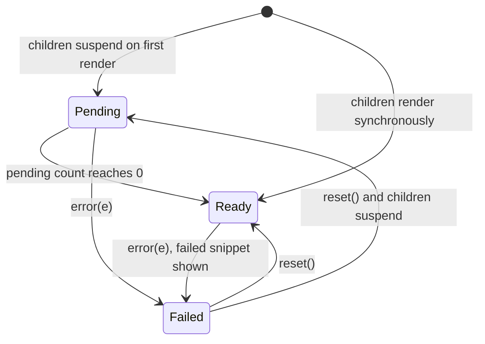

## Overview

`<svelte:boundary>` marks a part of the tree that handles two kinds of trouble for its descendants: errors thrown while rendering or updating, and asynchronous work that is still pending. On error it shows a `failed` snippet (and calls `onerror`); while async work started by its content is in flight on first render it shows a `pending` snippet. The runtime class is `Boundary` in `dom/blocks/boundary.js`. Errors reach it through `handle_error` and `invoke_error_boundary` in `error-handling.js`, and async template content registers with it through `dom/blocks/async.js` and the batch machinery ([[Batches and Scheduling]]).

Sources: [packages/svelte/src/internal/client/dom/blocks/boundary.js:33-56](repo://packages/svelte/src/internal/client/dom/blocks/boundary.js#L33-L56), [packages/svelte/src/internal/client/error-handling.js:12-69](repo://packages/svelte/src/internal/client/error-handling.js#L12-L69)

## Compiling a boundary

The client `SvelteBoundary` visitor collects the boundary's props into an object: attributes such as `onerror` (a getter when the expression is reactive) and the `failed` and `pending` snippets declared inside it, which are hoisted next to the call. The remaining children become the `children` function. The result is `$.boundary(node, props, ($$anchor) => { ... })`.

Sources: [packages/svelte/src/compiler/phases/3-transform/client/visitors/SvelteBoundary.js:14-116](repo://packages/svelte/src/compiler/phases/3-transform/client/visitors/SvelteBoundary.js#L14-L116)

On the server a boundary renders its `pending` snippet if it has one, otherwise its children, between hydration markers. There is no server error handling or async waiting here; the client re-runs the children when it hydrates.

Sources: [packages/svelte/src/compiler/phases/3-transform/server/visitors/SvelteBoundary.js:12-38](repo://packages/svelte/src/compiler/phases/3-transform/server/visitors/SvelteBoundary.js#L12-L38)

## The Boundary object

`new Boundary(node, props, children)` creates a block effect with flags `EFFECT_TRANSPARENT | EFFECT_PRESERVED | BOUNDARY_EFFECT` and stores itself as that effect's `b`. Every effect copies `b` from its parent when created, so any effect can find its nearest boundary in one step, and boundaries form their own parent chain through `parent`.

Sources: [packages/svelte/src/internal/client/dom/blocks/boundary.js:45-160](repo://packages/svelte/src/internal/client/dom/blocks/boundary.js#L45-L160), [packages/svelte/src/internal/client/reactivity/effects.js:103-120](repo://packages/svelte/src/internal/client/reactivity/effects.js#L103-L120)

A boundary manages up to three branches: the main content, the `pending` snippet and the `failed` snippet. Normally the block renders the children at once, catching a synchronous error, and then shows the pending snippet if any async work registered during that render. When hydrating a boundary that has a `pending` snippet, the server sent the pending content, so the boundary hydrates that and renders the real children in a queued task.

Sources: [packages/svelte/src/internal/client/dom/blocks/boundary.js:126-160](repo://packages/svelte/src/internal/client/dom/blocks/boundary.js#L126-L160)

## Error propagation

`update_reaction` wraps every derived and effect run in a `try`, sending exceptions to `handle_error` ([[Signals and Dependency Tracking]]). `handle_error` decides how to route the error:

Sources: [packages/svelte/src/internal/client/error-handling.js:12-44](repo://packages/svelte/src/internal/client/error-handling.js#L12-L44), [packages/svelte/src/internal/client/runtime.js:364-370](repo://packages/svelte/src/internal/client/runtime.js#L364-L370)

| Situation | What happens |
| --- | --- |
| No active effect (an unowned derived) | The derived gets `ERROR_VALUE` and stores the error as its value; `get` re-throws it on the next read |
| The effect is being created (`EFFECT_RAN` not set) and is not a boundary | Re-thrown, so it unwinds through the synchronous creation of its ancestors until a boundary's `try` catches it |
| The effect is a boundary being created | `effect.b.error(error)` |
| The effect already ran (an update) | `invoke_error_boundary` walks up the parent chain |

Sources: [packages/svelte/src/internal/client/error-handling.js:12-44](repo://packages/svelte/src/internal/client/error-handling.js#L12-L44), [packages/svelte/src/internal/client/runtime.js:364-370](repo://packages/svelte/src/internal/client/runtime.js#L364-L370)

`invoke_error_boundary(error, effect)` visits each ancestor with `BOUNDARY_EFFECT` and calls its `error` method; if that throws (the boundary cannot handle it, or its handler failed), the new error continues upwards. With no boundary left, the error is thrown to the caller. The same function is used for errors from async work, event handlers wrapped by the runtime, and the infinite-update guard.

Sources: [packages/svelte/src/internal/client/error-handling.js:46-69](repo://packages/svelte/src/internal/client/error-handling.js#L46-L69), [packages/svelte/src/internal/client/reactivity/batch.js:586-602](repo://packages/svelte/src/internal/client/reactivity/batch.js#L586-L602)

In dev, the first time an error passes through an effect it is annotated: `get_adjustments` appends a component stack (`in Child.svelte`, `in App.svelte`, built from the effect's component contexts) to the message and removes `svelte/src/internal` frames from the stack. The adjustment is applied only when the error leaves Svelte uncaught.

Sources: [packages/svelte/src/internal/client/error-handling.js:71-116](repo://packages/svelte/src/internal/client/error-handling.js#L71-L116)

## Handling an error

`Boundary.error(error)`:

Sources: [packages/svelte/src/internal/client/dom/blocks/boundary.js:256-357](repo://packages/svelte/src/internal/client/dom/blocks/boundary.js#L256-L357)

1. Destroys the main, pending and failed branches. When hydrating, it also removes the server nodes up to the boundary's closing marker.
2. Re-throws if the boundary has neither `onerror` nor `failed`, or if the error happened while rendering the `failed` snippet itself, so an outer boundary takes over.
3. Calls `onerror(error, reset)` outside any reaction. An error thrown by `onerror` goes to the parent boundary.
4. If there is a `failed` snippet, renders it in a microtask with getters for the error and for `reset`.

Sources: [packages/svelte/src/internal/client/dom/blocks/boundary.js:256-357](repo://packages/svelte/src/internal/client/dom/blocks/boundary.js#L256-L357)

`reset()` re-creates the main content: it pauses the failed branch and renders the children again (showing `pending` if they suspend). It may be called once per error; a second call warns with `svelte_boundary_reset_noop`, and calling it synchronously inside `onerror` throws `svelte_boundary_reset_onerror`.

Sources: [packages/svelte/src/internal/client/dom/blocks/boundary.js:281-315](repo://packages/svelte/src/internal/client/dom/blocks/boundary.js#L281-L315)

Sources: [packages/svelte/src/internal/client/dom/blocks/boundary.js:197-221](repo://packages/svelte/src/internal/client/dom/blocks/boundary.js#L197-L221), [packages/svelte/src/internal/client/dom/blocks/boundary.js:256-357](repo://packages/svelte/src/internal/client/dom/blocks/boundary.js#L256-L357)

## Pending content

### Counting pending work

A boundary with a `pending` snippet counts the async operations in progress under it. `get_pending_boundary()` finds the nearest boundary that has a `pending` snippet; with none, `await` in a template throws `await_outside_boundary`. `update_pending_count(d)` forwards to that boundary (boundaries without a `pending` snippet forward to their parent).

Sources: [packages/svelte/src/internal/client/dom/blocks/boundary.js:223-240](repo://packages/svelte/src/internal/client/dom/blocks/boundary.js#L223-L240), [packages/svelte/src/internal/client/dom/blocks/boundary.js:378-391](repo://packages/svelte/src/internal/client/dom/blocks/boundary.js#L378-L391)

When the count is above zero after the children render, `#show_pending_snippet` moves the main branch's nodes into an offscreen `DocumentFragment` (it keeps running and resolving there) and renders the `pending` branch in its place. When the count returns to zero, the pending branch is paused (so it can transition out), the offscreen content is inserted before the anchor, and `pending` becomes `false`.

Sources: [packages/svelte/src/internal/client/dom/blocks/boundary.js:185-221](repo://packages/svelte/src/internal/client/dom/blocks/boundary.js#L185-L221), [packages/svelte/src/internal/client/dom/blocks/boundary.js:359-376](repo://packages/svelte/src/internal/client/dom/blocks/boundary.js#L359-L376)

Once a boundary is no longer pending, later async updates inside it do not bring the `pending` snippet back. Instead the batch that caused them waits before committing, so the old content stays on screen until the new content is ready ([[Batches and Scheduling]]).

Sources: [packages/svelte/src/internal/client/reactivity/batch.js:676-696](repo://packages/svelte/src/internal/client/reactivity/batch.js#L676-L696), [packages/svelte/src/internal/client/reactivity/deriveds.js:135-142](repo://packages/svelte/src/internal/client/reactivity/deriveds.js#L135-L142)

### Async template expressions

When the expression of a block contains `await` (an `{#if}`, `{#each}`, `{@html}`, `{@render}`, `<slot>` or `<svelte:element>`), the compiler wraps the block in `$.async(node, [async () => expression], (node, $$condition) => ...)`; awaited expressions in text and attributes go through the async values of `template_effect` instead ([[Effects and the Effect Tree]]). `async` increments the pending boundary's count, resolves the expressions with `flatten` (each becomes an async derived), reads them all eagerly so a rejection is thrown before any block is created, renders the content, and decrements the count.

Sources: [packages/svelte/src/internal/client/dom/blocks/async.js:1-26](repo://packages/svelte/src/internal/client/dom/blocks/async.js#L1-L26), [packages/svelte/src/internal/client/reactivity/async.js:24-65](repo://packages/svelte/src/internal/client/reactivity/async.js#L24-L65), [packages/svelte/src/compiler/phases/3-transform/client/visitors/IfBlock.js:72-88](repo://packages/svelte/src/compiler/phases/3-transform/client/visitors/IfBlock.js#L72-L88)

A component with a top-level `await` in its script is wrapped in `$.async_body`, which suspends the boundary for the whole body and sends a rejection to the nearest boundary unless the component was destroyed while waiting.

Sources: [packages/svelte/src/internal/client/reactivity/async.js:177-193](repo://packages/svelte/src/internal/client/reactivity/async.js#L177-L193), [packages/svelte/src/compiler/phases/3-transform/client/transform-client.js:369-385](repo://packages/svelte/src/compiler/phases/3-transform/client/transform-client.js#L369-L385)

### $effect.pending()

`$effect.pending()` returns how many async operations the current boundary is waiting for, and updates as that changes. The source behind it is created lazily through `createSubscriber` only when something reads it, because updating a source on every pending-count change would otherwise schedule flushes for no reader. Outside a boundary it returns `0`; outside any effect it throws `effect_pending_outside_reaction`.

Sources: [packages/svelte/src/internal/client/dom/blocks/boundary.js:79-104](repo://packages/svelte/src/internal/client/dom/blocks/boundary.js#L79-L104), [packages/svelte/src/internal/client/dom/blocks/boundary.js:242-254](repo://packages/svelte/src/internal/client/dom/blocks/boundary.js#L242-L254), [packages/svelte/src/internal/client/dom/blocks/boundary.js:393-410](repo://packages/svelte/src/internal/client/dom/blocks/boundary.js#L393-L410)
