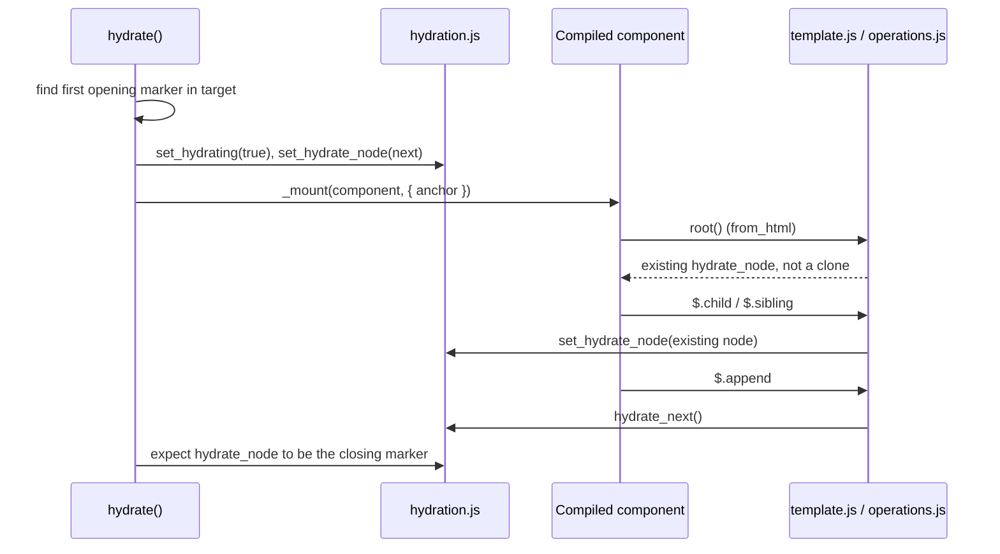

## Overview

`mount`, `hydrate` and `unmount` from `svelte` are the entry points of the browser runtime, implemented in `internal/client/render.js`. `mount` builds a component's DOM from scratch inside a target element. `hydrate` adopts DOM that the server already rendered, walking the existing nodes in the same order the component would create them and attaching effects and event handlers to them instead of creating new ones. Both run the component inside a root effect, so `unmount` only has to destroy that root. The node-creation helpers the compiled code calls (`$.from_html`, `$.child`, `$.sibling`, `$.append`) live in `dom/template.js` and `dom/operations.js`, and each one has a hydration branch.

Sources: [packages/svelte/src/internal/client/render.js:63-100](repo://packages/svelte/src/internal/client/render.js#L63-L100), [packages/svelte/src/index-client.js:244-246](repo://packages/svelte/src/index-client.js#L244-L246)

## Mounting

`mount(Component, options)` delegates to `_mount`, which:

Sources: [packages/svelte/src/internal/client/render.js:173-276](repo://packages/svelte/src/internal/client/render.js#L173-L276), [packages/svelte/src/internal/client/dom/operations.js:25-77](repo://packages/svelte/src/internal/client/dom/operations.js#L25-L77)

1. Calls `init_operations`, which captures `window` and `document` lazily (so the module can be imported on a server), caches the `firstChild`/`nextSibling` getters, and pre-defines expando properties such as `__click`, `__attributes` and `__t` on DOM prototypes so later lookups are fast.
2. Registers delegated event listeners: for every event name any compiled component has passed to `$.delegate`, one listener on the target and one on `document` (reference-counted across mounted roots), so events from nodes moved outside the target are still handled ([[Elements, Attributes and Events]]).
3. Creates a `component_root` effect. Inside it, an anchor text node is appended to the target (or the given `anchor` is used), and a `branch` calls `Component(anchor, props)`. A `context` option is pushed as a root component context, and `events` become `props.$$events` for legacy components.
4. Records the unmount function in a `WeakMap` keyed by the returned exports object.

Sources: [packages/svelte/src/internal/client/render.js:173-276](repo://packages/svelte/src/internal/client/render.js#L173-L276), [packages/svelte/src/internal/client/dom/operations.js:25-77](repo://packages/svelte/src/internal/client/dom/operations.js#L25-L77)

The `intro` option sets the module-level `should_intro` while the component function runs, so blocks know whether transitions on first render should play; it defaults to `true` for `mount` and `false` for `hydrate`.

Sources: [packages/svelte/src/internal/client/render.js:35-45](repo://packages/svelte/src/internal/client/render.js#L35-L45), [packages/svelte/src/internal/client/render.js:236-239](repo://packages/svelte/src/internal/client/render.js#L236-L239)

`unmount(exports, { outro })` looks up and calls the stored function, which destroys the root effect (after running outro transitions when `outro` is true), removes the event listeners it added, and removes its anchor. It returns a promise that resolves when removal is done. Unmounting something that is not mounted logs `lifecycle_double_unmount` in dev ([[Effects and the Effect Tree]]).

Sources: [packages/svelte/src/internal/client/render.js:246-316](repo://packages/svelte/src/internal/client/render.js#L246-L316), [packages/svelte/src/internal/client/reactivity/effects.js:262-289](repo://packages/svelte/src/internal/client/reactivity/effects.js#L262-L289)

## Creating DOM from templates

The compiler hoists each static template as `var root = $.from_html('...', flags)` ([[Client Code Generation]]). `from_html` returns a function. The first call parses the HTML once into a fragment (prefixing `<!>` when the template does not start with a text or element node, so there is a stable first node); every call returns a deep clone, using `importNode` instead of `cloneNode` when `TEMPLATE_USE_IMPORT_NODE` is set or in Firefox. `from_svg` and `from_mathml` parse inside an `<svg>` or `<math>` wrapper so elements get the right namespace, and `from_tree` builds nodes from the nested-array form produced with `fragments: 'tree'`.

Sources: [packages/svelte/src/internal/client/dom/template.js:37-89](repo://packages/svelte/src/internal/client/dom/template.js#L37-L89), [packages/svelte/src/internal/client/dom/template.js:91-159](repo://packages/svelte/src/internal/client/dom/template.js#L91-L159), [packages/svelte/src/internal/client/dom/template.js:161-252](repo://packages/svelte/src/internal/client/dom/template.js#L161-L252)

Each of these calls `assign_nodes(start, end)`, which records the first and last node on the current effect if it has none yet. That is how a branch effect knows the range of DOM to remove when it is destroyed or to move when an `{#each}` reorders. `$.append(anchor, dom)` then inserts the clone before the anchor; blocks always render before an anchor node, which is why fragments and blocks are separated by comment or empty-text anchors.

Sources: [packages/svelte/src/internal/client/dom/template.js:25-35](repo://packages/svelte/src/internal/client/dom/template.js#L25-L35), [packages/svelte/src/internal/client/dom/template.js:336-356](repo://packages/svelte/src/internal/client/dom/template.js#L336-L356)

`$.text(value)` and `$.comment()` create single nodes for fragments that need no template. `$.child`, `$.first_child` and `$.sibling(node, count)` navigate inside a clone using the cached getters. `$.props_id()` returns a unique id `c1`, `c2`, ... from a counter on `window.__svelte`, shared by every Svelte runtime on the page.

Sources: [packages/svelte/src/internal/client/dom/template.js:296-334](repo://packages/svelte/src/internal/client/dom/template.js#L296-L334), [packages/svelte/src/internal/client/dom/template.js:358-377](repo://packages/svelte/src/internal/client/dom/template.js#L358-L377), [packages/svelte/src/internal/client/dom/operations.js:79-135](repo://packages/svelte/src/internal/client/dom/operations.js#L79-L135), [packages/svelte/src/internal/client/dom/operations.js:163-204](repo://packages/svelte/src/internal/client/dom/operations.js#L163-L204)

## Hydrating

The server brackets every component and block with comment markers: `<!--[-->` opens, `<!--[!-->` opens an "else" branch, `<!--]-->` closes ([[Server Code Generation]]). Hydration is a cursor walk over those nodes, driven by the same compiled code that would otherwise create them.

Sources: [packages/svelte/src/constants.js:23-27](repo://packages/svelte/src/constants.js#L23-L27), [packages/svelte/src/internal/client/dom/hydration.js:13-45](repo://packages/svelte/src/internal/client/dom/hydration.js#L13-L45)

Sources: [packages/svelte/src/internal/client/render.js:100-138](repo://packages/svelte/src/internal/client/render.js#L100-L138), [packages/svelte/src/internal/client/dom/template.js:52-56](repo://packages/svelte/src/internal/client/dom/template.js#L52-L56), [packages/svelte/src/internal/client/dom/operations.js:110-130](repo://packages/svelte/src/internal/client/dom/operations.js#L110-L130)

`hydrate` sets the opening marker's next sibling as `hydrate_node`, the module-level cursor, turns on `hydrating`, and calls `_mount` with the marker as anchor. While `hydrating` is true:

Sources: [packages/svelte/src/internal/client/dom/hydration.js:43-119](repo://packages/svelte/src/internal/client/dom/hydration.js#L43-L119), [packages/svelte/src/internal/client/dom/template.js:296-356](repo://packages/svelte/src/internal/client/dom/template.js#L296-L356), [packages/svelte/src/internal/client/dom/operations.js:131-204](repo://packages/svelte/src/internal/client/dom/operations.js#L131-L204)

- Template functions return the current `hydrate_node` instead of cloning, and record it on the effect.
- `$.child` and `$.sibling` move the cursor through the existing nodes. When the compiled code expects a text node and the server rendered none (an expression that was empty on the server), they insert an empty text node.
- `$.append` sets the effect's `nodes_end` to the cursor and advances past it.
- `$.reset(node)` moves the cursor back to an element after its children are hydrated, and `$.next(n)` skips static siblings.
- Blocks read the marker at their position with `read_hydration_instruction` to learn which branch the server rendered.

Sources: [packages/svelte/src/internal/client/dom/hydration.js:43-119](repo://packages/svelte/src/internal/client/dom/hydration.js#L43-L119), [packages/svelte/src/internal/client/dom/template.js:296-356](repo://packages/svelte/src/internal/client/dom/template.js#L296-L356), [packages/svelte/src/internal/client/dom/operations.js:131-204](repo://packages/svelte/src/internal/client/dom/operations.js#L131-L204)

After `_mount` returns, the cursor must sit on the closing `<!--]-->`; anything else is a mismatch. `$.props_id()` reads the id the server wrote as a `<!--#id-->` comment, so ids match between server and client.

Sources: [packages/svelte/src/internal/client/render.js:124-133](repo://packages/svelte/src/internal/client/render.js#L124-L133), [packages/svelte/src/internal/server/index.js:496-499](repo://packages/svelte/src/internal/server/index.js#L496-L499), [packages/svelte/src/internal/client/dom/template.js:358-377](repo://packages/svelte/src/internal/client/dom/template.js#L358-L377)

The `hydrating` flag is a module-level `let` guarded throughout, and the comment in `hydration.js` notes that this lets bundlers tree-shake hydration code from apps that only call `mount`.

Sources: [packages/svelte/src/internal/client/dom/hydration.js:13-22](repo://packages/svelte/src/internal/client/dom/hydration.js#L13-L22)

## When hydration fails

Hydration errs on the side of throwing: any helper that finds the wrong kind of node (`set_hydrate_node(null)`, `reset` with leftover siblings, `read_hydration_instruction` on a non-comment) logs the `hydration_mismatch` warning and throws the `HYDRATION_ERROR` sentinel. `hydrate` catches it and recovers by clearing the target and calling `mount`, so the page ends up correct but re-rendered from scratch. Errors whose message contains a `https://svelte.dev/e/` link are real Svelte errors and are re-thrown; other errors are logged as "Failed to hydrate". With `recover: false`, `hydrate` throws `hydration_failed` instead of re-mounting.

Sources: [packages/svelte/src/internal/client/dom/hydration.js:33-58](repo://packages/svelte/src/internal/client/dom/hydration.js#L33-L58), [packages/svelte/src/internal/client/render.js:136-169](repo://packages/svelte/src/internal/client/render.js#L136-L169)

Some mismatches are expected and handled locally. An `{#if}` whose condition differs between server and client (such as `{#if browser}`) sees the wrong marker, removes the server nodes up to the matching close with `remove_nodes`, renders its branch in normal mode, and then resumes hydration for the rest of the page.

Sources: [packages/svelte/src/internal/client/dom/blocks/if.js:87-135](repo://packages/svelte/src/internal/client/dom/blocks/if.js#L87-L135), [packages/svelte/src/internal/client/dom/hydration.js:83-106](repo://packages/svelte/src/internal/client/dom/hydration.js#L83-L106)
