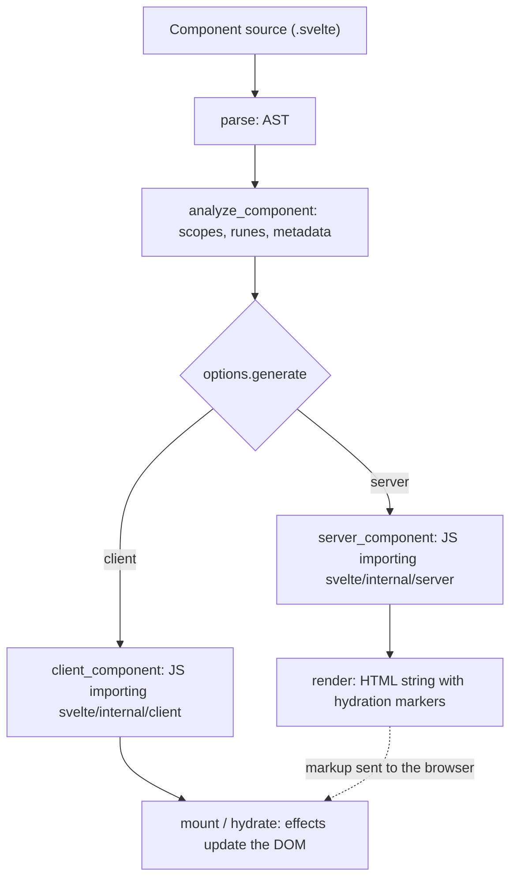

## Overview

Svelte is a UI framework that does most of its work at build time. This repository is a pnpm monorepo whose one published package, `svelte` in `packages/svelte`, holds two things: a compiler that turns `.svelte` components (and `.svelte.js` modules that use runes) into plain JavaScript modules, and the runtime libraries that those generated modules import. The compiler emits code for either the browser or the server; the browser code calls into `svelte/internal/client`, the server code into `svelte/internal/server`.

Sources: [packages/svelte/package.json:1-28](repo://packages/svelte/package.json#L1-L28), [packages/svelte/src/compiler/index.js:14-54](repo://packages/svelte/src/compiler/index.js#L14-L54)

The root `package.json` only drives the workspace: it builds every package under `packages/`, runs Vitest for the whole repository, lints with ESLint and Prettier, publishes with Changesets and runs the benchmarks in `benchmarking/`. The `documentation/` folder holds the user-facing docs for the framework itself, and `playgrounds/sandbox` is a scratch app for trying the local build ([[Quickstart]]).

Sources: [package.json:1-31](repo://package.json#L1-L31)

## Parts of the package

| Area | What it does | Page |
| --- | --- | --- |
| Compiler entry | `compile`, `compileModule`, `parse`, option validation, the `CompileResult` | [[Compiler Pipeline]] |
| Phase 1: parse | Reads markup, `<script>`, `<style>` and expressions into an AST | [[Template Parser]] |
| Phase 2: analyze | Scopes and bindings, rune validation, runes vs legacy mode | [[Scopes and Bindings]], [[Component Analysis]] |
| Analyzer checks | a11y warnings and unused-CSS pruning | [[Accessibility Checks]], [[Scoped CSS]] |
| Phase 3: transform | Emits the client module or the server module | [[Client Code Generation]], [[Server Code Generation]] |
| Tooling around compile | `preprocess`, source maps, `migrate` | [[Preprocessing and Source Maps]], [[Svelte 5 Migration Tool]] |
| Diagnostics | Errors and warnings generated from `messages/` | [[Errors and Warnings]] |
| Reactivity core | Sources, deriveds, effects, batches, proxies | [[Signals and Dependency Tracking]], [[Effects and the Effect Tree]], [[Batches and Scheduling]], [[Deep State Proxies]] |
| Components in the browser | Props, context, mount and hydrate | [[Props and Component Context]], [[Mounting and Hydration]] |
| DOM runtime | Blocks, elements, bindings, transitions | [[Control Flow Blocks]], [[Each Blocks]], [[Error Boundaries and Async Rendering]], [[Elements, Attributes and Events]], [[Element Bindings]], [[Transitions and Animations]] |
| Runtime extras | Web components and dev-only helpers | [[Custom Elements]], [[Dev Mode Tools]] |
| Server runtime | `render()` and the payload compiled server code writes to | [[Server Rendering Runtime]] |
| Libraries | `svelte/store`, `svelte/reactivity`, `svelte/motion`, `svelte/legacy` | [[Stores]], [[Reactive Built-ins]], [[Motion]], [[Legacy Component API]] |
| Repository work | Test suites, build, types and releases | [[Testing]], [[Building and Releasing]] |

Sources: [packages/svelte/package.json:20-123](repo://packages/svelte/package.json#L20-L123)

## Main flow

A component goes through three compiler phases and then one of two runtimes.

Sources: [packages/svelte/src/compiler/index.js:5-9](repo://packages/svelte/src/compiler/index.js#L5-L9)

Sources: [packages/svelte/src/compiler/index.js:21-54](repo://packages/svelte/src/compiler/index.js#L21-L54), [packages/svelte/src/compiler/phases/3-transform/index.js:19-41](repo://packages/svelte/src/compiler/phases/3-transform/index.js#L19-L41)

1. `compile` strips a byte-order mark, resets compiler state, validates the options and calls the parser, which returns the modern AST; options from `<svelte:options>` are merged in ([[Compiler Pipeline]], [[Template Parser]]).
2. `analyze_component` builds scopes, decides whether the component uses runes, validates every node and records what the transform needs ([[Scopes and Bindings]], [[Component Analysis]]).
3. `transform_component` calls `client_component` or `server_component` depending on `options.generate`, prints the result with esrap and renders the scoped stylesheet ([[Client Code Generation]], [[Server Code Generation]], [[Scoped CSS]]).
4. In the browser, `mount` or `hydrate` runs the compiled function inside a root effect; template effects re-run when the signals they read change ([[Mounting and Hydration]], [[Effects and the Effect Tree]]).
5. On the server, `render` calls the compiled function with a payload and joins the strings it pushed into `head` and `body` HTML ([[Server Rendering Runtime]]).

Sources: [packages/svelte/src/compiler/index.js:21-54](repo://packages/svelte/src/compiler/index.js#L21-L54), [packages/svelte/src/compiler/phases/3-transform/index.js:19-62](repo://packages/svelte/src/compiler/phases/3-transform/index.js#L19-L62)

## Design decisions

### Work moves to compile time

The compiler knows which variables are ever reassigned, so it only creates signals where they can change. In the `text-nodes-deriveds` snapshot, `count1` and `count2` are declared with `$state` but never written, so the client output declares them as plain `let count1 = 0`; the `state-proxy-literal` snapshot reassigns its state in `reset`, so there the output wraps it in `$.state('')` and reads it through `$.get`. Static markup becomes one HTML string cloned per instance (`$.from_html`), and only the dynamic text is updated by a `$.template_effect`.

Sources: [packages/svelte/tests/snapshot/samples/text-nodes-deriveds/index.svelte:1-14](repo://packages/svelte/tests/snapshot/samples/text-nodes-deriveds/index.svelte#L1-L14), [packages/svelte/tests/snapshot/samples/text-nodes-deriveds/_expected/client/index.svelte.js:1-24](repo://packages/svelte/tests/snapshot/samples/text-nodes-deriveds/_expected/client/index.svelte.js#L1-L24), [packages/svelte/tests/snapshot/samples/state-proxy-literal/_expected/client/index.svelte.js:1-33](repo://packages/svelte/tests/snapshot/samples/state-proxy-literal/_expected/client/index.svelte.js#L1-L33)

### Fine-grained signals instead of a virtual DOM

The client runtime has no diffing of component trees. Each piece of the DOM that can change is owned by an effect that reads signals; when a signal is set, only the effects depending on it re-run. Event handlers call `$.set` on the state source and bindings pass a getter and setter pair to the runtime (`$.bind_value(input, () => $.get(str), ...)`). [[Signals and Dependency Tracking]] explains the graph.

Sources: [packages/svelte/tests/snapshot/samples/state-proxy-literal/_expected/client/index.svelte.js:4-33](repo://packages/svelte/tests/snapshot/samples/state-proxy-literal/_expected/client/index.svelte.js#L4-L33)

### Two outputs, chosen by export conditions

Server output never touches the DOM: the same component compiles to a function that pushes escaped strings into `$$payload.out`. The public entry points follow the same split. `svelte`, `svelte/store`, `svelte/reactivity` and `svelte/legacy` each map the `browser` condition to a client file and `worker` and `default` to a server file, so a bundler targeting the browser picks `index-client.js` while Node gets `index-server.js`, where `onMount` is a no-op and `mount` throws `lifecycle_function_unavailable`.

Sources: [packages/svelte/tests/snapshot/samples/text-nodes-deriveds/_expected/server/index.svelte.js:1-16](repo://packages/svelte/tests/snapshot/samples/text-nodes-deriveds/_expected/server/index.svelte.js#L1-L16), [packages/svelte/package.json:22-28](repo://packages/svelte/package.json#L22-L28), [packages/svelte/package.json:74-103](repo://packages/svelte/package.json#L74-L103), [packages/svelte/src/index-server.js:1-31](repo://packages/svelte/src/index-server.js#L1-L31)

### Runtime features are switched on by imports

Generated modules import side-effect files that flip runtime flags: `svelte/internal/flags/legacy` for components not in runes mode, `flags/async` when `experimental.async` is on, `flags/tracing` when `$inspect.trace` is used, and `disclose-version`, which records the Svelte version on `window.__svelte`. Code paths guarded by these flags can be dropped by a bundler when no component imports them.

Sources: [packages/svelte/src/compiler/phases/3-transform/client/transform-client.js:576-590](repo://packages/svelte/src/compiler/phases/3-transform/client/transform-client.js#L576-L590), [packages/svelte/src/internal/flags/index.js:1-20](repo://packages/svelte/src/internal/flags/index.js#L1-L20), [packages/svelte/src/internal/disclose-version.js:1-6](repo://packages/svelte/src/internal/disclose-version.js#L1-L6)

### The package ships its source

`files` publishes `src` as-is and the `exports` map points straight at `src/*.js`; only `compiler/index.js` is bundled, for `require`. Types are written as JSDoc and generated into `types/index.d.ts` ([[Building and Releasing]]).

Sources: [packages/svelte/package.json:10-45](repo://packages/svelte/package.json#L10-L45)

### Messages are generated

Every compiler, client, server and shared error or warning is written once as markdown under `messages/`; `errors.js` and `warnings.js` files are generated from them and carry a "Do not edit!" header. [[Errors and Warnings]] covers the generator.

Sources: [packages/svelte/src/compiler/errors.js:1-5](repo://packages/svelte/src/compiler/errors.js#L1-L5), [packages/svelte/src/internal/client/errors.js:1-5](repo://packages/svelte/src/internal/client/errors.js#L1-L5)
