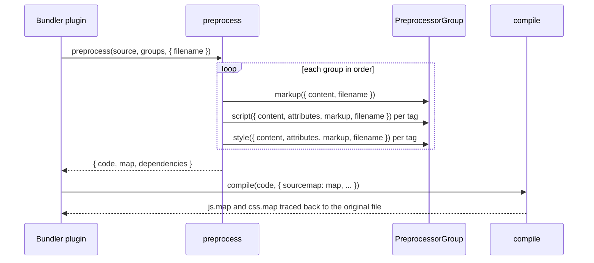

## Overview

`preprocess` lets build tools rewrite a component before it is compiled: turn `<script lang="ts">` into JavaScript, `<style lang="scss">` into CSS, or rewrite the whole markup. It is exported from `svelte/compiler` next to `compile`, it is asynchronous, and it does not parse the component; it finds `<script>` and `<style>` tags with regular expressions and hands their contents to the preprocessors. Its other job is to keep source maps exact through every rewrite, so that the final map from `compile` still points into the file the developer wrote.

Sources: [packages/svelte/src/compiler/index.js:12-12](repo://packages/svelte/src/compiler/index.js#L12-L12), [packages/svelte/src/compiler/preprocess/index.js:329-368](repo://packages/svelte/src/compiler/preprocess/index.js#L329-L368)

Sources: [packages/svelte/src/compiler/preprocess/index.js:338-368](repo://packages/svelte/src/compiler/preprocess/index.js#L338-L368), [packages/svelte/src/compiler/utils/mapped_code.js:394-418](repo://packages/svelte/src/compiler/utils/mapped_code.js#L394-L418)

## Running the preprocessors

### Groups and order

`preprocess(source, preprocessor, options)` accepts one `PreprocessorGroup` or an array of them. A group may have a `markup`, a `script` and a `style` function. Groups run in array order, and within a group the order is always markup, then script, then style; each step sees the output of the previous one. The filename comes from `options.filename` or, for older callers, from a `filename` property on the preprocessor.

Sources: [packages/svelte/src/compiler/preprocess/index.js:338-368](repo://packages/svelte/src/compiler/preprocess/index.js#L338-L368)

The running state is a `PreprocessResult`. `update_source` replaces the current source when a step returns code, pushes the step's map onto the front of `sourcemap_list`, and collects `dependencies` (files a preprocessor read, which watchers should track). `to_processed` combines all maps into one and returns `{ code, map, dependencies, toString }`, deduplicating the dependencies.

Sources: [packages/svelte/src/compiler/preprocess/index.js:19-98](repo://packages/svelte/src/compiler/preprocess/index.js#L19-L98)

### Markup preprocessors

`process_markup` calls `markup({ content, filename })` with the whole source. A returned `map` may be a JSON string or an object; returning nothing leaves the source unchanged.

Sources: [packages/svelte/src/compiler/preprocess/index.js:304-327](repo://packages/svelte/src/compiler/preprocess/index.js#L304-L327)

### Script and style preprocessors

`process_tag` finds every `<script>` or `<style>` with a regular expression that also matches HTML comments, so a tag inside `<!-- -->` is skipped rather than processed. For each match, `process_single_tag` calls the preprocessor with the tag's `content`, its `attributes` parsed into an object (`lang="ts"` becomes `{ lang: 'ts' }`, a bare attribute becomes `true`), the full current `markup`, and the `filename`. When the preprocessor returns nothing, or the same code without a map, the tag is kept as it was. A preprocessor may also return new `attributes`, which replace the tag's attributes in the output (for example to drop `lang`).

Sources: [packages/svelte/src/compiler/preprocess/index.js:218-302](repo://packages/svelte/src/compiler/preprocess/index.js#L218-L302)

The replacement is assembled by `replace_in_code`. It runs the regular expression once to start all preprocessor calls concurrently, waits for them, then rebuilds the file as a chain of `MappedCode` pieces: the unchanged text before each tag, the processed tag, and the unchanged tail.

Sources: [packages/svelte/src/compiler/preprocess/replace_in_code.js:19-72](repo://packages/svelte/src/compiler/preprocess/replace_in_code.js#L19-L72)

## Keeping maps exact

Every piece of the rebuilt file carries its own decoded source map, and `MappedCode.concat` joins pieces while shifting line and column offsets, so the map of the whole file is built as the file is. Unchanged slices get a high-resolution identity map from `MappedCode.from_source`, which emits a segment for every token and starts at the slice's line and column in the original source (via `slice_source`, which offsets `get_location`).

Sources: [packages/svelte/src/compiler/utils/mapped_code.js:75-110](repo://packages/svelte/src/compiler/utils/mapped_code.js#L75-L110), [packages/svelte/src/compiler/utils/mapped_code.js:216-247](repo://packages/svelte/src/compiler/utils/mapped_code.js#L216-L247), [packages/svelte/src/compiler/preprocess/replace_in_code.js:4-17](repo://packages/svelte/src/compiler/preprocess/replace_in_code.js#L4-L17)

A processed tag becomes three pieces in `processed_tag_to_code`: the opening tag, the content and the closing tag. If the preprocessor changed the attributes, the opening tag's length changed, so a small hand-built map ties the start and end of the new opening tag to those of the original. The content's map, returned by the preprocessor relative to the content alone, is decoded and shifted by the position where the content starts in the file (`sourcemap_add_offset`); only segments that point at the component file itself are shifted, so maps that reference other files (an imported SCSS partial, say) stay intact.

Sources: [packages/svelte/src/compiler/preprocess/index.js:100-216](repo://packages/svelte/src/compiler/preprocess/index.js#L100-L216)

Preprocessors return maps in several shapes, and the code accepts them all:

Sources: [packages/svelte/src/compiler/preprocess/index.js:114-125](repo://packages/svelte/src/compiler/preprocess/index.js#L114-L125)

- `decode_map` parses JSON strings, decodes VLQ `mappings` strings with `@jridgewell/sourcemap-codec`, and converts a mozilla `SourceMapGenerator` by reading its internal arrays.
- `parse_attached_sourcemap` removes a trailing `sourceMappingURL` comment from the processed code. A base64 data URL becomes the map (with a console warning if a map was also returned); a plain path is dropped with a warning asking for the map data instead.

Sources: [packages/svelte/src/compiler/preprocess/decode_sourcemap.js:82-96](repo://packages/svelte/src/compiler/preprocess/decode_sourcemap.js#L82-L96), [packages/svelte/src/compiler/utils/mapped_code.js:335-388](repo://packages/svelte/src/compiler/utils/mapped_code.js#L335-L388)

## Combining maps

`combine_sourcemaps` chains the maps collected from all steps with `@jridgewell/remapping`. The list is kept newest first. When every map except the oldest has a single source, the array form of `remapping` is used; otherwise the loader form walks the chain, following a map's source only when it names the component file and treating any other source as a leaf. If the combined map has no sources (an empty leading map), the filename is added so tools still know which file it describes.

Sources: [packages/svelte/src/compiler/utils/mapped_code.js:261-301](repo://packages/svelte/src/compiler/utils/mapped_code.js#L261-L301)

> [!NOTE]
> Matching sources assumes the preprocessor map lists the component by its basename (`bar.svelte` for `src/foo/bar.svelte`), which is why the result uses `get_basename(filename)` throughout. A comment in `combine_sourcemaps` notes this as brittle.

Sources: [packages/svelte/src/compiler/utils/mapped_code.js:280-292](repo://packages/svelte/src/compiler/utils/mapped_code.js#L280-L292), [packages/svelte/src/compiler/preprocess/index.js:56-62](repo://packages/svelte/src/compiler/preprocess/index.js#L56-L62)

## Merging into the compile output

The tool passes the preprocessor's map to `compile` as the `sourcemap` option. After esrap prints the JavaScript, and after `render_stylesheet` generates the CSS map, both call `merge_with_preprocessor_map` ([[Compiler Pipeline]], [[Scoped CSS]]). It sets the compiler map's `sources` to the component's basename so it lines up with the preprocessor map, combines the two with `apply_preprocessor_sourcemap`, and then rewrites `sources` relative to the output file when `outputFilename` (or `cssOutputFilename`) puts the output elsewhere. The combined map gets `toString` and `toUrl` methods, matching the `SourceMap` class the rest of the result uses.

Sources: [packages/svelte/src/compiler/utils/mapped_code.js:303-333](repo://packages/svelte/src/compiler/utils/mapped_code.js#L303-L333), [packages/svelte/src/compiler/utils/mapped_code.js:390-454](repo://packages/svelte/src/compiler/utils/mapped_code.js#L390-L454), [packages/svelte/src/compiler/phases/3-transform/index.js:37-46](repo://packages/svelte/src/compiler/phases/3-transform/index.js#L37-L46)

Path handling is written by hand (`get_relative_path`, `get_basename`) rather than with `node:path`, and base64 uses `btoa`/`atob` when `window` exists, so the compiler and `preprocess` also run in a browser; the comment on `get_relative_path` gives that reason.

Sources: [packages/svelte/src/compiler/utils/mapped_code.js:249-258](repo://packages/svelte/src/compiler/utils/mapped_code.js#L249-L258), [packages/svelte/src/compiler/utils/mapped_code.js:420-446](repo://packages/svelte/src/compiler/utils/mapped_code.js#L420-L446)
