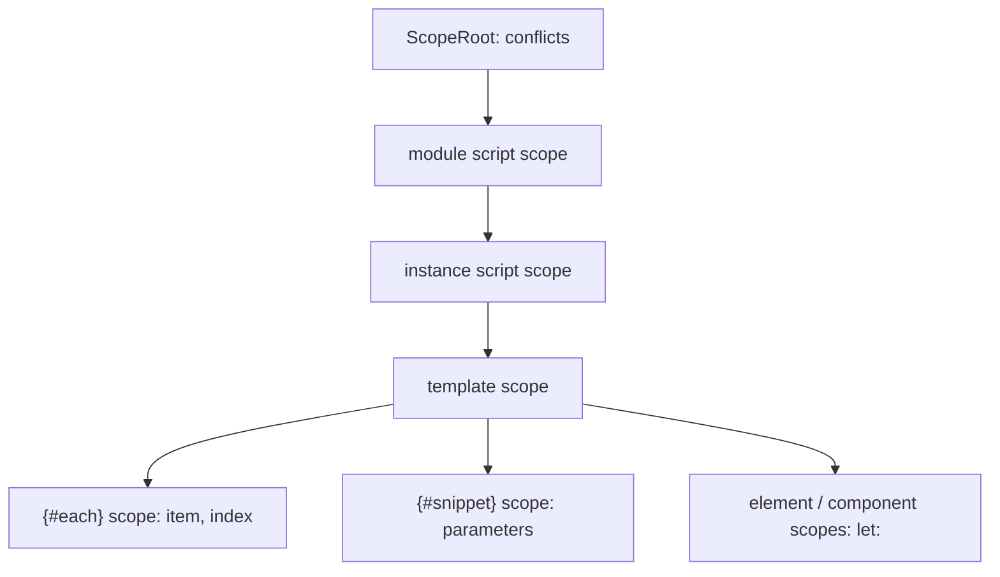

## Overview

Most decisions the compiler makes depend on what a name refers to: is `count` a `$state` variable, a prop, an `{#each}` item, a store subscription, an import or a global? `phases/scope.js` answers that question. It builds a tree of `Scope` objects over the script and template, declares a `Binding` for every name, records every reference and every write, and offers a small partial evaluator that can tell when an expression always has the same value. [[Component Analysis]] builds these scopes first and then refines binding kinds; both transforms ([[Client Code Generation]], [[Server Code Generation]]) look bindings up to decide what code to emit.

Sources: [packages/svelte/src/compiler/phases/scope.js:88-170](repo://packages/svelte/src/compiler/phases/scope.js#L88-L170), [packages/svelte/src/compiler/phases/scope.js:564-660](repo://packages/svelte/src/compiler/phases/scope.js#L564-L660), [packages/svelte/src/compiler/phases/scope.js:746-762](repo://packages/svelte/src/compiler/phases/scope.js#L746-L762)

## Binding

A `Binding` describes one declared name. `node` is the declaring identifier and `scope` the scope that owns it. `kind` says how the compiler must treat it at runtime, and `declaration_kind` says how it was declared (`var`, `let`, `const`, `function`, `import`, `param`, `rest_param`, or `synthetic` for names the compiler invents). `initial` holds the initializer: an expression, a function or class declaration, the `ImportDeclaration`, or the `EachBlock` or `SnippetBlock` that introduced the name; for a destructured prop with a default it is the default value, not `$props()`.

Sources: [packages/svelte/src/compiler/phases/scope.js:88-150](repo://packages/svelte/src/compiler/phases/scope.js#L88-L150), [packages/svelte/src/compiler/types/index.d.ts:282-290](repo://packages/svelte/src/compiler/types/index.d.ts#L282-L290)

`references` lists every place the name is read or written, each with the AST path that led to it. `reassigned` is set when the name itself is assigned (`count = 1`), `mutated` when a property under it is (`obj.x = 1`); `updated` is either. `is_function()` is true only for a binding initialised with a function and never updated, which lets the transforms call it directly, for instance as an event handler. `prop_alias` keeps the external name of a renamed prop, and `legacy_dependencies` the bindings a `$:` declaration depends on.

Sources: [packages/svelte/src/compiler/phases/scope.js:108-170](repo://packages/svelte/src/compiler/phases/scope.js#L108-L170)

| Kind | Meaning |
| --- | --- |
| `normal` | A plain variable |
| `state` | `$state(...)`: deeply reactive |
| `raw_state` | `$state.raw(...)` |
| `derived` | `$derived(...)` or `$derived.by(...)` |
| `prop`, `bindable_prop`, `rest_prop` | Props from `$props()` (or `export let` in legacy mode) |
| `each` | An `{#each}` item |
| `snippet` | A snippet parameter |
| `store_sub` | A `$store` auto-subscription |
| `legacy_reactive` | A name first declared by a `$:` assignment |
| `template` | Declared in the template, such as `{@const}`, `let:` or an `{:then}` value |
| `static` | A value that never changes, such as the index of an unkeyed `{#each}` |

Sources: [packages/svelte/src/compiler/types/index.d.ts:267-280](repo://packages/svelte/src/compiler/types/index.d.ts#L267-L280)

Scope creation only assigns `normal`, `each`, `snippet`, `template`, `static` and `legacy_reactive`. The rune kinds are filled in later by the analyzer's `VariableDeclarator` visitor, which looks at the initializer with `get_rune` and sets `state`, `raw_state`, `derived`, `prop` or `rest_prop`; the `store_sub` bindings are synthetic declarations the analyzer adds for each `$name` reference.

Sources: [packages/svelte/src/compiler/phases/2-analyze/visitors/VariableDeclarator.js:28-50](repo://packages/svelte/src/compiler/phases/2-analyze/visitors/VariableDeclarator.js#L28-L50), [packages/svelte/src/compiler/phases/2-analyze/index.js:417-424](repo://packages/svelte/src/compiler/phases/2-analyze/index.js#L417-L424)

## Scope

### Declarations and lookup

A `Scope` maps names to bindings in `declarations`, maps each declarator to the bindings it creates in `declarators`, and lists every referenced name in `references`. `parent` links to the enclosing scope; `get(name)` walks up the chain and `owner(name)` returns the scope that declares a name. `function_depth` increases only for scopes that are not *porous*: block scopes (`{ }`, `for`, `switch`) are porous, so a `var` declared inside them is forwarded to the parent, as JavaScript does.

Sources: [packages/svelte/src/compiler/phases/scope.js:564-667](repo://packages/svelte/src/compiler/phases/scope.js#L564-L667), [packages/svelte/src/compiler/phases/scope.js:694-722](repo://packages/svelte/src/compiler/phases/scope.js#L694-L722)

`declare` also enforces two rules. Imports always go to the top of the chain. Declaring a name twice in one scope raises `declaration_duplicate` unless both declarations are `var`. Every new name is checked by `validate_identifier_name` and added to the root's `conflicts` set.

Sources: [packages/svelte/src/compiler/phases/scope.js:632-659](repo://packages/svelte/src/compiler/phases/scope.js#L632-L659)

`reference(node, path)` records a read in the current scope and climbs until it finds the declaring scope, adding the reference to that binding. A name declared nowhere is a global, and it is added to `conflicts` so generated names never shadow it.

Sources: [packages/svelte/src/compiler/phases/scope.js:724-744](repo://packages/svelte/src/compiler/phases/scope.js#L724-L744)

### Generating names

The transforms need fresh identifiers for template nodes, deriveds and helpers. `scope.generate('div')` sanitises the preferred name and appends `_1`, `_2`, ... until the name collides with no reference, declaration, root conflict or reserved word, then reserves it. `ScopeRoot.unique` does the same at the root level and returns an `Identifier` node. This is why compiled output shows names like `input_1` and `$$index`.

Sources: [packages/svelte/src/compiler/phases/scope.js:665-692](repo://packages/svelte/src/compiler/phases/scope.js#L665-L692), [packages/svelte/src/compiler/phases/scope.js:810-831](repo://packages/svelte/src/compiler/phases/scope.js#L810-L831)

## Building the scope tree

`create_scopes(ast, root, allow_reactive_declarations, parent)` walks one AST and returns `{ scope, scopes, has_await }`, where `scopes` maps nodes to the scope they open. `analyze_component` calls it three times with a shared `ScopeRoot`: for the module script, for the instance script with the module scope as parent (and `$:` declarations allowed), and for the template with the instance scope as parent. A name used in the template therefore resolves first to template declarations, then the instance script, then the module script.

Sources: [packages/svelte/src/compiler/phases/scope.js:833-858](repo://packages/svelte/src/compiler/phases/scope.js#L833-L858), [packages/svelte/src/compiler/phases/2-analyze/index.js:321-335](repo://packages/svelte/src/compiler/phases/2-analyze/index.js#L321-L335)

Sources: [packages/svelte/src/compiler/phases/2-analyze/index.js:321-335](repo://packages/svelte/src/compiler/phases/2-analyze/index.js#L321-L335), [packages/svelte/src/compiler/phases/scope.js:1147-1262](repo://packages/svelte/src/compiler/phases/scope.js#L1147-L1262)

The walk declares names as it meets them:

Sources: [packages/svelte/src/compiler/phases/scope.js:960-1006](repo://packages/svelte/src/compiler/phases/scope.js#L960-L1006)

- Imports, functions, classes, variables and `catch` parameters are declared as `normal`; function parameters get their own scope.
- `{#each items as item, i}` creates a scope with each identifier of the context declared as `each` (marking those inside a rest element), and the index as `template` when the block is keyed by something other than the index, else `static`. It also fills the block's `metadata`, including a unique `$$index` name.
- `{:then value}` and `{:catch error}` declare their names twice: as `template` in the scope for the block's children and as `normal` in a scope for the pattern itself.
- `{#snippet name(a, b)}` declares `name` as a function in the enclosing scope and the parameters as `snippet` in a child scope.
- `let:` directives declare `template` bindings in the scope of the component or slot they belong to; components get one child scope per named slot.

Sources: [packages/svelte/src/compiler/phases/scope.js:1007-1060](repo://packages/svelte/src/compiler/phases/scope.js#L1007-L1060), [packages/svelte/src/compiler/phases/scope.js:1104-1145](repo://packages/svelte/src/compiler/phases/scope.js#L1104-L1145), [packages/svelte/src/compiler/phases/scope.js:1147-1260](repo://packages/svelte/src/compiler/phases/scope.js#L1147-L1260), [packages/svelte/src/compiler/phases/scope.js:917-955](repo://packages/svelte/src/compiler/phases/scope.js#L917-L955)

References and writes are not resolved during the walk. Each reference identifier and each assignment, update or `bind:` target is pushed to a list, and only after the walk are references resolved with `scope.reference` and `reassigned`/`mutated` set, so a name used before its declaration still binds correctly. In the instance script, an assignment `$: total = a + b` to a name declared nowhere becomes a `legacy_reactive` binding.

Sources: [packages/svelte/src/compiler/phases/scope.js:983-1000](repo://packages/svelte/src/compiler/phases/scope.js#L983-L1000), [packages/svelte/src/compiler/phases/scope.js:1042-1050](repo://packages/svelte/src/compiler/phases/scope.js#L1042-L1050), [packages/svelte/src/compiler/phases/scope.js:1294-1327](repo://packages/svelte/src/compiler/phases/scope.js#L1294-L1327)

The walk also notes whether any `await` appears outside a function (`has_await`). That lets the analyzer switch a component into runes mode on a top-level `await` without a second pass.

Sources: [packages/svelte/src/compiler/phases/scope.js:960-975](repo://packages/svelte/src/compiler/phases/scope.js#L960-L975)

Later walks over the same AST use `set_scope` as their catch-all visitor: when a node has an entry in `scopes`, it swaps that scope into the walker's state before visiting children.

Sources: [packages/svelte/src/compiler/phases/scope.js:1329-1337](repo://packages/svelte/src/compiler/phases/scope.js#L1329-L1337)

## Recognising runes

Runes are not keywords; they are calls to globals with reserved names. `get_rune(node, scope)` returns the rune name for a `CallExpression` such as `$state(0)`, `$derived.by(fn)` or `$effect.pre(fn)`. `get_global_keypath` flattens the callee into a key path (`$state.raw`, `$inspect().with`) and returns `null` when the path contains a computed member or when its root identifier resolves to a binding. So a local variable or import named `$state` is never treated as the rune.

Sources: [packages/svelte/src/compiler/phases/scope.js:1339-1382](repo://packages/svelte/src/compiler/phases/scope.js#L1339-L1382)

## Partial evaluation

`scope.evaluate(expression)` returns an `Evaluation` with the set of values the expression may have. Literals add themselves; identifiers follow their binding's `initial` when the binding is never updated and is not a prop; binary, unary, logical and conditional expressions are folded with the real JavaScript operators when the operands are known, or reduced to a type (`NUMBER`, `STRING`) otherwise; known `Math`, `Number` and `String` functions are called. `$state(x)`, `$state.raw(x)` and `$derived(x)` evaluate to `x`, `$props.id()` to a string. Anything else is `UNKNOWN`. Re-entrant evaluation of the same expression returns the evaluation in progress, which stops cycles.

Sources: [packages/svelte/src/compiler/phases/scope.js:230-280](repo://packages/svelte/src/compiler/phases/scope.js#L230-L280), [packages/svelte/src/compiler/phases/scope.js:425-470](repo://packages/svelte/src/compiler/phases/scope.js#L425-L470), [packages/svelte/src/compiler/phases/scope.js:746-764](repo://packages/svelte/src/compiler/phases/scope.js#L746-L764)

The result exposes `is_known` (exactly one value), `value`, `is_defined`, `is_string`, `is_number`, `is_function` and `has_unknown`. The client transform uses it to inline constant text: when a template expression evaluates to a known value it emits a string literal instead of an effect, and it only marks text as stateful when the expression has state and is not known.

Sources: [packages/svelte/src/compiler/phases/scope.js:531-561](repo://packages/svelte/src/compiler/phases/scope.js#L531-L561), [packages/svelte/src/compiler/phases/3-transform/client/visitors/shared/utils.js:100-116](repo://packages/svelte/src/compiler/phases/3-transform/client/visitors/shared/utils.js#L100-L116)

## Node helpers

`phases/nodes.js` holds small helpers shared by the phases: `is_element_node` and `is_component_node` classify template nodes, `is_custom_element_node` detects a hyphenated tag or an `is` attribute, and `create_expression_metadata` creates the record each template expression carries (`dependencies`, `references`, `has_state`, `has_call`, `has_await`, `has_member_expression`, `has_assignment`), which the analyzer fills from the bindings an expression touches.

Sources: [packages/svelte/src/compiler/phases/nodes.js:7-81](repo://packages/svelte/src/compiler/phases/nodes.js#L7-L81), [packages/svelte/src/compiler/types/index.d.ts:292-307](repo://packages/svelte/src/compiler/types/index.d.ts#L292-L307)

`phases/bindings.js` is the table of `bind:` targets the analyzer validates against: each entry says which elements accept it, which event signals a change, whether it writes back to the DOM (`bidirectional`), and whether the server output omits it. [[Element Bindings]] covers the runtime side.

Sources: [packages/svelte/src/compiler/phases/bindings.js:1-40](repo://packages/svelte/src/compiler/phases/bindings.js#L1-L40), [packages/svelte/src/compiler/phases/2-analyze/visitors/BindDirective.js:30-45](repo://packages/svelte/src/compiler/phases/2-analyze/visitors/BindDirective.js#L30-L45)
