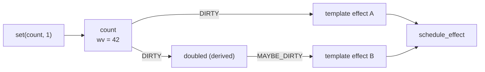

## Overview

Svelte 5's reactivity is a graph of signals. A **source** holds a value that code writes (`$state`). A **derived** computes a value from other signals and caches it (`$derived`). A **reaction** is anything that runs a function and records which signals it read: deriveds and effects. When a source changes, the runtime marks every reaction that read it, directly or through deriveds, so that exactly those re-run. The graph lives in plain objects with a bit-flag field `f`; the logic is in `reactivity/sources.js`, `reactivity/deriveds.js` and `runtime.js`.

Sources: [packages/svelte/src/internal/client/reactivity/types.d.ts:10-61](repo://packages/svelte/src/internal/client/reactivity/types.d.ts#L10-L61)

This page covers values and tracking. What effects are and how they form a tree is in [[Effects and the Effect Tree]]; when scheduled effects actually run is in [[Batches and Scheduling]]; how `$state` objects become deeply reactive is in [[Deep State Proxies]]. The compiler is what inserts the `$.get` and `$.set` calls ([[Client Code Generation]]).

Sources: [packages/svelte/src/compiler/phases/3-transform/client/visitors/shared/declarations.js:14-53](repo://packages/svelte/src/compiler/phases/3-transform/client/visitors/shared/declarations.js#L14-L53)

## Signal shapes

| Field | On | Meaning |
| --- | --- | --- |
| `f` | all | Bit flags: kind and status |
| `wv` | all | Write version: the global counter value when the value last changed |
| `v` | values | Current value |
| `equals` | values | Equality check that decides whether a write is a change |
| `reactions` | values | Reactions that read this value |
| `rv` | values | Read version: used to deduplicate reads within one run |
| `fn` | reactions | The function to run |
| `deps` | reactions | Values read during the last run |
| `ctx` | reactions | Component context to restore while running |
| `ac` | reactions | `AbortController` for `getAbortSignal()` |
| `parent`, `effects` | deriveds | Owning effect or derived; effects created inside the derived |

Sources: [packages/svelte/src/internal/client/reactivity/types.d.ts:10-61](repo://packages/svelte/src/internal/client/reactivity/types.d.ts#L10-L61)

The flags in `constants.js` combine a kind (`DERIVED`, `EFFECT`, `RENDER_EFFECT`, `BLOCK_EFFECT`, `BRANCH_EFFECT`, `ROOT_EFFECT`, ...) with exactly one status: `CLEAN`, `MAYBE_DIRTY` or `DIRTY`. `set_signal_status` swaps the status bits and leaves the rest. Other bits record state such as `UNOWNED`, `DISCONNECTED`, `INERT`, `DESTROYED`, `REACTION_IS_UPDATING` and `ERROR_VALUE`.

Sources: [packages/svelte/src/internal/client/constants.js:1-27](repo://packages/svelte/src/internal/client/constants.js#L1-L27), [packages/svelte/src/internal/client/runtime.js:738-752](repo://packages/svelte/src/internal/client/runtime.js#L738-L752)

## Sources

### Creating sources

`source(v)` creates a plain value signal with flags `0`, `reactions: null` and `equals` comparing with `===`. The variants differ in when they are used:

Sources: [packages/svelte/src/internal/client/reactivity/sources.js:66-83](repo://packages/svelte/src/internal/client/reactivity/sources.js#L66-L83)

- `state(v)` is what `$state` compiles to. It also calls `push_reaction_value`, which records the source in `current_sources` when it is created inside a running derived (or any reaction outside async mode); reading or writing such a source inside the same reaction neither adds a dependency nor counts as an unsafe mutation.
- `mutable_source(v, immutable)` is used for legacy-mode `let` variables. Unless the component is immutable, it uses `safe_equals`, which treats any object or function as changed so that `obj.x = 1; obj = obj` still updates; it also registers the source on the component context for `beforeUpdate`/`afterUpdate`.

Sources: [packages/svelte/src/internal/client/reactivity/sources.js:59-119](repo://packages/svelte/src/internal/client/reactivity/sources.js#L59-L119), [packages/svelte/src/internal/client/reactivity/equality.js:1-31](repo://packages/svelte/src/internal/client/reactivity/equality.js#L1-L31), [packages/svelte/src/internal/client/runtime.js:84-100](repo://packages/svelte/src/internal/client/runtime.js#L84-L100)

### Writing

`set(source, value, should_proxy)` first guards against writing state where it is not allowed: in runes mode, setting a source while a derived, a block effect or an inspect effect is running throws `state_unsafe_mutation`, unless the source was created inside that reaction. It then wraps the value in a proxy if asked, and calls `internal_set`.

Sources: [packages/svelte/src/internal/client/reactivity/sources.js:136-163](repo://packages/svelte/src/internal/client/reactivity/sources.js#L136-L163)

`internal_set` does nothing when `equals` says the value is the same. Otherwise it:

Sources: [packages/svelte/src/internal/client/reactivity/sources.js:171-172](repo://packages/svelte/src/internal/client/reactivity/sources.js#L171-L172)

1. Stores the new value and remembers the old one in `old_values` (used while effects are being destroyed, so teardown code still sees the value it ran with).
2. Records the change in the current batch with `Batch.ensure().capture(source, old_value)`.
3. Bumps the global write version and stores it in `source.wv`.
4. Calls `mark_reactions(source, DIRTY)`.
5. If the write happened inside a clean effect that does not yet depend on the source, adds it to `untracked_writes`, so the effect re-runs if it reads the source later in the same run (as in `$effect(() => count++)`).

Sources: [packages/svelte/src/internal/client/reactivity/sources.js:165-244](repo://packages/svelte/src/internal/client/reactivity/sources.js#L165-L244)

`update` and `update_pre` implement `count++` and `++count` on top of `get` and `set`; `mutate` is the legacy-mode helper for `obj.x = v`, which re-sets the source to itself so `safe_equals` reports a change.

Sources: [packages/svelte/src/internal/client/reactivity/sources.js:120-134](repo://packages/svelte/src/internal/client/reactivity/sources.js#L120-L134), [packages/svelte/src/internal/client/reactivity/sources.js:266-299](repo://packages/svelte/src/internal/client/reactivity/sources.js#L266-L299)

### Propagating a change

`mark_reactions` walks the `reactions` of the changed signal. Direct readers are set to the given status (`DIRTY`), but a reaction that is already `DIRTY` is left alone. Deriveds recurse with `MAYBE_DIRTY`: a derived further down may not actually change, so its readers are only told to check. Effects are passed to `schedule_effect`, and block effects are also collected in `eager_block_effects` when the batch asks for them. In legacy mode the currently running effect is skipped to avoid infinite loops; in dev, inspect effects are collected and run immediately so their stack trace points at the write.

Sources: [packages/svelte/src/internal/client/reactivity/sources.js:301-346](repo://packages/svelte/src/internal/client/reactivity/sources.js#L301-L346)

Sources: [packages/svelte/src/internal/client/reactivity/sources.js:308-346](repo://packages/svelte/src/internal/client/reactivity/sources.js#L308-L346)

## Reading and tracking

`get(signal)` is what every compiled read of reactive state calls. If a reaction is active and reads are not untracked, the signal becomes one of its dependencies. Then, if the signal is a derived that may be stale, it is brought up to date before its value is returned; a derived that last threw has `ERROR_VALUE` set, and `get` re-throws the stored error.

Sources: [packages/svelte/src/internal/client/runtime.js:528-605](repo://packages/svelte/src/internal/client/runtime.js#L528-L605), [packages/svelte/src/internal/client/runtime.js:652-683](repo://packages/svelte/src/internal/client/runtime.js#L652-L683)

Dependency collection is designed to allocate nothing when a reaction reads the same signals in the same order as last time, which is the common case. Each run gets a fresh `read_version`; a signal whose `rv` already equals it was read in this run and is ignored. Otherwise, if the signal is the next entry of the reaction's previous `deps`, `get` only increments `skipped_deps`. At the first difference it starts a `new_deps` array.

Sources: [packages/svelte/src/internal/client/runtime.js:533-563](repo://packages/svelte/src/internal/client/runtime.js#L533-L563), [packages/svelte/src/internal/client/runtime.js:102-141](repo://packages/svelte/src/internal/client/runtime.js#L102-L141)

`update_reaction(reaction)` runs a derived's or effect's function with this machinery in place. It saves and replaces the module-level tracking state (`active_reaction`, `new_deps`, `skipped_deps`, `untracked_writes`, `current_sources`, `component_context`, `untracking`), aborts the previous run's `AbortController` with `STALE_REACTION`, sets `REACTION_IS_UPDATING` and calls `fn`. Afterwards it splices `new_deps` into `deps` after the skipped prefix, removes the reaction from dependencies it no longer reads (`remove_reactions`), and registers it in the `reactions` of new ones. Branch and root effects are never the active reaction, so code inside them does not subscribe them to anything. Errors go to `handle_error` ([[Error Boundaries and Async Rendering]]).

Sources: [packages/svelte/src/internal/client/runtime.js:255-330](repo://packages/svelte/src/internal/client/runtime.js#L255-L330), [packages/svelte/src/internal/client/runtime.js:330-382](repo://packages/svelte/src/internal/client/runtime.js#L330-L382)

A read that happens while the reaction is not in its update cycle (after an `await` inside an async derived or effect) is added to `deps` and `reactions` directly. In dev, such a read in an async context that was not already a dependency raises the `await_reactivity_loss` warning, because reads after an `await` do not normally re-trigger the reaction.

Sources: [packages/svelte/src/internal/client/runtime.js:564-605](repo://packages/svelte/src/internal/client/runtime.js#L564-L605)

`untrack(fn)` sets `untracking` for the duration of `fn`, so `get` returns values without recording them. `safe_get` is `get` for `var` declarations, which may be read before they are assigned.

Sources: [packages/svelte/src/internal/client/runtime.js:704-736](repo://packages/svelte/src/internal/client/runtime.js#L704-L736)

## Deriveds

### Creating deriveds

`derived(fn)` creates a lazy signal with flags `DERIVED | DIRTY` and an `UNINITIALIZED` value. It records its owner in `parent`: the derived it was created in, or the active effect. A derived created outside any effect, or inside an unowned derived, is flagged `UNOWNED`. `user_derived` (the compiled form of `$derived` in components) also calls `push_reaction_value`, and `derived_safe_equal` uses `safe_equals` for legacy mode.

Sources: [packages/svelte/src/internal/client/reactivity/deriveds.js:49-92](repo://packages/svelte/src/internal/client/reactivity/deriveds.js#L49-L92), [packages/svelte/src/internal/client/reactivity/deriveds.js:225-249](repo://packages/svelte/src/internal/client/reactivity/deriveds.js#L225-L249)

`update_derived` re-runs the function through `execute_derived`, which first destroys effects the previous run created and runs `update_reaction` with the nearest parent effect as `active_effect`; in dev it detects a derived that reads itself (`derived_references_self`). If the new value differs by `equals`, `v` and `wv` are updated. The derived then becomes `CLEAN`, except that an unowned derived (or one read without a tracking context) stays `MAYBE_DIRTY`, since nobody will tell it when its dependencies change.

Sources: [packages/svelte/src/internal/client/reactivity/deriveds.js:268-355](repo://packages/svelte/src/internal/client/reactivity/deriveds.js#L268-L355)

### Deciding whether to re-run

`is_dirty(reaction)` is the check behind both `get` on a derived and the decision to run a scheduled effect. A `DIRTY` reaction must re-run. A `MAYBE_DIRTY` one walks its `deps` in order: each dependency that is itself a stale derived is updated first, and as soon as any dependency's `wv` is newer than the reaction's own `wv`, the reaction is dirty. If none is, it is marked `CLEAN` without running. This is what lets a chain such as `a → isEven → effect` skip the effect when `a` changes from 2 to 4.

Sources: [packages/svelte/src/internal/client/runtime.js:147-223](repo://packages/svelte/src/internal/client/runtime.js#L147-L223)

### Unowned and disconnected deriveds

A derived only stays in its dependencies' `reactions` while something reads it. When `remove_reaction` drops the last reader of a derived, the derived is marked `MAYBE_DIRTY` and `DISCONNECTED`, its own effects are destroyed and it removes itself from its dependencies, so it can be garbage-collected. The next `is_dirty` check from an effect reconnects it by pushing it back into each dependency's `reactions`. An unowned derived read inside an effect is reconnected the same way, and loses the `UNOWNED` flag once its parent is owned.

Sources: [packages/svelte/src/internal/client/runtime.js:384-426](repo://packages/svelte/src/internal/client/runtime.js#L384-L426), [packages/svelte/src/internal/client/runtime.js:163-201](repo://packages/svelte/src/internal/client/runtime.js#L163-L201)

### Async deriveds

`async_derived(fn)` backs a `$derived` whose expression contains `await`. It is not a lazy derived but a source updated by an async effect: each run awaits the promise and writes the result, and the first run suspends the nearest boundary until it settles. The details belong to [[Batches and Scheduling]] and [[Error Boundaries and Async Rendering]].

Sources: [packages/svelte/src/internal/client/reactivity/deriveds.js:94-125](repo://packages/svelte/src/internal/client/reactivity/deriveds.js#L94-L125)
