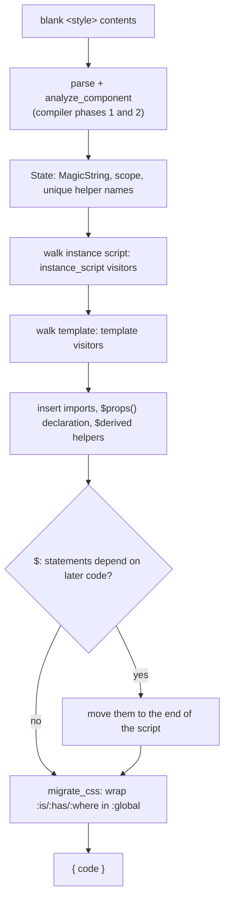

## Overview

`migrate(source, { filename, use_ts })`, exported from `svelte/compiler`, rewrites a Svelte 4 component into Svelte 5 runes syntax and returns `{ code }`. It is a source-to-source tool: instead of generating code from the AST, it uses the compiler's own parser and analyzer to understand the component and then edits the original text with MagicString, so formatting and comments outside the edited spans survive. When a construct is too ambiguous to rewrite safely, it either leaves an `@migration-task` comment for a human or gives up on the whole file.

Sources: [packages/svelte/src/compiler/migrate/index.js:113-124](repo://packages/svelte/src/compiler/migrate/index.js#L113-L124), [packages/svelte/src/compiler/index.js:172-173](repo://packages/svelte/src/compiler/index.js#L172-L173)

The sandbox's `run.js` calls it for every component it compiles and writes the result to `output/migrated` ([[Quickstart]]).

Sources: [playgrounds/sandbox/run.js:67-72](repo://playgrounds/sandbox/run.js#L67-L72)

## How a migration runs



Sources: [packages/svelte/src/compiler/migrate/index.js:124-240](repo://packages/svelte/src/compiler/migrate/index.js#L124-L240), [packages/svelte/src/compiler/migrate/index.js:330-441](repo://packages/svelte/src/compiler/migrate/index.js#L330-L441)

1. Style contents are replaced with a placeholder before parsing, because they may be SCSS or another language the compiler cannot parse; they are restored into the MagicString right after.
2. The source is parsed and analysed with the normal compiler phases ([[Template Parser]], [[Component Analysis]]), with `experimental.async` on and warnings discarded. The analysis supplies scopes, binding kinds and the sorted reactive statements.
3. A `State` holds the MagicString, the indentation guessed from the file, a list of collected props, the insertion points, and unique names for every helper the migration may introduce (`props`, `rest`, `run`, `handlers`, `preventDefault`, ...), each generated through `analysis.root.unique` so they cannot clash with the component's own names.
4. `context="module"` on the module script becomes the `module` attribute. The instance script and then the template are walked with their own visitor sets.
5. Collected changes are inserted: a `<script>` tag if the component had none, a `svelte/legacy` import for any compatibility helpers used, a self-import replacing `<svelte:self>`, the `$props()` declaration, and `$derived` declarations for dynamic components.

Sources: [packages/svelte/src/compiler/migrate/index.js:126-240](repo://packages/svelte/src/compiler/migrate/index.js#L126-L240), [packages/svelte/src/compiler/migrate/index.js:242-282](repo://packages/svelte/src/compiler/migrate/index.js#L242-L282)

## Script rewrites

### Props

In the instance script, each `export let x = init` becomes an entry in `state.props` and its declaration is removed (with care for multi-variable declarations such as `let a, b, c` where only some are exported). A prop is marked bindable when the component updates it, since a Svelte 4 parent could have bound to it. After the walk the props are written as one destructuring declaration at the first prop's position:

Sources: [packages/svelte/src/compiler/migrate/index.js:284-300](repo://packages/svelte/src/compiler/migrate/index.js#L284-L300)

```js
let { a, b = 1, c = $bindable(), ...rest } = $props();
```

Sources: [packages/svelte/src/compiler/migrate/index.js:565-600](repo://packages/svelte/src/compiler/migrate/index.js#L565-L600), [packages/svelte/src/compiler/migrate/index.js:628-700](repo://packages/svelte/src/compiler/migrate/index.js#L628-L700), [packages/svelte/src/compiler/migrate/index.js:284-319](repo://packages/svelte/src/compiler/migrate/index.js#L284-L319)

When the component uses `$$props`, the declaration becomes `let { ...props } = $props()` and `handle_identifier` rewrites `$$props` and references to props as `props.x`; `$$restProps` becomes the `...rest` name. If the file uses TypeScript (a `lang="ts"` script, or `use_ts` without JSDoc), a `Props` interface is generated from the declarations' type annotations and comments; otherwise a JSDoc `@typedef`. Each insertion first checks that no variable named `props`, `bindable` or `derived` would be shadowed by the rune, and throws a `MigrationError` if one exists.

Sources: [packages/svelte/src/compiler/migrate/index.js:320-386](repo://packages/svelte/src/compiler/migrate/index.js#L320-L386), [packages/svelte/src/compiler/migrate/index.js:1848-1870](repo://packages/svelte/src/compiler/migrate/index.js#L1848-L1870), [packages/svelte/src/compiler/migrate/index.js:271-282](repo://packages/svelte/src/compiler/migrate/index.js#L271-L282)

### State

A plain `let` whose binding the analyzer turned into `state` (reassigned and read in the template or in `$:`) gets its initializer wrapped as `$state(init)`. A declaration without an initializer is checked first: when the variable is only ever assigned inside one `$:` statement it is a derived value in disguise, and that statement is migrated to `$derived` instead.

Sources: [packages/svelte/src/compiler/migrate/index.js:720-800](repo://packages/svelte/src/compiler/migrate/index.js#L720-L800)

### Reactive statements

`$:` statements are rewritten in `LabeledStatement`:

Sources: [packages/svelte/src/compiler/migrate/index.js:925-931](repo://packages/svelte/src/compiler/migrate/index.js#L925-L931)

- `$: total = a + b`, where `total` is only declared by this statement, becomes `let total = $derived(a + b)`.
- An assignment with no reactive dependencies, such as `$: count = 0`, becomes a `let count = $state(0)` declaration and the statement is removed.
- Anything else (blocks, side effects, assignments to existing state) becomes `run(() => { ... })`, using the `run` helper from `svelte/legacy`, which keeps the Svelte 4 behaviour of re-running before render.

Sources: [packages/svelte/src/compiler/migrate/index.js:931-1045](repo://packages/svelte/src/compiler/migrate/index.js#L931-L1045)

Svelte 4 sorted reactive statements by their dependencies; `$derived` and `run` run in source order. So when any statement depends on a binding declared after it, the migration moves all reactive statements, in the analyzer's sorted order, to the end of the instance script.

Sources: [packages/svelte/src/compiler/migrate/index.js:388-427](repo://packages/svelte/src/compiler/migrate/index.js#L388-L427)

## Template rewrites

### Event directives

`handle_events` turns `on:` directives into event attributes. `on:click={fn}` becomes `onclick={fn}` (or `{onclick}` when the handler has the same name). Modifiers become wrappers imported from `svelte/legacy`, applied in a fixed order (`preventDefault`, `stopPropagation`, `stopImmediatePropagation`, `self`, `trusted`, `once`); `passive` and `nonpassive` become a `use:passive={['click', () => handler]}` action. Several handlers for one event are combined with `handlers(a, b)`, and a bare `on:click` that forwarded the event becomes a call to a `bubble` function created with `createBubbler()`.

Sources: [packages/svelte/src/compiler/migrate/index.js:1710-1816](repo://packages/svelte/src/compiler/migrate/index.js#L1710-L1816)

### Slots

Slots become snippets. A `<slot>` in the component becomes `{@render children?.(props)}`, or `{#if children}{@render children(props)}{:else}fallback{/if}` when it has fallback content, and a `<slot name="x">` renders a prop `x`. Each slot is added to the props with a `Snippet` type. If the generated name would differ from the slot name, or a `let:` directive or `slot` attribute in scope would shadow it, the migration either aliases it through a `$derived` or throws.

Sources: [packages/svelte/src/compiler/migrate/index.js:1226-1300](repo://packages/svelte/src/compiler/migrate/index.js#L1226-L1300), [packages/svelte/src/compiler/migrate/index.js:1300-1363](repo://packages/svelte/src/compiler/migrate/index.js#L1300-L1363)

On the consuming side, `migrate_slot_usage` turns children of a component that use `slot="name"` or `let:` directives into `{#snippet name(props)}` blocks. Slot names that are not valid identifiers, or that would shadow a prop of the parent, get an `@migration-task` comment instead.

Sources: [packages/svelte/src/compiler/migrate/index.js:1418-1470](repo://packages/svelte/src/compiler/migrate/index.js#L1418-L1470)

### Special elements

`<svelte:component this={expr}>` becomes a regular component tag. When `expr` is not already a valid component name, the migration introduces one: inside a block, as a `{@const}` just before the tag; at the top level, as a `const Name = $derived(expr)` in the script. `<svelte:self>` becomes the component's own name with a self-import, and an `@migration-task` comment when the filename is unknown. `beforeUpdate`/`afterUpdate`, `createEventDispatcher` and other Svelte 4 APIs are left in place; they still work through the compatibility layer described in [[Legacy Component API]].

Sources: [packages/svelte/src/compiler/migrate/index.js:1074-1110](repo://packages/svelte/src/compiler/migrate/index.js#L1074-L1110), [packages/svelte/src/compiler/migrate/index.js:1140-1209](repo://packages/svelte/src/compiler/migrate/index.js#L1140-L1209)

## CSS

`migrate_css` wraps the arguments of those pseudo-classes in `:global(...)`, skipping arguments already inside `:global` and leaving `:not()` alone, so those selectors stay unscoped as they were in Svelte 4. Nothing else in the stylesheet changes.

Sources: [packages/svelte/src/compiler/migrate/index.js:37-100](repo://packages/svelte/src/compiler/migrate/index.js#L37-L100)

## When the migration gives up

There are two levels of failure:

Sources: [packages/svelte/src/compiler/migrate/index.js:442-450](repo://packages/svelte/src/compiler/migrate/index.js#L442-L450)

| Situation | Result |
| --- | --- |
| A local construct cannot be rewritten (an invalid slot name, `<svelte:self>` with no filename) | An `<!-- @migration-task: ... -->` comment is inserted next to it and the rest of the file is migrated |
| The component as a whole cannot be rewritten safely: a `MigrationError` such as a destructured `export let`, `$$props` mixed with named props, a rune name already used as a variable, or a slot that would be renamed | The original source is returned unchanged with `<!-- @migration-task Error while migrating Svelte code: ... -->` on top |
| Any other exception | Same as above, and the error is logged to the console |

Sources: [packages/svelte/src/compiler/migrate/index.js:28-35](repo://packages/svelte/src/compiler/migrate/index.js#L28-L35), [packages/svelte/src/compiler/migrate/index.js:442-460](repo://packages/svelte/src/compiler/migrate/index.js#L442-L460), [packages/svelte/src/compiler/migrate/index.js:1074-1085](repo://packages/svelte/src/compiler/migrate/index.js#L1074-L1085)

Whenever any task comment was added, `migrate` logs a message naming the file so the developer knows to search for `@migration-task`.

Sources: [packages/svelte/src/compiler/migrate/index.js:451-459](repo://packages/svelte/src/compiler/migrate/index.js#L451-L459)

`svelte-ignore` comments with old dashed codes are updated to the underscore form by `migrate_svelte_ignore` when the template's comments are visited.

Sources: [packages/svelte/src/compiler/utils/extract_svelte_ignore.js:84-104](repo://packages/svelte/src/compiler/utils/extract_svelte_ignore.js#L84-L104), [packages/svelte/src/compiler/migrate/index.js:1365-1370](repo://packages/svelte/src/compiler/migrate/index.js#L1365-L1370)
