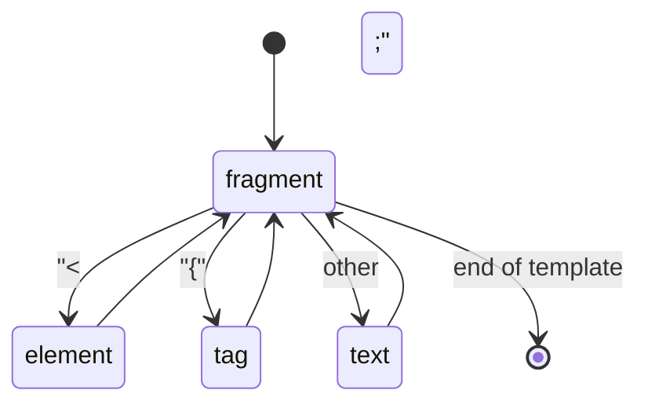

## Overview

Phase 1 of the compiler turns component source into the modern AST: a `Root` node with a `fragment` of template nodes, an optional `instance` and `module` script, an optional `css` stylesheet, the parsed `<svelte:options>`, and every JavaScript comment found along the way. It is a hand-written, single-pass parser for the markup that hands every JavaScript expression to acorn. [[Compiler Pipeline]] calls it through `parse(template, loose)`; the AST it returns feeds [[Scopes and Bindings]] and [[Component Analysis]].

Sources: [packages/svelte/src/compiler/phases/1-parse/index.js:74-91](repo://packages/svelte/src/compiler/phases/1-parse/index.js#L74-L91), [packages/svelte/src/compiler/phases/1-parse/index.js:291-301](repo://packages/svelte/src/compiler/phases/1-parse/index.js#L291-L301)

## The Parser and its states

`Parser` holds the template, a cursor (`index`), a `stack` of open nodes (elements and blocks waiting for their closing tag) and a parallel `fragments` stack of the node lists new children go into. `append` pushes a node into the top fragment; `pop` closes the top node. Helpers move the cursor: `eat` consumes an exact string and, when `required`, throws `expected_token`; `match` and `match_regex` look without moving; `read`, `read_until` and `read_identifier` consume and return text.

Sources: [packages/svelte/src/compiler/phases/1-parse/index.js:18-52](repo://packages/svelte/src/compiler/phases/1-parse/index.js#L18-L52), [packages/svelte/src/compiler/phases/1-parse/index.js:153-219](repo://packages/svelte/src/compiler/phases/1-parse/index.js#L153-L219), [packages/svelte/src/compiler/phases/1-parse/index.js:248-289](repo://packages/svelte/src/compiler/phases/1-parse/index.js#L248-L289)

Parsing is a loop over state functions. Each state reads some input and may return the next state; when it returns nothing the loop goes back to `fragment`, which looks at one character to choose `element` for `<`, `tag` for `{`, and `text` for anything else. `text` collects characters up to the next `<` or `{` and stores both the `raw` text and the `data` with character references decoded.

Sources: [packages/svelte/src/compiler/phases/1-parse/index.js:93-98](repo://packages/svelte/src/compiler/phases/1-parse/index.js#L93-L98), [packages/svelte/src/compiler/phases/1-parse/state/fragment.js:1-17](repo://packages/svelte/src/compiler/phases/1-parse/state/fragment.js#L1-L17), [packages/svelte/src/compiler/phases/1-parse/state/text.js:1-23](repo://packages/svelte/src/compiler/phases/1-parse/state/text.js#L1-L23)

Sources: [packages/svelte/src/compiler/phases/1-parse/state/fragment.js:6-17](repo://packages/svelte/src/compiler/phases/1-parse/state/fragment.js#L6-L17)

Once the loop reaches the end, anything still on the stack is unclosed: in strict mode that is `element_unclosed` or `block_unclosed`. The constructor then sets the root's `start` and `end` to the first and last non-whitespace template positions, and pulls the `SvelteOptions` node out of the fragment, turning it into `root.options` with `read_options`. The raw node is kept on a non-enumerable `__raw__` property so the legacy AST can put it back.

Sources: [packages/svelte/src/compiler/phases/1-parse/index.js:100-151](repo://packages/svelte/src/compiler/phases/1-parse/index.js#L100-L151)

## Elements and attributes

`element` handles every construct that starts with `<`. HTML comments become `Comment` nodes. A closing tag pops the stack until it finds the matching open element; regular elements popped on the way were closed implicitly (as in `

`) and raise the `element_implicitly_closed` warning, while a non-element in between is an error.

Sources: [packages/svelte/src/compiler/phases/1-parse/state/element.js:51-127](repo://packages/svelte/src/compiler/phases/1-parse/state/element.js#L51-L127)

For an opening tag the name decides the node type: names in the `svelte:` map become `SvelteHead`, `SvelteOptions`, `SvelteWindow`, `SvelteElement`, `SvelteBoundary` and the rest; a capitalised or dotted name is a `Component`; `<title>` inside `<svelte:head>` is a `TitleElement`; `<slot>` is a `SlotElement` unless it sits in a declarative shadow-root template; everything else is a `RegularElement`. Root-only tags such as `<svelte:window>` may appear once and only at the top level. When the HTML rules say the new tag closes its parent (a `
` after an open `
`, say), the parent is popped and remembered in `last_auto_closed_tag` so a later explicit closing tag gets a clear error.

Sources: [packages/svelte/src/compiler/phases/1-parse/state/element.js:32-49](repo://packages/svelte/src/compiler/phases/1-parse/state/element.js#L32-L49), [packages/svelte/src/compiler/phases/1-parse/state/element.js:129-207](repo://packages/svelte/src/compiler/phases/1-parse/state/element.js#L129-L207)

Attributes are read one at a time. A duplicate of the same kind is an `attribute_duplicate` error, where `bind:x` counts as the same name as `x` but `class:x` and `style:x` do not. The `this` attribute of `<svelte:component>` and `<svelte:element>` is removed from the list and stored as the node's `expression` or `tag`. An attribute name with a colon becomes a directive through `get_directive_type`; the part after the colon is split on `|` into the directive name and its modifiers, a `transition:`, `in:` or `out:` sets `intro` and `outro`, and `bind:value` or `class:active` without a value gets an identifier of the same name as its expression.

Sources: [packages/svelte/src/compiler/phases/1-parse/state/element.js:209-300](repo://packages/svelte/src/compiler/phases/1-parse/state/element.js#L209-L300), [packages/svelte/src/compiler/phases/1-parse/state/element.js:610-707](repo://packages/svelte/src/compiler/phases/1-parse/state/element.js#L610-L707)

| Prefix | Node type |
| --- | --- |
| `use:` | `UseDirective` |
| `animate:` | `AnimateDirective` |
| `bind:` | `BindDirective` |
| `class:` | `ClassDirective` |
| `style:` | `StyleDirective` |
| `on:` | `OnDirective` |
| `let:` | `LetDirective` |
| `in:`, `out:`, `transition:` | `TransitionDirective` |

Sources: [packages/svelte/src/compiler/phases/1-parse/state/element.js:696-706](repo://packages/svelte/src/compiler/phases/1-parse/state/element.js#L696-L706)

Children are handled by what the element is. Void and self-closing elements are not pushed on the stack. `<textarea>` content is read as a sequence of text and expression tags up to `</textarea>`. A nested ``, replaces all text before it with spaces (keeping newlines) so acorn reports offsets and line numbers that match the component file, and parses the result as a module. `context="module"` or the bare `module` attribute makes it the module script; attributes such as `server` or `default` are reserved and others warn with `script_unknown_attribute`. A second script of the same kind is `script_duplicate`. An HTML comment directly before the script is attached as a leading comment, which lets `svelte-ignore` comments placed there reach warnings about the script ([[Errors and Warnings]]).

Sources: [packages/svelte/src/compiler/phases/1-parse/read/script.js:10-90](repo://packages/svelte/src/compiler/phases/1-parse/read/script.js#L10-L90), [packages/svelte/src/compiler/phases/1-parse/state/element.js:302-346](repo://packages/svelte/src/compiler/phases/1-parse/state/element.js#L302-L346)

`read_style` parses the stylesheet into a CSS AST of rules, at-rules, selectors and declarations, keeping the raw `styles` text and its offsets. [[Scoped CSS]] explains how that tree is analysed and rewritten.

Sources: [packages/svelte/src/compiler/phases/1-parse/read/style.js:19-43](repo://packages/svelte/src/compiler/phases/1-parse/read/style.js#L19-L43)

`read_options` validates each `<svelte:options>` attribute: `runes`, `namespace` (`html`, `mathml` or `svg`), `css="injected"`, `customElement` (a tag name or an object with `tag`, `shadow`, `props` and `extend`), `immutable`, `accessors` and `preserveWhitespace`. The deprecated `tag` attribute is an error, and unknown attributes raise `svelte_options_unknown_attribute`.

Sources: [packages/svelte/src/compiler/phases/1-parse/read/options.js:22-60](repo://packages/svelte/src/compiler/phases/1-parse/read/options.js#L22-L60), [packages/svelte/src/compiler/phases/1-parse/read/options.js:150-192](repo://packages/svelte/src/compiler/phases/1-parse/read/options.js#L150-L192)

## Tags and blocks

`tag` reads what follows `{`: `#` opens a block, `:` continues one (`{:else}`, `{:then}`, `{:catch}`), `@` is a special tag, and `/` closes a block unless it starts a JavaScript comment. Anything else is an `ExpressionTag`.

Sources: [packages/svelte/src/compiler/phases/1-parse/state/tag.js:17-48](repo://packages/svelte/src/compiler/phases/1-parse/state/tag.js#L17-L48)

Opening a block appends the block node and pushes it with its first fragment, the same way an element is pushed. `{#if}` pushes its `consequent`; `{:else}` pops that fragment and pushes a new `alternate`, and `{:else if}` nests another `IfBlock` marked `elseif` inside the alternate, so closing `{/if}` has to pop every nested `elseif` block. The other openers are `each`, `await`, `key` and `snippet`; the `@` tags are `html`, `debug`, `const`, `render` and `attach`.

Sources: [packages/svelte/src/compiler/phases/1-parse/state/tag.js:50-79](repo://packages/svelte/src/compiler/phases/1-parse/state/tag.js#L50-L79), [packages/svelte/src/compiler/phases/1-parse/state/tag.js:441-470](repo://packages/svelte/src/compiler/phases/1-parse/state/tag.js#L441-L470), [packages/svelte/src/compiler/phases/1-parse/state/tag.js:555-583](repo://packages/svelte/src/compiler/phases/1-parse/state/tag.js#L555-L583)

`{#each list as { y = z }}` needs special care because acorn would read `list as { y = z }` as a TypeScript `as` expression or fail on the pattern. The parser tries to read the expression, and on failure cuts the template back to the last `as` before the error and tries again, restoring the full template afterwards. When the expression did swallow an `as` cast it walks the expression to find the trailing `TSAsExpression` and splits it off.

Sources: [packages/svelte/src/compiler/phases/1-parse/state/tag.js:81-140](repo://packages/svelte/src/compiler/phases/1-parse/state/tag.js#L81-L140)

## JavaScript expressions

All JavaScript goes through `acorn.js`, which picks plain acorn or acorn extended with `@sveltejs/acorn-typescript` depending on whether the component has `lang="ts"` (detected by a regular expression over the source before parsing). Both parse as ES modules at `ecmaVersion: 16`. Comments are collected into `root.comments` and attached afterwards as `leadingComments` and `trailingComments` on the nearest nodes, so esrap can print them back. When parsing a script, `parseStatement` is patched to clear acorn's `undefinedExports`, because a component may `export` names that are declared in the template rather than the script.

Sources: [packages/svelte/src/compiler/phases/1-parse/acorn.js:1-90](repo://packages/svelte/src/compiler/phases/1-parse/acorn.js#L1-L90), [packages/svelte/src/compiler/phases/1-parse/index.js:15-16](repo://packages/svelte/src/compiler/phases/1-parse/index.js#L15-L16), [packages/svelte/src/compiler/phases/1-parse/index.js:65-72](repo://packages/svelte/src/compiler/phases/1-parse/index.js#L65-L72)

`read_expression` calls `parse_expression_at` at the cursor, which lets acorn decide where the expression ends. Acorn's node does not include surrounding parentheses, so the function counts the `(` between the cursor and the node's start and then requires as many `)` after its end, moving the cursor past them. Acorn errors become `js_parse_error` with acorn's position suffix stripped.

Sources: [packages/svelte/src/compiler/phases/1-parse/read/expression.js:29-93](repo://packages/svelte/src/compiler/phases/1-parse/read/expression.js#L29-L93), [packages/svelte/src/compiler/phases/1-parse/index.js:157-163](repo://packages/svelte/src/compiler/phases/1-parse/index.js#L157-L163)

## Loose mode

`parse(source, { loose: true })` exists for editor tooling, which needs an AST while the user is still typing. The `loose` flag changes behaviour in several places:

Sources: [packages/svelte/src/compiler/phases/1-parse/index.js:25-30](repo://packages/svelte/src/compiler/phases/1-parse/index.js#L25-L30)

- `eat(str, true, false)` stops throwing for tokens marked as not required in loose mode, such as the `>` of an opening tag.
- An expression that does not parse becomes an `Identifier` with an empty name spanning up to the matching closing bracket (`get_loose_identifier`).
- An unclosed element or block at the end of the template is ended at the template's end instead of raising an error.
- A tag that did not close may have swallowed the next `<` as an attribute, or the start of a `{/` or `{#`; the parser backs up to re-read it.
- A tag name ending in `.` (as in `<Foo.` while typing) is accepted and treated as a component.

Sources: [packages/svelte/src/compiler/phases/1-parse/index.js:165-181](repo://packages/svelte/src/compiler/phases/1-parse/index.js#L165-L181), [packages/svelte/src/compiler/phases/1-parse/read/expression.js:8-27](repo://packages/svelte/src/compiler/phases/1-parse/read/expression.js#L8-L27), [packages/svelte/src/compiler/phases/1-parse/index.js:100-112](repo://packages/svelte/src/compiler/phases/1-parse/index.js#L100-L112), [packages/svelte/src/compiler/phases/1-parse/state/element.js:350-375](repo://packages/svelte/src/compiler/phases/1-parse/state/element.js#L350-L375), [packages/svelte/src/compiler/phases/1-parse/state/element.js:134-140](repo://packages/svelte/src/compiler/phases/1-parse/state/element.js#L134-L140)

## The legacy AST

Svelte 4 tools expect a differently shaped tree, and `parse` still returns it by default. `convert` in `legacy.js` walks the modern AST with zimmerframe, deleting `metadata` from every node and renaming or restructuring nodes: `RegularElement` becomes `Element`, `Component` becomes `InlineComponent`, `OnDirective` becomes `EventHandler`, `BindDirective` becomes `Binding`, `HtmlTag` becomes `RawMustacheTag`, and `ExpressionTag` becomes `MustacheTag` (or `AttributeShorthand` for `{x}` attributes). Blocks are split into the old child nodes such as `PendingBlock`, `ThenBlock`, `CatchBlock` and `ElseBlock`, and the `<svelte:options>` node is put back into the fragment from `__raw__`.

Sources: [packages/svelte/src/compiler/legacy.js:36-80](repo://packages/svelte/src/compiler/legacy.js#L36-L80), [packages/svelte/src/compiler/legacy.js:107-145](repo://packages/svelte/src/compiler/legacy.js#L107-L145), [packages/svelte/src/compiler/legacy.js:305-330](repo://packages/svelte/src/compiler/legacy.js#L305-L330), [packages/svelte/src/compiler/legacy.js:370-415](repo://packages/svelte/src/compiler/legacy.js#L370-L415)
