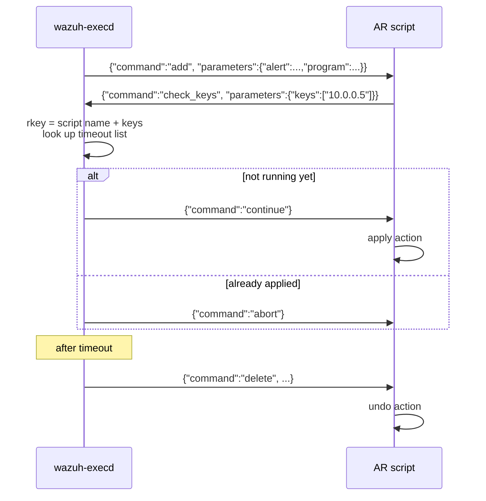

## Overview

Active response runs a script on an endpoint in reaction to something the manager decided: block an IP with the firewall, add it to `hosts.deny`, disable an account, restart Wazuh. On the endpoint the work is done by `wazuh-execd`, which receives JSON commands on a local socket, looks up the script, feeds it the command on standard input, and remembers it so it can undo the action after a timeout. The scripts under `src/active-response` share a small C library that implements their side of that conversation.

Sources: [src/os_execd/execd.c:204-260](repo://src/os_execd/execd.c#L204-L260), [src/active-response/active_responses.c:41-98](repo://src/active-response/active_responses.c#L41-L98)

## From the manager to the agent

### Sending a command

The framework (for example, the REST API's active-response endpoint) builds a JSON message with `origin`, `command` and `parameters` (`extra_args` and the triggering `alert`), after checking that active response is not disabled on the target agent. `WazuhQueue.send_msg_to_agent` wraps it as `(msg_to_agent) [] <flag> <agent id> <json>`, where the flag says whether it goes to all agents (`A`) or one (`NNS`), and writes it to `queue/alerts/ar`. For the manager itself (agent `000`) the JSON is written without the wrapper.

Sources: [framework/wazuh/core/active_response.py:240-284](repo://framework/wazuh/core/active_response.py#L240-L284), [framework/wazuh/core/wazuh_queue.py:14-35](repo://framework/wazuh/core/wazuh_queue.py#L14-L35), [framework/wazuh/core/wazuh_queue.py:146-160](repo://framework/wazuh/core/wazuh_queue.py#L146-L160)

### Forwarding in remoted

Remoted's `AR_Forward` thread reads `queue/alerts/ar`, parses the location flags and the agent ID, and prefixes the payload with `#!-execd ` (or only `#!-` for non-AR control messages such as a syscheck restart). For all-agents requests it sends to every agent whose last message arrived within `agents_disconnection_time`; otherwise it sends to the one agent named. [[Remoted: Agent Connections]] covers `send_msg`, and [[Agent Daemon (agentd)]] shows how agentd writes the payload to execd's socket `queue/alerts/execq`.

Sources: [src/remoted/ar-forward.c:20-130](repo://src/remoted/ar-forward.c#L20-L130), [src/headers/defs.h:171-180](repo://src/headers/defs.h#L171-L180)

## Execd main loop

### Waiting for commands

`ExecdStart` creates the timeout list and, when `repeated_offenders` is configured, a hash of repeat counts. Each loop it reaps finished children with `waitpid`, runs `ExecdTimeoutRun`, and waits up to `EXECD_TIMEOUT` seconds on the queue socket; every message received is passed to `ExecdRun`.

Sources: [src/os_execd/execd.c:468-554](repo://src/os_execd/execd.c#L468-L554)

### Resolving the script

`ExecdRun` parses the JSON and reads `command`. The name `restart-wazuh` is special-cased on Unix: it runs `active-response/bin/restart.sh agent|manager` directly. Other names are looked up in `etc/shared/ar.conf`, a file of lines `name - script - timeout`; when a name is missing the file is reread once, so a new command pushed with the shared configuration works without restarting execd. `ReadExecConfig` rejects scripts containing `..` and blanks entries whose file is not present in `active-response/bin`.

Sources: [src/os_execd/execd.c:220-262](repo://src/os_execd/execd.c#L220-L262), [src/os_execd/exec.c:26-140](repo://src/os_execd/exec.c#L26-L140), [src/headers/defs.h:158-166](repo://src/headers/defs.h#L158-L166)

## The script protocol

### Message exchange

Execd and the script talk over the script's stdin and stdout, one JSON line at a time:

Sources: [src/os_execd/execd.c:263-282](repo://src/os_execd/execd.c#L263-L282)

Sources: [src/os_execd/execd.c:263-380](repo://src/os_execd/execd.c#L263-L380), [src/active-response/active_responses.c:99-150](repo://src/active-response/active_responses.c#L99-L150)

1. Execd sets `command` to `add`, sets `origin.module` to `wazuh-execd`, adds `parameters.program`, and writes the line.
2. The script answers with `check_keys` and the values that identify this action, such as the source IP. Execd builds the key `rkey` from the script name and those keys.
3. If `rkey` is already in the timeout list, the action is in effect: execd refreshes its timer and answers `abort`. Otherwise it adds a timeout entry holding the same JSON with `command` set to `delete`, and answers `continue`.

Sources: [src/os_execd/execd.c:263-380](repo://src/os_execd/execd.c#L263-L380), [src/os_execd/execd.c:380-460](repo://src/os_execd/execd.c#L380-L460), [src/os_execd/execd.h:19-22](repo://src/os_execd/execd.h#L19-L22)

A script that does not answer `check_keys` is run but never added to the timeout list.

Sources: [src/os_execd/execd.c:283-292](repo://src/os_execd/execd.c#L283-L292)

### Timeouts and repeated offenders

`ExecdTimeoutRun` walks the list on every loop and, for each entry older than its `time_to_block`, runs the script again with the stored `delete` JSON and removes the entry. A timeout of 0 means the action is never undone. With `<repeated_offenders>` (a list of minutes), each time the same `rkey` is seen again the timeout grows to the next value in the list, so persistent attackers are blocked for longer.

Sources: [src/os_execd/execd.c:141-203](repo://src/os_execd/execd.c#L141-L203), [src/os_execd/execd.c:330-366](repo://src/os_execd/execd.c#L330-L366), [src/os_execd/config.c:75-145](repo://src/os_execd/config.c#L75-L145)

## Writing a response

The helper library gives each script the same skeleton. `setup_and_check_message` changes into the install directory, reads the first line from stdin, and returns `ADD_COMMAND` or `DELETE_COMMAND`. Helpers such as `get_srcip_from_json` read fields from `parameters.alert.data` (including `win.eventdata.ipAddress` on Windows). On `add`, `send_keys_and_check_message` prints the `check_keys` line and returns `CONTINUE_COMMAND` or `ABORT_COMMAND`. Every step is logged to `logs/active-responses.log` with `write_debug_file`.

Sources: [src/active-response/active_responses.c:28-147](repo://src/active-response/active_responses.c#L28-L147), [src/active-response/active_responses.c:226-262](repo://src/active-response/active_responses.c#L226-L262), [src/active-response/active_responses.h:12-22](repo://src/active-response/active_responses.h#L12-L22)

`default-firewall-drop` shows the pattern: it reads `srcip`, sends it as the key, stops on `abort`, picks `iptables` or `ip6tables` from the address version, takes a lock under `active-response/bin/fw-drop` so concurrent runs do not race, and inserts (`-I`) or deletes (`-D`) the drop rule.

Sources: [src/active-response/firewalls/default-firewall-drop.c:10-110](repo://src/active-response/firewalls/default-firewall-drop.c#L10-L110)

## Built-in responses

| Script | Action |
| --- | --- |
| `default-firewall-drop` (`firewall-drop`) | iptables/ip6tables drop rule on Linux, with variants for other systems |
| `firewalld-drop` | Rich rule in firewalld |
| `pf`, `ipfw`, `npf` | BSD and macOS packet filters |
| `host-deny` | Line in `/etc/hosts.deny` |
| `route-null` | Null route to the source IP |
| `disable-account` | Locks the user named in the alert |
| `ip-customblock` | Marker file per blocked IP |
| `netsh` | Windows firewall rule |
| `restart-wazuh`, `restart.sh` | Restart of the agent or manager |
| `wazuh-slack`, `kaspersky` | Notification to Slack, Kaspersky Endpoint scan |

Sources: [src/active-response/firewalls/default-firewall-drop.c:1-20](repo://src/active-response/firewalls/default-firewall-drop.c#L1-L20), [src/Makefile:2057-2117](repo://src/Makefile#L2057-L2117), [src/Makefile:770-770](repo://src/Makefile#L770-L770)

Execd also listens on the `com` socket, which the manager reaches through the request channel described on [[Agent Daemon (agentd)]]. It answers `getconfig`, and runs maintenance commands: `unmerge` and `uncompress` for shared files, `restart`, `reload` and `lock_restart` for the agent itself.

Sources: [src/os_execd/wcom.c:36-106](repo://src/os_execd/wcom.c#L36-L106)
