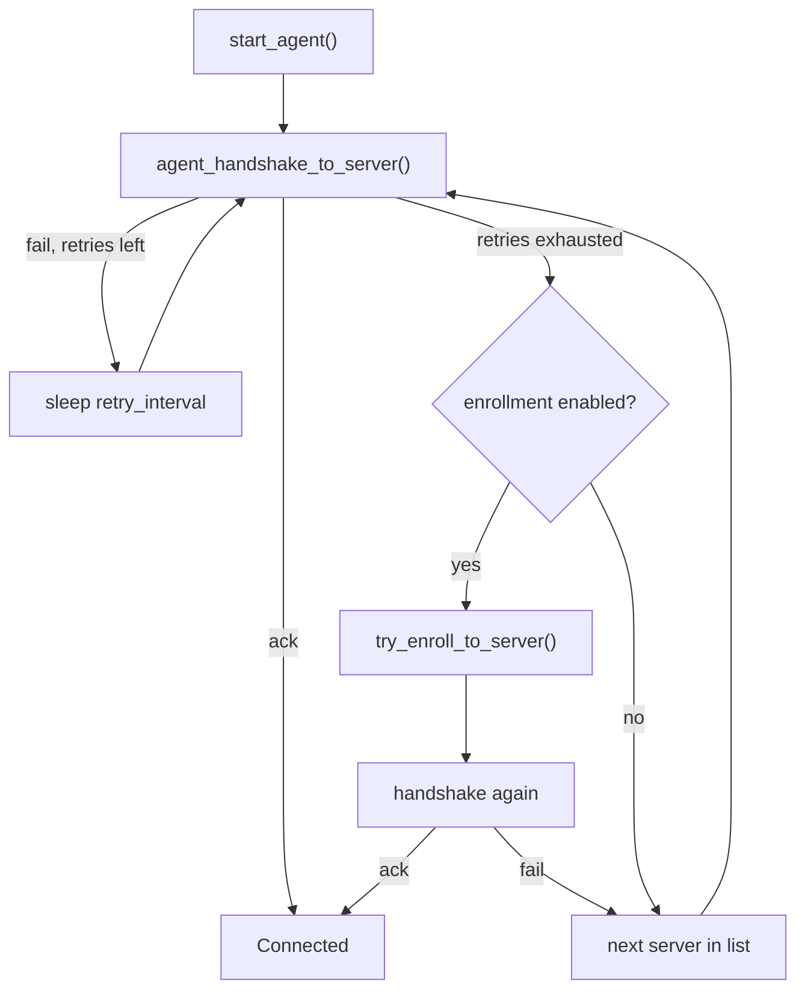

## Overview

`wazuh-agentd` is the only agent process that talks to the manager. Every other agent daemon (logcollector, syscheckd, modulesd) writes its events to the local queue socket; agentd reads that socket, encrypts each message with the agent key, and sends it to the manager's remoted. In the other direction it receives commands, requests and shared configuration files and hands each to the local component that owns it. The message envelope and encryption are on [[Message Encryption and Client Keys]]; how an agent first gets its key is on [[Agent Enrollment (authd)]].

Sources: [src/client-agent/agentd.c:82-101](repo://src/client-agent/agentd.c#L82-L101), [src/client-agent/event-forward.c:17-45](repo://src/client-agent/event-forward.c#L17-L45)

## Startup

`main` parses `-f`, `-d`, `-t`, `-u`, `-g` and `-c`, reads the configuration through `ClientConf`, and calls `AgentdStart`. `ClientConf` sets the defaults before reading `<client>`, `<labels>` and `<client_buffer>`: a 5000-message buffer at 500 events per second, and AES as the encryption method.

Sources: [src/client-agent/main.c:89-130](repo://src/client-agent/main.c#L89-L130), [src/client-agent/main.c:200-249](repo://src/client-agent/main.c#L200-L249), [src/client-agent/config.c:40-80](repo://src/client-agent/config.c#L40-L80)

`AgentdStart` then runs these steps in order.

Sources: [src/client-agent/agentd.c:24-31](repo://src/client-agent/agentd.c#L24-L31)

1. Daemonize, then drop to the configured group and user.
2. Check `client.keys`. With auto-enrollment enabled an empty key file is allowed; without it the daemon exits with `AG_NOKEYS_EXIT`.
3. Read the keys with `OS_ReadKeys`, open the local queue socket (`queue/sockets/queue`) for reading, and write the PID file.
4. Install `SIGUSR1` as the reload signal, and start the log rotation thread when `monitord.rotate_log` is set.
5. Start the buffer dispatch thread when the client buffer is enabled, and the state thread.
6. Call `start_agent(1)` to connect and handshake with a manager.
7. Start the request receiver thread, register `send_agent_stopped_message` at exit, and send the first keep-alive.

Sources: [src/client-agent/agentd.c:24-101](repo://src/client-agent/agentd.c#L24-L101), [src/client-agent/agentd.c:101-160](repo://src/client-agent/agentd.c#L101-L160)

## Connecting to a manager

### Handshake

`start_agent` loops over the configured `<server>` entries. For each server it calls `agent_handshake_to_server` up to `max_retries` times, sleeping `retry_interval` between tries. A handshake opens a TCP or UDP socket (`connect_server` resolves `host/ip` forms and IPv6), sends a control message `#!-agent startup {"version":...}`, and waits `agent.recv_timeout` seconds for a reply. Only an `agent ack` reply counts: it records `available_server` and, on the first start, sends the "agent started" event. A `#!-err` reply carries a JSON message that is logged as the reason.

Sources: [src/client-agent/start_agent.c:48-128](repo://src/client-agent/start_agent.c#L48-L128), [src/client-agent/start_agent.c:327-391](repo://src/client-agent/start_agent.c#L327-L391)

### Failover and enrollment

When the attempts for one server run out, `start_agent` tries enrollment once (if enabled) and a last handshake, then moves to the next server in the list, wrapping to the first with "Unable to connect to any server". It never gives up, so the agent keeps retrying until a manager answers.

Sources: [src/client-agent/start_agent.c:131-183](repo://src/client-agent/start_agent.c#L131-L183)

Sources: [src/client-agent/start_agent.c:131-183](repo://src/client-agent/start_agent.c#L131-L183), [src/client-agent/start_agent.c:305-317](repo://src/client-agent/start_agent.c#L305-L317)

With an empty key store, `w_agentd_keys_init` enrolls before the first handshake: first against the configured enrollment manager, then against each server, sleeping 5 more seconds after every failed round up to 60. After a successful enrollment the agent waits `delay_after_enrollment`, reloads its keys with `OS_UpdateKeys`, and applies the crypto method.

Sources: [src/client-agent/start_agent.c:191-247](repo://src/client-agent/start_agent.c#L191-L247), [src/client-agent/start_agent.c:305-317](repo://src/client-agent/start_agent.c#L305-L317)

## The main loop

After connecting, `AgentdStart` loops on `select` over two descriptors with a one-second timeout: the manager socket and the local queue. Each turn it calls `run_notify`, applies a pending configuration reload, and reconnects the execd queue if it is closed. Data on the manager socket goes to `receive_msg`; a failure there marks the agent not active and calls `start_agent(0)` to reconnect. Data on the local queue goes to `EventForward`.

Sources: [src/client-agent/agentd.c:164-258](repo://src/client-agent/agentd.c#L164-L258)

During a reconnect, `os_setwait` creates the wait file and `os_delwait` removes it. `SendMSG`, which every collector uses to write to the queue, calls `os_wait` first, so collectors pause instead of filling the queue while the manager is unreachable.

Sources: [src/shared/wait_op.c:19-41](repo://src/shared/wait_op.c#L19-L41), [src/shared/mq_op.c:181-185](repo://src/shared/mq_op.c#L181-L185), [src/client-agent/agentd.c:242-252](repo://src/client-agent/agentd.c#L242-L252)

## Forwarding events

### Direct sending

`EventForward` drains the queue socket without blocking. Without a buffer it calls `send_msg` for each message directly. `send_msg` builds the encrypted frame with `CreateSecMSG` and sends it with `OS_SendUDPbySize` or, under a mutex, `OS_SendSecureTCP`; a send error is logged and followed by a one-second sleep.

Sources: [src/client-agent/event-forward.c:17-45](repo://src/client-agent/event-forward.c#L17-L45), [src/client-agent/sendmsg.c:22-75](repo://src/client-agent/sendmsg.c#L22-L75)

### Client buffer

With `<client_buffer>` enabled, `EventForward` appends to a ring buffer of `queue_size` slots instead, and `dispatch_buffer` sends from it at most `events_per_second` per second, sleeping the rest of each interval in `delay`. When the buffer is full the new event is dropped. The buffer tracks a state machine and reports each change to the manager as an event from location `wazuh-agent`, so the manager knows events were lost.

Sources: [src/client-agent/buffer.c:204-235](repo://src/client-agent/buffer.c#L204-L235)

| State | Entered when | Left when |
| --- | --- | --- |
| `NORMAL` | Usage falls to `agent.normal_level` | Usage reaches `agent.warn_level` or the buffer fills |
| `WARNING` | Usage reaches `agent.warn_level` | Usage falls to normal, or the buffer fills |
| `FULL` | No free slot | Usage drops below warning |
| `FLOOD` | Full for `agent.tolerance` seconds | Usage drops below warning |

Sources: [src/client-agent/buffer.c:58-134](repo://src/client-agent/buffer.c#L58-L134), [src/client-agent/buffer.c:140-255](repo://src/client-agent/buffer.c#L140-L255)

A `SIGUSR1` reload rereads `<client_buffer>` from `ossec.conf` and `agent.conf`, and frees, starts or resizes the buffer to match.

Sources: [src/client-agent/agentd.c:193-231](repo://src/client-agent/agentd.c#L193-L231)

## Keep-alives

`run_notify` sends a keep-alive every `notify_time` seconds. The message carries the `uname` string, the MD5 of `agent.conf` when present, the agent labels, the line `<md5> merged.mg` for the shared bundle (or `x` when it is missing), and the agent's own IP as the `_agent_ip` label. The manager compares that checksum with the group's current bundle to decide whether to push new shared files.

Sources: [src/client-agent/notify.c:21-40](repo://src/client-agent/notify.c#L21-L40), [src/client-agent/notify.c:123-203](repo://src/client-agent/notify.c#L123-L203)

`run_notify` also guards the connection. When no message has come from the manager for `time-reconnect` seconds, it reconnects; when `force_reconnect_interval` is set and that much time passed since the last connect, it reconnects even if the link is healthy.

Sources: [src/client-agent/notify.c:92-121](repo://src/client-agent/notify.c#L92-L121)

## Messages from the manager

### Control messages

`receive_msg` decrypts each frame with `ReadSecMSG` and, when it starts with the control header, dispatches on the prefix. Any valid control message refreshes `available_server`.

Sources: [src/client-agent/receiver.c:89-104](repo://src/client-agent/receiver.c#L89-L104)

| Prefix | Handling |
| --- | --- |
| `#!-execd ` | Sent to the execd queue (a queue thread on Windows) |
| `#!-force_reconnect` | Reconnects with `start_agent(0)` |
| syscheck and FIM sync headers | `ag_send_syscheck` to syscheckd |
| syscollector and its sync header | `wmcom_send` to modulesd |
| `#!-req ` | `req_push` into the request queue |
| `#!-sca-dump` | Forwarded to the SCA queue |
| `#!-up file <md5> <name>` | Opens `etc/shared/<name>` for writing |
| `#!-close file` | Verifies the MD5 and installs the file |

Sources: [src/client-agent/receiver.c:105-198](repo://src/client-agent/receiver.c#L105-L198)

### Shared files

Between `up file` and `close file`, every non-control frame is appended to the open file. On close the MD5 must match the announced sum, or the file is deleted. When the file is `merged.mg`, `UnmergeFiles` expands it into `etc/shared`, removes stale files, and clears the cached hash so the next keep-alive reports the new sum. If remote configuration is on and the new `agent.conf` validates, the agent reloads itself when `auto_restart` is set. File names with `..` are rejected to block directory traversal.

Sources: [src/client-agent/receiver.c:200-318](repo://src/client-agent/receiver.c#L200-L318), [src/client-agent/receiver.c:320-324](repo://src/client-agent/receiver.c#L320-L324)

### Requests

A request is `#!-req <counter> <target> <payload>`. `req_push` connects to `queue/sockets/<target>` (unless the target is `agent` itself), replies `ack` immediately over UDP, and queues the request. `req_receiver` threads send the payload to the target socket, read the answer, and send it back with the same counter; targets `agent` are answered by `agcom_dispatch` in-process. This is how the manager reads an agent's running configuration or state.

Sources: [src/client-agent/request.c:108-200](repo://src/client-agent/request.c#L108-L200), [src/client-agent/request.c:232-300](repo://src/client-agent/request.c#L232-L300)

## Related pages

The manager side of each exchange is on [[Remoted: Agent Connections]]; the active-response path that `#!-execd` feeds is on [[Active Response and Execd]]; the shared `agent.conf` format is on [[Configuration Loading (ossec.conf)]].

Sources: [src/client-agent/receiver.c:105-149](repo://src/client-agent/receiver.c#L105-L149)
