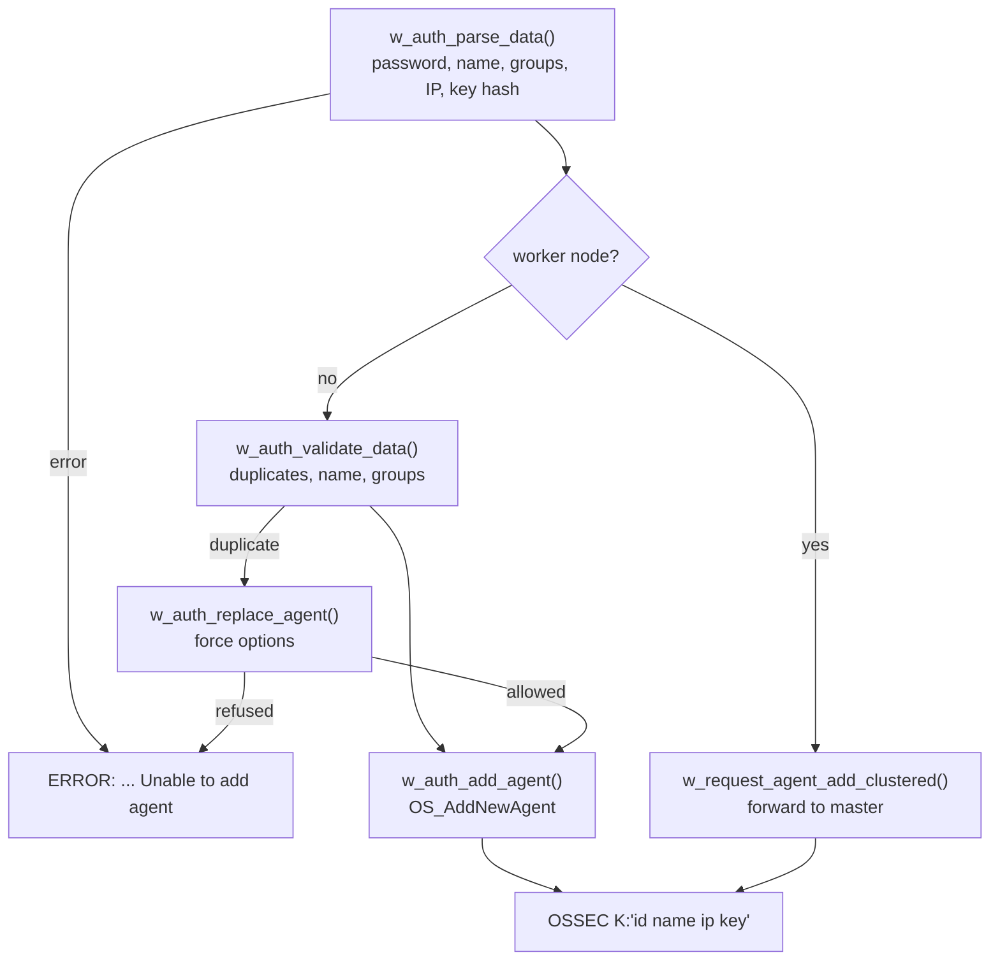

## Overview

Before an agent can talk to [[Remoted: Agent Connections]] it needs a line in `client.keys`, on both sides. Enrollment is how that line is created: the agent opens a TLS connection to `wazuh-authd` on the manager (port 1515 by default), asks for a key under its name, and stores the answer. `wazuh-authd` validates the request, generates the key, writes it to the manager's `client.keys`, and registers the agent in wazuh-db. The same daemon also serves a local socket that the API uses to add and remove agents, and a key-request channel that lets remoted fetch keys for unknown agents from an external source. The key file format is on [[Message Encryption and Client Keys]].

Sources: [src/os_auth/main-server.c:540-560](repo://src/os_auth/main-server.c#L540-L560), [src/config/authd-config.c:75-80](repo://src/config/authd-config.c#L75-L80), [src/os_auth/main-server.c:710-750](repo://src/os_auth/main-server.c#L710-L750)

## The protocol

The exchange is one request line and one response line over TLS. The agent sends:

Sources: [src/shared/enrollment_op.c:282-300](repo://src/shared/enrollment_op.c#L282-L300)

```text
[OSSEC PASS: <password> ]OSSEC A:'<agent name>'[ V:'<version>'][ G:'<group,...>'][ IP:'<ip>|src'][ K:'<sha1 of current key>']
```

Sources: [src/os_auth/auth.c:66-130](repo://src/os_auth/auth.c#L66-L130), [src/os_auth/auth.c:150-235](repo://src/os_auth/auth.c#L150-L235)

On success the manager answers `OSSEC K:'<id> <name> <ip> <key>'`, the exact `client.keys` line. On failure it answers `ERROR: <reason>. Unable to add agent`, for example `ERROR: Invalid password` or `ERROR: Duplicate agent name: web01`.

Sources: [src/os_auth/main-server.c:736-750](repo://src/os_auth/main-server.c#L736-L750), [src/os_auth/auth.c:86-92](repo://src/os_auth/auth.c#L86-L92)

`w_auth_parse_data` reads the optional fields in order. An agent version newer than the manager is refused unless `allow_higher_versions` is set. Group names are validated and de-duplicated. `IP:'src'` means "use the address the connection came from"; a missing IP field registers the agent as `any`, so it can connect from anywhere. `K:` carries the SHA-1 of the key the agent already has, which lets the manager recognize a re-enrollment of the same agent.

Sources: [src/os_auth/auth.c:150-235](repo://src/os_auth/auth.c#L150-L235)

## The client side

Agents enroll from `agentd` automatically when they have no key (see [[Agent Daemon (agentd)]]), or by hand with the `agent-auth` tool built from `main-client.c`. Both use `w_enrollment_request_key` from `src/shared/enrollment_op.c`:

Sources: [src/shared/enrollment_op.c:126-153](repo://src/shared/enrollment_op.c#L126-L153), [src/os_auth/main-client.c:305-312](repo://src/os_auth/main-client.c#L305-L312)

1. Connect over TCP and complete the TLS handshake. With a manager CA configured, `w_enrollment_verify_ca_certificate` checks the manager certificate against the expected host name (`check_x509_cert`).
2. Build the request with the agent name (the configured name or the host name), the password if one is configured or present in `authd.pass`, and the optional group, source IP and current key hash.
3. Read the response. `OSSEC K:'...'` is parsed and written to `client.keys` through a temporary file and an atomic move; `ERROR` is logged.

Sources: [src/shared/enrollment_op.c:195-260](repo://src/shared/enrollment_op.c#L195-L260), [src/shared/enrollment_op.c:349-445](repo://src/shared/enrollment_op.c#L349-L445), [src/shared/enrollment_op.c:499-535](repo://src/shared/enrollment_op.c#L499-L535)

## The server side

### Startup

`wazuh-authd` builds the TLS context with `os_ssl_keys` (manager certificate and key, optional agent CA, cipher list; TLS 1.2 only unless `auto_negotiate` is set), binds the port, and registers it with epoll. When `use_password` is on, it reads the password from `etc/authd.pass`, or generates a random one and logs it. On the master node it then loads `client.keys` in raw mode, including removed entries unless `clear_removed` is set, and the registration timestamps.

Sources: [src/os_auth/main-server.c:540-625](repo://src/os_auth/main-server.c#L540-L625), [src/os_auth/ssl.c:100-180](repo://src/os_auth/ssl.c#L100-L180)

It then starts three threads: the local server, the remote server (when remote enrollment is enabled), and the writer.

Sources: [src/os_auth/main-server.c:628-660](repo://src/os_auth/main-server.c#L628-L660)

### Handling a request

`run_remote_server` drives non-blocking TLS sessions with epoll. After `SSL_accept`, when `verify_host` is set together with an agent CA, the agent's certificate must match its source IP. The request is then processed by `process_message`:

Sources: [src/os_auth/main-server.c:801-826](repo://src/os_auth/main-server.c#L801-L826), [src/os_auth/main-server.c:884-900](repo://src/os_auth/main-server.c#L884-L900)



Sources: [src/os_auth/main-server.c:710-750](repo://src/os_auth/main-server.c#L710-L750), [src/os_auth/auth.c:319-382](repo://src/os_auth/auth.c#L319-L382)

On a cluster worker, authd does not touch its own keys: it forwards the request to the master, which decides. On the master, under the keys mutex, `w_auth_validate_data` rejects an agent named like the manager and checks for an existing agent with the same IP or name. A duplicate is replaced only if the `<force>` options allow it: force must be enabled, the old agent must have been disconnected for at least `disconnected_time` (when set), registered for at least `after_registration_time`, and, with `key_mismatch`, only replaced when the agent's key hash differs from the stored one. Otherwise the request fails with `Duplicate IP` or `Duplicate agent name`.

Sources: [src/os_auth/auth.c:236-318](repo://src/os_auth/auth.c#L236-L318), [src/os_auth/auth.c:319-366](repo://src/os_auth/auth.c#L319-L366)

`w_auth_add_agent` calls `OS_AddNewAgent`, which takes the next ID from the keystore counter (formatted as three digits) and derives the key from hashes of the time, name, IP, ID and random numbers, then queues an insert for the writer.

Sources: [src/os_auth/auth.c:366-382](repo://src/os_auth/auth.c#L366-L382), [src/os_auth/auth.c:38-64](repo://src/os_auth/auth.c#L38-L64), [src/addagent/validate.c:40-70](repo://src/addagent/validate.c#L40-L70)

### Persisting keys

The writer thread sleeps until there is pending work, takes the queued inserts and removals, writes `client.keys` and the timestamps file once for the whole batch, and then updates wazuh-db: `wdb_insert_agent` for each new agent (plus `wdb_set_agent_groups_csv` when a group was requested) and `wdb_remove_agent` for each removal. Batching keeps a burst of enrollments from rewriting the key file once per agent. Remoted notices the new file through its key reload thread.

Sources: [src/os_auth/main-server.c:1057-1160](repo://src/os_auth/main-server.c#L1057-L1160)

## Local socket API

`run_local_server` listens on `queue/sockets/auth` for JSON requests with a `function` field. The framework uses it to manage agents without going through TLS:

Sources: [src/os_auth/local-server.c:91-95](repo://src/os_auth/local-server.c#L91-L95), [src/os_auth/local-server.c:190-200](repo://src/os_auth/local-server.c#L190-L200)

| `function` | Arguments | Effect |
| --- | --- | --- |
| `add` | `name`, `ip`, optional `id`, `key`, `groups`, `key_hash`, `force` | Same validation as a remote enrollment, returns the new ID and key |
| `remove` | `id`, `purge` | Removes the key (or marks it removed) and the agent in wazuh-db |
| `get` | `id` | Returns the agent's key entry |

Sources: [src/os_auth/local-server.c:197-316](repo://src/os_auth/local-server.c#L197-L316), [src/os_auth/local-server.c:345-460](repo://src/os_auth/local-server.c#L345-L460), [src/os_auth/local-server.c:460-500](repo://src/os_auth/local-server.c#L460-L500)

## Key requests

When remoted receives a message from an unknown agent, or one it cannot decrypt, it pushes a key request by ID or IP to `queue/sockets/krequest`. Authd's key request thread passes it to a configured integration, either an external socket or an executable (`exec_path`) run with `id` or `ip` and the value. The integration answers with the agent's ID, name, IP and key in JSON, and authd adds that agent like a local `add`. This lets an external inventory system provision keys on demand.

Sources: [src/os_auth/key_request.c:112-210](repo://src/os_auth/key_request.c#L112-L210), [src/os_auth/key_request.c:212-330](repo://src/os_auth/key_request.c#L212-L330), [src/os_auth/key_request.c:330-345](repo://src/os_auth/key_request.c#L330-L345), [src/remoted/secure.c:699-712](repo://src/remoted/secure.c#L699-L712)
