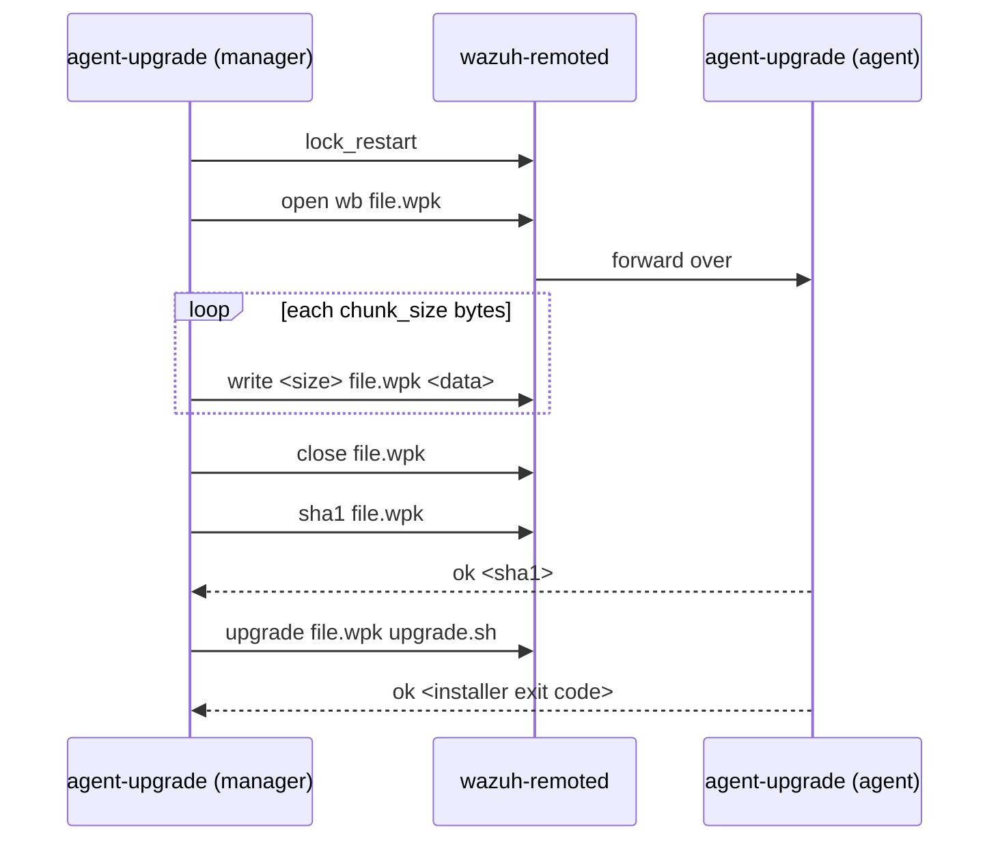

## Overview

Agents can be upgraded remotely from the manager by pushing a WPK (Wazuh signed package) over the existing agent connection. Three pieces cooperate. The `agent-upgrade` module on the manager accepts upgrade requests, validates each agent and package, and streams the WPK to the agent. The same module on the agent receives the file, verifies and unpacks it, and runs its installer. The `task-manager` module on the manager records every upgrade as a task in wazuh-db, so the API can report progress and stuck tasks time out. Both modules are default modules of [[Modules Daemon (modulesd)]] and run even without a configuration block.

Sources: [src/wazuh_modules/wmodules.c:30-36](repo://src/wazuh_modules/wmodules.c#L30-L36), [src/wazuh_modules/agent_upgrade/manager/wm_agent_upgrade_manager.c:62-87](repo://src/wazuh_modules/agent_upgrade/manager/wm_agent_upgrade_manager.c#L62-L87)

## Requests to the manager module

The manager module listens on `queue/tasks/upgrade`. After a short wait for the task manager to start, it cancels upgrade tasks left pending from a previous run and starts the dispatcher thread. Each request is a JSON command parsed by `wm_agent_upgrade_parse_message` into one of four kinds:

Sources: [src/wazuh_modules/agent_upgrade/manager/wm_agent_upgrade_manager.c:88-110](repo://src/wazuh_modules/agent_upgrade/manager/wm_agent_upgrade_manager.c#L88-L110), [src/headers/defs.h:150-155](repo://src/headers/defs.h#L150-L155)

| Command | Handler | Purpose |
| --- | --- | --- |
| `upgrade` | `wm_agent_upgrade_process_upgrade_command` | Upgrade agents to a version from a WPK repository |
| `upgrade_custom` | `wm_agent_upgrade_process_upgrade_custom_command` | Upgrade with a local WPK file and optional installer |
| `upgrade_update_status` | `wm_agent_upgrade_process_agent_result_command` | An agent reports how its upgrade ended |
| `upgrade_result` | `wm_agent_upgrade_process_upgrade_result_command` | Ask for the state of agents' tasks |

Sources: [src/wazuh_modules/agent_upgrade/manager/wm_agent_upgrade_manager.c:150-190](repo://src/wazuh_modules/agent_upgrade/manager/wm_agent_upgrade_manager.c#L150-L190)

For an upgrade request, each agent ID is checked by `wm_agent_upgrade_analyze_agent`, which reads the agent from wazuh-db and runs `wm_agent_upgrade_validate_agent_task`: a valid ID (not the manager), an active connection, a supported platform and architecture (which also picks the package type), and a version that the requested upgrade can apply to. Agents that fail get an error entry in the response; the rest become tasks created in the task manager and queued for dispatch. The caller receives the list of task IDs and errors immediately; the upgrades run in the background.

Sources: [src/wazuh_modules/agent_upgrade/manager/wm_agent_upgrade_commands.c:87-125](repo://src/wazuh_modules/agent_upgrade/manager/wm_agent_upgrade_commands.c#L87-L125), [src/wazuh_modules/agent_upgrade/manager/wm_agent_upgrade_commands.c:316-345](repo://src/wazuh_modules/agent_upgrade/manager/wm_agent_upgrade_commands.c#L316-L345), [src/wazuh_modules/agent_upgrade/manager/wm_agent_upgrade_upgrades.c:137-150](repo://src/wazuh_modules/agent_upgrade/manager/wm_agent_upgrade_upgrades.c#L137-L150)

## Sending the WPK

### Dispatch and status

`wm_agent_upgrade_dispatch_upgrades` pops tasks from the queue and starts one thread per task, limited by a semaphore of `max_threads`. Each thread sets its task to `In progress`, sends the WPK, and on failure sets the task to `Failed` with the error text. Agents older than the new upgrade mechanism cannot report a result, so their task is marked `Legacy` once the package is delivered.

Sources: [src/wazuh_modules/agent_upgrade/manager/wm_agent_upgrade_upgrades.c:154-257](repo://src/wazuh_modules/agent_upgrade/manager/wm_agent_upgrade_upgrades.c#L154-L257), [src/wazuh_modules/wm_task_general.c:55-63](repo://src/wazuh_modules/wm_task_general.c#L55-L63)

### The command sequence

`wm_agent_upgrade_send_wpk_to_agent` validates the package (the version against the repository and the SHA-1 of the downloaded WPK, or the SHA-1 of a custom file), picks the installer (`upgrade.sh`, or `upgrade.bat` for Windows), and sends this sequence, stopping at the first failure:

Sources: [src/wazuh_modules/agent_upgrade/manager/wm_agent_upgrade_upgrades.c:259-300](repo://src/wazuh_modules/agent_upgrade/manager/wm_agent_upgrade_upgrades.c#L259-L300)



Sources: [src/wazuh_modules/agent_upgrade/manager/wm_agent_upgrade_upgrades.c:300-357](repo://src/wazuh_modules/agent_upgrade/manager/wm_agent_upgrade_upgrades.c#L300-L357)

Each step is a request written to remoted's local socket (`queue/sockets/remote`) as `<agent id> upgrade {"command":"open",...}`, or as the older `com open wb ...` text form when the agent predates the JSON format. Remoted delivers it as a `#!-req` request and returns the agent's answer, as [[Agent Daemon (agentd)]] describes. The `open` step is retried a few times, and the final `upgrade` step fails unless the installer's exit code is `0`.

Sources: [src/wazuh_modules/agent_upgrade/manager/wm_agent_upgrade_upgrades.c:377-420](repo://src/wazuh_modules/agent_upgrade/manager/wm_agent_upgrade_upgrades.c#L377-L420), [src/wazuh_modules/agent_upgrade/manager/wm_agent_upgrade_upgrades.c:557-633](repo://src/wazuh_modules/agent_upgrade/manager/wm_agent_upgrade_upgrades.c#L557-L633)

## On the agent

### Receiving and installing

`wm_agent_upgrade_process_command` handles `open`, `write`, `close`, `sha1`, `upgrade` and `clear_upgrade_result`. File names are confined to the incoming directory, and `write` must target the file that `open` opened. On `upgrade`, the agent verifies the WPK signature (`_unsign`), decompresses it, empties the upgrade directory, unmerges the bundle into it, checks that the installer path stays inside that directory, makes it executable, and runs it with `wm_exec` under the `execd.request_timeout` limit. The reply carries the installer's exit status.

Sources: [src/wazuh_modules/agent_upgrade/agent/wm_agent_upgrade_com.c:160-200](repo://src/wazuh_modules/agent_upgrade/agent/wm_agent_upgrade_com.c#L160-L200), [src/wazuh_modules/agent_upgrade/agent/wm_agent_upgrade_com.c:325-375](repo://src/wazuh_modules/agent_upgrade/agent/wm_agent_upgrade_com.c#L325-L375)

### Reporting the result

The installer restarts the agent, and the package installer script writes an upgrade result file with `0`, `1` or `2`. After restart, `wm_agent_upgrade_check_status` waits for the queue, then repeatedly reads that file and sends an `upgrade_update_status` message to the manager with queue byte `u` (`UPGRADE_MQ`), backing off from `upgrade_wait_start` by `upgrade_wait_factor_increase` up to `upgrade_wait_max`. The loop ends when the manager, having updated the task, sends `clear_upgrade_result`, which deletes the file and allows new upgrades.

Sources: [src/wazuh_modules/agent_upgrade/agent/wm_agent_upgrade_agent.c:193-286](repo://src/wazuh_modules/agent_upgrade/agent/wm_agent_upgrade_agent.c#L193-L286), [src/wazuh_modules/agent_upgrade/agent/wm_agent_upgrade_com.c:377-386](repo://src/wazuh_modules/agent_upgrade/agent/wm_agent_upgrade_com.c#L377-L386)

## Task manager

The task manager listens on `queue/tasks/task` and turns each request into a `task <command> <json>` query for [[Wazuh DB]], which stores tasks in the `TASKS` table of its own database:

Sources: [src/wazuh_modules/task_manager/wm_task_manager.c:60-120](repo://src/wazuh_modules/task_manager/wm_task_manager.c#L60-L120), [src/wazuh_modules/task_manager/wm_task_manager_commands.c:437-455](repo://src/wazuh_modules/task_manager/wm_task_manager_commands.c#L437-L455)

```sql
CREATE TABLE IF NOT EXISTS TASKS (
    TASK_ID INTEGER PRIMARY KEY AUTOINCREMENT,
    AGENT_ID INT NOT NULL,
    NODE TEXT NOT NULL,
    MODULE TEXT NOT NULL,
    COMMAND TEXT NOT NULL,
    CREATE_TIME INTEGER NOT NULL,
    LAST_UPDATE_TIME INTEGER,
    STATUS TEXT NOT NULL,
    ERROR_MESSAGE TEXT DEFAULT NULL
);
```

Sources: [src/wazuh_db/schema_task_manager.sql:11-21](repo://src/wazuh_db/schema_task_manager.sql#L11-L21)

The `NODE` column records which cluster node owns the task, so on a cluster only that node's pending tasks are cancelled on restart. Statuses are `Pending`, `In progress`, `Done`, `Failed`, `Cancelled`, `Timeout` and `Legacy`. A cleanup thread periodically marks tasks that stayed `In progress` longer than `task_timeout` as `Timeout`, and deletes tasks older than `cleanup_time`.

Sources: [src/wazuh_db/wdb_task.c:241-330](repo://src/wazuh_db/wdb_task.c#L241-L330), [src/wazuh_modules/task_manager/wm_task_manager_commands.c:363-436](repo://src/wazuh_modules/task_manager/wm_task_manager_commands.c#L363-L436), [src/wazuh_modules/wm_task_general.c:55-63](repo://src/wazuh_modules/wm_task_general.c#L55-L63)
