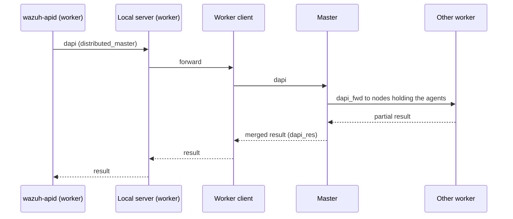

## Overview

Several managers can run as one cluster: one master and any number of workers, with agents spread across them. `wazuh-clusterd` (`framework/scripts/wazuh_clusterd.py`) is the asyncio daemon that links them. Workers connect to the master and keep three things consistent: the shared configuration files (rules, decoders, lists, group files), the agent registry in [[Wazuh DB]], and agent group assignments. The same connection carries distributed API requests, so an API call made on any node runs where its data lives ([[Python Framework]]). On the master an optional HAProxy helper balances agent connections across workers.

Sources: [framework/scripts/wazuh_clusterd.py:70-158](repo://framework/scripts/wazuh_clusterd.py#L70-L158)

## Process layout

`master_main` starts the `Master` server, warms up its task process pool, starts a `LocalServerMaster`, and, when `haproxy_helper` is enabled, the `HAPHelper`, all with `asyncio.gather`. `worker_main` creates a one-process pool once (so it survives reconnections) and loops forever: it creates a `Worker` client and a `LocalServerWorker`, runs them, and starts over after `connection_retry` seconds when the connection to the master is lost. Without access to `/dev/shm` the pool is not created and work runs in the event loop.

Sources: [framework/scripts/wazuh_clusterd.py:70-104](repo://framework/scripts/wazuh_clusterd.py#L70-L104), [framework/scripts/wazuh_clusterd.py:108-158](repo://framework/scripts/wazuh_clusterd.py#L108-L158)

## The protocol

### Framing and encryption

Nodes talk over TCP (port 1516 by default) with a small framing defined in `Handler`: each message has a header `!2I<cmd_len>s` with a counter, the payload size and a command name, followed by the payload. The payload is encrypted with Fernet using the cluster `key` from the configuration (32 characters), so only nodes sharing the key can talk. Large payloads are split across several frames and reassembled by `InBuffer`; responses are matched to requests by counter.

Sources: [framework/wazuh/core/cluster/common.py:301-350](repo://framework/wazuh/core/cluster/common.py#L301-L350), [framework/wazuh/core/cluster/utils.py:195-205](repo://framework/wazuh/core/cluster/utils.py#L195-L205), [framework/wazuh/core/cluster/common.py:383-445](repo://framework/wazuh/core/cluster/common.py#L383-L445), [framework/wazuh/core/cluster/common.py:65-110](repo://framework/wazuh/core/cluster/common.py#L65-L110)

### Commands

Each side dispatches incoming commands in `process_request`. Command names are short byte strings: `syn_i_w_m` (integrity from worker to master), `syn_a_w_m` (agent info), `syn_m_c` (master's answer with files to change), `dapi`/`dapi_res` (distributed API request and result), `sendsync` and others. Files are sent with `send_file` in chunks and received by `ReceiveFileTask`, and long strings with `SendStringTask`/`ReceiveStringTask`.

Sources: [framework/wazuh/core/cluster/master.py:239-297](repo://framework/wazuh/core/cluster/master.py#L239-L297), [framework/wazuh/core/cluster/worker.py:198-250](repo://framework/wazuh/core/cluster/worker.py#L198-L250), [framework/wazuh/core/cluster/common.py:132-250](repo://framework/wazuh/core/cluster/common.py#L132-L250), [framework/wazuh/core/cluster/common.py:250-300](repo://framework/wazuh/core/cluster/common.py#L250-L300)

## Synchronization tasks

### Integrity of files

Every `sync_integrity` seconds (9 by default), a worker asks the master for permission, computes the status of its files with `get_files_status` in the process pool (a BLAKE2b hash per file in the directories listed in `cluster.json`: `etc/`, `etc/shared/`, `var/multigroups/`, `etc/rules/`, `etc/decoders/`, `etc/lists/`, minus excluded files and extensions), and sends that metadata zipped.

Sources: [framework/wazuh/core/cluster/worker.py:515-555](repo://framework/wazuh/core/cluster/worker.py#L515-L555), [framework/wazuh/core/cluster/cluster.json:1-40](repo://framework/wazuh/core/cluster/cluster.json#L1-L40)

The master decompresses it and `compare_files` classifies every file as `shared` (differs), `missing` (only on the master), `extra` (only on the worker) or `extra_valid`. If everything matches it answers `syn_m_c_ok`; otherwise it zips the files the worker must create or update, with the classification, and sends them; the worker writes them and deletes its extra files. The master's own view (`integrity_control`) is recalculated in the background every `recalculate_integrity` seconds rather than per worker. The zip size adapts between `min_zip_size` and `max_zip_size` when transfers time out.

Sources: [framework/wazuh/core/cluster/master.py:715-800](repo://framework/wazuh/core/cluster/master.py#L715-L800), [framework/wazuh/core/cluster/worker.py:633-700](repo://framework/wazuh/core/cluster/worker.py#L633-L700), [framework/wazuh/core/cluster/master.py:1066-1100](repo://framework/wazuh/core/cluster/master.py#L1066-L1100)

### Agent information

Every `sync_agent_info` seconds the worker reads the agents whose status changed on it from its local wazuh-db (`global sync-agent-info-get`) and sends them; the master writes them into its own wazuh-db with `global sync-agent-info-set`. This is why remoted on a worker marks agent updates as `syncreq` ([[Remoted: Agent Connections]]): those rows are pending for this task.

Sources: [framework/wazuh/core/cluster/worker.py:556-592](repo://framework/wazuh/core/cluster/worker.py#L556-L592), [framework/wazuh/core/cluster/master.py:619-652](repo://framework/wazuh/core/cluster/master.py#L619-L652)

### Agent groups

Group assignments flow the other way. The master periodically sends changed assignments (`syn_g_m_w`) together with a checksum of all assignments. The worker writes them into its wazuh-db and compares checksums; after `agent_groups_mismatch_limit` consecutive mismatches it asks for the entire table (`syn_w_g_c`), which the master sends with `syn_g_m_w_c`.

Sources: [framework/wazuh/core/cluster/master.py:653-714](repo://framework/wazuh/core/cluster/master.py#L653-L714), [framework/wazuh/core/cluster/worker.py:359-470](repo://framework/wazuh/core/cluster/worker.py#L359-L470)

### Keep-alives

Workers send a keep-alive every `keep_alive` seconds; the master checks every `check_worker_lastkeepalive` seconds and disconnects a worker silent for more than `max_allowed_time_without_keepalive`.

Sources: [framework/wazuh/core/cluster/cluster.json:1-40](repo://framework/wazuh/core/cluster/cluster.json#L1-L40)

## Local server and DAPI

### The local socket

Each node also listens on `queue/cluster/c-internal.sock`. Local processes (the API, framework scripts, `cluster_control`) use it through `LocalClient` to ask the cluster daemon for `get_config`, `get_nodes`, `get_health`, `get_hash` and to submit DAPI requests. On the master, `dapi` requests are added to the master's DAPI request queue and `dapi_fwd` requests are forwarded to a specific worker; on a worker, `dapi` requests are sent to the master over the cluster connection and `sendsync` messages are relayed.

Sources: [framework/wazuh/core/cluster/local_server.py:21-70](repo://framework/wazuh/core/cluster/local_server.py#L21-L70), [framework/wazuh/core/cluster/local_server.py:184-215](repo://framework/wazuh/core/cluster/local_server.py#L184-L215), [framework/wazuh/core/cluster/local_server.py:234-345](repo://framework/wazuh/core/cluster/local_server.py#L234-L345), [framework/wazuh/core/cluster/local_server.py:357-400](repo://framework/wazuh/core/cluster/local_server.py#L357-L400)

### Request routing

Sources: [framework/wazuh/core/cluster/dapi/dapi.py:139-180](repo://framework/wazuh/core/cluster/dapi/dapi.py#L139-L180), [framework/wazuh/core/cluster/master.py:298-345](repo://framework/wazuh/core/cluster/master.py#L298-L345)

DAPI requests can wait up to `timeout_dapi_request` (200 seconds by default) and ordinary cluster requests `timeout_cluster_request` (20 seconds).

Sources: [framework/wazuh/core/cluster/cluster.json:1-40](repo://framework/wazuh/core/cluster/cluster.json#L1-L40)

## HAProxy helper

When agents connect through HAProxy, the master can manage its backend. `HAPHelper.start` reads `haproxy_helper` from the cluster configuration and connects to the HAProxy Data Plane API. In a loop it adds new worker nodes to the backend and removes gone ones (`manage_wazuh_cluster_nodes`), checks whether agent connections are unbalanced across nodes (`check_for_balance`), and, when they are, asks the chosen agents to reconnect through DAPI so HAProxy places them on less loaded nodes.

Sources: [framework/wazuh/core/cluster/hap_helper/hap_helper.py:38-110](repo://framework/wazuh/core/cluster/hap_helper/hap_helper.py#L38-L110), [framework/wazuh/core/cluster/hap_helper/hap_helper.py:289-400](repo://framework/wazuh/core/cluster/hap_helper/hap_helper.py#L289-L400), [framework/wazuh/core/cluster/hap_helper/hap_helper.py:474-530](repo://framework/wazuh/core/cluster/hap_helper/hap_helper.py#L474-L530)
