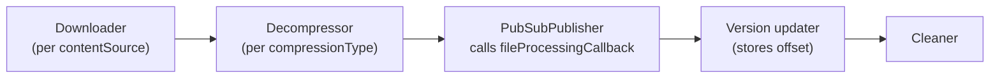

## Overview

The content manager (`src/shared_modules/content_manager`, built as `libcontent_manager.so`) keeps a local copy of externally published content up to date. A consumer registers a topic with a configuration and a callback; the content manager then periodically (and on request) downloads the content, decompresses it, hands the resulting file paths to the callback, records how far it got, and cleans up. The main consumer is the [[Vulnerability Scanner]], whose CVE feed comes from the Wazuh Cyber Threat Intelligence (CTI) API as a snapshot followed by incremental offsets.

Sources: [src/shared_modules/content_manager/README.md:1-20](repo://src/shared_modules/content_manager/README.md#L1-L20), [src/wazuh_modules/vulnerability_scanner/src/databaseFeedManager/databaseFeedManager.hpp:385-395](repo://src/wazuh_modules/vulnerability_scanner/src/databaseFeedManager/databaseFeedManager.hpp#L385-L395)

## Registration

### The module and topics

The `content_manager` module of [[Modules Daemon (modulesd)]] loads the library and calls `content_manager_start`, which installs the module's log function. Consumers then create a `ContentRegister(topicName, parameters, fileProcessingCallback)`. The parameters carry `interval` (seconds between runs), `ondemand` (whether the topic can be triggered externally), and `configData`, which defines the pipeline.

Sources: [src/wazuh_modules/wm_content_manager.c:38-55](repo://src/wazuh_modules/wm_content_manager.c#L38-L55), [src/shared_modules/content_manager/src/contentModuleFacade.cpp:20-26](repo://src/shared_modules/content_manager/src/contentModuleFacade.cpp#L20-L26), [src/shared_modules/content_manager/include/contentRegister.hpp:40-61](repo://src/shared_modules/content_manager/include/contentRegister.hpp#L40-L61)

### configData

| Key | Meaning |
| --- | --- |
| `contentSource` | `api`, `cti-offset`, `cti-snapshot`, `file` or `offline` |
| `compressionType` | `gzip`, `zip`, `xz` or `raw` |
| `versionedContent` | `false`, or `cti-api` to remember the last offset |
| `deleteDownloadedContent` | Remove downloaded files after processing |
| `url` | HTTP(S) URL or filesystem path of the content |
| `outputFolder`, `contentFileName` | Where downloads and extracted content go |
| `databasePath` | RocksDB path for the stored offset |
| `consumerName` | Sent as the HTTP `User-Agent` |

Sources: [src/shared_modules/content_manager/README.md:5-20](repo://src/shared_modules/content_manager/README.md#L5-L20)

## Actions and scheduling

Each topic gets an `Action`. `startActionScheduler(interval)` runs the action once immediately and then every `interval` seconds on a condition variable, so changing the interval or stopping takes effect without waiting a full period. With `ondemand` the action is also registered on the on-demand server. Both paths go through `runActionExclusively`, which uses an atomic flag so a scheduled run and an on-demand run never overlap; a scheduled request that finds an action in progress is ignored with a debug message.

Sources: [src/shared_modules/content_manager/src/action.hpp:74-130](repo://src/shared_modules/content_manager/src/action.hpp#L74-L130), [src/shared_modules/content_manager/src/action.hpp:146-195](repo://src/shared_modules/content_manager/src/action.hpp#L146-L195)

The on-demand server listens on `queue/sockets/updater-ondemand` and serves `GET /ondemand/<topic>`. The optional `offset` parameter may only be `0` (start over from offset 0) or `-1` (keep the current offset); an unknown topic answers 404.

Sources: [src/shared_modules/content_manager/src/onDemandManager.cpp:25-76](repo://src/shared_modules/content_manager/src/onDemandManager.cpp#L25-L76), [src/shared_modules/content_manager/include/contentManager.hpp:30-30](repo://src/shared_modules/content_manager/include/contentManager.hpp#L30-L30)

## The orchestration chain

### Building the chain

When an `ActionOrchestrator` is created it runs an `ExecutionContext` step, which creates the output folders, opens the RocksDB database and reads the last stored offset and file hash (starting at offset 0 on the first run), and then `FactoryContentUpdater::create` builds a chain of responsibility. Each step reads and enriches a shared `UpdaterContext` and passes it on:

Sources: [src/shared_modules/content_manager/src/actionOrchestrator.hpp:115-140](repo://src/shared_modules/content_manager/src/actionOrchestrator.hpp#L115-L140), [src/shared_modules/content_manager/src/components/executionContext.hpp:40-80](repo://src/shared_modules/content_manager/src/components/executionContext.hpp#L40-L80), [src/shared_modules/content_manager/src/components/factoryContentUpdater.hpp:42-62](repo://src/shared_modules/content_manager/src/components/factoryContentUpdater.hpp#L42-L62)

Sources: [src/shared_modules/content_manager/src/components/factoryContentUpdater.hpp:46-60](repo://src/shared_modules/content_manager/src/components/factoryContentUpdater.hpp#L46-L60)

### Downloaders

`FactoryDownloader` picks the first step from `contentSource`: `APIDownloader` (one HTTP request), `CtiOffsetDownloader` (offsets from the CTI changes endpoint, in pages of 1000, from the stored offset to the latest), `CtiSnapshotDownloader` (the latest full snapshot), `FileDownloader` (a file on disk) and `OfflineDownloader` (a local or remote archive, skipped when its hash has not changed). An unknown source is a configuration error. Decompressors (`gzip`, `zip`, `xz`) or a skip step for `raw` follow.

Sources: [src/shared_modules/content_manager/src/components/factoryDownloader.hpp:38-70](repo://src/shared_modules/content_manager/src/components/factoryDownloader.hpp#L38-L70), [src/shared_modules/content_manager/src/components/offlineDownloader.hpp:150-160](repo://src/shared_modules/content_manager/src/components/offlineDownloader.hpp#L150-L160), [src/shared_modules/content_manager/README.md:25-60](repo://src/shared_modules/content_manager/README.md#L25-L60)

### Publishing to the consumer

`PubSubPublisher` serializes the context data (a JSON with `paths`, `type` such as `offsets` or `raw`, and per-stage status) and calls the consumer's `fileProcessingCallback`. The callback returns the offset and file hash it reached plus a success flag; on success those become the new state, which the version updater persists. A failure while processing offsets throws `OffsetProcessingException`; a failure on a snapshot throws `SnapshotProcessingException`.

Sources: [src/shared_modules/content_manager/src/components/pubSubPublisher.hpp:35-66](repo://src/shared_modules/content_manager/src/components/pubSubPublisher.hpp#L35-L66)

## Update types and recovery

`ActionOrchestrator::run` handles three kinds of request:

Sources: [src/shared_modules/content_manager/src/actionOrchestrator.hpp:148-186](repo://src/shared_modules/content_manager/src/actionOrchestrator.hpp#L148-L186)

| Type | Built with | Effect |
| --- | --- | --- |
| `CONTENT` | `createContentUpdateData(offset)` | Normal run of the chain; offset 0 resets the stored offset first |
| `OFFSET` | `createOffsetUpdateData(offset)` | Only sets the stored offset (must not be negative) |
| `FILE_HASH` | `createFileHashUpdateData(hash)` | Only sets the stored file hash |

Sources: [src/shared_modules/content_manager/src/actionOrchestrator.hpp:35-105](repo://src/shared_modules/content_manager/src/actionOrchestrator.hpp#L35-L105), [src/shared_modules/content_manager/src/actionOrchestrator.hpp:223-270](repo://src/shared_modules/content_manager/src/actionOrchestrator.hpp#L223-L270)

If processing offsets fails, `run` catches `OffsetProcessingException`, logs "Offset processing failed. Triggered a snapshot download.", and immediately reruns the chain as a content update with the offset reset, so a consumer whose incremental state broke recovers from a full snapshot instead of retrying the same broken offsets. Any other failure is rethrown as "Orchestration run failed".

Sources: [src/shared_modules/content_manager/src/actionOrchestrator.hpp:175-185](repo://src/shared_modules/content_manager/src/actionOrchestrator.hpp#L175-L185)
