## Overview

Agent modules that track state (file integrity, system inventory) need to answer two questions on every scan: what changed since last time, and does the manager still hold the same data as the agent. DBSync (`src/shared_modules/dbsync`) answers the first: it is a small SQLite layer that stores the last known rows, compares a new scan against them inside a transaction, and calls back with each inserted, modified and deleted row. RSync (`src/shared_modules/rsync`) answers the second: it builds checksums over ranges of a DBSync table and runs a split-and-compare dialogue with the manager until both sides agree. [[File Integrity Monitoring (Syscheck)]] and [[System Inventory (Syscollector and Data Provider)]] use DBSync; the manager side of RSync is in [[Wazuh DB]].

Sources: [src/shared_modules/dbsync/include/dbsync.hpp:50-160](repo://src/shared_modules/dbsync/include/dbsync.hpp#L50-L160), [src/shared_modules/rsync/src/rsyncImplementation.cpp:60-126](repo://src/shared_modules/rsync/src/rsyncImplementation.cpp#L60-L126)

## DBSync

### Creating a database

`DBSync(hostType, dbType, path, sqlStatement, dbManagement, upgradeStatements)` opens a database with the module's `CREATE TABLE` statements. Only SQLite is implemented. With `VOLATILE` management the file is recreated every time; with `PERSISTENT` it is kept and versioned with SQLite's `user_version`: version 0 means the database is recreated, a lower version than the current one runs the missing upgrade statements in order, each in its own transaction. New databases are opened with `journal_mode = truncate` and `synchronous = OFF`, trading durability on power loss for speed, since the data can always be rebuilt from a new scan.

Sources: [src/shared_modules/dbsync/include/dbsync.hpp:50-72](repo://src/shared_modules/dbsync/include/dbsync.hpp#L50-L72), [src/shared_modules/dbsync/src/sqlite/sqlite_dbengine.cpp:544-626](repo://src/shared_modules/dbsync/src/sqlite/sqlite_dbengine.cpp#L544-L626), [src/shared_modules/common/commonDefs.h:21-45](repo://src/shared_modules/common/commonDefs.h#L21-L45)

### Results

Every change is reported through a callback with a `ReturnTypeCallback`:

Sources: [src/shared_modules/common/commonDefs.h:49-58](repo://src/shared_modules/common/commonDefs.h#L49-L58)

| Value | Meaning |
| --- | --- |
| `INSERTED` | A row that did not exist was added |
| `MODIFIED` | A row with the same primary key changed |
| `DELETED` | A row that existed was not seen again |
| `MAX_ROWS` | The table reached its configured row limit; the row was not stored |
| `DB_ERROR` | An internal error |
| `SELECTED` | A row returned by a select |

Sources: [src/shared_modules/common/commonDefs.h:49-58](repo://src/shared_modules/common/commonDefs.h#L49-L58)

### Transactions

A scan uses a `DBSyncTxn` over one or more tables. Opening it runs `initializeStatusField`: each table gets a hidden status column (added on first use) and every row's status is reset to 0. Each `syncTxnRow` call then inserts or updates rows; a row that is unchanged only gets its status set to 1, a changed row is updated and reported as `MODIFIED` (with the old values when `return_old_data` is set), and a new row is inserted and reported as `INSERTED`. `getDeletedRows` commits and reports every row whose status is still 0 as `DELETED`, then removes them.

Sources: [src/shared_modules/dbsync/src/sqlite/sqlite_dbengine.cpp:154-270](repo://src/shared_modules/dbsync/src/sqlite/sqlite_dbengine.cpp#L154-L270), [src/shared_modules/dbsync/src/sqlite/sqlite_dbengine.cpp:288-376](repo://src/shared_modules/dbsync/src/sqlite/sqlite_dbengine.cpp#L288-L376), [src/shared_modules/dbsync/src/sqlite/sqlite_dbengine.cpp:376-434](repo://src/shared_modules/dbsync/src/sqlite/sqlite_dbengine.cpp#L376-L434)

```mermaid
sequenceDiagram
  participant M as Module scan
  participant T as DBSyncTxn
  participant DB as SQLite table
  M->>T: create(tables)
  T->>DB: status = 0 for all rows
  loop each item found
    M->>T: syncTxnRow(item)
    T->>DB: insert / update / mark status = 1
    T-->>M: INSERTED or MODIFIED callback
  end
  M->>T: getDeletedRows()
  T->>DB: rows with status = 0
  T-->>M: DELETED callback per row
```

Sources: [src/shared_modules/dbsync/src/sqlite/sqlite_dbengine.cpp:154-270](repo://src/shared_modules/dbsync/src/sqlite/sqlite_dbengine.cpp#L154-L270), [src/shared_modules/dbsync/src/sqlite/sqlite_dbengine.cpp:376-434](repo://src/shared_modules/dbsync/src/sqlite/sqlite_dbengine.cpp#L376-L434)

This mark-and-sweep design means a module never has to remember what it saw in the previous scan: it reports what exists now, and DBSync derives the deltas. Outside a transaction, `syncRow` applies the same comparison to a single row (used for real-time FIM events), and `setTableMaxRow` caps a table, which is how FIM's file limit is enforced.

Sources: [src/shared_modules/dbsync/include/dbsync.hpp:100-160](repo://src/shared_modules/dbsync/include/dbsync.hpp#L100-L160), [src/shared_modules/dbsync/src/sqlite/sqlite_dbengine.cpp:45-88](repo://src/shared_modules/dbsync/src/sqlite/sqlite_dbengine.cpp#L45-L88)

### C and C++ interfaces

The library exports a C API (`dbsync_create`, `dbsync_create_txn`, `dbsync_sync_txn_row`, `dbsync_get_deleted_rows`, ...) built on opaque handles, which syscheckd's C code uses through its `fim_db_*` wrappers, and the C++ classes `DBSync` and `DBSyncTxn`, which syscollector uses directly.

Sources: [src/shared_modules/dbsync/include/dbsync.h:41-130](repo://src/shared_modules/dbsync/include/dbsync.h#L41-L130), [src/shared_modules/dbsync/include/dbsync.h:130-230](repo://src/shared_modules/dbsync/include/dbsync.h#L130-L230), [src/syscheckd/src/db/src/db.cpp:120-160](repo://src/syscheckd/src/db/src/db.cpp#L120-L160)

## RSync

### Starting a synchronization

`startRSync(handle, dbsync, configuration, callback)` begins a round for one table. It runs the configured first and last queries to find the lowest and highest index value, computes a checksum over the whole range (`fillChecksum`), and sends an `integrity_check_global` message with `begin`, `end`, `checksum` and an `id` (the current time). An empty table sends `integrity_clear` instead, which tells the manager to drop everything for that component.

Sources: [src/shared_modules/rsync/src/rsyncImplementation.cpp:60-126](repo://src/shared_modules/rsync/src/rsyncImplementation.cpp#L60-L126), [src/shared_modules/rsync/src/rsyncImplementation.cpp:278-342](repo://src/shared_modules/rsync/src/rsyncImplementation.cpp#L278-L342)

### Answering the manager

The manager compares the range against its own copy ([[Wazuh DB]]) and, when they differ, answers through the agent with `checksum_fail` or `no_data` for that range. `registerSyncId` installs a callback per component that checks the answer's `id` belongs to the current round and then:

Sources: [src/shared_modules/rsync/src/rsyncImplementation.cpp:141-190](repo://src/shared_modules/rsync/src/rsyncImplementation.cpp#L141-L190)

| Answer | Range size | Agent sends |
| --- | --- | --- |
| `checksum_fail` | One row | The row itself (`state` message) |
| `checksum_fail` | More than one row | `integrity_check_left` and `integrity_check_right` with checksums of each half |
| `no_data` | Any | Every row in the range |

Sources: [src/shared_modules/rsync/src/rsyncImplementation.cpp:200-237](repo://src/shared_modules/rsync/src/rsyncImplementation.cpp#L200-L237), [src/shared_modules/rsync/src/rsyncImplementation.cpp:411-452](repo://src/shared_modules/rsync/src/rsyncImplementation.cpp#L411-L452)

The dialogue is a binary search over the table: each disagreement halves the range until single differing rows are sent, so a table of a million rows with one changed entry costs about twenty round trips rather than a million rows.

Sources: [src/shared_modules/rsync/src/rsyncImplementation.cpp:200-237](repo://src/shared_modules/rsync/src/rsyncImplementation.cpp#L200-L237)

### Message flow

Outgoing messages are produced by message creators (`CHECKSUM` for integrity messages, `ROW_DATA` for rows) and handed to the module's callback, which sends them to the manager through the agent queue. Incoming answers are pushed with `push(handle, data)` into a dispatcher that decodes them (JSON decoder) and routes them by component header. On the manager, remoted republishes these sync messages on the `rsync` router topic, which is how [[Inventory Harvester]] and [[Vulnerability Scanner]] see state rows.

Sources: [src/shared_modules/rsync/src/rsyncImplementation.cpp:191-199](repo://src/shared_modules/rsync/src/rsyncImplementation.cpp#L191-L199), [src/shared_modules/rsync/src/messageCreatorFactory.h:20-63](repo://src/shared_modules/rsync/src/messageCreatorFactory.h#L20-L63), [src/remoted/secure.c:968-994](repo://src/remoted/secure.c#L968-L994)

> [!NOTE]
> In this branch the agent-side callers of RSync are being replaced: syscheckd and syscollector start their synchronization threads but the calls into RSync are commented out ([[File Integrity Monitoring (Syscheck)]], [[System Inventory (Syscollector and Data Provider)]]).

Sources: [src/syscheckd/src/run_check.c:520-538](repo://src/syscheckd/src/run_check.c#L520-L538), [src/wazuh_modules/wm_syscollector.c:358-390](repo://src/wazuh_modules/wm_syscollector.c#L358-L390)
