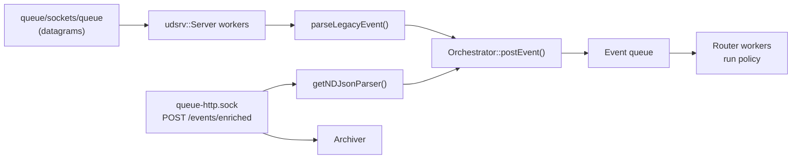

## Overview

The analysis engine is the C++ program in `src/engine` that decodes, normalizes, enriches and routes every event the manager receives. It is built as `wazuh-engine` and installed as `bin/wazuh-analysisd`, taking the place of the classic analysis daemon. Its behavior is not hard-coded: decoders, rules, filters and outputs are YAML assets stored in its own document store, grouped into policies, compiled by the builder into expression trees, and selected per event by the router. This page follows `main.cpp` from start to steady state and the two ways events get in; each module has its own page.

Sources: [src/engine/CMakeLists.txt:187-187](repo://src/engine/CMakeLists.txt#L187-L187), [src/init/inst-functions.sh:1112-1112](repo://src/init/inst-functions.sh#L1112-L1112), [docs/ref/modules/engine/architecture.md:140-185](repo://docs/ref/modules/engine/architecture.md#L140-L185)

## Modules

| Module | Directory | Role | Page |
| --- | --- | --- | --- |
| Conf | `source/conf` | Reads `analysisd.*` keys and environment variables | [[Configuration Loading (ossec.conf)]] |
| Store | `source/store` | Namespaced JSON/YAML document store on disk | [[Engine Store, KVDB, Schema and Geo]] |
| KVDB | `source/kvdb` | RocksDB key-value databases for lookups | [[Engine Store, KVDB, Schema and Geo]] |
| Geo | `source/geo` | MaxMind database manager | [[Engine Store, KVDB, Schema and Geo]] |
| Schema | `source/schemf` | Field types the builder validates against | [[Engine Store, KVDB, Schema and Geo]] |
| HLP / Logpar | `source/hlp`, `source/logpar` | Log parsers and parse expressions | [[Log Parsing (HLP and Logpar)]] |
| Builder | `source/builder` | Compiles policies and assets into expressions | [[Engine Assets, Policies and the Builder]], [[Engine Helper Functions]] |
| Router | `source/router` | Orchestrator, routes, test sessions | [[Engine Router, Orchestrator and Test Sessions]] |
| Backend | `source/bk` | Executes compiled expressions | [[Engine Router, Orchestrator and Test Sessions]] |
| API | `source/api`, `source/httpsrv` | Management API over a Unix socket | [[Engine API and Command-Line Tools]] |
| Archiver | `source/archiver` | Optional raw-event archive | [[Engine API and Command-Line Tools]] |
| Event servers | `source/udgramsrv`, `source/httpsrv` | Ingest events | This page |

Sources: [src/engine/source/main.cpp:10-45](repo://src/engine/source/main.cpp#L10-L45)

## Startup sequence

### Process setup

`main` parses `-f` (foreground), `-t` (test configuration), `-d` (more debug) and `-h`. Unless the environment variable `WAZUH_SKIP_OSSEC_CONF` enables standalone mode, it loads `libwazuhshared.so` with `dlopen`, changes to the install directory, and routes its log through the shared library's `mtLoggingFunctionsWrapper`, so its messages land in `ossec.log` with the same format as the C daemons. With `-t` it only runs `os_logging_config` and exits. It then daemonizes, loads the configuration, and installs `SIGINT`/`SIGTERM` handlers that stop the event server, plus `SIGPIPE` ignore.

Sources: [src/engine/source/main.cpp:104-206](repo://src/engine/source/main.cpp#L104-L206), [src/engine/source/base/src/logging.cpp:189-200](repo://src/engine/source/base/src/logging.cpp#L189-L200)

### Building the modules

Inside one `try` block, modules are created in dependency order. Each step logs "... initialized", and a cleanup action is pushed on `exitHandler` (a stack) so shutdown runs in reverse order.

Sources: [src/engine/source/main.cpp:208-260](repo://src/engine/source/main.cpp#L208-L260)

1. Switch to the configured user and group (`wazuh` by default) and apply the log level.
2. Create the file store on `analysisd.store_path` and the KVDB manager on `analysisd.kvdb_path`.
3. Create the Geo manager over the store, and load the field schema from the store document `schema/engine-schema/0`. A missing schema is a warning: the engine runs, but type checks against indexer mappings are off.
4. Initialize the time-zone database and HLP, which requires the store document `schema/wazuh-logpar-overrides/0`; without it startup fails.
5. Create the builder with the store, schema, definitions builder, allowed fields (`schema/allowed-fields/0`, unrestricted if missing), logpar, KVDB and Geo; then the catalog and the policy manager.
6. Create the event queue (`analysisd.queue_size`, with flood options) and the test queue, and start the orchestrator with `analysisd.orchestrator_threads` workers.
7. Create the archiver, register every API handler group on one HTTP server, and start it on `analysisd.server_api_socket`.

Sources: [src/engine/source/main.cpp:225-338](repo://src/engine/source/main.cpp#L225-L338), [src/engine/source/main.cpp:338-405](repo://src/engine/source/main.cpp#L338-L405), [src/engine/source/main.cpp:456-560](repo://src/engine/source/main.cpp#L456-L560), [src/engine/source/main.cpp:560-593](repo://src/engine/source/main.cpp#L560-L593)

Finally it starts the two event servers, writes the PID file, and loops until the local event server stops. Any exception during startup logs the full exception stack, runs the exit handlers and exits with failure.

Sources: [src/engine/source/main.cpp:595-664](repo://src/engine/source/main.cpp#L595-L664)

## Event ingestion

### Queue socket

The datagram server (`udsrv::Server`) binds `analysisd.server_event_socket`, which defaults to `queue/sockets/queue`, the socket every Wazuh daemon writes events to. It starts `analysisd.server_event_threads` workers; each blocks on `recv` with a 64 KiB buffer and passes the datagram to the handler. A handler exception is logged as a warning and the event dropped, so one malformed message never stops ingestion.

Sources: [src/engine/source/udgramsrv/src/udsrv.cpp:19-100](repo://src/engine/source/udgramsrv/src/udsrv.cpp#L19-L100), [src/engine/source/udgramsrv/src/udsrv.cpp:130-161](repo://src/engine/source/udgramsrv/src/udsrv.cpp#L130-L161), [src/engine/source/main.cpp:595-604](repo://src/engine/source/main.cpp#L595-L604)

The handler is `parseLegacyEvent` followed by `orchestrator->postEvent`. `parseLegacyEvent` turns the `<queue>:<location>:<message>` format described on [[Wazuh Overview]] into a JSON event:

Sources: [src/engine/source/base/src/eventParser.cpp:121-161](repo://src/engine/source/base/src/eventParser.cpp#L121-L161)

| Field | Value |
| --- | --- |
| `/wazuh/queue` | The queue byte as an integer (`49` for `1`, a log line) |
| `/wazuh/location` | The location, unescaped; for agent events only the part after `->` |
| `/agent/id`, `/agent/name` | From `[id] (name) ip->` when present, otherwise `000` and the manager host name |
| `/agent/manager_name` | The manager host name |
| `/event/original` | The message |

Sources: [src/engine/source/base/include/base/eventParser.hpp:12-17](repo://src/engine/source/base/include/base/eventParser.hpp#L12-L17), [src/engine/source/base/src/eventParser.cpp:40-120](repo://src/engine/source/base/src/eventParser.cpp#L40-L120), [src/engine/source/base/src/eventParser.cpp:161-190](repo://src/engine/source/base/src/eventParser.cpp#L161-L190)

### Enriched events endpoint

A second HTTP server listens on `analysisd.server_enriched_events_socket` (`queue/sockets/queue-http.sock`) and accepts `POST /events/enriched`. The body is NDJSON; `getNDJsonParser` turns each line into an event, rejecting empty batches or lines with 400. The raw body is first handed to the archiver, and each parsed event is posted to the orchestrator.

Sources: [src/engine/source/main.cpp:606-621](repo://src/engine/source/main.cpp#L606-L621), [src/engine/source/api/event/src/handlers.cpp:8-52](repo://src/engine/source/api/event/src/handlers.cpp#L8-L52), [src/engine/source/api/event/include/api/event/ndJsonParser.hpp:27-70](repo://src/engine/source/api/event/include/api/event/ndJsonParser.hpp#L27-L70)

Sources: [src/engine/source/main.cpp:595-621](repo://src/engine/source/main.cpp#L595-L621)

### Back-pressure

`postEvent` pushes onto a bounded concurrent queue. When it is full, the queue's flood options decide. With `analysisd.queue_drop_on_flood` (the default) the push is retried `queue_flood_attempts` times, 500 µs apart, and the event is then dropped. Otherwise, with no `queue_flood_file` the caller blocks until there is room; with a flood file the push is retried `queue_flood_attempts` times `queue_flood_sleep` apart and the event is then written to that file.

Sources: [src/engine/source/main.cpp:504-519](repo://src/engine/source/main.cpp#L504-L519), [src/engine/source/conf/src/conf.cpp:54-63](repo://src/engine/source/conf/src/conf.cpp#L54-L63), [src/engine/source/queue/include/queue/concurrentQueue.hpp:144-193](repo://src/engine/source/queue/include/queue/concurrentQueue.hpp#L144-L193)

## Configuration keys

All keys live under `analysisd.` in `internal_options.conf`/`local_internal_options.conf`, or come from the environment variable shown, which wins.

Sources: [src/engine/source/conf/src/conf.cpp:26-103](repo://src/engine/source/conf/src/conf.cpp#L26-L103)

| Key | Environment variable | Default |
| --- | --- | --- |
| `store_path` | `WAZUH_STORE_PATH` | `<home>/engine/store` |
| `kvdb_path` | `WAZUH_KVDB_PATH` | `<home>/engine/kvdb/` |
| `queue_size` | `WAZUH_QUEUE_SIZE` | 1000000 |
| `orchestrator_threads` | `WAZUH_ORCHESTRATOR_THREADS` | 0 (one per CPU) |
| `server_api_socket` | `WAZUH_SERVER_API_SOCKET` | `<home>/queue/sockets/analysis` |
| `server_api_timeout` | `WAZUH_SERVER_API_TIMEOUT` | 5000 ms |
| `server_event_socket` | `WAZUH_SERVER_EVENT_SOCKET` | `<home>/queue/sockets/queue` |
| `server_event_threads` | `WAZUH_SERVER_EVENT_THREADS` | 1 |
| `server_enriched_events_socket` | `WAZUH_SERVER_ENRICHED_EVENTS_SOCKET` | `<home>/queue/sockets/queue-http.sock` |
| `tzdb_path`, `tzdb_auto_update` | `WAZUH_TZDB_PATH`, `WAZUH_TZDB_AUTO_UPDATE` | `<home>/queue/tzdb`, false |
| `archiver_enabled`, `archiver_path` | `WAZUH_ARCHIVER_ENABLED`, `WAZUH_ARCHIVER_PATH` | false, `<home>/logs/archives/archives.json` |
| `user`, `group` | `WAZUH_ENGINE_USER`, `WAZUH_ENGINE_GROUP` | `wazuh` |

Sources: [src/engine/source/conf/src/conf.cpp:34-102](repo://src/engine/source/conf/src/conf.cpp#L34-L102), [src/engine/source/router/src/orchestrator.cpp:276-286](repo://src/engine/source/router/src/orchestrator.cpp#L276-L286)

The indexer connector and metrics keys are registered too, but their initialization in `main.cpp` is commented out until the connector is unified with the rest of the manager; in this version alerts reach the indexer through the file output and `wazuh-forwarder`.

Sources: [src/engine/source/main.cpp:268-336](repo://src/engine/source/main.cpp#L268-L336), [src/engine/source/main.cpp:406-454](repo://src/engine/source/main.cpp#L406-L454)
