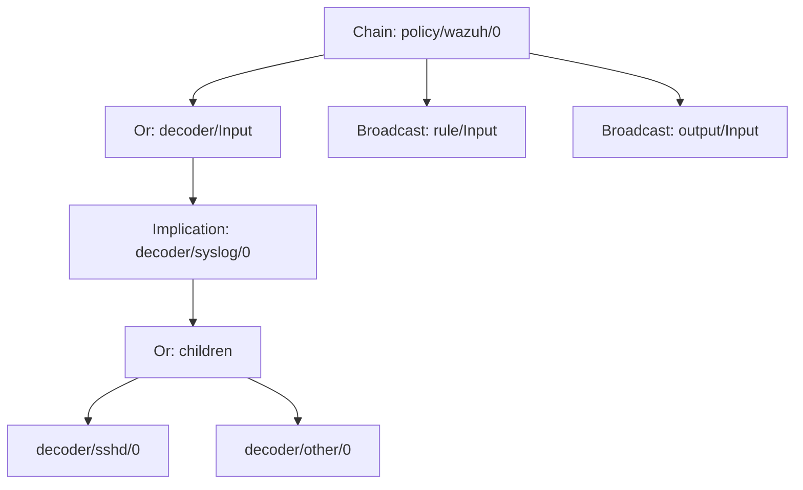

## Overview

Everything the engine does to an event is described in data, not code. A decoder, a rule, an output or a filter is an asset: a YAML or JSON document with a name and an ordered list of stages. A policy names the assets that apply together. The builder reads those documents from the store and compiles a policy into one `base::Expression` tree, which the router later executes for each event ([[Engine Router, Orchestrator and Test Sessions]]). This page covers the asset format, the policy format, and the compilation; the helper functions used inside stages are on [[Engine Helper Functions]] and the parse stage on [[Log Parsing (HLP and Logpar)]].

Sources: [src/engine/source/builder/src/builder.cpp:22-77](repo://src/engine/source/builder/src/builder.cpp#L22-L77)

## Asset names

Every document name has three parts, `<type>/<name>/<version>`, for example `decoder/syslog/0`. The first part decides the asset type: `decoder`, `rule`, `output`, `filter`, `integration` or `policy`.

Sources: [src/engine/source/builder/src/syntax.hpp:84-93](repo://src/engine/source/builder/src/syntax.hpp#L84-L93)

## Asset structure

### Keys in order

`AssetBuilder` reads the document's keys in a fixed order and rejects documents that start with anything but `name`:

Sources: [src/engine/source/builder/src/policy/assetBuilder.cpp:222-283](repo://src/engine/source/builder/src/policy/assetBuilder.cpp#L222-L283)

| Key | Required | Meaning |
| --- | --- | --- |
| `name` | yes | The asset's full name |
| `metadata` | no | Descriptive data (not compiled) |
| `parents` | no | Assets this one runs after |
| `definitions` | no | Named constants usable as `$name` in stages; may appear anywhere |
| `check` | no | Condition: when false, the asset is skipped |
| `parse\|<field>` | no | Parse expressions applied to `<field>`; part of the condition |
| `normalize` / `rule_normalize` | no | Blocks of check, parse and map that modify the event |
| `map` | no | Field assignments and helper calls |
| `outputs`, `file` | no | Where events go (outputs only) |

Sources: [src/engine/source/builder/src/syntax.hpp:26-48](repo://src/engine/source/builder/src/syntax.hpp#L26-L48), [src/engine/source/builder/src/policy/assetBuilder.cpp:75-100](repo://src/engine/source/builder/src/policy/assetBuilder.cpp#L75-L100)

A decoder that recognizes an SSH log line could look like this:

Sources: [src/engine/source/builder/src/policy/assetBuilder.cpp:100-175](repo://src/engine/source/builder/src/policy/assetBuilder.cpp#L100-L175)

```yaml
name: decoder/sshd/0
parents:
  - decoder/syslog/0
check:
  - process.name: sshd
parse|message:
  - "Accepted <_auth_method> for <user.name> from <source.ip> port <source.port>"
normalize:
  - map:
      - event.category: array_append(authentication)
      - event.outcome: success
```

Sources: [src/engine/source/builder/src/builders/stage/normalize.cpp:15-131](repo://src/engine/source/builder/src/builders/stage/normalize.cpp#L15-L131)

### Condition and consequence

`AssetBuilder::buildExpression` compiles one asset into an `Implication`: the condition is an `And` of the `check` stage and the `parse` stage; the consequence is an `And` of every remaining stage, built by the stage builder registered under its key, followed by a step that deletes temporary variables (fields starting with `_`) from the event. The consequence only runs when the condition succeeds, and the implication's own result is the condition's result. An asset with only a condition compiles to a plain `And`.

Sources: [src/engine/source/builder/src/policy/assetBuilder.cpp:102-221](repo://src/engine/source/builder/src/policy/assetBuilder.cpp#L102-L221), [src/engine/source/bk/src/rx/exprBuilder.hpp:98-115](repo://src/engine/source/bk/src/rx/exprBuilder.hpp#L98-L115), [src/engine/source/builder/src/syntax.hpp:53-58](repo://src/engine/source/builder/src/syntax.hpp#L53-L58)

## Stages

### check

`check` accepts two forms. A list of single-key objects (`field: value` or `field: helper(args)`) becomes an `And` of conditions. A string is a logical expression over helper calls, combined with `AND`, `OR`, `NOT` and parentheses, compiled with the `logicexpr` Dijkstra evaluator.

Sources: [src/engine/source/builder/src/builders/stage/check.cpp:21-140](repo://src/engine/source/builder/src/builders/stage/check.cpp#L21-L140)

### normalize and map

`normalize` is a non-empty list of blocks. Each block may contain `check`, `parse|<field>` and `map`, compiled to an `And` named `subblock`; the blocks are joined in a `Chain`, so every block is attempted in order and a failed block does not stop the next one. `map` is a list of assignments where the value is a literal, a reference (`$field`) or a map/transform helper.

Sources: [src/engine/source/builder/src/builders/stage/normalize.cpp:15-131](repo://src/engine/source/builder/src/builders/stage/normalize.cpp#L15-L131)

### outputs

`outputs` is a list of single-key objects, each naming an output stage; they are combined with `Broadcast`, so every output receives the event regardless of the others. The registered output in this version is `file` with a `path`, which appends the event as JSON to that file; the indexer output registration is commented out.

Sources: [src/engine/source/builder/src/builders/stage/outputs.cpp:16-82](repo://src/engine/source/builder/src/builders/stage/outputs.cpp#L16-L82), [src/engine/source/builder/src/builders/stage/fileOutput.cpp:11-60](repo://src/engine/source/builder/src/builders/stage/fileOutput.cpp#L11-L60), [src/engine/source/builder/src/register.hpp:355-370](repo://src/engine/source/builder/src/register.hpp#L355-L370)

## Policies

A policy document has a `name`, a non-empty `hash`, an `assets` list, and optional `default_parents`. A small policy might read as follows.

Sources: [src/engine/source/builder/src/syntax.hpp:75-79](repo://src/engine/source/builder/src/syntax.hpp#L75-L79)

```yaml
name: policy/wazuh/0
hash: "1234"
default_parents:
  system:
    - decoder/integrations/0
assets:
  - integration/syslog/0
  - decoder/integrations/0
  - output/file-output-integrations/0
```

Sources: [src/engine/source/builder/src/policy/factory.cpp:166-245](repo://src/engine/source/builder/src/policy/factory.cpp#L166-L245)

`factory::readData` classifies each entry of `assets` by its name. Decoders, rules, outputs and filters are recorded under the store namespace they live in; an integration is expanded into the decoders, rules and outputs listed in its own document (`/decoders`, `/rules`, `/outputs`). Duplicate entries are errors. `default_parents` maps a namespace to a decoder or rule that becomes the parent of every asset in that namespace that declares no parents, which lets user assets hang under a root without naming it.

Sources: [src/engine/source/builder/src/policy/factory.cpp:245-318](repo://src/engine/source/builder/src/policy/factory.cpp#L245-L318), [src/engine/source/builder/src/policy/factory.cpp:21-60](repo://src/engine/source/builder/src/policy/factory.cpp#L21-L60), [src/engine/source/builder/src/policy/factory.cpp:320-364](repo://src/engine/source/builder/src/policy/factory.cpp#L320-L364)

## From policy to expression

### Building the graph

`Policy` builds in three steps: build every asset (so that each knows its parents), build a graph per asset type, and turn the graphs into one expression.

Sources: [src/engine/source/builder/src/policy/policy.cpp:12-59](repo://src/engine/source/builder/src/policy/policy.cpp#L12-L59)

`buildSubgraph` creates an input node per type, named from the type plus the suffix `Input` (for example `decoder/Input`), adds every asset, and links it to each parent, or to the input node when it has none. A parent that is not in the policy is an error ("Parent ... does not exist"). Filters are not a subgraph of their own: each filter is injected between its parent and that parent's children, so it gates everything below the parent.

Sources: [src/engine/source/builder/src/policy/factory.cpp:366-445](repo://src/engine/source/builder/src/policy/factory.cpp#L366-L445), [src/engine/source/builder/src/policy/factory.cpp:15-15](repo://src/engine/source/builder/src/policy/factory.cpp#L15-L15), [src/engine/source/builder/src/policy/factory.cpp:447-477](repo://src/engine/source/builder/src/policy/factory.cpp#L447-L477)

### Building the expression

`buildExpression` chains the subgraphs in a `Chain` named after the policy. Each node with children becomes an `Implication` of the asset (condition) and a group of its children (consequence); the group operator depends on the type:

Sources: [src/engine/source/builder/src/policy/factory.cpp:479-511](repo://src/engine/source/builder/src/policy/factory.cpp#L479-L511), [src/engine/source/builder/src/policy/factory.hpp:317-360](repo://src/engine/source/builder/src/policy/factory.hpp#L317-L360), [src/engine/source/bk/src/rx/exprBuilder.hpp:48-97](repo://src/engine/source/bk/src/rx/exprBuilder.hpp#L48-L97)

| Type | Children operator | Effect |
| --- | --- | --- |
| Decoders | `Or` | The first child decoder that matches wins; its siblings are not tried |
| Rules | `Broadcast` | Every child rule is evaluated |
| Outputs | `Broadcast` | Every output receives the event |

Sources: [src/engine/source/builder/src/policy/factory.cpp:490-502](repo://src/engine/source/builder/src/policy/factory.cpp#L490-L502)



Sources: [src/engine/source/builder/src/policy/factory.cpp:479-511](repo://src/engine/source/builder/src/policy/factory.cpp#L479-L511)

A node reached from several parents is built once and shared, so diamond-shaped hierarchies do not duplicate work.

Sources: [src/engine/source/builder/src/policy/factory.hpp:324-334](repo://src/engine/source/builder/src/policy/factory.hpp#L324-L334)

## Validation

The builder validates assets as it compiles them. Field names are checked against the schema's types ([[Engine Store, KVDB, Schema and Geo]]). The allowed-fields document `schema/allowed-fields/0` lists, per asset type, the fields an asset of that type may write; for example, rules may only set fields such as `rule.*`, `threat.*` and `event.risk_score`. Helpers that write a field call `allowedFields().check(assetType, field)`, and a disallowed field fails the build. Types with no entry are unrestricted.

Sources: [src/engine/ruleset/schemas/allowed-fields.json:1-30](repo://src/engine/ruleset/schemas/allowed-fields.json#L1-L30), [src/engine/source/builder/src/allowedFields.cpp:56-77](repo://src/engine/source/builder/src/allowedFields.cpp#L56-L77), [src/engine/source/builder/src/builders/baseHelper.cpp:140-155](repo://src/engine/source/builder/src/builders/baseHelper.cpp#L140-L155)

`Builder` also exposes `validateAsset` and `validateIntegration`, which build into a throwaway context and return the error instead of throwing. The catalog API uses them so a broken asset is rejected when it is uploaded, not when a policy using it is loaded ([[Engine API and Command-Line Tools]]).

Sources: [src/engine/source/builder/src/builder.cpp:100-202](repo://src/engine/source/builder/src/builder.cpp#L100-L202)
