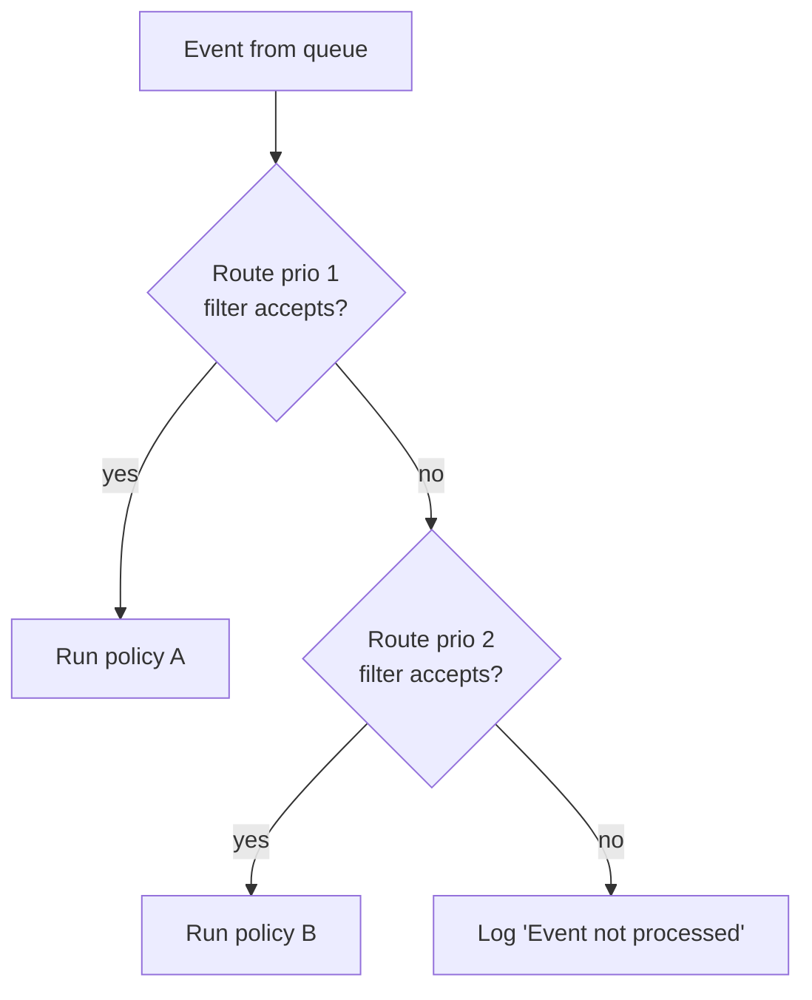

## Overview

Once an event is in the engine ([[Engine Architecture and Startup]]), something has to decide which policy runs it and on which thread. That is the router module. The `Orchestrator` owns a pool of worker threads; each worker holds its own copy of the route table (production) and the session table (testing). A route pairs a filter with a policy and a priority, and the first enabled route whose filter accepts the event runs it. Test sessions run a policy on demand and return the resulting event together with traces of every asset that was evaluated. Policies are compiled as described on [[Engine Assets, Policies and the Builder]]; routes and sessions are managed through the API on [[Engine API and Command-Line Tools]].

Sources: [src/engine/source/router/src/orchestrator.cpp:253-320](repo://src/engine/source/router/src/orchestrator.cpp#L253-L320), [src/engine/source/router/src/router.cpp:169-186](repo://src/engine/source/router/src/router.cpp#L169-L186)

## Environments

### Building an environment

A route or session does not hold a policy directly but an `Environment`, created by `EnvironmentBuilder::create(policy, filter)`. It builds the policy with the builder, wraps the expression in a backend controller, builds the filter asset (the name must start with `filter/`), and records the policy hash. `Environment::isAccepted` runs the filter; `ingest` and `ingestGet` push the event through the controller, the second returning the processed event.

Sources: [src/engine/source/router/src/environmentBuilder.hpp:20-139](repo://src/engine/source/router/src/environmentBuilder.hpp#L20-L139), [src/engine/source/router/src/environment.hpp:55-78](repo://src/engine/source/router/src/environment.hpp#L55-L78)

### The backend controller

`bk::rx::Controller` turns the expression tree into a reactive pipeline once, at build time. `ExprBuilder` maps each operator to RxCpp stages: `And` filters on success after each operand, `Or` filters on failure so later operands only see events the earlier ones rejected, `Chain` and `Broadcast` feed every operand and always succeed, and `Implication` runs the consequence only when the condition succeeded and returns the condition's result. Terms run their function and publish a trace line when someone is subscribed to that asset. Pushing an event is then just emitting it into the pipeline's subject.

Sources: [src/engine/source/bk/src/rx/controller.cpp:12-34](repo://src/engine/source/bk/src/rx/controller.cpp#L12-L34), [src/engine/source/bk/src/rx/exprBuilder.hpp:48-160](repo://src/engine/source/bk/src/rx/exprBuilder.hpp#L48-L160)

## Routes

### The route table

A production entry has a name, a policy, a filter, a priority and a description. `Router::addEntry` builds the environment first (a build failure returns "Failed to create the route", except while loading from the store, where the entry is kept without an environment), then inserts it in a table ordered by priority, refusing duplicate names and duplicate priorities. New entries start `DISABLED` and are enabled after every worker has added them, so all threads switch at the same moment.

Sources: [src/engine/source/router/src/router.cpp:23-60](repo://src/engine/source/router/src/router.cpp#L23-L60), [src/engine/source/router/src/orchestrator.cpp:336-358](repo://src/engine/source/router/src/orchestrator.cpp#L336-L358)

### Routing an event

`Router::ingest` walks the table in priority order under a shared lock and gives the event to the first enabled entry whose filter accepts it. Only one policy processes an event. An event that no route accepts is logged as "Event not processed" and dropped.

Sources: [src/engine/source/router/src/router.cpp:169-186](repo://src/engine/source/router/src/router.cpp#L169-L186)

Sources: [src/engine/source/router/src/router.cpp:169-186](repo://src/engine/source/router/src/router.cpp#L169-L186)

### Changing routes

Every change goes through the orchestrator, which takes its mutex exclusively and applies the operation to every worker with `forEachWorker`: `postEntry`, `deleteEntry`, `changeEntryPriority` (priority 0 is invalid), and `reloadEntry`, which rebuilds the environment from the current store contents so an updated policy takes effect without restarting the engine. After a change the table is saved to the store as `router/router/0`, and on startup it is read back from there; a missing document is created empty.

Sources: [src/engine/source/router/src/orchestrator.cpp:336-428](repo://src/engine/source/router/src/orchestrator.cpp#L336-L428), [src/engine/source/router/src/orchestrator.cpp:166-186](repo://src/engine/source/router/src/orchestrator.cpp#L166-L186), [src/engine/source/router/include/router/orchestrator.hpp:37-39](repo://src/engine/source/router/include/router/orchestrator.hpp#L37-L39)

## Workers

### The worker loop

The orchestrator creates `analysisd.orchestrator_threads` workers (one per CPU when the value is 0) and loads both tables into each. Every worker loops on two queues:

Sources: [src/engine/source/router/src/orchestrator.cpp:262-303](repo://src/engine/source/router/src/orchestrator.cpp#L262-L303)

1. Try to pop one test request; if there is one, run it through its tester and call the request's callback with the result.
2. If the EPS limit is not reached, wait up to a short timeout for a production event and pass it to the router; otherwise sleep briefly.

Sources: [src/engine/source/router/src/worker.cpp:8-56](repo://src/engine/source/router/src/worker.cpp#L8-L56)

Because each worker has its own environments, one event never touches state shared with another thread during processing. The cost is memory: every policy is compiled once per worker.

Sources: [src/engine/source/router/src/orchestrator.cpp:290-303](repo://src/engine/source/router/src/orchestrator.cpp#L290-L303)

### EPS limiting

The `EpsCounter` caps production throughput across all workers. `limitReached` increments a shared counter and only compares it with the limit; when the limit is exceeded and the refresh interval has elapsed, one thread resets the counter. The settings (`eps`, `refreshInterval`, `active`) are changed with `changeEpsSettings`, activated or deactivated through the API, and persisted to `router/eps/0`. Test requests are not limited.

Sources: [src/engine/source/router/src/epsCounter.hpp:68-100](repo://src/engine/source/router/src/epsCounter.hpp#L68-L100), [src/engine/source/router/src/orchestrator.cpp:108-160](repo://src/engine/source/router/src/orchestrator.cpp#L108-L160), [src/engine/source/router/src/orchestrator.cpp:305-320](repo://src/engine/source/router/src/orchestrator.cpp#L305-L320)

## Test sessions

### Running a test

A session is a named entry in the tester table with a policy and a lifetime; it is persisted as `router/tester/0`. `Orchestrator::ingestTest(event, options)` validates the options, wraps event, options and a callback in a tuple, and pushes it on the test queue (failing with "Test queue is full"). If the production queue is empty it pushes a null event, which wakes a worker blocked on that queue so the test is not delayed. The tester API handler waits on the returned future for up to five seconds and then reads the result.

Sources: [src/engine/source/router/src/orchestrator.cpp:553-586](repo://src/engine/source/router/src/orchestrator.cpp#L553-L586), [src/engine/source/api/tester/src/handlers.cpp:440-447](repo://src/engine/source/api/tester/src/handlers.cpp#L440-L447), [src/engine/source/router/interface/router/types.hpp:172-217](repo://src/engine/source/router/interface/router/types.hpp#L172-L217)

### Traces

`Tester::ingestTest` finds the session's environment, subscribes a collector to each asset named in the options, runs `ingestGet`, and unsubscribes. The trace level (`NONE`, `ASSET_ONLY` or `ALL`) decides how much is kept per asset: nothing, whether it succeeded, or every trace line its operations produced. The result is the processed event plus the per-asset traces, which is what `engine-test` and the API show when a decoder does not match as expected.

Sources: [src/engine/source/router/src/tester.cpp:176-214](repo://src/engine/source/router/src/tester.cpp#L176-L214), [src/engine/source/router/src/tester.cpp:30-65](repo://src/engine/source/router/src/tester.cpp#L30-L65), [src/engine/source/router/interface/router/types.hpp:262-267](repo://src/engine/source/router/interface/router/types.hpp#L262-L267)

Production routes are compiled with tracing and sandbox off; test sessions use `makeController` with its defaults, tracing and sandbox on. `is_test_session` is a filter helper that lets assets behave differently under test, for example skipping outputs with side effects. Each use updates the session's last-use time so unused sessions can be expired.

Sources: [src/engine/source/router/src/environmentBuilder.hpp:83-100](repo://src/engine/source/router/src/environmentBuilder.hpp#L83-L100), [src/engine/source/router/src/environmentBuilder.hpp:121-130](repo://src/engine/source/router/src/environmentBuilder.hpp#L121-L130), [src/engine/source/router/src/tester.cpp:70-75](repo://src/engine/source/router/src/tester.cpp#L70-L75), [src/engine/source/builder/src/register.hpp:56-57](repo://src/engine/source/builder/src/register.hpp#L56-L57), [src/engine/source/router/src/tester.cpp:233-250](repo://src/engine/source/router/src/tester.cpp#L233-L250)
