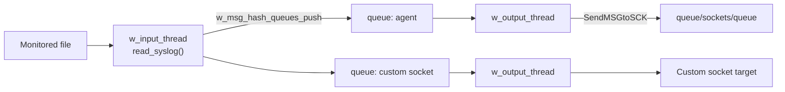

## Overview

`wazuh-logcollector` turns each `<localfile>` entry of the configuration into a stream of events. It reads files, command output, the systemd journal, the macOS unified log and Windows event channels, and writes each event to one or more output sockets: by default the local queue socket, from which [[Agent Daemon (agentd)]] forwards it to the manager (on a manager the engine reads the same socket directly). It runs on agents and on the manager alike.

Sources: [src/logcollector/logcollector.c:173-180](repo://src/logcollector/logcollector.c#L173-L180), [src/logcollector/logcollector.c:1917-1960](repo://src/logcollector/logcollector.c#L1917-L1960)

## Configuration

Each `<localfile>` becomes a `logreader`. `Read_Localfile` accepts these elements, among others:

Sources: [src/config/localfile-config.c:46-70](repo://src/config/localfile-config.c#L46-L70)

| Element | Purpose |
| --- | --- |
| `location` | File path; may contain wildcards or `strftime` patterns |
| `log_format` | Selects the reader (see below) |
| `command`, `frequency`, `alias` | Run a command every `frequency` seconds and name its output |
| `only-future-events` | Start at the end of the file instead of resuming |
| `target`, `out_format` | Send to named `<socket>` outputs, optionally reformatted |
| `ignore`, `restrict` | Regular expressions that drop or keep lines |
| `multiline_regex` | Groups lines into one event by regex |
| `query`, `reconnect_time` | Windows event channel and journald filters |
| `age`, `exclude`, `ignore_binaries` | Limits on which expanded files are read |

Sources: [src/config/localfile-config.c:46-70](repo://src/config/localfile-config.c#L46-L70)

How the file is read into this structure is on [[Configuration Loading (ossec.conf)]]; logcollector reads it with the `CLOCALFILE` and `CLGCSOCKET` flags, then reads `agent.conf` on agents.

Sources: [src/logcollector/config.c:86-101](repo://src/logcollector/config.c#L86-L101)

## Startup

`LogCollectorStart` prepares every reader before any thread reads:

Sources: [src/logcollector/logcollector.c:173-215](repo://src/logcollector/logcollector.c#L173-L215)

1. Load the last read positions from `queue/logcollector/file_status.json`, and register `w_save_file_status` to run at exit.
2. Start the state thread, connect the output sockets (`set_sockets`), and expand wildcard locations (`check_pattern_expand`).
3. Walk every reader. `eventlog` and `eventchannel` start Windows subscriptions; `command` and `full_command` assign `read_command` or `read_fullcommand`; `macos` and `journald` set up their log sources; plain files are opened by `set_read`, which also picks the reader function.
4. Save the file status, create one output thread per target socket and `N_INPUT_THREADS` input threads, and start the `lccom` request socket.

Sources: [src/logcollector/logcollector.c:205-260](repo://src/logcollector/logcollector.c#L205-L260), [src/logcollector/logcollector.c:261-360](repo://src/logcollector/logcollector.c#L261-L360), [src/logcollector/logcollector.c:360-430](repo://src/logcollector/logcollector.c#L360-L430), [src/logcollector/logcollector.c:465-485](repo://src/logcollector/logcollector.c#L465-L485)

## Readers by log format

`set_read` maps `log_format` to a function pointer stored in `current->read`. Every reader has the signature `void *read_x(logreader *lf, int *rc, int drop_it)`.

Sources: [src/logcollector/logcollector.c:1213-1302](repo://src/logcollector/logcollector.c#L1213-L1302)

| `log_format` | Reader | Notes |
| --- | --- | --- |
| `syslog` (default) | `read_syslog` | One event per line |
| `json` | `read_json` | One JSON object per line |
| `multi-line:N` | `read_multiline` | Fixed number of lines per event |
| `multi-line-regex` | `read_multiline_regex` | Lines grouped by a regex |
| `audit` | `read_audit` | Linux audit records grouped by ID |
| `mysql_log`, `mssql_log`, `postgresql_log` | `read_mysql_log`, ... | Database log layouts |
| `djb-multilog` | `read_djbmultilog` | daemontools multilog |
| `nmapg`, `snort-full`, `ossecalert` | dedicated readers | Tool-specific formats |
| `command`, `full_command` | `read_command`, `read_fullcommand` | Each line, or the whole output, as one event |
| `journald` | `read_journald` | Linux only |
| `macos` | `read_macos` | Reads the `log stream` process output |
| `eventchannel`, `eventlog` | Windows subscriptions | Windows only |

Sources: [src/logcollector/logcollector.c:1243-1302](repo://src/logcollector/logcollector.c#L1243-L1302), [src/logcollector/logcollector.c:300-410](repo://src/logcollector/logcollector.c#L300-L410)

On Windows, files with no explicit format fall back to the UCS-2 readers when the file is UTF-16 encoded, and an empty file with binary filtering is assumed UCS-2 LE.

Sources: [src/logcollector/logcollector.c:1277-1301](repo://src/logcollector/logcollector.c#L1277-L1301)

## Reading lines

### The syslog reader

`read_syslog` is the model for line readers. It reads with `fgets` up to `logcollector.max_lines` lines per call (0 means no limit) and only while `can_read()` is true. A line without a trailing newline at end of file is incomplete: the reader seeks back and tries again next round, so a half-written line is never sent. A line longer than the maximum is sent truncated and the rest is skipped with one error per file. Lines containing NUL bytes are dropped. Each accepted line passes `check_ignore_and_restrict` and is pushed with queue byte `LOCALFILE_MQ` (`1`).

Sources: [src/logcollector/read_syslog.c:19-138](repo://src/logcollector/read_syslog.c#L19-L138), [src/logcollector/config.c:43-54](repo://src/logcollector/config.c#L43-L54)

### Multi-line regex

`read_multiline_regex` builds one event from several lines with `multiline_getlog`, which follows the configured match type: `start` (a match begins a new event), `end` (a match ends the current event) or `all` (the buffer as a whole must match). A partial event is kept in a context across calls, and is flushed when it has not grown for the configured timeout. The `replace` option decides what happens to each line break inside the event: `wspace` turns it into a space, `tab` into a tab, `none` removes it, and `no-replace` keeps it.

Sources: [src/logcollector/read_multiline_regex.c:133-215](repo://src/logcollector/read_multiline_regex.c#L133-L215), [src/logcollector/read_multiline_regex.c:434-487](repo://src/logcollector/read_multiline_regex.c#L434-L487), [src/config/localfile-config.h:71-77](repo://src/config/localfile-config.h#L71-L77), [src/logcollector/read_multiline_regex.c:533-545](repo://src/logcollector/read_multiline_regex.c#L533-L545)

## Threads

### Input threads

Each input thread sleeps `logcollector.loop_timeout` seconds, then walks every reader under the files read-lock. A thread that wins the reader's mutex with `trylock` reads it, so two threads never read the same file and a busy file never blocks the others. Commands run when `frequency` seconds have passed since the last run; journald is read only by the thread that owns the journal handle.

Sources: [src/logcollector/logcollector.c:2037-2110](repo://src/logcollector/logcollector.c#L2037-L2110)

### Output threads

Readers do not write to sockets. `w_msg_hash_queues_push` copies the event into the bounded queue of every target of the reader; a full queue drops the line and logs "message queue is full" once. One output thread per target pops events and calls `SendMSGtoSCK`. For the default `agent` target it never gives up: on failure it reconnects to `queue/sockets/queue` with infinite attempts and resends. Other targets get three tries, with a growing sleep, before the event is dropped.

Sources: [src/logcollector/logcollector.c:1834-1903](repo://src/logcollector/logcollector.c#L1834-L1903), [src/logcollector/logcollector.c:1917-2010](repo://src/logcollector/logcollector.c#L1917-L2010)

Sources: [src/logcollector/logcollector.c:1834-1903](repo://src/logcollector/logcollector.c#L1834-L1903), [src/logcollector/logcollector.c:1917-2010](repo://src/logcollector/logcollector.c#L1917-L2010)

## Rotation and resuming

### File checks

Every `logcollector.vcheck_files` seconds the main loop pauses the readers (`set_can_read(0)` and the files write-lock) and checks each open file. A changed inode means the file was rotated: logcollector sends `ossec: File rotated (inode changed)` as an event, forgets the saved position, and reopens the file from the start. A file that shrank with the same inode was truncated, which sends `ossec: File size reduced (inode remained)` and reopens it. Files that disappeared are retried `open_attempts` times, and expanded wildcard files that vanish are removed from the list. Wildcards are re-expanded on the same cadence.

Sources: [src/logcollector/logcollector.c:523-530](repo://src/logcollector/logcollector.c#L523-L530), [src/logcollector/logcollector.c:630-640](repo://src/logcollector/logcollector.c#L630-L640), [src/logcollector/logcollector.c:730-800](repo://src/logcollector/logcollector.c#L730-L800), [src/logcollector/logcollector.c:910-962](repo://src/logcollector/logcollector.c#L910-L962)

### Last read position

For each file, `file_status.json` stores the offset reached and the SHA-1 of the bytes before it. On start, `w_set_to_last_line_read` hashes the first `offset` bytes of the file again. If the hash differs, the file was replaced, so reading starts at the beginning; if the file grew by more than `diff_max_size` since, reading starts at the end to avoid a burst; otherwise it resumes at the saved offset. A new file, or one with `only-future-events` on, starts at the end.

Sources: [src/logcollector/logcollector.c:2805-2856](repo://src/logcollector/logcollector.c#L2805-L2856), [src/logcollector/logcollector.c:1075-1095](repo://src/logcollector/logcollector.c#L1075-L1095), [src/logcollector/logcollector.c:2588-2620](repo://src/logcollector/logcollector.c#L2588-L2620)

## Statistics and requests

The state module counts events and bytes per file and per target, including drops. With `logcollector.state_interval` greater than zero, a thread dumps the counters to `var/run/wazuh-logcollector.state` every interval. The `lccom` socket answers `getstate` with the same data and `getconfig localfile|socket|internal` with the running configuration; the manager reaches it through the request channel described on [[Agent Daemon (agentd)]].

Sources: [src/logcollector/state.c:83-125](repo://src/logcollector/state.c#L83-L125), [src/logcollector/lccom.c:45-66](repo://src/logcollector/lccom.c#L45-L66), [src/logcollector/state.h:14-19](repo://src/logcollector/state.h#L14-L19)
