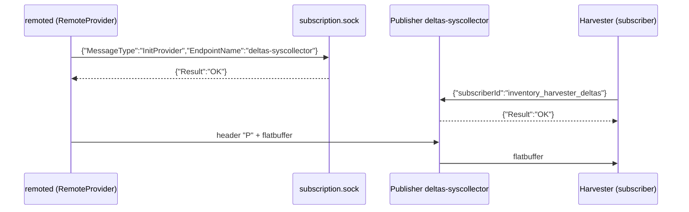

## Overview

The router (`src/shared_modules/router`, built as `librouter.so`) is a small publish/subscribe bus for the manager's processes. It is unrelated to the engine's event router ([[Engine Router, Orchestrator and Test Sessions]]). A producer opens a provider on a named topic and pushes byte buffers; consumers subscribe to the topic and get every buffer through a callback. Its main use is moving agent inventory and FIM data from `wazuh-remoted` to the server modules in `wazuh-modulesd` (the [[Inventory Harvester]] and the [[Vulnerability Scanner]]) without either side knowing about the other. It also hosts a small HTTP API on behalf of [[Wazuh DB]].

Sources: [src/shared_modules/router/readme.md:1-11](repo://src/shared_modules/router/readme.md#L1-L11), [src/remoted/secure.c:254-268](repo://src/remoted/secure.c#L254-L268)

## Topics in use

| Topic | Provider | Subscribers | Content |
| --- | --- | --- | --- |
| `deltas-syscollector` | remoted (agents), modulesd syscollector (manager) | Inventory harvester, vulnerability scanner | Syscollector deltas |
| `deltas-syscheck` | remoted | Inventory harvester | FIM deltas |
| `rsync` | remoted | Inventory harvester, vulnerability scanner | Integrity sync messages |
| `wdb-agent-events`, `wdb-fim-events`, `wdb-inventory-events` | wazuh-db | Inventory harvester (all three), vulnerability scanner (agent and inventory events) | Database-level changes (removals, upgrades) |
| `policy` | No provider in this tree | Vulnerability scanner policy manager | Policy changes |

Sources: [src/remoted/secure.c:954-1027](repo://src/remoted/secure.c#L954-L1027), [src/wazuh_modules/wm_syscollector.c:228-237](repo://src/wazuh_modules/wm_syscollector.c#L228-L237), [src/wazuh_db/main.c:19-21](repo://src/wazuh_db/main.c#L19-L21), [src/wazuh_db/main.c:211-225](repo://src/wazuh_db/main.c#L211-L225), [src/wazuh_modules/inventory_harvester/src/inventoryHarvesterFacade.cpp:30-72](repo://src/wazuh_modules/inventory_harvester/src/inventoryHarvesterFacade.cpp#L30-L72), [src/wazuh_modules/inventory_harvester/src/inventoryHarvesterFacade.cpp:165-192](repo://src/wazuh_modules/inventory_harvester/src/inventoryHarvesterFacade.cpp#L165-L192), [src/wazuh_modules/vulnerability_scanner/src/vulnerabilityScannerFacade.cpp:214-296](repo://src/wazuh_modules/vulnerability_scanner/src/vulnerabilityScannerFacade.cpp#L214-L296), [src/wazuh_modules/vulnerability_scanner/src/policyManager/policyManager.hpp:415-422](repo://src/wazuh_modules/vulnerability_scanner/src/policyManager/policyManager.hpp#L415-L422)

## The broker

### Starting the router

The broker lives in `wazuh-modulesd`: the `router` module (`wm_router.c`) loads `librouter.so` and calls `router_initialize` and `router_start`. Starting the facade opens a registration socket, `queue/router/subscription.sock`, which accepts two JSON commands: `InitProvider` (create a publisher for a topic) and `RemoveSubscriber`.

Sources: [src/wazuh_modules/wm_router.c:38-70](repo://src/wazuh_modules/wm_router.c#L38-L70), [src/shared_modules/router/src/routerFacade.cpp:18-64](repo://src/shared_modules/router/src/routerFacade.cpp#L18-L64), [src/shared_modules/router/src/remoteSubscriptionManager.hpp:21-21](repo://src/shared_modules/router/src/remoteSubscriptionManager.hpp#L21-L21)

### Publishers

Each topic is a `Publisher`: a socket server on `queue/router/<topic>` plus a message dispatcher with one thread. A frame with the header `P` is data from a provider and is queued for dispatch; a frame without a header is a JSON subscription request carrying a `subscriberId`, which registers a subscriber that writes each message back to that client's socket. The dispatcher calls every subscriber with each message in order.

Sources: [src/shared_modules/router/src/publisher.hpp:23-103](repo://src/shared_modules/router/src/publisher.hpp#L23-L103)

Sources: [src/shared_modules/router/src/remoteProvider.hpp:30-60](repo://src/shared_modules/router/src/remoteProvider.hpp#L30-L60), [src/shared_modules/router/src/publisher.hpp:43-80](repo://src/shared_modules/router/src/publisher.hpp#L43-L80)

## Providers and subscribers

### Local and remote

`RouterProvider(topic, isLocal)` and `RouterSubscriber(topic, id, isLocal)` hide the transport. A local provider or subscriber lives in the same process as the broker and talks to the `Publisher` object directly. A remote one, used from other processes such as remoted and wazuh-db, connects over the sockets: a `RemoteProvider` first sends `InitProvider` to the registration socket and then connects to the topic socket, sending each message with header `P`; a `RemoteSubscriber` connects to the topic socket and sends its subscription. Both accept an `onConnect` callback, so a client can wait until the link is up.

Sources: [src/shared_modules/router/src/router.cpp:102-190](repo://src/shared_modules/router/src/router.cpp#L102-L190), [src/shared_modules/router/src/routerFacade.cpp:78-165](repo://src/shared_modules/router/src/routerFacade.cpp#L78-L165), [src/shared_modules/router/src/remoteProvider.hpp:20-72](repo://src/shared_modules/router/src/remoteProvider.hpp#L20-L72)

### The C interface

C daemons use the functions in `router.h`: `router_initialize`, `router_provider_create(name, is_local)`, `router_provider_send`, `router_provider_send_fb` and `router_provider_send_fb_json`, and `router_provider_destroy`. remoted creates its providers as remote (`false`) because the broker runs in modulesd.

Sources: [src/shared_modules/router/include/router.h:20-120](repo://src/shared_modules/router/include/router.h#L20-L120), [src/shared_modules/router/include/router.h:120-189](repo://src/shared_modules/router/include/router.h#L120-L189), [src/remoted/secure.c:255-268](repo://src/remoted/secure.c#L255-L268)

## Flatbuffer messages

`router_provider_send_fb_json(handle, message, agent_ctx, schema)` is how agent JSON becomes a typed message. `SchemaAdapter::adaptJsonMessage` rewrites the agent's JSON into the shape of the target flatbuffer schema and prepends an `agent_info` object with the agent's ID, name, IP and version. The thread-local flatbuffers parser for the schema (`MT_SYS_DELTAS`, `MT_SYNC` or `MT_SYSCHECK_DELTAS`, compiled from the `.fbs` files in `shared_modules/utils/flatbuffers/schemas`) then turns that JSON into a binary buffer, which is pushed to the provider. A message the adapter does not recognize produces an empty buffer and is silently skipped; a parse failure is logged with the JSON.

Sources: [src/shared_modules/router/src/router.cpp:331-375](repo://src/shared_modules/router/src/router.cpp#L331-L375), [src/shared_modules/router/src/schemaAdapter.hpp:85-140](repo://src/shared_modules/router/src/schemaAdapter.hpp#L85-L140), [src/shared_modules/router/src/router.cpp:33-64](repo://src/shared_modules/router/src/router.cpp#L33-L64), [src/shared_modules/router/include/router.h:24-32](repo://src/shared_modules/router/include/router.h#L24-L32)

Converting to flatbuffers at the producer means consumers read typed fields without parsing JSON again, and a schema mismatch is caught where the data enters the bus.

Sources: [src/shared_modules/utils/flatbuffers/schemas/syscollector_deltas.fbs:1-20](repo://src/shared_modules/utils/flatbuffers/schemas/syscollector_deltas.fbs#L1-L20)

## HTTP endpoints for wazuh-db

The router library also contains a small HTTP gateway. `router_register_api_endpoint(module, socket, method, path, pre, post)` adds a `GET` or `POST` route to an httplib server for that socket, and `router_start_api(socket)` serves it on `queue/sockets/<socket>` in a thread. Requests are passed to `RouterModuleGateway::redirect`, which only knows the `wazuh-db` module: the WDB gateway runs the endpoint handler (`endpointGetV1AgentsIds`, `endpointPostV1AgentsSummary`, `endpointGetV1AgentsSync`, and others under `src/wazuh-db`), calling wazuh-db's `pre` and `post` callbacks around it. wazuh-db registers its endpoints on `wdb-http.sock` at start.

Sources: [src/shared_modules/router/src/router.cpp:400-500](repo://src/shared_modules/router/src/router.cpp#L400-L500), [src/shared_modules/router/src/routerModuleGateway.hpp:23-55](repo://src/shared_modules/router/src/routerModuleGateway.hpp#L23-L55), [src/wazuh_db/main.c:248-257](repo://src/wazuh_db/main.c#L248-L257)
