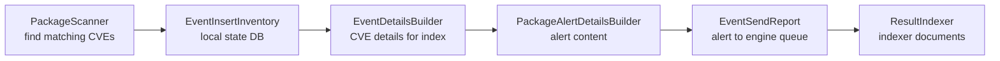

## Overview

The vulnerability scanner is a manager-side module of `wazuh-modulesd` (`vulnerability_scanner`, configured by `<vulnerability-detection>`). It watches every agent's software inventory, matches packages, the operating system and Windows hotfixes against a local CVE database built from the Wazuh CTI feed, and keeps the result in two places: a state index in the Wazuh indexer (`wazuh-states-vulnerabilities-*`) and alert events sent to the analysis engine when a vulnerability appears or is solved. It is built from a facade, a chain-of-responsibility orchestrator per event type, and a feed manager that owns the CVE database.

Sources: [docs/ref/modules/vulnerability-scanner/architecture.md:1-38](repo://docs/ref/modules/vulnerability-scanner/architecture.md#L1-L38), [src/wazuh_modules/vulnerability_scanner/src/policyManager/policyManager.hpp:28-35](repo://src/wazuh_modules/vulnerability_scanner/src/policyManager/policyManager.hpp#L28-L35)

## Inputs

The scanner subscribes to router topics ([[Router Publish/Subscribe Module]]): `deltas-syscollector` for inventory changes, `rsync` for inventory synchronization, and `wdb-agent-events` and `wdb-inventory-events` for agent removals, database upgrades and other database changes. Each message is pushed, with its buffer type, into a persistent event queue (`queue/vd/event`, a RocksDB-backed dispatcher), so events survive a restart and are processed in bulk.

Sources: [src/wazuh_modules/vulnerability_scanner/src/vulnerabilityScannerFacade.cpp:212-300](repo://src/wazuh_modules/vulnerability_scanner/src/vulnerabilityScannerFacade.cpp#L212-L300), [src/wazuh_modules/vulnerability_scanner/src/vulnerabilityScannerFacade.cpp:27-37](repo://src/wazuh_modules/vulnerability_scanner/src/vulnerabilityScannerFacade.cpp#L27-L37)

The inventory itself comes from the agents' syscollector module ([[System Inventory (Syscollector and Data Provider)]]); for the manager's own inventory, modulesd publishes deltas directly unless `vulnerability-detection.disable_scan_manager` is set.

Sources: [src/wazuh_modules/wm_syscollector.c:106-118](repo://src/wazuh_modules/wm_syscollector.c#L106-L118), [src/wazuh_modules/wm_syscollector.c:184-186](repo://src/wazuh_modules/wm_syscollector.c#L184-L186)

## Startup

`VulnerabilityScannerFacade::start` runs these steps:

Sources: [src/wazuh_modules/vulnerability_scanner/src/vulnerabilityScannerFacade.cpp:457-470](repo://src/wazuh_modules/vulnerability_scanner/src/vulnerabilityScannerFacade.cpp#L457-L470)

1. Initialize the policy manager with the module configuration and open the state database (`queue/vd/state_track`). Compare the stored policy and cluster settings with the current ones; a change can trigger a full rescan or cleanup. If the module is disabled, stop here.
2. Create the indexer connector for the states index, with the template `templates/vd_states_template.json` when the indexer is enabled ([[Indexer Connector and Keystore]]).
3. Create the report dispatcher, the event dispatcher, and the router subscriptions.
4. If a pre-built database archive (`tmp/vd_1.0.0_vd_4.13.0.tar.xz`) is present and the stored database version is missing or differs from the running version, decompress it into `queue/vd`, which makes the CVE database available without waiting for a full download.
5. Create the `DatabaseFeedManager`, which registers with the [[Content Manager]] for feed updates, and start the event worker.

Sources: [src/wazuh_modules/vulnerability_scanner/src/vulnerabilityScannerFacade.cpp:470-589](repo://src/wazuh_modules/vulnerability_scanner/src/vulnerabilityScannerFacade.cpp#L470-L589), [src/wazuh_modules/vulnerability_scanner/src/vulnerabilityScannerFacade.cpp:47-104](repo://src/wazuh_modules/vulnerability_scanner/src/vulnerabilityScannerFacade.cpp#L47-L104)

## Event processing

### Classifying the event

The event worker verifies each flatbuffer and passes it to `ScanOrchestrator::processEvent`. A `ScanContext` built from the message decides the scanner type: an `INSERTED` or `DELETED` package delta becomes `PackageInsert` or `PackageDelete`, an OS delta or sync becomes `Os`, hotfix deltas become `HotfixInsert` or `HotfixDelete`, integrity-clear sync messages become `IntegrityClear`, and JSON action messages become `ReScanAllAgents`, `ReScanSingleAgent`, `CleanupAllAgentData`, `CleanupSingleAgentData` or `GlobalSyncInventory`.

Sources: [src/wazuh_modules/vulnerability_scanner/src/vulnerabilityScannerFacade.cpp:147-205](repo://src/wazuh_modules/vulnerability_scanner/src/vulnerabilityScannerFacade.cpp#L147-L205), [src/wazuh_modules/vulnerability_scanner/src/scanOrchestrator/scanContext.hpp:245-360](repo://src/wazuh_modules/vulnerability_scanner/src/scanOrchestrator/scanContext.hpp#L245-L360), [src/wazuh_modules/vulnerability_scanner/src/scanOrchestrator/scanContext.hpp:460-570](repo://src/wazuh_modules/vulnerability_scanner/src/scanOrchestrator/scanContext.hpp#L460-L570)

### Delayed events

The orchestrator runs one event at a time under a mutex. If wazuh-db data for an agent is not ready, the event is moved to a per-agent delayed queue (`WdbDataException`), and later events for that agent are postponed behind it so order is preserved; cleanup and rescan-all events skip the queue because they purge it.

Sources: [src/wazuh_modules/vulnerability_scanner/src/scanOrchestrator/scanOrchestrator.hpp:263-284](repo://src/wazuh_modules/vulnerability_scanner/src/scanOrchestrator/scanOrchestrator.hpp#L263-L284), [src/wazuh_modules/vulnerability_scanner/src/vulnerabilityScannerFacade.cpp:176-189](repo://src/wazuh_modules/vulnerability_scanner/src/vulnerabilityScannerFacade.cpp#L176-L189)

### Orchestration chains

`TFactoryOrchestrator::create` builds one chain per scanner type. The package insert chain is representative:

Sources: [src/wazuh_modules/vulnerability_scanner/src/scanOrchestrator/factoryOrchestrator.hpp:95-102](repo://src/wazuh_modules/vulnerability_scanner/src/scanOrchestrator/factoryOrchestrator.hpp#L95-L102)

Sources: [src/wazuh_modules/vulnerability_scanner/src/scanOrchestrator/factoryOrchestrator.hpp:95-102](repo://src/wazuh_modules/vulnerability_scanner/src/scanOrchestrator/factoryOrchestrator.hpp#L95-L102)

| Scanner type | Chain |
| --- | --- |
| `PackageDelete` | Delete from inventory, build "solved" alert details, send report, index deletions |
| `HotfixInsert` | Find CVEs the hotfix solves, sync inventory, build solved-alert details, report, index |
| `Os` | OS scanner, inventory sync, details, OS alert details, report, index |
| `IntegrityClear` | Clean the agent's component inventory and its indexed documents, report |
| `ReScanAllAgents`, `ReScanSingleAgent` | Clean inventory, build the agent list, run the package and OS chains for each agent |
| `CleanupAllAgentData`, `CleanupSingleAgentData` | Remove inventory and indexed documents |
| `GlobalSyncInventory` | Resynchronize the local indexer state with the indexer |

Sources: [src/wazuh_modules/vulnerability_scanner/src/scanOrchestrator/factoryOrchestrator.hpp:104-180](repo://src/wazuh_modules/vulnerability_scanner/src/scanOrchestrator/factoryOrchestrator.hpp#L104-L180)

## Matching packages

### Choosing the CVE source

`PackageScanner` first picks the CNA (CVE Numbering Authority) whose data applies to the package, trying in order the package format, the package source, the vendor by prefix, and the vendor by substring, with the OS platform as context. A CNA may map to a base CNA per platform. Package names and vendors can be translated before lookup: translations come from an in-memory LRU cache (L1) and a cache loaded from the feed's translation table (L2).

Sources: [src/wazuh_modules/vulnerability_scanner/src/scanOrchestrator/packageScanner.hpp:84-190](repo://src/wazuh_modules/vulnerability_scanner/src/scanOrchestrator/packageScanner.hpp#L84-L190), [src/wazuh_modules/vulnerability_scanner/src/scanOrchestrator/packageScanner.hpp:200-275](repo://src/wazuh_modules/vulnerability_scanner/src/scanOrchestrator/packageScanner.hpp#L200-L275)

### Version comparison

`getVulnerabilitiesCandidates` returns, for the package, each candidate CVE with its affected version ranges (`version`, `lessThan`, `lessThanOrEqual`, a status) and a default status. The package's format selects the comparison scheme: `deb` uses Debian versions, `rpm` RPM, `pypi` PEP 440, `npm` SemVer, and `pacman`, `snap`, `pkg`, `apk`, `win` and `macports` use dedicated matcher strategies. The first range that matches decides whether the package is affected; when no range matches, the CVE's default status decides.

Sources: [src/wazuh_modules/vulnerability_scanner/src/scanOrchestrator/packageScanner.hpp:44-60](repo://src/wazuh_modules/vulnerability_scanner/src/scanOrchestrator/packageScanner.hpp#L44-L60), [src/wazuh_modules/vulnerability_scanner/src/scanOrchestrator/packageScanner.hpp:400-519](repo://src/wazuh_modules/vulnerability_scanner/src/scanOrchestrator/packageScanner.hpp#L400-L519), [src/wazuh_modules/vulnerability_scanner/src/scanOrchestrator/packageScanner.hpp:520-570](repo://src/wazuh_modules/vulnerability_scanner/src/scanOrchestrator/packageScanner.hpp#L520-L570)

## The CVE feed

`DatabaseFeedManager` keeps the feed in RocksDB at `queue/vd/feed`, with separate columns for CVE candidates, descriptions, remediations, hotfix applications and translations. It registers a content topic with the content manager using the updater configuration from the policy manager. Each callback processes the downloaded offsets or snapshot into those columns, reloads the in-memory global maps, and runs the post-update callback, which (when enabled) queues a `reboot` action so all agents are rescanned against the new data.

Sources: [src/wazuh_modules/vulnerability_scanner/src/databaseFeedManager/databaseFeedManager.hpp:38-38](repo://src/wazuh_modules/vulnerability_scanner/src/databaseFeedManager/databaseFeedManager.hpp#L38-L38), [src/wazuh_modules/vulnerability_scanner/src/databaseFeedManager/databaseFeedManager.hpp:315-392](repo://src/wazuh_modules/vulnerability_scanner/src/databaseFeedManager/databaseFeedManager.hpp#L315-L392), [src/wazuh_modules/vulnerability_scanner/src/vulnerabilityScannerFacade.cpp:560-590](repo://src/wazuh_modules/vulnerability_scanner/src/vulnerabilityScannerFacade.cpp#L560-L590)

## Configuration

The policy manager normalizes `<vulnerability-detection>` and `<indexer>`. `enabled` and `index-status` are required; `feed-update-interval` defaults to `60m` and is raised to the minimum if set lower. Without `offline-url` the updater uses `cti-offset` from `cti-url`; with an `offline-url` (`file://`, `http://` or `https://`) it uses the `offline` source instead. A configuration that enables detection with `index-status` while `<indexer>` is disabled is rejected with "Indexer cannot be disabled while vulnerability detection index is enabled".

Sources: [src/wazuh_modules/vulnerability_scanner/src/policyManager/policyManager.hpp:100-180](repo://src/wazuh_modules/vulnerability_scanner/src/policyManager/policyManager.hpp#L100-L180), [src/wazuh_modules/vulnerability_scanner/src/policyManager/policyManager.hpp:225-285](repo://src/wazuh_modules/vulnerability_scanner/src/policyManager/policyManager.hpp#L225-L285)

## Outputs

### Alerts

`EventSendReport` serializes each new or solved finding and pushes it to the report dispatcher, which writes it as a datagram to the engine's queue socket, sleeping between reports to honor the configured alerts-per-second limit. The engine then decodes these like any other event.

Sources: [src/wazuh_modules/vulnerability_scanner/src/scanOrchestrator/eventSendReport.hpp:20-70](repo://src/wazuh_modules/vulnerability_scanner/src/scanOrchestrator/eventSendReport.hpp#L20-L70), [src/wazuh_modules/vulnerability_scanner/src/vulnerabilityScannerFacade.cpp:106-145](repo://src/wazuh_modules/vulnerability_scanner/src/vulnerabilityScannerFacade.cpp#L106-L145)

### State documents

`ResultIndexer` sends insert and delete operations for the agent's vulnerability documents to the indexer connector, which batches them into the `wazuh-states-vulnerabilities-<cluster name>` index (lower-cased). The documents describe the agent, the package and the vulnerability (CVE, severity, scores, references), which is what the dashboard queries.

Sources: [src/wazuh_modules/vulnerability_scanner/src/scanOrchestrator/resultIndexer.hpp:20-77](repo://src/wazuh_modules/vulnerability_scanner/src/scanOrchestrator/resultIndexer.hpp#L20-L77), [src/wazuh_modules/vulnerability_scanner/src/policyManager/policyManager.hpp:112-117](repo://src/wazuh_modules/vulnerability_scanner/src/policyManager/policyManager.hpp#L112-L117), [docs/ref/modules/vulnerability-scanner/architecture.md:40-77](repo://docs/ref/modules/vulnerability-scanner/architecture.md#L40-L77)
