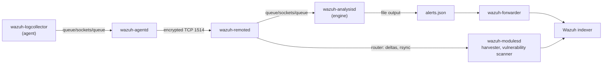

## Overview

Wazuh is an open source platform for threat prevention, detection and response. It has two halves: an endpoint agent deployed on each monitored system, and a manager (server) that collects what the agents send and analyzes it. The agent reads logs, watches files, inventories the system and checks its configuration; the manager decodes and correlates those events and stores the results.

Sources: [README.md:13-17](repo://README.md#L13-L17)

This repository is the 5.0.0 alpha line. Its biggest change from earlier releases is that the event analysis daemon is now the C++ analysis engine: the build installs `build/engine/wazuh-engine` under the old name `bin/wazuh-analysisd`, so the rest of the manager still starts and talks to "analysisd" as before.

Sources: [VERSION.json:1-4](repo://VERSION.json#L1-L4), [src/init/inst-functions.sh:1104-1115](repo://src/init/inst-functions.sh#L1104-L1115)

## The binaries

One source tree builds both halves. `make TARGET=agent` builds `BUILD_AGENT` and `make TARGET=server` builds `BUILD_SERVER` plus the CMake projects (shared modules, syscollector, and on the server the engine). An agent runs five daemons; a manager runs the agent's collectors too, because the manager monitors itself.

Sources: [src/Makefile:680-760](repo://src/Makefile#L680-L760)

| Side | Daemons started by the service script |
| --- | --- |
| Agent | `wazuh-modulesd`, `wazuh-logcollector`, `wazuh-syscheckd`, `wazuh-agentd`, `wazuh-execd` |
| Manager | `wazuh-clusterd`, `wazuh-modulesd`, `wazuh-monitord`, `wazuh-logcollector`, `wazuh-remoted`, `wazuh-syscheckd`, `wazuh-analysisd`, `wazuh-execd`, `wazuh-db`, `wazuh-authd`, `wazuh-apid`, `wazuh-forwarder` |

Sources: [src/init/wazuh-client.sh:20-23](repo://src/init/wazuh-client.sh#L20-L23), [src/init/wazuh-server.sh:30-35](repo://src/init/wazuh-server.sh#L30-L35)

## Parts of the system

| Area | What it does | Page |
| --- | --- | --- |
| Build and install | Compiles agent or server, installs under `/var/ossec` | [[Quickstart: Build and Install]], [[Build System and Packaging]] |
| Configuration | Reads `ossec.conf`, `internal_options` and group `agent.conf` | [[Configuration Loading (ossec.conf)]] |
| Agent transport | Connects to the manager, buffers and forwards events | [[Agent Daemon (agentd)]], [[Message Encryption and Client Keys]] |
| Log collection | Reads files, commands, journald, Windows event channels | [[Log Collection (Logcollector)]] |
| File integrity | Scans files and registry, realtime and whodata | [[File Integrity Monitoring (Syscheck)]] |
| Inventory | Hardware, OS, packages, processes, ports, users | [[System Inventory (Syscollector and Data Provider)]] |
| Policy checks | SCA YAML policies and Rootcheck | [[Security Configuration Assessment]] |
| Response | Runs active-response scripts on the endpoint | [[Active Response and Execd]] |
| Modules | Thread host for scheduled modules and integrations | [[Modules Daemon (modulesd)]], [[Cloud and Service Integrations]], [[Agent Upgrades and Task Manager]] |
| Agent intake | Receives, decrypts and dispatches agent messages | [[Remoted: Agent Connections]], [[Agent Enrollment (authd)]] |
| State | Per-agent and global SQLite databases | [[Wazuh DB]] |
| Operations | Start/stop scripts, log rotation, agent status | [[Service Control and Monitord]] |
| Analysis | Decodes, enriches and routes every event | [[Engine Architecture and Startup]] and the Analysis Engine pages |
| Server modules | Inventory indexing, CVE matching, content updates | [[Inventory Harvester]], [[Vulnerability Scanner]], [[Content Manager]], [[Indexer Connector and Keystore]] |
| Shared libraries | Local state diffing and message fan-out | [[DBSync and RSync]], [[Router Publish/Subscribe Module]] |
| Management | Python framework, REST API, RBAC, cluster | [[Python Framework]], [[Server REST API]], [[RBAC and Security]], [[Cluster]] |
| Quality | Unit, component and integration tests | [[Testing]] |

Sources: [src/Makefile:680-700](repo://src/Makefile#L680-L700), [src/init/wazuh-server.sh:30-31](repo://src/init/wazuh-server.sh#L30-L31)

## Main event flow

An event from a monitored file travels through four processes before it lands in the indexer. The diagram follows a log line; inventory and FIM messages take the extra branch at remoted.

Sources: [src/remoted/secure.c:954-1027](repo://src/remoted/secure.c#L954-L1027)

Sources: [src/remoted/secure.c:254-292](repo://src/remoted/secure.c#L254-L292), [src/remoted/secure.c:924-948](repo://src/remoted/secure.c#L924-L948), [src/engine/source/main.cpp:595-604](repo://src/engine/source/main.cpp#L595-L604), [src/alert_forwarder/main.py:31-45](repo://src/alert_forwarder/main.py#L31-L45)

1. A collector on the agent writes the line to the local queue socket; [[Log Collection (Logcollector)]] covers how lines are read and tagged.
2. `wazuh-agentd` reads that socket, compresses and encrypts each message, and sends it to the manager, as [[Agent Daemon (agentd)]] and [[Message Encryption and Client Keys]] describe.
3. `wazuh-remoted` decrypts it, prefixes the agent identity (`[id] (name) ip`) and writes it to the manager's queue socket; syscollector, syscheck and sync messages are also published on the router so server modules see them. See [[Remoted: Agent Connections]] and [[Router Publish/Subscribe Module]].
4. The engine's datagram server parses each queue message and posts it to the router orchestrator, which runs the policy that matches it ([[Engine Architecture and Startup]], [[Engine Router, Orchestrator and Test Sessions]]).
5. The policy's outputs write the alert; `wazuh-forwarder` tails `alerts.json` and posts each alert to the `wazuh-alerts` index, while [[Inventory Harvester]] and [[Vulnerability Scanner]] write their own documents through [[Indexer Connector and Keystore]].

Sources: [src/client-agent/agentd.c:80-90](repo://src/client-agent/agentd.c#L80-L90), [src/remoted/secure.c:909-946](repo://src/remoted/secure.c#L909-L946), [src/alert_forwarder/main.py:113-130](repo://src/alert_forwarder/main.py#L113-L130)

## Design decisions

### Local Unix sockets between daemons

Every daemon is a separate process and they talk through Unix sockets under the install directory rather than shared memory. The paths are constants in `defs.h`: the event queue (`queue/sockets/queue`), the engine API (`queue/sockets/analysis`), the wazuh-db socket (`queue/db/wdb`), and one control socket per daemon. Any daemon can be restarted alone, and the framework talks to the same sockets the daemons use.

Sources: [src/headers/defs.h:118-156](repo://src/headers/defs.h#L118-L156)

### One queue message format

Every event on the queue socket is `<queue id>:<location>:<message>`, where the first byte says which collector produced it (`1` for log files, `8` for syscheck, `d` for syscollector, `p` for SCA). `SendMSG` escapes `:` in the location with `|`, and for messages that arrive from agents (`SECURE_MQ`) it takes the original queue byte from the message and writes `location->origin`. The engine's `parseLegacyEvent` reverses exactly this: it reads the queue byte, finds the first unescaped `:`, and unescapes the location.

Sources: [src/headers/mq_op.h:18-29](repo://src/headers/mq_op.h#L18-L29), [src/shared/mq_op.c:124-146](repo://src/shared/mq_op.c#L124-L146), [src/engine/source/base/src/eventParser.cpp:121-161](repo://src/engine/source/base/src/eventParser.cpp#L121-L161)

### The engine keeps the analysisd contract

Because it binds the same queue socket and is installed under the old binary name, the engine needed no change in remoted or the service scripts. When it cannot read `/proc/self/exe` it still writes its PID file as `wazuh-analysisd`. Outside standalone mode it loads `libwazuhshared.so` with `dlopen` to reuse the C logging and the `ossec.conf` checks.

Sources: [src/engine/source/main.cpp:126-164](repo://src/engine/source/main.cpp#L126-L164), [src/engine/source/main.cpp:623-646](repo://src/engine/source/main.cpp#L623-L646)

### Privilege separation

Daemons start as root, bind what they need, then switch to the unprivileged `wazuh` user and group. The engine reads the user and group from its configuration (default `wazuh`) and calls `privSepSetGroup` and `privSepSetUser` before it opens its stores, unless `WAZUH_SKIP_USER_CHANGE` is set.

Sources: [src/engine/source/main.cpp:225-250](repo://src/engine/source/main.cpp#L225-L250), [src/engine/source/conf/src/conf.cpp:98-102](repo://src/engine/source/conf/src/conf.cpp#L98-L102)

### Shared C++ modules

New features are C++ libraries under `src/shared_modules` (DBSync, RSync, router, content manager, indexer connector, keystore) that both the C daemons and `wazuh-modulesd` link. Remoted, for example, creates router providers named `deltas-syscollector`, `deltas-syscheck` and `rsync`, and the inventory harvester subscribes to those same names, so adding a consumer needs no change in remoted.

Sources: [src/remoted/secure.c:255-268](repo://src/remoted/secure.c#L255-L268), [src/wazuh_modules/inventory_harvester/src/inventoryHarvesterFacade.cpp:30-72](repo://src/wazuh_modules/inventory_harvester/src/inventoryHarvesterFacade.cpp#L30-L72)
